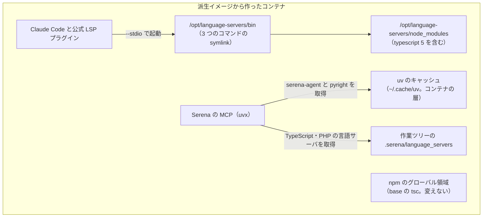

# 派生イメージの言語サーバ（Python・TypeScript・PHP）

## 概要

`general`・`php`・`php85` の派生イメージは、Python・TypeScript・PHP の**言語サーバ**を持つ。これらのイメージから作った
コンテナでは、入った時点で 3 つのコマンドが PATH の上にあり、Claude Code の公式 LSP プラグインが `--stdio` で起動できる。

| コマンド | 言語 | パッケージ |
| --- | --- | --- |
| `pyright-langserver` | Python | `pyright` |
| `typescript-language-server` | TypeScript・JavaScript | `typescript-language-server`（同じ置き場の `typescript` 5 を使う） |
| `intelephense` | PHP | `intelephense` |

- 言語サーバは base ではなく派生イメージに置く。base は重くしない（[プロジェクト MVV](../../.ndf/mvv.md) の Value 1）。
  base の Dockerfile と `containers/base/` の下は言語サーバのために変えない
- 言語サーバは専用の**言語サーバの置き場** `/opt/language-servers` に root で入り、利用者の `npm i -g` の領域
  （base の npm のグローバル領域）とは分かれる。`tsc` は base と同じ版のままである
- 版は Dockerfile で厳密に固定し、3 つのイメージで同じ**言語サーバの組**にする。静的な検査がこれを縛る
- Serena の uv のキャッシュはイメージで温めない。Serena の MCP は初回の起動で `serena-agent` と自分の言語サーバを取得する

プラグイン（公式 LSP プラグイン）の導入は利用者の `~/.claude` の設定であり、この仕様の外である。

## 用語

言語サーバ・言語サーバの置き場・言語サーバの組・uv のキャッシュ・派生イメージ・展開後の大きさの定義は
[用語集: イメージの継承（`image-lineage`）](../glossary.md#イメージの継承image-lineage) にある。

## 対象範囲

- `containers/general/Dockerfile`・`containers/php/Dockerfile`・`containers/php85/Dockerfile` の言語サーバを入れる `RUN` と `ENV PATH`
- その形を縛る静的な検査 `tests/containers/test_language_servers_dockerfile.py`

含まない:

- base（`containers/base/`）。base の `npm i -g` が入れる `typescript`（`tsc`）の版
- ほかの派生イメージ（`browser`・`go`・`latex`・`bi-tools`・`trygroup`）。言語サーバを持たない
- Python・TypeScript・PHP のほかの言語（Go の `gopls` など）
- Serena（mcp-serena）の起動定義・言語サーバの取得。ai-plugins の領分である
- どの派生イメージを使うか。各プロジェクトの `compose.yml` の dev サービスの `build.context` が決める。言語サーバの有無を
  切り替える引数や環境変数は持たない

## 構成要素

| 要素 | 置き場所 | 責務 |
| --- | --- | --- |
| 言語サーバの `RUN` | `containers/general/Dockerfile`・`containers/php/Dockerfile`・`containers/php85/Dockerfile` | `USER root` の区画で言語サーバの組を `npm install --prefix /opt/language-servers` で入れ、3 つのコマンドの symlink を置き場の `bin` に作り、`typescript-language-server --version` で入ったことを確かめ、npm のキャッシュ（`/root/.npm`）を消す。`php`・`php85` では Composer の `COPY` の後に置く |
| `ENV PATH` | 同上（`RUN` の直後） | `/opt/language-servers/bin` を PATH の先頭へ足す |
| `USER ubuntu` | 同上（`ENV PATH` の後） | 利用者へ戻す |
| 言語サーバの形の検査 | `tests/containers/test_language_servers_dockerfile.py` | Docker を起動せずに、3 つの Dockerfile の文字列から下の常に成り立つ条件 I1〜I7 を縛る。対象のイメージの名前（`IMAGES`）を検査の中に持つ。Dockerfile を命令に分けるのは `tests/containers/dockerfile_parse.py` の `parse` |

型（クラス）は持たない。Dockerfile の命令と静的な検査だけで構成する。

Serena の MCP はイメージの言語サーバを使わないため、`SE` から `BIN` への線は無い（下の「Serena」）。

## 仕様

### 常に成り立つ条件

| # | 条件 | 破れたときの扱い |
| --- | --- | --- |
| I1 | 対象の 3 つの Dockerfile が、それぞれ 1 つの `RUN` で `npm install --prefix /opt/language-servers` により `pyright`・`typescript-language-server`・`typescript`・`intelephense` の 4 つを入れる | 形の検査が、欠けたパッケージを挙げて落ちる |
| I2 | 4 つのパッケージの版がすべて厳密な版（`<名前>@<数字>.<数字>.<数字>`）で、`typescript` の版が `5.` で始まる | 形の検査が、範囲・`latest`・版の無い指定・5 以外の `typescript` を挙げて落ちる |
| I3 | 3 つの Dockerfile の言語サーバの組（名前と版）が同じである | 形の検査が、食い違うイメージと組を挙げて落ちる |
| I4 | 言語サーバの `RUN` は `npm i -g` / `npm install -g`（`--global`）を使わない。置き場の `bin` に張る symlink は 3 つのコマンドだけで、それぞれ `/opt/language-servers/node_modules/.bin/<コマンド>` を指す | 形の検査が落ちる。建てたイメージの `tsc --version` が base の版でなくなる |
| I5 | `ENV PATH` が `/opt/language-servers/bin` を含み、`node_modules` を含まない | 形の検査が落ちる。非対話のシェル（`docker exec`）でコマンドが見つからない、または置き場の `tsc` が見える |
| I6 | 対象の 3 つの Dockerfile に `UV_CACHE_DIR` と `serena-agent` が無い | 形の検査が落ちる |
| I7 | 言語サーバの `RUN` の前の最後の `USER` が `root`、後の最後の `USER` が `ubuntu` で、`RUN` が `rm -rf /root/.npm` を含む | 形の検査が落ちる |

base の `containers/base/` が言語サーバのために変わらないことは、検査ではなく変更の差分で見る。

### 置き場と PATH

言語サーバは `/opt/language-servers` に root が入れる。持ち主は root で、利用者 `ubuntu` は読みと実行だけができる
（書けない）。版を上げるのはイメージの Dockerfile の変更だけで、利用者の `npm` では上がらない。

PATH に出すのは置き場の `bin` の 3 つのコマンドだけである。`node_modules/.bin` を PATH に出さないため、置き場の `tsc`・`tsserver` は
見えず、`tsc` は base の npm のグローバル領域のものに当たる。`ENV PATH` で足すため、ログインシェルでない非対話のシェルでも
3 つのコマンドが見つかる。

**専用の置き場にする理由**: `typescript-language-server` は TypeScript 5 を要るが、base のグローバル領域の `typescript` は版を固定せずに入る最新の版で、
建てた時点（2026-10-13）では 7.0.2 で `lib/tsserver.js` を持たない。グローバル領域へ `typescript@5` を入れると派生イメージの `tsc` が 5 へ下がり、利用者や道具の更新が
同じ領域の `typescript` を上げると TypeScript 5 の解決が黙って崩れる。`node_modules/.bin` を PATH の末尾へ足す形は、`tsc` がどちらに
当たるかが PATH の並びだけで決まるため採らない。

**root で入れる理由**: 利用者が更新する領域（`bi-tools`・`trygroup` が `USER ubuntu` で `npm i -g` する `ubuntu:npm` の領域）に置くと、
固定した版と動いている版が食い違っても検査で気づけない。

### TypeScript の解決

`typescript-language-server` は、実体のパス（`realpath`）の親を順にたどって最初に見つかる `node_modules/typescript` を使う。
置き場に `typescript` 5 を一緒に入れるため、それは `/opt/language-servers/node_modules/typescript` で、`lib/tsserver.js` を持つ。
ai-plugins のインストールチェック（mcp-serena の `check`）の `typescript_major_5` も同じたどり方で、この置き場に当たる。

### 対象のイメージ

言語サーバを持つのは `general`・`php`・`php85` の 3 つで、3 つとも 3 つの言語をすべて持つ。

**3 つの言語をすべて入れる理由**: `general` は多くのプロジェクトが使う汎用の派生イメージで、どの言語のコードを扱うかをイメージの側から
決められない。PHP のプロジェクトは画面の側に TypeScript・JavaScript を持つことが多い。組を 1 つにすれば、言語の欠けが利用者の選んだ
イメージで変わらず、3 つの Dockerfile を同じ検査（I3）で揃えられる。

ほかの派生イメージには入れない。`go` は対象の外の言語を主にし、`latex` はコードを扱わず、`bi-tools`・`trygroup` は特定のプロジェクトの
ための派生イメージである。要るときは同じ `RUN` を写し、検査の `IMAGES` に名前を足す。

**同じ `RUN` を各 Dockerfile に書く理由**: 派生イメージは `containers/<名前>/` をビルドの文脈にして建つ（各プロジェクトの `compose.yml` の
`build.context`）。文脈の外のファイルは `COPY` できず、共通のスクリプトや `ARG` で版を渡す形は、プラグインのリポジトリの `compose.yml` を
変えないと成り立たない。組の一致は検査（I3）で縛る。

### Serena

Serena の MCP（ai-plugins の mcp-serena）は `uvx --from serena-agent==<版>` で起動し、PATH の上の言語サーバを使わない。Python は `uvx` で
`pyright` を、TypeScript と PHP は作業ツリーの `.serena/language_servers/` へ自分の固定した版を取得する。

派生イメージは Serena の uv のキャッシュを温めない（`UV_CACHE_DIR` も `serena-agent` も持たない。I6）。**Serena の MCP の初回の起動
（コンテナを作り直した後の最初の起動を含む）にはネットワークが要る。** これは言語サーバを持たない派生イメージと同じ振る舞いである。

**温めない理由**: `serena-agent` だけを温めても、Serena が言語を扱い始める時点の取得は残る。温めるには 1 つのイメージにつき約 131MB が要り
（キャッシュを削るとオフラインの起動が壊れる）、ai-plugins が版の固定を上げるたびに温めたキャッシュは外れて重さだけが残る。イメージが
Serena の版を持たなければ、ai-plugins の版の固定と揃える作業が生まれない。

## データ・設定

言語サーバの組（3 つの Dockerfile で同じ）:

| パッケージ | 版 |
| --- | --- |
| `pyright` | 1.1.414 |
| `typescript-language-server` | 6.0.2 |
| `typescript` | 5.9.3 |
| `intelephense` | 1.18.5 |

`npm install` には `--omit=dev --no-audit --no-fund` を付ける。4 つのパッケージは JavaScript だけで、アーキテクチャごとの取得物を持たない。
Node は base のものを使う。

展開後の大きさ（arm64・Docker Desktop の containerd のイメージストア・2026-10-13。言語サーバを入れる前と後の同じ Dockerfile を同じ base の上に
建て、コンテナで `du -sbx /` を測ったバイト数）:

| イメージ | 前 | 後 | 増分 |
| --- | ---: | ---: | ---: |
| `general` | 2,969,540,486 | 3,118,859,637 | 149,319,151 |
| `php` | 3,135,202,864 | 3,284,522,031 | 149,319,167 |
| `php85` | — | — | 149,319,167 |

`php85` は増分だけを記録した。

1 つの派生イメージで増える展開後の大きさは 350,000,000 バイト以下に保つ。

## 運用

- 言語サーバは**イメージを建て直すまで届かない**。使っている派生イメージを `devbase build` で建て直し、稼働中のコンテナは作り直す。
  base を建て直す必要は無い
- 版を上げるときは、3 つの Dockerfile の言語サーバの組を同時に同じ版へ変える（I3）。`typescript` は 5 系に留める（I2）。
  `typescript-language-server` の新しい版が TypeScript 5 を外したら、組の全体を見直す
- 各プロジェクトの `compose.yml` は自分の名前のタグで `containers/general/` などを建てる。ビルドのキャッシュに当たれば層は共有される
  （同じ Dockerfile の 2 つ目のタグはキャッシュだけで建った）。キャッシュ無しで建て直すとプロジェクトごとに約 149MB の層が別に残り得る
- 言語サーバのコマンドの有無と起動は、建てたイメージで `--entrypoint bash` を付けて確かめる。派生イメージは base の entrypoint を継ぎ、
  entrypoint は `DEVBASE_ACCOUNT_GROUP` が無いと止まる。`DEVBASE_ACCOUNT_GROUP` を渡して entrypoint を通すと、ボリュームや機密の用意へ進み
  実の環境に触れ得る。`devbase up` で起動したコンテナでは確かめない
- amd64 での建てと、利用者のコンテナの中で公式 LSP プラグインの診断が届くことは、自動テストでは確かめていない

## テスト観点

`tests/containers/test_language_servers_dockerfile.py`（Docker を要さない。`general`・`php`・`php85` のそれぞれ）:

- I1: `--prefix /opt/language-servers` を持つ `RUN` が 1 つだけあり、`npm install` が入れるパッケージの名前が 4 つと一致すること
- I2: 4 つの版が `<数字>.<数字>.<数字>` に完全一致し、`typescript` が `5.` で始まること。版の無い指定は落ちること
- I3: 3 つのイメージの名前と版の組が同じであること
- I4: `RUN` に `npm i` / `npm install` の `-g`・`--global` が無く、`ln -s` の宛先が置き場の `bin` の 3 つのコマンドだけで、
  元が `node_modules/.bin/<同じ名前>` であること
- I5: `ENV PATH=` に `/opt/language-servers/bin:` があり、`node_modules` が無いこと
- I6: 命令の本文に `UV_CACHE_DIR` と `serena-agent` が無いこと
- I7: `RUN` より前の最後の `USER` が `root`、後の最後の `USER` が `ubuntu` で、`RUN` に `rm -rf /root/.npm` があること

建てたイメージで確かめること（手動。CI はイメージを建てない。手元の base の上に作業用のタグで建て、`docker run --rm --entrypoint bash`
で打つ。作業用のタグは記録を書いたら消す）:

- 非対話の bash の `command -v` が 3 つのコマンドの `/opt/language-servers/bin/` のパスを返すこと
- 3 つのコマンドを `--stdio` で起動して LSP の `initialize` を送ると、`result.capabilities` を持つ応答が 30 秒以内に返ること
- `typescript-language-server` の `realpath` の親をたどって最初に見つかる `node_modules/typescript/package.json` の版が `5.` で始まり、
  `lib/tsserver.js` があること
- ai-plugins の mcp-serena の `check`（ランタイムは Claude Code）で、Python・TypeScript・PHP の `binary` と `typescript_major_5` の欠けが出ないこと
  （`plugin` の欠けは利用者の設定のため問わない）
- `tsc --version` が base と同じ版を返すこと。`ubuntu` から `/opt/language-servers` に書けないこと
- 変更の前後で展開後の大きさを測り、増分が 350,000,000 バイト以下であること。測った端末（アーキテクチャ）とイメージストアを記録すること
- amd64 でも同じこと（リリース後テスト）。利用者のコンテナの中の Claude Code で `.py` を編集し、公式 LSP プラグインの診断が届くこと

## 関連リンク

- [base イメージの中身の絞り込み（文書の除外と DinD の廃止）](base-image-contents.md)（派生イメージの一覧と文書の除外）
- [base イメージの文字の描画と、文書を扱う道具](base-image-rendering.md)（ブラウザの派生イメージ）
- [派生イメージの継承の連なりのビルド（直の親の読み方）](base-image-chain-build.md)
- [用語集: イメージの継承（`image-lineage`）](../glossary.md#イメージの継承image-lineage)
- [コンテナ操作ガイド](../user/container-operations.md)
