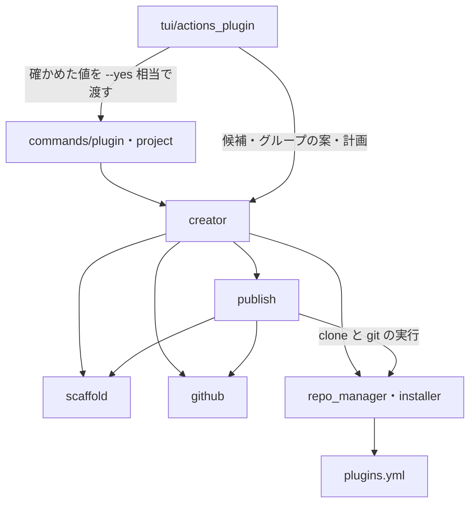
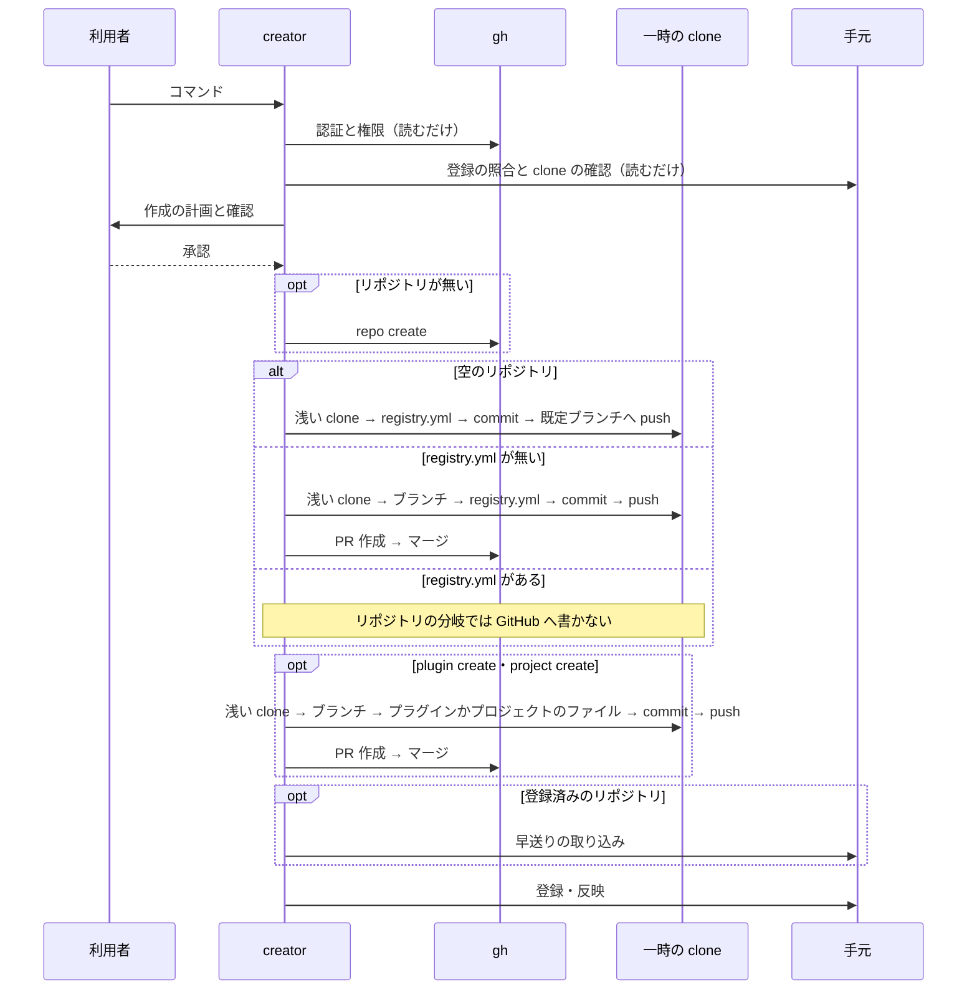

# リポジトリ・プラグイン・プロジェクトの作成フロー

## 概要

`devbase plugin repo create`・`devbase plugin create`・`devbase project create` は、GitHub の URL か `owner/repo` を
1 つ受け、権限の確認からファイルの配置・PR・マージ・手元への取り込み・`plugins.yml` への登録までを 1 回で行う。
`devbase list` の TUI のプラグインのメニューからも同じ操作を実行できる。

どのコマンドも、書き込みの前に作成の計画を確定して利用者に示す。計画までは読むだけで、GitHub にも手元にも
書かない。コンテナは起動しない（`devbase up` は打たない）。`gh` が要るのはこの 3 つのコマンドだけである。

利用者向けの引数と使い方は [plugin グループ](../user/cli-reference/04-plugin.md) と
[project グループ](../user/cli-reference/02-project.md#devbase-project-create) にある。

## 用語

プラグインリポジトリ・作成フロー・作成の計画・名前の形・アカウントグループは [用語集](../glossary.md) の定義に従う。
プラグインリポジトリは、収めたプラグインが 0 件（`plugins: []`）でもよい。

## コンテキスト

| コンテキスト | 何の語が 1 つの意味に決まるか |
| --- | --- |
| プラグインの配布 | プラグインリポジトリ・プラグイン・プロジェクト・登録・導入・作成フロー |
| 機密の置き場（`secret`） | アカウントグループとその宣言 |
| コマンドの入口（`cli`） | 名前の形 |

作成フローはプラグインの配布に属する。ほかの 2 つに対しては順応者で、グループの規則
（`validate_account_group`）と名前の形（`names.is_single_segment_name`）をそのまま受け入れ、独自の規則を持たない。

## 背景

GitHub 上のプラグインへリポジトリを足すには、`registry.yml`・`plugin.yml`・`project.yml` を人が置き、PR を出してマージし、
`plugin update` を打つ必要がある。作成フローは、この手作業と入れ先の判断をまとめて行う。

既存の経路とのつなぎ目には、次の事実がある。

| 事実 | 仕様への影響 |
| --- | --- |
| `add_repository` は `registry.yml` が無いリポジトリを登録せず、clone を消す | `registry.yml` を既定ブランチへ入れてから登録する |
| `refresh_repository` の `git pull` は `--ff-only` を付けない | 登録済みの clone は先に `_pull_ff_only` で取り込む |
| `get_repository_by_url` は完全一致で探す | 登録の照合には使わず、URL の形を吸収する `_find_registered` を使う |
| GitHub は空のリポジトリに PR を作れない | 空のリポジトリの最初のコミットだけを既定ブランチへ直接入れる |

## 対象範囲

| 区分 | 内容 |
| --- | --- |
| 含む | 3 つのコマンド、PR の作成・マージ・手元への取り込み・`plugins.yml` への登録、TUI の入口とプラグインのメニュー、シェル補完 |
| 含まない | 追加したプロジェクトの起動、`env` の値の登録、`pre-up` などのフック、`Dockerfile` の雛形の出し分け、プラグインの `description` の書き足し、GitHub 以外のホスト、Organization の作成、`gh` の導入やログインの代行 |

## 構成要素

| 要素 | 置き場所 | 責務 |
| --- | --- | --- |
| 引数の解決と `gh` の呼び出し | `lib/devbase/plugin/github.py` | `GitHubRef`（引数の解決）、`GhClient`（権限・作成・PR・マージ）、`RepoView`。トークンを扱わない |
| 雛形と `registry.yml` の追記 | `lib/devbase/plugin/scaffold.py` | 雛形の文字列の生成、`registry.yml` への 1 項目の追記と読み直し、Compose とイメージの名前の形。外部へ出ない純粋な処理 |
| 既定ブランチへの反映 | `lib/devbase/plugin/publish.py` | 一時の浅い clone で変更を作る。`push_initial`（最初のコミット）、`publish_change`（push・PR・マージ）、`branch_name`、`MergeFailed` |
| 計画と実行 | `lib/devbase/plugin/creator.py` | `plan_repo`・`plan_plugin`・`plan_project`（読むだけ）、`execute`（書く）、`CreationPlan`、入れ先とグループの決定 |
| 登録の照合と取り込み | `lib/devbase/plugin/repo_manager.py` | `_find_registered`、`_require_default_branch`、`_pull_ff_only`、`_snapshot_repo_projects`。`refresh_repository` は控えを `pre_pull_projects` で受ける |
| CLI の入口 | `lib/devbase/commands/plugin.py`、`lib/devbase/commands/project.py` | `cmd_plugin_create`・`cmd_repo_create`・`cmd_project_create`、計画の確認 `run_creation`、端末で聞く `_TtyPrompter` |
| パーサと機密の注入 | `lib/devbase/cli.py` | パーサ、`SUBCMD_MAP`、`repo_subcmds`、`_NO_SECRET_INJECTION`、`_injection_subcommand` |
| TUI | `lib/devbase/tui/actions_plugin.py` | 2 階層のメニューと新規追加の 3 つの入口 |
| シェル補完 | `etc/_devbase`、`etc/devbase-completion.bash` | 3 つのコマンドとオプションの候補 |

`bin/devbase` は変わらない。`_PROJECT_NAME_SUBCOMMANDS` に `create` が無いので、`project create owner/repo` の引数は
プロジェクト名として解決されない。`create` は `project`・`plugin` の既存の副命令と接頭辞が重ならないため、
`SUBCMD_PREFIX_PREFERENCES` は持たない。

## 仕様

### 集約

| 集約 | 持ち主（書き換えてよいもの） | 根 | エンティティ | 値オブジェクト |
| --- | --- | --- | --- | --- |
| プラグインリポジトリ（GitHub の既定ブランチ） | 中身は `publish` が PR のマージと、空のリポジトリの最初のコミットで書く。リポジトリの作成は `creator` が `GhClient.create_repo` を呼んで行う | リポジトリ | プラグイン・プロジェクト | `GitHubRef`・`registry.yml` の項目 |
| 手元の登録（`plugins.yml`） | `PluginRegistry`（`add_repository`・`install_plugin`・`refresh_repository` 経由だけ） | `plugins.yml` | 登録済みリポジトリ・導入済みプラグイン | — |
| 手元の clone（`repos/` の clone と `projects/` への反映） | `_pull_ff_only`（取り込み）と、`add_repository`（clone）・`install_plugin`・`refresh_repository`（`projects/` への反映） | `repos/` の clone | 作業ツリー | — |

`creator` と `publish` は手元の `repos/` の clone へファイルを置かない。手元が変わるのは、既定ブランチへの反映の後に
上の持ち主を呼ぶときだけである。

### 常に成り立つ条件

| # | 集約 | 条件 | 破れたときの扱い |
| --- | --- | --- | --- |
| I1 | 全体 | 計画の確定（解決と確認）が終わるまで、GitHub にも手元にも書かない | テストで止める |
| I2 | 手元の登録 | 作成フローが既定ブランチへ入れる変更がすべて反映される（最初のコミットの push かマージが成功する）まで `plugins.yml` を変えない。入れる変更が無い経路は、確認の後にそのまま登録する | テストで止める |
| I3 | プラグインリポジトリ | `registry.yml` の編集の前後で既存の項目が同じで、増えるのは 1 項目だけである | 読み直しで不一致なら push せず止める |
| I4 | 手元の clone | 未コミットの変更を失わない | 取り込みが変更とぶつかれば止める |
| I5 | プラグインリポジトリ | リポジトリの公開は `--public` のときだけである | テストで止める |
| I6 | 全体 | 作成フローはコンテナを起動しない | テストで止める |
| I7 | プラグインリポジトリ | 既定ブランチへの直接の push は、空のリポジトリの最初のコミットだけである | テストで止める |
| I8 | 手元の clone | 手元の clone の取り込みは早送りだけである | 早送りできなければ止める |
| I9 | 全体 | グループ（`--group`・最多の値・端末で聞いた値）は `validate_account_group` を、プラグインとプロジェクトの名前は `names.is_single_segment_name` を、プロジェクトの名前はさらに Compose のプロジェクト名の規則を通してから計画へ入れる | 通らなければ何も変えず、理由を出して終了コード 1 で止まる |

### コマンド

| コマンド | 引数 | 終了コード |
| --- | --- | --- |
| `devbase plugin repo create <repo>` | `--public`（既定 private）、`--yes` | 0 成功・push できる登録済み / 1 それ以外 |
| `devbase plugin create <repo>` | `--name`（既定はリポジトリ名）、`--public`、`--yes` | 0 成功 / 1 それ以外 |
| `devbase project create <repo>` | `--plugin`、`--group`、`--name`（既定はリポジトリ名を整えたもの）、`--yes` | 0 成功 / 1 それ以外 |

`<repo>` は `owner/repo`・`https://github.com/owner/repo[.git]`・`git@github.com:owner/repo[.git]` を受ける。`git@` の形の
入力は clone の URL も `git@` のままにし、ほかは `https://github.com/owner/repo.git` にする。GitHub 以外の URL と形の誤りは
終了コード 1 になる。

`--public` は新しく作るときだけ効き、既存のリポジトリの公開範囲は変えない。

### 計画の確認

`run_creation` が `CreationPlan.describe()` の文面を出して確認を取る。

| 状況 | 動作 |
| --- | --- |
| `--yes` がある | 確認を出さずに実行する |
| 端末がある | `[y/N]` で聞く。`y`・`yes` のほかは何も変えず終了コード 1 |
| 端末が無く `--yes` も無い | 何も変えず終了コード 1 |
| 計画に `noop_reason` がある | 計画も確認も出さず、理由を出して終了コード 0 |

### リポジトリの分岐

`plugin repo create` と、未登録のリポジトリへの `plugin create` が通る。

| リポジトリ | push | `registry.yml` | 動作 |
| --- | --- | --- | --- |
| 無い・未登録 | owner に作れる | — | 作る → 最初のコミットを直接 push → 登録 |
| 無い・未登録 | owner に作れない | — | 終了（1） |
| 無い・登録済み | — | — | 終了（1）。権限を失った登録の URL へ新しいリポジトリを作らない |
| 空・未登録 | できる | — | 最初のコミットを直接 push → 登録 |
| ある・未登録 | できる | 無い | PR → マージ → 登録 |
| ある・未登録 | できる | ある | 登録だけ |
| 空・ある・登録済み | できる | — | `plugin repo create` は何もせず 0 |
| 空・ある | できない | — | 終了（1）。登録済みでも同じ |

- push できるのは `viewerPermission` が `ADMIN`・`MAINTAIN`・`WRITE` のときである
- owner に作れるのは次のどちらかのときである
  - owner が `gh api user` の `login` と同じである（大文字小文字は区別しない）
  - `gh api user/memberships/orgs/<owner>` の `state` が `active` で、`role` が `admin` か、組織の `members_can_create_repositories` が偽でない
- `members_can_create_repositories` は組織の owner にしか返らない。値が無いときは判定できないので計画へ進め、作れなければ `gh repo create` の出力を示して止まる
- 読めない private のリポジトリは「無い」と同じに見える。未登録なら `gh repo create` の失敗の出力を示して止まる
- 未登録で `repos/` の clone の置き場が既にあるときは、確認の前に終了コード 1 で止まる。`add_repository` の拒否でマージの後に止まるのを避けるためである

### 登録の照合

登録済みか未登録かは、計画の確定の前に `_find_registered` で決める。入力の URL と `plugins.yml` の全登録の `repo.url` を
`_url_to_repos_dirname` の一致で比べる。比べ方は `_reject_duplicate_registration` と同じで、`add_repository` が拒否するものを
計画の段階で登録済みの経路へ入れる。

見つけた登録は計画に持ち、登録済みの経路の呼び出しには入力の URL ではなく登録の値を渡す。`install_plugin` の内部が
`get_repository_by_url` の完全一致で登録を探すためである。

| 呼び出し | 渡す値 |
| --- | --- |
| `_pull_ff_only` | 登録の `repo.local_path` の clone |
| `refresh_repository` | 登録の `repo.name` |
| `install_plugin` | `<repo.url>:<プラグイン名>`（登録の `repo.url`） |
| 一時の clone と push（`plugin create`・`project create`） | 登録の `repo.url`（SSH の認証だけの利用者が https で止まらない） |

### 計画の確定の前の確認

`plugin create` と `project create` は、計画の確定の前に次を確かめる。対象の登録は、`plugin create` では `_find_registered` が見つけた
登録、`project create` では入れ先のプラグインの登録である。どれも GitHub にも手元にも書かず、終了コード 1 で止まる。

| 確認 | 止まる理由 | 案内 |
| --- | --- | --- |
| `repo.local_path` が空でなく、`devbase_root / repo.local_path` がディレクトリである | 空のまま進むと `devbase_root` そのものを指し、devbase 本体を取り込む | `plugin repo remove <repo.name>` と `plugin repo add <repo.url>`。導入し直す `plugin install` も案内する |
| clone が GitHub の既定ブランチにいて、`origin` の同じブランチを追っている | clone の `origin/HEAD` は既定ブランチの変更に追従せず、取り込みが成功しても足したものが手元に現れない | 切り替えのコマンド |
| `plugin create`: 登録済みのリポジトリの既定ブランチに `registry.yml` がある | 登録済みの経路は 1 項目の追記だけで、リポジトリの分岐を通らない | — |
| `project create`: 登録の `path` が既定ブランチの `registry.yml` の項目と同じである | 古い `path` へマージすると、足したプロジェクトが `projects/` に現れないまま 0 で終わる | `plugin repo refresh <repo.name>` |

`plugin repo create` はこれらを確かめない。登録済みの経路は clone に触らないので、`local_path` が空でも push できれば何もせず 0 で終わる。

### 経路ごとの反映と登録

| コマンド | リポジトリ | 既定ブランチへの反映 | 登録と反映（反映の後に行う） | 通るイベント（E4 の後） |
| --- | --- | --- | --- | --- |
| `plugin repo create` | 無い | 最初のコミットの直接の push | `add_repository` | E5 → E6 → E9 |
| `plugin repo create` | 空 | 最初のコミットの直接の push | `add_repository` | E6 → E9 |
| `plugin repo create` | `registry.yml` が無い | PR のマージ | `add_repository` | E6 → E7 → E9 |
| `plugin repo create` | `registry.yml` がある・未登録 | 無し | `add_repository` | E9 |
| `plugin create` | 登録済み | プラグインの PR のマージ | `_pull_ff_only` → `refresh_repository` → `install_plugin` | E6 → E7 → E8 → E9 |
| `plugin create` | 無い | 最初のコミット → プラグインの PR のマージ | `add_repository` → `install_plugin` | E5 → E6 → E6 → E7 → E9 |
| `plugin create` | 空 | 最初のコミット → プラグインの PR のマージ | `add_repository` → `install_plugin` | E6 → E6 → E7 → E9 |
| `plugin create` | `registry.yml` が無い | `registry.yml` の PR のマージ → プラグインの PR のマージ | `add_repository` → `install_plugin` | E6 → E7 → E6 → E7 → E9 |
| `plugin create` | `registry.yml` がある・未登録 | プラグインの PR のマージ | `add_repository` → `install_plugin` | E6 → E7 → E9 |
| `project create` | 入れ先のプラグインのリポジトリ（登録済み） | プロジェクトの PR のマージ | `_pull_ff_only` → `refresh_repository` | E6 → E7 → E8 → E9 |

未登録のリポジトリには手元の clone が無いので E8 を通らず、`add_repository` が clone する。

未登録のリポジトリへの `plugin create` は、リポジトリの分の反映とプラグインの追加を別の変更として順に行い、プラグインの PR の
マージが成功してから登録する。先に登録すると、マージの失敗で `plugins.yml` が変わったまま残るためである。

登録済みの経路は `_pull_ff_only` の前に、導入済みのプラグインのプロジェクト一覧を `_snapshot_repo_projects` で控え、
`refresh_repository` へ `pre_pull_projects` で渡す。取り込みにプラグインの改名や移動が入っていても移行先を見つけられる。

### ドメインイベント

| # | イベント | 発生元 | 受け手 |
| --- | --- | --- | --- |
| E1 | 引数を GitHub の owner/repo へ解決した | `GitHubRef.parse` | 各フロー |
| E2 | `gh` の認証と権限を確かめた | `GhClient` | 各フロー |
| E3 | 入れ先のプラグインとグループを決めた | `plan_project` | 計画 |
| E4 | 実行の計画を示して確認を得た | CLI・TUI | `execute` |
| E5 | リポジトリを作った | `GhClient.create_repo` | `publish` |
| E6 | 手元の clone と別の作業場所でブランチを作り、ファイルを置いて push した | `publish` | `GhClient` |
| E7 | PR を作ってマージした | `GhClient` | 取り込み |
| E8 | 手元の clone へ取り込んだ | `_pull_ff_only` | 登録 |
| E9 | `plugins.yml` へ登録し、`projects/` へ反映した | `add_repository`・`install_plugin`・`refresh_repository` | 利用者 |

最初のコミットの push も E6 に含む。

### プラグインの計画

名前は `--name`、無ければリポジトリ名である。名前の形に合わなければ終了コード 1 になる。次のときは何も変えずに終了コード 1 になる。

- 同じ名前のプラグインが導入済みである
- 同じ名前の項目が既定ブランチの `registry.yml` にある
- 同じ名前のパスがリポジトリにある

### プロジェクトの計画

**名前。** プロジェクトの名前は、名前の形に加えて Compose のプロジェクト名の規則（`[a-z0-9][a-z0-9_-]*`）に合わせる。
`devbase up` が名前をそのまま `COMPOSE_PROJECT_NAME` へ渡すので、合わない名前は作成が 0 で終わっても起動で止まるためである。

| 名前の出所 | 扱い |
| --- | --- |
| リポジトリ名（既定） | 名前の形を確かめた後、小文字にし、使えない文字の並びを `-` に置き換える（`MyApp` は `myapp`、`foo.github.io` は `foo-github-io`） |
| `--name` | 変えない。規則に合わなければ計画の確定の前に終了コード 1 で止まる |

**対象。** 対象のリポジトリを読めないとき、同じ名前が手元の `projects/`（壊れた symlink を含む）か入れ先の既定ブランチに
あるときは、何も変えずに終了コード 1 になる。

**入れ先のプラグイン。** 次の順に決める。

1. `--plugin` があればそれを使う。導入済みの GitHub のプラグインの中に無いか、push できなければ終了コード 1 になる
2. 導入済みで、リンクの導入でなく、登録済みの GitHub のリポジトリに項目があり、そのリポジトリが空でなく push できるものを候補にする。`gh` はリポジトリごとに 1 回呼ぶ
3. 対象と同じ owner の候補があれば、それに絞る（大文字小文字は区別しない）
4. 1 件ならそれを計画に示す。複数なら端末で選ばせ、端末が無ければ候補を出して終了コード 1 になる。0 件なら終了コード 1 になる

入れ先のパスは、導入済みの `plugin.path` の `repo.local_path` からの相対で決める。`registry.yml` の項目に `path` が無い
プラグインは、導入と同じくリポジトリの直下として扱い、書き込み先は `projects/<名前>` になる。

**グループ。** `--group`、入れ先の既存プロジェクトの最多の値の順に決める。最多が同数か値が無いときは端末で聞き、端末が無ければ
終了コード 1 になる。入れ先の既存プロジェクトの宣言を読めないものは、数えない。どの出所の値も `validate_account_group` を通す。

### TUI

プラグインのメニューは第 1 階層が用途で、各項目はサブメニューへ入る。先頭の「見る」は閲覧だけで、Enter を続けて押しても安全な
一覧へ届く。

| 第 1 階層 | 第 2 階層 |
| --- | --- |
| 見る | 導入済み一覧・利用可能一覧・詳細・リポジトリ一覧 |
| 新規追加 | プロジェクト・プラグイン・リポジトリ |
| 導入・更新 | インストール・更新・リポジトリ登録・リポジトリ更新 |
| 削除 | アンインストール・リポジトリ削除 |
| 保守 | リンクの再同期・レガシー構成の移行 |

新規追加の入力の順は次のとおりである。入力ごとに Esc・← で 1 つ前のメニューへ戻り、Ctrl-C で全体を中止する。

| 項目 | 順 |
| --- | --- |
| プロジェクト | リポジトリ → 名前（空で既定）→ 入れ先の選択（候補が 1 件なら選択を出さない）→ グループ（案を既定値に）→ 計画の確認 |
| プラグイン | リポジトリ → 名前（空で既定）→ 計画の確認 |
| リポジトリ | リポジトリ → 公開するかの確認（既定 いいえ）→ 計画の確認 |

TUI は `creator` の読むだけの関数で候補・案・計画を得て、確かめた値を `yes=True` で `cmd_plugin`・`cmd_project_create` へ渡す。
入力の差を CLI と TUI で分けないため、ロジックは二重に持たない。TUI のプラグインの入口は `--public` を持たない。
`plugin repo create` の計画が `noop_reason` を持つときは、確認を出さずに渡す。

## データ・設定

`plugins.yml` の形は変わらない。

### 雛形

雛形は `scaffold.py` の文字列で生成する。小さな 3 種類で差し替えの要求が無く、テンプレートの置き場と依存を増やさないためである。

| 種類 | ファイル | 中身 |
| --- | --- | --- |
| リポジトリ | `registry.yml` | `name: <リポジトリ名>`・`description: ""`・`plugins: []` |
| プラグイン | `<名前>/plugin.yml` | `name`・`version: "1.0.0"`・`description: ""`・`requires.devbase: ">=3.0.0"`・`projects.mode: auto`・`priority: 50` |
| プラグイン | `<名前>/projects/.gitkeep` | 空 |
| プロジェクト | `<プラグインの path>/projects/<名前>/project.yml` | `version: 1`・`scale: 1`・`open_editor: true`・`repos`（`owner`・`repo`） |
| プロジェクト | `<プラグインの path>/projects/<名前>/compose.yml` | `containers/general` を建てる `dev` 1 台。ネットワークは外部の `devbase_net` |
| プロジェクト | `<プラグインの path>/projects/<名前>/env` | `DEVBASE_ACCOUNT_GROUP=<グループ>` |

`compose.yml` のイメージ名は `<名前>:latest` である。プロジェクトの名前は Docker の参照より広いので、小文字にし、末尾の区切り文字を
落とし、2 つの英数字の間に置けない区切り文字の並びを `-` にする（`app-` は `app:latest`、`app_-web` は `app-web:latest`）。

### `registry.yml` の追記

コメントと引用符の形を保つため、YAML を書き戻さず文字列で 3 行（`name`・`path`・`description`）を足す。新しい依存も足さない。

| `plugins` の形 | 動作 |
| --- | --- |
| キーが無い | 末尾へブロックを足す |
| `plugins: []` | ブロックへ置き換える |
| ブロックで項目が無い | キーの直後へ足す |
| ブロックで項目がある | 最後の項目の後へ、同じ字下げで足す |
| それ以外の値 | 足せないので止まる |

追記の後に読み直し、既存の項目が同じで 1 項目だけ増えたことを確かめ、違えば止まる（I3）。

### 作業ブランチと PR

作業ブランチは `devbase/create-<種類>-<名前>`、PR の題は `devbase: <種類> <名前> を足す` である。種類は `repo`・`plugin`・`project` で、
PR の本文は固定の 1 行である。

名前の形は git のブランチ名より広いので、`..` を含むか `.`・`.lock` で終わる名前は、ブランチの `<名前>` の `.` を `-` に置き換えて
元の名前の SHA-256 の先頭 8 文字を足す（`app..web` は `app--web-<8 文字>`）。違う名前が同じブランチにならず、同じ名前は打ち直しても
同じブランチになる。

### 一時の clone

手元の未コミットの変更を守り、登録の有無を同じ手順で扱うため、作業は `tempfile.TemporaryDirectory` の `git clone --depth 1` で行う。
成功でも失敗でも作業場所は残らない。

書き込むパスは、symlink と `..` を解決して clone の中に収まることを確かめる。clone の中身は他人が書いたもので、書き込みが利用者の
手元のファイルへ届かないようにするためである。外を指すものがあれば 1 ファイルも書かずに止まる。既にあるパスは上書きしない。

## 外部連携

GitHub の操作は `gh` の呼び出しで行う。認証を利用者の設定に任せられ、アプリがトークンを受け取らずに済むためである。

| 操作 | 呼び出し |
| --- | --- |
| 導入と認証の確認 | `shutil.which('gh')`、`gh api user` |
| リポジトリの状態 | `gh repo view <owner/repo> --json isEmpty,defaultBranchRef,viewerPermission`。`Could not resolve to a Repository` は「無い」と読む |
| owner に作れるか | `gh api user/memberships/orgs/<owner>`、`gh api orgs/<owner>`。HTTP 403・404 は値が無いと読む |
| 既定ブランチのファイル | `gh api repos/<owner/repo>/contents/<path>`。HTTP 404 は「無い」と読む |
| リポジトリの作成 | `gh repo create <owner/repo> --private`（`--public` のときだけ `--public`） |
| PR | `gh pr create`、`gh pr list`（開いている PR の確認） |
| マージ | `gh pr view --json mergeable`、`gh repo view`（方式の確認）、`gh pr merge <方式> --delete-branch` |

`gh` の子プロセスは `GH_HOST=github.com` で動かす。`GitHubRef` が受けるのも `git` が操作するのも github.com だけで、`GH_HOST` が別の
ホストを指すと確認やリポジトリの作成が `git` と別のホストへ向かうためである。`gh` の版は確かめない。古くて失敗したときは、その
出力で止まる。

**マージは 1 回だけ試す。** `mergeable` が `UNKNOWN` の間は 2 秒おきに最大 15 回読み、判定が出てから `gh pr merge` を 1 回実行する。
CI は待たず、`--auto` と `--admin` は使わない。必須の検査やレビューを越えないためで、CI を持たないプラグインリポジトリも多い。
マージの方式は、リポジトリが許す順に merge・squash・rebase から選ぶ。

## エラー処理

エラーは `RepositoryError`（`git_clone` の失敗は `PluginError`）の本文に理由と次のコマンドを載せ、CLI がエラーとして出して
終了コード 1 を返す。進んだ段階は `logger.info` で 1 行ずつ出す。

| 止まった所 | 残るもの | 出す案内 |
| --- | --- | --- |
| 解決・確認 | 何も残らない | 理由 |
| `gh` が無い・未認証 | 何も残らない | `gh` の入手先と `gh auth login` |
| 作ったリポジトリへの反映 | 作ったリポジトリ | 作成済みであることと、同じコマンドの打ち直し |
| 同じブランチが既にある | 既存のブランチと PR | 開いている PR があればその URL。無ければブランチを消して打ち直す案内 |
| PR の作成 | GitHub のブランチ | ブランチを消して打ち直す案内 |
| マージ | PR とブランチ | PR の URL と、マージの後に打つコマンド（未登録は `plugin repo add`、登録済みは `plugin repo refresh`。`plugin create` は `plugin install` も） |
| `plugin create` の `registry.yml` の PR | PR とブランチ。プラグインの PR はまだ無い。`plugins.yml` は元のまま | PR の URL と、マージの後に同じ `plugin create` を打ち直す案内 |
| 未登録のリポジトリへの `plugin create` のプラグインの PR | 先に反映した最初のコミットか `registry.yml` は既定ブランチに残る。`plugins.yml` は元のまま | PR の URL と、マージの後に打つコマンド（`plugin repo add`・`plugin install`） |
| 取り込み | マージ済み。手元は元のまま | 原因と `git -C <clone> status`、続けて打つコマンド |
| 登録 | マージと取り込み済み | 既存のコマンドのエラーと、続けて打つコマンド |

取り込みは、既定ブランチ以外・detached HEAD・分岐した clone・作業ツリーの変更とぶつかる場合に何も変えず止まる。

## セキュリティ

- 認証は `gh`・`git` の既存の設定に任せ、トークンを引数へ渡さない
- 機密の `GH_TOKEN` が環境変数に載ると `gh` がそのトークンで動くので、3 つのコマンドは機密を注入しない（`_NO_SECRET_INJECTION`。`pl` の別名でも同じ）。TUI は起動時の注入が載ったまま動くので、`gh` を呼ぶ前に `clear_injected` で取り除く
- `gh` の標準エラーはそのままエラーへ載せる
- リポジトリの公開は `--public` のときだけである（I5）。公開範囲を黙って広げない
- 一時の clone へ書くパスは clone の外へ出さない

## 運用

- 外部コマンドは `gh`・`git` で、Linux・macOS で動く。`gh` は devbase の必須の依存ではなく、この 3 つのコマンドだけが要る
- 組織の規則で private の作成が禁じられているときは事前に判定せず、`gh repo create` の失敗で止まる
- 登録の照合は URL の大文字小文字の違いを同じものと見ない（devbasex/devbase#516）
- 実の GitHub での完走と TUI の見た目は、テストでは確かめない。作業用の Organization かアカウントで 3 つのコマンドを打つ配布後の確認の対象である

## テスト観点

テストは実の GitHub に触らない。`tests/plugin/creation_harness.py` の偽の `gh` と、`url.<base>.insteadOf` で向けた手元の bare
リポジトリと本物の `git` で通し、作ったもの・PR・`plugins.yml` を結果で見る。

| 観点 | 満たすこと | テスト |
| --- | --- | --- |
| リポジトリの分岐 | 分岐の表の全行で、作るもの・PR・登録・終了コードが表のとおりである。既定は private で `--public` のときだけ公開になる。`plugins: []` も登録できる | `tests/plugin/test_create_repo.py` |
| 引数の解決 | 4 つの形が同じ owner/repo に解決され、GitHub 以外は拒まれる | `tests/plugin/test_github.py` |
| プラグイン | `plugin.yml`・`registry.yml` の項目が入り、`plugin list` に出る。重複名と名前の形の誤りは何も変えない | `tests/plugin/test_create_plugin.py` |
| 未登録へのプラグイン | 4 状態で、リポジトリの分 → プラグインの PR → 登録の順である | `tests/plugin/test_create_plugin.py` |
| 登録の照合 | URL の形が違っても登録済みの経路を通り、`plugins.yml` の `url` が変わらない。push できない登録は何も書かず 1 で終わる | `tests/plugin/test_create_plugin.py`、`tests/plugin/test_create_repo.py` |
| 登録の clone | `local_path` が空か clone が無い登録は、確認の前に止まり、書き込みの呼び出しが 0 回で、devbase 本体が変わらない。`plugin repo create` は 0 で終わる | `tests/plugin/test_create_plugin.py`、`tests/plugin/test_create_project.py` |
| プロジェクト | 3 ファイルと `projects/<名前>` の反映。読めないとき・重複のときは何も変わらない | `tests/plugin/test_create_project.py` |
| 入れ先とグループ | 決定の 4 段を満たす。同数で片方を選ばず、どの出所でもグループの規則を通す | `tests/plugin/test_create_project.py` |
| 名前 | Compose・Docker の参照・git のブランチ名の規則に合う | `tests/plugin/test_create_project.py`、`tests/plugin/test_create_plugin.py`、`tests/plugin/test_publish.py` |
| コンテナ | どの経路でも `docker` と `compose` を呼ばない | `tests/plugin/test_create_project.py` ほか |
| `gh` と確認 | `gh` が無い・未認証・確認の前は書き込みの呼び出しが 0 回である。端末が無く `--yes` が無ければ 1 である | `tests/plugin/test_create_repo.py` ほか |
| 手元の clone | 未コミットの変更が残り、分岐した clone と既定ブランチを追わない clone は止まる。`creator`・`publish` は手元の作業ツリーへ書かない | `tests/plugin/test_repo_manager_creation.py`、`tests/plugin/test_create_plugin.py` |
| マージの失敗 | `plugins.yml` が同じで URL が出る。未登録のリポジトリへの `plugin create` でも同じである。成功のとき作業場所が残らない | `tests/plugin/test_create_plugin.py`、`tests/plugin/test_create_project.py` |
| `registry.yml` | コメント付きのファイルで既存の行が残り、壊れる追記は止まる | `tests/plugin/test_scaffold.py` |
| TUI | メニューの全項目が既存の操作へ届き、Esc と Ctrl-C の戻り値が既存どおりに伝わる | `tests/cli/tui/test_actions_plugin.py` |
| 退行 | 既存の `plugin` のサブコマンドが変わらない。`project create owner/repo` がプロジェクトの切替を通らない。補完の候補が CLI と一致する | `tests/cli/test_project_create_dispatch.py`、`tests/cli/test_completion.py` |

## 関連リンク

- [CLI リファレンス: 作成フロー](../user/cli-reference/04-plugin.md#作成フローplugin-create--plugin-repo-create--project-create-に共通)
- [CLI リファレンス: `devbase project create`](../user/cli-reference/02-project.md#devbase-project-create)
- [プラグイン開発クイックスタート: コマンドで足す](../plugin-dev/quickstart.md#コマンドで足す)
- [plugin.yml リファレンス](../plugin-dev/plugin-yml-reference.md)
- [位置引数の解決](cli-argument-resolution.md)
- 課題: devbasex/devbase#514。実装 PR: #517・#518
