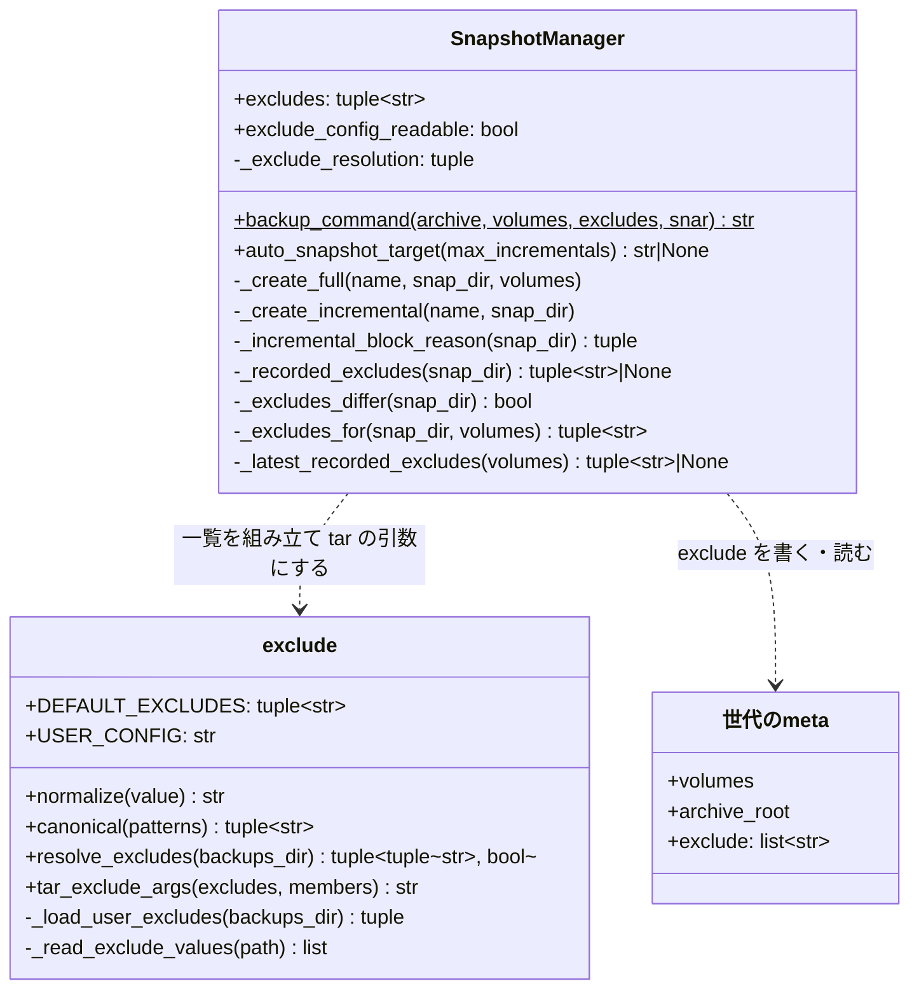

# スナップショットの除外の一覧（既定の除外と利用者の除外）

## 概要

スナップショットの控え（フルの世代・差分・復元前バックアップ）は、対象のボリュームから**除外の一覧**に
当たるパスとその下を外して作る。除外の一覧は、devbase の本体が持つ**既定の除外**と、利用者が
`backups/exclude.yml` に書いた**利用者の除外**を合わせたものである。

- 既定の除外は、作り直せる一時ファイル・ログ・取り直せる取得物（Codex の動作ログ・プラグインの取得物・
  Serena のログなど）だけを挙げる。会話の記録とプラグインの状態のファイルは控える
- 利用者の除外は既定の除外に足すだけで、既定の除外を外せない
- 世代は full を作ったときの除外の一覧を `meta.yml` の `exclude` に残す。1 つの世代のアーカイブは、すべて
  同じ除外の一覧で作る。今と違う除外の一覧の世代へは差分を積まず、自動スナップショットは新しい世代を作る
- 復元は除外の一覧を読まない。除外を持たない世代も持つ世代も同じ手順で戻す

世代の系列と差分の積み先の規則は [スナップショットの世代の系列](snapshot-series.md) にある。利用者向けの
読み方は [スナップショットガイド: 控えから外すもの](../user/snapshot-guide.md#控えから外すもの) にある。

## 用語

除外の一覧・既定の除外・利用者の除外・除外のパターンは [用語集](../glossary.md) のとおり。

## 背景

除外を持たない控えは、使う間ずっと書き換わる `.codex/logs_2.sqlite`（測った端末で 602MB）を差分のたびに
丸ごと入れ、作り直せるもの（同じ端末で合計約 1.9GB）を毎回控えていた。`.gemini/tmp/<プロジェクト>/` は
`chats/` に会話の記録を持つため、丸ごとは外さず `logs.json`・`logs/` だけを外す。

## 対象範囲

- フルの世代・差分・復元前バックアップのアーカイブから除外の一覧のパスを外すこと
- `backups/exclude.yml` の読み込みと、使えない値・読めない設定の扱い
- 世代の `meta.yml` の `exclude` と、除外の一覧の違いによる差分の止め方

含まない:

- 復元・`copy`・`list`・`rotate`（除外の一覧を読まない。`copy` は `meta.yml` ごと写すため `exclude` も写る）
- CLI の引数（除外を指定する引数は持たない）
- プロジェクトごと・ボリュームごとの除外（除外の一覧は devbase のルートに 1 つ）

## 構成要素

| 要素 | 置き場所 | 責務 |
| --- | --- | --- |
| 除外の一覧の組み立て | `lib/devbase/snapshot/exclude.py` | 既定の除外 `DEFAULT_EXCLUDES` を持つ。`backups/exclude.yml` を読み（`_load_user_excludes`）、パターンを正規化・検査し（`normalize`）、既定の除外と合わせて並べ替える（`resolve_excludes`・`canonical`）。除外の一覧から tar の引数を作る（`tar_exclude_args`）。Docker も `meta.yml` も使わない |
| 今の除外の一覧 | `lib/devbase/snapshot/manager.py` の `SnapshotManager.excludes`・`exclude_config_readable` | 初回の参照で 1 回だけ `resolve_excludes` を呼んで持つ。同じ実行で警告を 2 度出さない |
| 世代の記録 | 同 `_recorded_excludes` | 世代の `meta.yml` の `exclude` を読む。無い・リストでない・文字列でない要素を含むなら `None` |
| 比較 | 同 `_excludes_differ`・`_incremental_block_reason` | 世代の記録が今の一覧と違うかを決める。差分を積めない理由（対象ボリューム → 控えの起点 → 除外の一覧の順）の最後に当てる |
| 控えに使う一覧 | 同 `_excludes_for`・`_latest_recorded_excludes` | 設定を読めたら今の一覧、読めなければ記録の一覧を返す（下の「読めない設定の間」） |
| tar のコマンド | 同 `backup_command(archive, volumes, excludes, snar)` | 除外の引数を `-C` とメンバーより前に置く。`snar` は既定で `snapshot.snar`、世代の作り直しは `snapshot.snar.new` |
| 作成 | 同 `_create_full`・`_create_incremental` | `_excludes_for` の一覧で控える。full は `meta.yml` に `exclude` を書き、差分は書き換えない |

世代に関わる判断（記録・比較・積み先）は `manager.py` に置き、`exclude.py` は世代の状態に依らない処理だけを
持つ。世代の規則を読む人が検査の細部を読まずに済み、テストが `SnapshotManager` を組まずに検査を縛れるためである。



## 仕様

### 常に成り立つ条件

| # | 条件 | 破れたときの扱い |
| --- | --- | --- |
| I1 | 1 つの世代のアーカイブ（full と各差分）は、すべて同じ除外の一覧で作る | 自動スナップショットは差分を積まず新しい世代を作る（INFO 1 行）。名前を指定した差分は `SnapshotError`（終了コード 1）で止め、アーカイブ・`snapshot.snar`・`meta.yml` を変えない |
| I2 | `meta.yml` の `exclude` は、その世代の full を作ったときの除外の一覧に等しい。差分を積んでも書き換えない | — （full を作るときにだけ書く） |
| I3 | `meta.yml` に `exclude` が無い世代（除外を持たない世代）は、今の除外の一覧と違うものとして扱う | I1 と同じ |
| I4 | 除外のパターンはボリュームの中だけを指す（絶対パス・`..` の要素・空・`*` 以外のワイルドカードの文字を含まない） | その値を採らず WARNING 1 行。残りで控えを作る |
| I5 | 除外のパターンは各ボリュームの頭（`ai/`・`group/`・旧レイアウトの `./`）からだけ当たり、`*` は 1 つの要素の中だけに当たる | — （tar へ渡す形で守る） |
| I6 | 既定の除外は常に効く。利用者の除外は足すだけで、既定の除外を外せない | — （設定に「外す」書き方を持たない） |
| I7 | 既定の除外は、会話の記録・プラグインの状態のファイル・`.serena/language_servers` に当たらない | — （既定の一覧を変えたときにテストで落ちる） |
| I8 | 復元は除外の一覧を読まない。除外を持たない世代も持つ世代も同じ手順で戻す | — |
| I9 | 利用者の除外の設定が読めない間は、除外の一覧の違いを理由に新しい世代を作らず、今の世代の記録の一覧で控える | — （下の「読めない設定の間」） |

### 既定の除外

| パターン | 中身 |
| --- | --- |
| `.gemini/tmp/*/logs.json` | Gemini CLI のログ |
| `.gemini/tmp/*/logs` | 同上 |
| `.codex/logs_2.sqlite` | Codex の動作ログ |
| `.codex/logs_2.sqlite-wal` | 同じ SQLite の WAL |
| `.codex/logs_2.sqlite-shm` | 同じ SQLite の共有メモリのファイル |
| `.codex/.tmp` | Codex の一時ファイル・マーケットプレイスの写し |
| `.codex/cache` | Codex のキャッシュ |
| `.claude/plugins/cache` | Claude Code のプラグインの取得物 |
| `.claude/plugins/marketplaces` | Claude Code のマーケットプレイスの取得物 |
| `.serena/logs` | Serena のログ |

- 共通ボリュームとグループのボリュームの両方に当てる。同じパスがどちらにあっても作り直せ、ボリュームごとに
  一覧を分けると利用者の除外にも置き場の書き分けが要るためである
- SQLite の本体だけを外すと、復元後に本体が無く古い WAL だけが残る。WAL と共有メモリのファイルも作り直せる
  ログで、使う間ずっと書き換わるため、本体と一緒に外す
- 控えるもの: `.claude/projects`・`.codex/sessions`・`.codex/thread_history_1.sqlite`・`.codex/state_5.sqlite`・
  `.gemini/tmp/<プロジェクト>/chats/` の下（`chats/logs.json` を含む）・`.claude/plugins/installed_plugins.json`・
  `.claude/plugins/known_marketplaces.json`・`.claude/plugins/data/`・`.serena/language_servers`
- 除外の単位は「パスとその下」である。ディレクトリの中の一部だけを残すときは、外すものを個別に挙げる
  （`.gemini/tmp/*/` は `logs.json` と `logs` を挙げて `chats/` を残す）。GNU tar の `--exclude` は否定を
  持たないため、「外さないもの」を挙げて残りを外す形は採らない

### 除外のパターンの正規化と検査（`normalize`）

上から順に当て、最初に当たった行で決まる。

| 順 | 入力の形 | 扱い |
| --- | --- | --- |
| 1 | 文字列でない | 採らない（文字列ではありません） |
| 2 | 前後の空白を落として空 | 採らない（空です） |
| 3 | `/` で始まる | 採らない（絶対パスです） |
| 4 | `?`・`[`・`]`・`\` を含む | 採らない（使えない文字を含みます。ワイルドカードは `*` だけ） |
| 5 | `/` で分けた要素に `..` がある | 採らない（ボリュームの外を指します） |
| 6 | 空の要素と `.` の要素を落とす（`./a//b/` → `a/b`） | 落とした後に要素が無ければ採らない（空です） |
| 7 | それ以外 | 要素を `/` でつないだ文字列 |

### tar へ渡す形

`tar_exclude_args(excludes, members)` は次の形を返す。`members` は `backup_command` のメンバー名（`ai`・`group`、
旧レイアウトは `.`）で、一覧が空なら空文字を返す。

```text
--anchored --no-wildcards-match-slash --exclude=<メンバー>/<パターン> ...（メンバー × パターン）
```

- 各 `--exclude=…` は `shlex.quote` し、`*` をシェルに展開させない
- `backup_command` はこれを `tar --listed-incremental=…` の直後、`-cf - -C /source <メンバー>` より前に置く。
  GNU tar 1.35 では、メンバーの後に置いた `--anchored --exclude` は効かず、終了コードが 0 でなくなる
- `--anchored` が無いと `--exclude=.codex/cache` が `ai/work/.codex/cache` のようなボリュームの下の深い場所の
  同じ名前にも当たり、利用者のプロジェクトの中のファイルを黙って外す。`--no-wildcards-match-slash` が無いと
  `*` が `/` に当たり、`.gemini/tmp/*/logs.json` が `chats/` の下の `logs.json` に当たりうる
- 端末に無いパスを除外しても、tar は終了コード 0 で警告を出さない

### 世代の記録と差分の止め方

- `_create_full` は控えに使った一覧を並べ替えて `meta.yml` の `exclude` に書く。差分の上限で作る新しい世代・
  `snapshot.snar` 無しのフォールバック・復元前バックアップもこの経路を通る
- `_create_incremental` は `exclude` を書き換えない（I2）
- 比べるのは正規化した一覧そのもので、集合として比べる（並びに依らない）。既定の除外を変えても、利用者が
  設定を変えても、同じ比較で新しい世代へ倒れる
- 自動スナップショットの積み先の判定は、[系列の規則の順 4a](snapshot-series.md#差分の積み先) で、
  記録が無い（I3）か、設定を読めて今の一覧と違う世代を `None`（新しい世代）にし、INFO 1 行を出す
- 名前を指定した差分は、`_incremental_block_reason` が対象ボリューム → 控えの起点（`archive_root`）→
  除外の一覧の順に調べ、除外の一覧で止まるときは `snapshot.snar` に触る前に `SnapshotError` を投げる。
  `snapshot.snar` が無いときのフルへの切り替えはこの比較より後に置き、記録の違う世代へ名前で積もうとしたら
  snar の有無に関わらず止める

違う除外の一覧の差分を積まないのは、GNU tar 1.35 で、除外なしの full の後に除外つきの差分を積んで順に展開すると、
外したパスが full の時点の中身で残るためである（消えも更新もされない）。復元の結果が除外の一覧とも、控えた
時点の中身とも合わなくなる。

### 読めない設定の間

`backups/exclude.yml` を読めない間（`exclude_config_readable` が偽）は、除外の一覧の違いを理由に新しい世代を作らない。

| 場面 | 控えに使う一覧 |
| --- | --- |
| 記録を持つ世代へ積む差分（自動・名前の指定） | 比べずに、その世代の記録の一覧 |
| 新しいフル（差分の上限・snar 無しのフォールバック・復元前バックアップ） | `_excludes_for` が、作り直す世代の記録 → 系列の最新の世代の記録の順に最初にある記録の一覧を返す。新しい世代の `meta.yml` の `exclude` も同じ一覧になる |
| 系列のどの世代も記録を持たない | I3 のとおり新しい世代になり、既定の除外だけで控える |
| 記録の無い世代へ名前で積む | I3 のとおり `SnapshotError` で止める |

読めない設定を「既定の除外だけ」として比べると、除外の一覧が変わったと判定して新しい世代ができ、
`_auto_snapshot` の直後の `rotate()`（系列ごとに 3 世代）が最も古い世代を消す。設定を直した次の `up` でも
一覧が戻ってもう 1 世代消え、編集の誤り 1 回で復元点を 2 つ失う。記録の一覧を引き継げば、直した設定が
記録と同じなら同じ世代へ積み続ける。読めない設定で控えを止める形は、控えの無い期間を作るほうが控えが
一時的に大きくなるより戻す費用が高いため採らない。

## データ・設定

### 世代の `meta.yml` の `exclude`

| 列 | 型 | 空を許すか | 意味 |
| --- | --- | --- | --- |
| `exclude` | 文字列のリスト（並べ替え済み・重複なし） | 無いことを許す | full を作ったときの除外の一覧（正規化したパターン。メンバー名の頭は付けない）。**無いのは除外を持たない世代**で、「何も外していない」ではない。空のリストは「何も外していない」 |

一覧のハッシュではなく一覧そのものを残すのは、世代ごとの除外の一覧を後から読めるようにするためである。
`backups/snapshot.yml` は変えない（系列の判定は `snapshot.yml` だけで行い、除外の比較は積む直前に
`meta.yml` で行う。`volumes` の照合と同じ置き方）。除外を持たない devbase は `exclude` を読み捨てる。

| 操作 | `meta.yml` の `exclude` | `snapshot.snar` | `backups/exclude.yml` |
| --- | --- | --- | --- |
| フルを作る | 書く | 作る | 読む |
| 差分を積む | 読む | 更新する | 読む |
| 積み先の判定 | 読む | — | 読む |
| 復元 | — | — | — |

### 利用者の除外の設定 `backups/exclude.yml`

```yaml
# スナップショットの控えから外すパス（ボリュームの中の相対のパス）
exclude:
  - .cache/pip
  - work/*/node_modules
```

| 項目 | 規則 |
| --- | --- |
| 置き場 | `$DEVBASE_ROOT/backups/exclude.yml`（`USER_CONFIG`）。devbase は作らず書かない |
| 形 | 最上位が辞書で、`exclude` が文字列のリスト |
| ファイルが無い | 既定の除外だけ。警告を出さない。設定を読めたものとして扱う |
| 中身が空・`exclude` のキーが無い・`null`・空のリスト | 既定の除外だけ。警告を出さない |
| 読めない（`OSError`・UTF-8 で読めない・YAML として読めない・最上位が辞書でない・`exclude` がリストでない） | WARNING 1 行。設定を読めなかったものとして扱い、控えは続ける（「読めない設定の間」） |
| 要素が文字列でない・空・使えない値 | 要素ごとに WARNING 1 行で採らない。残りで続ける |

利用者の除外を devbase のルートの 1 つのファイルで受けるのは、系列ごとの除外の一覧を起動のたびに揺らさない
ためである。`bin/devbase` は実行したディレクトリのプロジェクトの `env` を読むため、環境変数で受けると、同じ
グループのボリュームを使うプロジェクトのどれから `up` したかで一覧が変わり、そのたびに新しい世代ができる。
`backups/` はスナップショットの置き場で、プロジェクトの境界をまたがない。

## エラー処理

| 場面 | 扱い |
| --- | --- |
| `backups/exclude.yml` を読めない | WARNING `backups/exclude.yml を読めないため、今の世代の除外の一覧のまま控えます（記録の無い世代だけなら既定の除外だけで作ります）: {理由}`。終了コードは変えない |
| 使えない値 | WARNING `backups/exclude.yml の除外 {値!r} を採りません: {理由}` を要素ごとに 1 行。終了コードは変えない |
| 自動スナップショットの積み先の世代の除外の一覧が違う・記録が無い | INFO `世代 {名前} は今と違う除外の一覧で作られているため、新しい世代を作成します` |
| `devbase snapshot create --name <除外の一覧が違う世代>`（`--full` なし） | `SnapshotError` `スナップショット '{名前}' は今と違う除外の一覧で作られています。新しい世代を作成してください (devbase snapshot create)` → 終了コード 1。アーカイブ・`snapshot.snar`・`meta.yml` は変わらない |

同じ `SnapshotManager` で積み先の判定と作成を呼んでも、設定の WARNING は 1 回だけ出す。

## 運用

- 除外を持たない世代は書き換えない。更新後の最初の自動スナップショットで、系列ごとに新しいフルの世代が
  できる（I3）。そのまま一覧・復元でき、復元の結果は除外を持たない devbase で復元したときと同じである
- `backups/exclude.yml` で除外の一覧を変えるたびに、次の自動スナップショットが新しい世代を作り、系列ごとの
  保持数（3）を超えた最も古い世代がローテーションで消える。I1 から外せないため、利用者向けの文書に書いてある
- 切り戻し（除外を持たない devbase へ戻す）では `exclude` が読み捨てられる。除外を持つ世代を復元すると、
  除外したパスは無い
- 既定の除外のパスを消したホームで、Claude Code・Codex・Gemini CLI・Serena はエラーで止まらずに起動する。
  Claude Code は最初のセッションが始まるまで `claude plugin list` がプラグインを `cache-miss` と出し、最初の
  セッションでマーケットプレイスとプラグインを取り直して `installed_plugins.json` の一覧のまま読み込む。
  Codex は消した `logs_2.sqlite` と `cache` を作り直す
- 既存の世代の名前へ `--full` を打つと、その世代を作り直した時点の除外の一覧で作り直す（世代の作り直し。
  [スナップショットの系列](snapshot-series.md#世代の作り直し)）。前の差分は消え、前の時点へは戻せない。除外の一覧が
  違う世代への案内は「新しい世代を作成してください (devbase snapshot create)」とし、`--name` に既存の名前を勧めない

## テスト観点

正規化・設定の読み込み・tar の引数（`tests/snapshot/test_exclude.py`）:

- 既定の除外が上の 10 個で、正規化済みであること。会話の記録・プラグインの状態のファイル・
  `.serena/language_servers` に当たらないこと（I7）
- 相対パスを正規化すること（`./a//b/` → `a/b`）。絶対パス・`..` を含む値・空・`null`・数・`?[]\` を含む値を採らないこと
- 設定が無い・空・`exclude` が無い・空のリストで、既定の除外だけで警告が出ないこと
- 足した値が既定の除外に加わること。使えない値は値ごとに WARNING 1 行で、残りの値は効くこと
- 読めない設定（壊れた YAML・最上位がリスト・`exclude` が文字列）で、WARNING 1 行、一覧は既定の除外だけ、
  設定を読めたかが偽であること
- tar の引数が各パターンに各メンバーを頭に付けること。旧レイアウトは `./` で始まること。一覧が空なら空文字

世代の記録と積み先（`tests/snapshot/test_exclude_generations.py`。`_run_docker_tar` を差し替える）:

- full の `meta.yml` の `exclude` が並べ替えた一覧で、差分を積んでも変わらないこと（I2）
- 利用者の除外が既定の除外と一緒に tar のコマンドに入ること（I6）
- 復元前バックアップの tar のコマンドに除外の引数があり、`meta.yml` に `exclude` があること。旧レイアウトの
  復元前バックアップでパターンの頭が `./` であること
- 同じ実行で WARNING が 1 回であること
- 同じ除外の世代には積み続け、違う・記録の無い世代では `auto_snapshot_target` が `None` と INFO 1 行（I1・I3）
- 名前を指定した差分で記録が違う・無いと `SnapshotError` で、snar の有無に関わらず tar を呼ばず、
  `snapshot.snar` と `meta.yml` のバイト列が変わらないこと。`cmd_snapshot` は終了コード 1
- 積めない理由が重なるとき、最初の 1 件（対象ボリューム → 控えの起点 → 除外の一覧）だけを報告すること
- 読めない設定で、記録を持つ世代へ記録の一覧で積み続け、記録を変えないこと。記録の無い世代を引き継がないこと。
  差分の上限の後の新しいフル・snar 無しのフォールバック・復元前バックアップが記録の一覧で作られること。
  どの世代も記録を持たなければ既定の除外だけで作ること（I9）
- 除外を持たない世代の復元のコマンドが変わらないこと（I8）

実の GNU tar（`tests/snapshot/test_backup_real_tar.py`。GNU tar と zstd が無い端末では飛ぶ。CI の Linux で走る）:

- 既定の除外のパスを `ai`・`group` に置いた full に、どのパスもその下も無く、控えるもの（`chats/logs.json`・
  `work/.codex/cache` を含む）があること（I5・I7）
- full の後に `.codex/logs_2.sqlite` とほかのファイルを書き換えた差分に、`logs_2.sqlite` が無く、ほかのファイルがあること
- 除外つきの full と差分を順に展開すると、除外の外のパスは差分の時点の中身で、除外したパスが無いこと
- 既定の除外のパスが 1 つも無い木を控えて、終了コード 0 で警告が無いこと

除外を持たない世代の復元のテスト（`tests/snapshot/test_restore_incremental.py`・`test_manager_volumes.py`）が通ること。

実機で確かめる観点: 利用者の端末で `devbase snapshot create --full` の大きさを除外を持たない世代と比べ、
端末とボリュームの大きさを記録に残す。

## 関連リンク

- [スナップショットの世代の系列](snapshot-series.md)
- [スナップショットガイド: 控えから外すもの](../user/snapshot-guide.md#控えから外すもの)
- [CLI リファレンス: snapshot (ss) グループ](../user/cli-reference/05-snapshot.md)
- 実装 PR: devbasex/devbase#461（#368）
