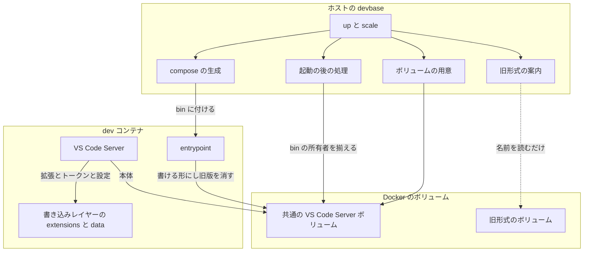
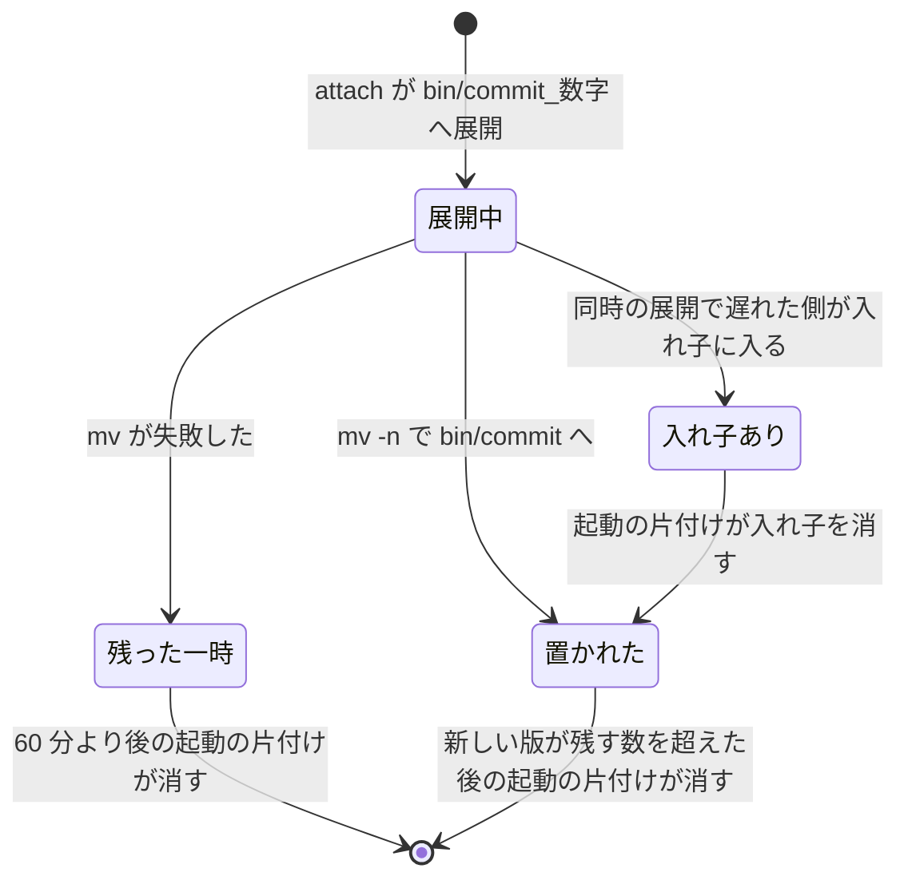
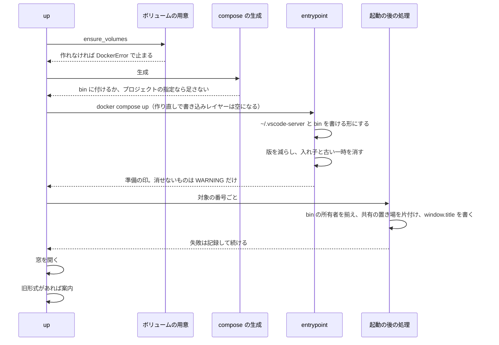

# VS Code Server の本体の共通ボリューム

## 概要

devbase は、VS Code Server の本体（`~/.vscode-server/bin/<commit>`）だけを全コンテナで 1 本のボリューム
`devbase_vscode-server-bin` に置く。どの dev インスタンスにも同じボリュームを `/home/ubuntu/.vscode-server/bin` に付け、
本体の版の数はコンテナの起動の片付けで 5 版までに収める。拡張・リモート側の設定と状態（`~/.vscode-server` の `bin/` 以外）は
どのボリュームにも置かず、コンテナの書き込みレイヤーに残る。窓のタイトルと窓の再接続は、コンテナごとに働く。

あわせて、どの dev インスタンスにも Dev Containers の共有の置き場（名前 `vscode` のボリューム）を `/vscode` に付ける。
Dev Containers 拡張は、この置き場が付いたコンテナでは拡張のキャッシュと本体の新しい版をこの中に置き、VS Code を動かしている
手元の端末のキャッシュを使わない。置き場は docker ホストごとにあるため、別の CPU 向けの拡張がコンテナへ送られない。

| 担い手 | 行うこと |
| --- | --- |
| ホストの devbase（`up` / `scale`） | 共通の VS Code Server ボリュームと Dev Containers の共有の置き場を用意し、生成した compose で dev インスタンスへ付ける |
| コンテナの entrypoint | `~/.vscode-server` と `~/.vscode-server/bin` を開発ユーザーが書ける形にし、本体の旧版と同時の展開の残りを片付ける |
| 起動の後の処理（`up` / `scale` / `project post-start`） | `bin` の所有者を `~/.vscode-server` の所有者へ揃える（entrypoint を建て直していないイメージのため）。共有の置き場の拡張のキャッシュと `bin` のリンク切れを片付ける |
| `devbase up` の最後 | 旧形式の VS Code Server ボリュームが残っていれば、名前と消し方を案内する |

## 用語

語の定義は用語集にある。

- [エディタで開く（`editor`）](../glossary.md#エディタで開くeditor): 共通の VS Code Server ボリューム・コンテナごとの VS Code Server の状態・旧形式の VS Code Server ボリューム・Dev Containers の共有の置き場
- [コンテナの起動（`container-start`）](../glossary.md#コンテナの起動container-start): 入れ子の本体・残す版の数

## コンテキスト

| コンテキスト | 何の語が 1 つの意味に決まるか |
| --- | --- |
| Compose の構成（`compose`） | dev インスタンスへ付けるボリュームとマウント先 |
| コンテナの起動（`container-start`） | entrypoint が起動のたびに行う、`~/.vscode-server` と `bin` の用意と本体の版の片付け |
| 起動の後の処理（`post-start`） | ホストから行う、`bin` の所有者の直しと `window.title` の書き込み |
| エディタで開く（`editor`） | 共通の VS Code Server ボリューム・コンテナごとの VS Code Server の状態・旧形式の VS Code Server ボリューム |

`compose` と `container-start`・`post-start` は公開された言語で繋ぐ。共有する言語はマウント先のパス `/home/ubuntu/.vscode-server/bin` で、
compose の生成がこのパスへ付け、entrypoint と起動の後の処理はこのパスと親の `/home/ubuntu/.vscode-server` だけを見て、ボリュームの名前を知らない。

VS Code Server と Dev Containers 拡張（外部の系）に対して devbase は順応者である。`bin/<commit>/product.json` を持つディレクトリが 1 版、
`bin/<commit>_<数字>` が展開の途中という向こうの形をそのまま受け入れ、`extensions/` と `data/` の中身には手を入れない（`window.title` の 1 キーを除く）。

## 背景

コンテナ 1 つに 1 本のボリュームで `~/.vscode-server` を丸ごと持つと、VS Code の更新のたびに約 0.6GB の版が各ボリュームへ溜まり、
手で消さない限り減らない。ホストのディスクが埋まると Docker Desktop が止まり、動いているコンテナが落ちる。

- **共有するのは `bin/` だけにする。** 本体は版ごとに不変で、2 つのコンテナから同じ版を使って壊れない。`extensions/` を共有すると、
  別のコンテナのサーバーの起動が `.obsolete` の付いた拡張の版を消し、動いている窓の拡張を消し得る。`data/Machine` を共有すると、
  `.devport-<commit>` と `window.title` が後から書いたコンテナの値になる
- **`extensions/`・`extensionsCache/`・`data/` はボリュームにしない。** コンテナごとのボリュームに置くと、dev インスタンスの数だけボリュームが増え、
  使わなくなったボリュームが溜まる形が残る。作り直しで失うもの（ローカル履歴・拡張のリモート側の状態・ログ・手で入れた設定と拡張）は利用者が受け入れた
- **本体の旧版は devbase が消す。** Dev Containers 拡張は、devbase の attach の形では `bin/` の旧版を消さない
- **Dev Containers の共有の置き場を付ける。** 付いていないコンテナでは、Dev Containers 拡張は拡張のキャッシュを手元の端末に 1 つ持ち、
  拡張の名前だけで選んでコンテナへ送る。arm64 の端末（Mac など）と x86_64 のサーバーの両方へ同じ VS Code から attach すると、
  別の CPU 向けの拡張（`-linux-arm64` など）が送られ、attach が「Copy extensions to remote」で止まる。置き場は docker ホストごとにあり、
  拡張はコンテナの中のリンクで取り込むため、作り直しの後も取り込み直さない

## 対象範囲

含む:

- 共通の VS Code Server ボリュームの用意と、dev インスタンスへの付け方
- コンテナの起動での `~/.vscode-server` と `bin` の用意、`bin/` の片付け
- 起動の後の処理での `bin` の所有者の直し
- 旧形式の VS Code Server ボリュームの案内
- Dev Containers の共有の置き場の用意と、dev インスタンスへの付け方
- 起動の後の処理での、共有の置き場の拡張のキャッシュと `bin` のリンク切れの片付け

含まない:

- 旧形式の VS Code Server ボリュームを devbase が消す・写す・付けること
- `extensions/`・`extensionsCache/`・`data/` を作り直しをまたいで残すこと、それらの片付け
- 拡張の版の選び方・自動更新の振る舞い（VS Code と Dev Containers 拡張の持ち物）
- `~/.vscode-server` 以外のサーバーの置き場（`~/.cursor-server` など）
- スナップショットの対象（共通の VS Code Server ボリュームと Dev Containers の共有の置き場は対象にならない）
- 手元の端末の拡張のキャッシュを devbase が消すこと（devbase からは届かない）
- 共有の置き場の本体（`/vscode/vscode-server/bin`）の片付け（Dev Containers 拡張が新しい 9 版まで残す）

## 構成要素

| 要素 | 置き場所 | 責務 |
| --- | --- | --- |
| 名前とパスの定数 | `lib/devbase/volume/manager.py` の `VSCODE_SERVER_VOLUME`・`VSCODE_SERVER_TARGET`・`VSCODE_BIN_TARGET`・`LEGACY_VSCODE_VOLUME_PREFIX` | 共通の VS Code Server ボリュームの名前 `devbase_vscode-server-bin`、マウント先のパス、旧形式の接頭辞 `devbase_vscode_` |
| ボリュームの用意 | 同ファイルの `VolumeManager.ensure_volumes` | 共通の VS Code Server ボリュームを 1 回だけ用意する（あれば作らない）。作れなければ `DockerError`。プロジェクトが `~/.vscode-server` を自分で付けていても作る |
| 旧形式の一覧 | 同ファイルの `find_legacy_vscode_volumes` | `docker volume ls --format {{.Name}}` の名前のうち `^devbase_vscode_.+_[0-9]+$` に当たるものを名前の順で返す。一覧が取れなければ空を返し、例外を出さない |
| マウントの判定 | `lib/devbase/volume/compose.py` の `_vscode_volume` | dev サービスが `~/.vscode-server` か `~/.vscode-server/bin` を宣言していれば `None`、それ以外は `VSCODE_SERVER_VOLUME` を返す。インスタンスの数に依らず同じ値 |
| マウントの組み立て | 同ファイルの `_replace_volumes_for_instance`・`_build_volumes_section` | 各インスタンスへ `<名前>:/home/ubuntu/.vscode-server/bin` を足し、`volumes:` の節にその名前を 1 回だけ `external: true` で宣言する |
| `bin` の所有者の直し | `lib/devbase/editor/vscode_server.py` の `bin_fix_script`・`prepare_bin_dir` | `docker exec -u 0 <コンテナ> sh -c <手順>` を 1 回打ち、`bin` の所有者を `~/.vscode-server` の所有者へ揃える。成否を真偽で返し、例外を出さない |
| 起動の後の処理の段 | `lib/devbase/commands/container.py` の `_prepare_vscode_server_bin` | 対象の番号ごとに `prepare_bin_dir` を呼ぶ。`_run_post_start` が `_apply_window_titles` の直前に呼ぶ（[起動の後の処理](post-start.md)） |
| 旧形式の案内 | 同ファイルの `_report_legacy_vscode_volumes` | `cmd_up` の `_maybe_open_editor` の後、`_finish_partial` の前に呼ぶ。`scale` と `project post-start` は呼ばない |
| 置き場の用意 | `containers/base/entrypoint.sh` の `devbase_setup_vscode_server_dir` | `~/.vscode-server` と `~/.vscode-server/bin` をこの順に `devbase_ensure_persistent_root` で用意し、片付けを呼ぶ |
| 片付け | 同ファイルの `devbase_prune_vscode_server_bin`・`devbase_remove_vscode_server_path`・`devbase_file_mtime` | `bin/` の 3 種だけを消す。消せずに残ったパスだけを WARNING に出す。終了コードは常に 0 |
| 共有の置き場の定数 | `lib/devbase/volume/manager.py` の `VSCODE_CACHE_VOLUME`・`VSCODE_CACHE_TARGET`・`VSCODE_CACHE_SERVER_DIR`・`VSCODE_CACHE_EXTENSIONS_DIR` | 名前 `vscode`、マウント先 `/vscode`、Dev Containers 拡張が使う `/vscode/vscode-server`、拡張のキャッシュ `/vscode/vscode-server/extensionsCache` |
| 共有の置き場の用意 | 同ファイルの `VolumeManager.ensure_volumes` | `vscode` を 1 回だけ用意する（あれば作らない） |
| 共有の置き場のマウントの判定 | `lib/devbase/volume/compose.py` の `_vscode_cache_volume` | dev サービスが `/vscode` を宣言していれば `None`、それ以外は `VSCODE_CACHE_VOLUME` を返す |
| 共有の置き場の片付け | `lib/devbase/editor/vscode_server.py` の `shared_cache_prune_script`・`prune_shared_cache`（残す版の数 `EXTENSIONS_CACHE_KEEP=3`） | `docker exec -u 0 <コンテナ> sh -c <手順>` を 1 回打ち、拡張のキャッシュを拡張ごとに新しい 3 版へ減らし、`bin` のリンク切れを消す。成否を真偽で返し、例外を出さない。`_prepare_vscode_server_bin` が `prepare_bin_dir` の後に呼ぶ |
| 片付けの定数 | 同ファイルの `DEVBASE_VSCODE_SERVER_KEEP=5`・`DEVBASE_VSCODE_SERVER_STALE_MINUTES=60` | 残す版の数と、展開の途中のディレクトリを残りと見なすまでの分数。環境変数で変える形にしない |



## 仕様

### 集約

| 集約 | 持ち主（書き換えてよいもの） | 根 | エンティティ | 値オブジェクト |
| --- | --- | --- | --- | --- |
| dev インスタンスのボリュームの構成 | compose の生成（`_vscode_volume` と `_replace_volumes_for_instance`） | 生成した compose の `dev-<index>` の `volumes` | — | マウント（ボリューム名とマウント先の組） |
| VS Code Server のボリュームの実体 | ボリュームの用意（`VolumeManager.ensure_volumes`）。作るだけで、消さない | Docker のボリューム | 共通の VS Code Server ボリューム（1 本） | ボリューム名 |
| 本体の版の集まり | 足すのは VS Code Server（外部）、消すのは entrypoint の片付け（`devbase_prune_vscode_server_bin`）だけ | 共通の VS Code Server ボリュームの根（`~/.vscode-server/bin`） | 本体の版 `bin/<commit>`（commit で識別） | `product.json` の更新時刻・残す版の数 |
| 共有の置き場の拡張のキャッシュ | 足すのは Dev Containers 拡張（外部）、消すのは Dev Containers 拡張（500 ファイルまで残す）と起動の後の処理の片付け | `/vscode/vscode-server/extensionsCache` | 拡張の版のファイル（ファイル名で識別） | 拡張の ID（ファイル名の最初の「`-` と数字」より前）・更新時刻・残す版の数 |
| `bin` の置き場の所有者 | entrypoint の `devbase_setup_vscode_server_dir` と、起動の後の処理の所有者の直し。どちらも「開発ユーザーが書ける」へ揃えるだけ | `~/.vscode-server/bin` のマウント先 | — | 所有者（uid:gid） |

コンテナごとの VS Code Server の状態（`extensions/`・`extensionsCache/`・`data/`）は VS Code Server の持ち物で、コンテナの書き込みレイヤーにある。
devbase は書き換えず（`window.title` の 1 キーを除く）、ボリュームにも置かない。

### 常に成り立つ条件

| # | 集約 | 条件 | 破れたときの扱い |
| --- | --- | --- | --- |
| I1 | dev インスタンスのボリュームの構成 | `~/.vscode-server` の下で devbase が足すのは、共通の VS Code Server ボリュームを `~/.vscode-server/bin` に付けるマウント 1 つだけである。`~/.vscode-server` と `~/.vscode-server/data` には何も足さない。プロジェクトの指定と合わせた最終の構成で、`~/.vscode-server/bin` のマウントは 1 つまでである | 同じパスに 2 つ付くと compose が弾く。compose の生成のテストが落ちる |
| I2 | dev インスタンスのボリュームの構成 | プロジェクトの dev サービスが `~/.vscode-server` か `~/.vscode-server/bin` を付けていれば、devbase は何も足さない。`~/.vscode-server/data` などほかの下のパスだけを付けていれば、共通の VS Code Server ボリュームを足す | compose の生成のテストが落ちる |
| I3 | dev インスタンスのボリュームの構成 | 生成した compose のマウントと `volumes:` の節に、旧形式の VS Code Server ボリュームが現れない | compose の生成のテストが落ちる |
| I4 | VS Code Server のボリュームの実体 | 共通の VS Code Server ボリュームの名前は 1 つの定数で、`devbase_vscode_` で始まらず、旧形式を選ぶ形（`^devbase_vscode_.+_[0-9]+$`）に当たらない | 旧形式の案内が共通のボリュームを消すよう勧める。名前のテストが落ちる |
| I5 | VS Code Server のボリュームの実体 | devbase は旧形式の VS Code Server ボリュームを作らず、消さず、付けず、中身を読まない。名前の一覧を読むだけ | 案内のテストが `docker volume rm`・`run`・`create` の呼び出しで落ちる |
| I6 | 本体の版の集まり | コンテナの起動の後、`bin/` の版は残す版の数以下で、残るのは `product.json` の更新時刻（同じなら名前）で並べた新しい側である。片付けが同時に走っても、残る版は残す版の数より少なくならない（片付けの前に残す版の数以上あったとき） | 片付けのテストが落ちる |
| I7 | 本体の版の集まり | コンテナの起動の後、残った `bin/<commit>/` の直下に入れ子の本体が無い。`bin/<commit>/` の直下のほかのものは残る | 片付けのテストが落ちる |
| I8 | 本体の版の集まり | 片付けは、版・入れ子の本体・60 分より古い一時の展開のディレクトリ（`bin/<commit>_<数字>`）だけを消す。`bin/` のほかのもの、`~/.vscode-server` の `bin` 以外に触らない。シンボリックリンクを辿らない | 片付けのテストが落ちる |
| I9 | 本体の版の集まり | 片付けで消せないものがあってもコンテナの起動は止まらない。消せずに残ったパスだけを WARNING の行に出し、ほかのコンテナが先に消したものは出さない | 片付けのテストが落ちる |
| I10 | `bin` の置き場の所有者 | 新しい entrypoint のコンテナは起動の後、この仕様より前の entrypoint のコンテナは起動の後の処理の後に、`~/.vscode-server` と `~/.vscode-server/bin` を開発ユーザーが書ける | VS Code Server が本体を置けず attach が失敗する。entrypoint と起動の後の処理のテストが落ちる |
| I11 | VS Code Server のボリュームの実体 | 共通の VS Code Server ボリュームと Dev Containers の共有の置き場は、スナップショットの対象にならない（対象は `devbase_home_*`） | スナップショットの対象のテストが落ちる |
| I12 | dev インスタンスのボリュームの構成 | どの dev インスタンスにも Dev Containers の共有の置き場 `vscode` が `/vscode` に 1 つ付き、`volumes:` に `external: true` で 1 回だけ宣言される。dev でないサービスには付かない。プロジェクトの dev サービスが `/vscode` を付けていれば、devbase は何も足さない | compose の生成のテストが落ちる |
| I13 | 共有の置き場の拡張のキャッシュ | 片付けは、拡張のキャッシュの直下の通常のファイルだけを消し、拡張ごとに更新時刻の新しい 3 つを残す。リンクとディレクトリに触らず、キャッシュ自身がリンクなら何もしない | 片付けのテストが落ちる |
| I14 | 本体の版の集まり | 起動の後の処理が `bin/` で消すのは、名前が 40 桁の 16 進で、リンク先が無いリンクだけである。`/vscode/vscode-server` が無いコンテナでは消さない | 片付けのテストが落ちる |

### ボリュームの名前

共通の VS Code Server ボリュームの名前は `devbase_vscode-server-bin` である。旧形式はどれも `devbase_vscode_` で始まり、この名前は
15 文字目が `-` で必ず違う。旧形式の案内は名前の形だけで旧形式を選ぶため、共通のボリュームを消すよう勧めることが無い。
`docker volume ls --filter name=devbase_vscode_`（部分一致）にも当たらない。末尾の `-bin` は、中身が `bin/` だけであることを示す。
ボリュームは端末（Docker の daemon）に 1 本で、プロジェクト・インスタンス・アカウントグループで分けない。リモートの docker context でも daemon の側に作る。

### 生成する compose

dev インスタンス 1 つ分の形:

```yaml
services:
  dev-1:
    volumes:
      # …プロジェクトのマウントと /persistent/ai・/persistent/group・/work
      - devbase_vscode-server-bin:/home/ubuntu/.vscode-server/bin
      - vscode:/vscode
volumes:
  devbase_vscode-server-bin: {external: true}
  vscode: {external: true}
```

マウントは短い書式で、新しい Compose のオプションを使わない。Docker はマウント先の親 `~/.vscode-server` を root の所有で書き込みレイヤーに作る。

### コンテナの起動（entrypoint）

`devbase_setup_vscode_server_dir "/home/${USERNAME}" "$USERNAME"` を起動のたびに打つ。`~/.vscode-server` と `~/.vscode-server/bin` を
開発ユーザーの所有で用意してから、`devbase_prune_vscode_server_bin` で `bin/` を片付ける。マウントが無い構成でもディレクトリを作るだけで、
VS Code の動作は変わらない。

片付けは、`~/.vscode-server/bin` がディレクトリで（リンクでなく）あるときだけ、次の順に行う。

1. **版を減らす。** 40 桁の 16 進の名前で `product.json` を持つディレクトリを版と数え、`product.json` の更新時刻の新しい順（同じなら名前の順、
   `LC_ALL=C`）に並べ、残す版の数（5）を超えた古い版を消す。`product.json` は片付けが書き換えないため、同時に走る片付けどうしで並びが同じになる。
   ディレクトリの更新時刻で並べると、同時の片付けで残る版が減った
2. **入れ子の本体を消す。** 残った版の直下の、`product.json` を持つディレクトリを消す。版を減らした後に行う
3. **残った一時を消す。** 60 分より古い `bin/<commit>_<数字>` を消す。展開に 60 分かかることは無いため、動いている展開を消さない

残す版の数を 5 にするのは、上限が約 3GB（1 版約 0.6GB）で収まり、VS Code がおおむね月に 1 版のため、別の端末の VS Code が数か月更新されずに
古い版で attach していてもその版を消しにくいためである。最後に使った時刻で並べる形は、devbase の attach の形ではその時刻が残らないため使わない。

`bin/` 自身・`bin/<commit>`・入れ子がシンボリックリンクなら、版にも片付けの対象にも数えない。リンク先の `bin` の外のものを消さないためである。

1 つのパスは `devbase_remove_vscode_server_path` が消す。`rm -rf` が失敗してもパスが無くなっていれば何も出さず（ほかのコンテナが同時に消した）、
まだあればもう一度消す。それでも残ったときだけ、次の 1 行を標準エラーへ出す。終了コードとほかの出力は変わらない。

```text
WARNING: VS Code Server の片付けで消せなかった: <パス> (<理由>)
```

entrypoint の変更は、base と派生イメージを建て直した後から効く。建て直すまでは共通の VS Code Server ボリュームの `bin/` に版が溜まる
（1 本分で、プロジェクトとインスタンスの数だけ重ならない）。

#### 本体の版の状態



置かれた版を、残す版の数に入っている間に消す遷移は無い。`devbase up` の作り直しは書き込みレイヤーだけを消し、この図の版には触らない。

### `bin` の所有者の直し（起動の後の処理）

空のボリュームは root の所有で付く。この仕様より前の entrypoint は `~/.vscode-server` しか開発ユーザーへ直さず、`bin` は root のままで
VS Code Server が本体を置けない。entrypoint の変更は base と派生イメージを建て直すまで効かず、派生イメージはプラグインのリポジトリが建てるため、
起動の後の処理で直す。直しは移行の間だけのものにせず残す。利用者がボリュームを消して作り直したとき、最初に付けるコンテナが古いイメージなら再び要る。

起動の後の処理は、対象の番号ごとに次のコマンドを 1 回打つ。

```text
docker exec -u 0 <コンテナ名> sh -c '<直しの手順>'
```

| 項目 | 内容 |
| --- | --- |
| 見るパス | `/home/ubuntu/.vscode-server` と `/home/ubuntu/.vscode-server/bin` の絶対パスだけ（root の `$HOME` は `/root`） |
| 手順 | `bin` が無ければ何もしない。2 つの所有者を `stat -c %u:%g`（使えなければ `stat -f %u:%g`）で読み、違うときだけ `bin` 1 つへ `~/.vscode-server` の所有者で `chown` する。再帰しない |
| 時間の上限 | 10 秒 |
| 失敗 | docker の失敗・タイムアウト・非 0 の終了は debug の記録にとどめ、`False` を返す。起動の後の処理は止めない |

揃える先は `~/.vscode-server` の所有者で、起動の後の処理の時点では、この仕様より前の entrypoint もそれを開発ユーザーへ直している。
所有者が揃っていれば何もしないため、新しい entrypoint のコンテナでは何も変えない。所有者はボリュームの根に残るため、1 つのコンテナで揃えば、
後から付けるコンテナは古いイメージでも書ける。

### Dev Containers の共有の置き場

名前は `vscode`、マウント先は `/vscode` である。名前は Dev Containers 拡張が決め打ちで探す値で、ほかの名前では効かないため、
devbase の決まり（`devbase_` で始める）から外れる。拡張は `Mounts` のうち `Type` が `volume` で `Name` が `vscode` のものを探し、
マウント先は問わない。マウント先は拡張が自分で作るコンテナと同じ `/vscode` にする。同じ docker ホストの Dev Containers のコンテナと
置き場を共有するが、どちらも同じ形で書くため壊れない。

置き場が付いたコンテナでの Dev Containers 拡張（0.469.0 で確かめた）の振る舞い:

| 置くもの | 置き場 | 拡張が残す数 |
| --- | --- | --- |
| 拡張のキャッシュ | `/vscode/vscode-server/extensionsCache`。root で写し戻し、取り込みはコンテナの中のリンク | 新しい 500 ファイル |
| 本体の新しい版 | `/vscode/vscode-server/bin/<linux-x64 などの build>/<commit>` に root で置き、`~/.vscode-server/bin/<commit>` からリンクを張る | 新しい 9 版 |

所有者は直さない。拡張は置き場へ root のシェル（`docker exec -u root`）で書き、開発ユーザーはリンクを辿って読むだけで、
空のボリュームが root の持ち物で付いても困らない。

### 共有の置き場の片付け（起動の後の処理）

起動の後の処理は、`bin` の所有者の直しに続けて、対象の番号ごとに次のコマンドを 1 回打つ。entrypoint でなくここで行うため、
イメージを建て直さずに効く。

```text
docker exec -u 0 <コンテナ名> sh -c '<片付けの手順>'
```

1. **拡張のキャッシュを減らす。** `/vscode/vscode-server/extensionsCache` がディレクトリで（リンクでなく）あるとき、直下の通常のファイルを
   ファイル名の最初の「`-` と数字」より前（`anthropic.claude-code-2.1.312-linux-x64` → `anthropic.claude-code`）で拡張ごとに分け、
   更新時刻（拡張が使うたびに更新する）の新しい順に 3 つを残して消す。CPU の違う同じ拡張は同じ拡張に数える。拡張が残す 500 ファイルは、
   1 本 130MB 前後で更新の多い拡張があると数十 GB になり得るため減らす
2. **`bin` のリンク切れを消す。** `/vscode/vscode-server` があり、`~/.vscode-server/bin` がディレクトリで（リンクでなく）あるとき、
   直下の名前が 40 桁の 16 進のリンクのうち、リンク先が無いものを消す。拡張が `/vscode` 側の古い版を消すと、リンクだけが切れて残るためである。
   `/vscode/vscode-server` が無いコンテナ（共有の置き場を付ける前に作ったもの）では行わない。`bin` は全 dev コンテナで共有のボリュームで、
   そのコンテナからは他のコンテナが張ったリンクがすべて切れて見えるためである。entrypoint の片付けの規則（リンクを版に数えず、辿らない）は変えない

| 項目 | 内容 |
| --- | --- |
| 時間の上限 | 30 秒 |
| 失敗 | 手順の中の失敗は無視し、終了コードは常に 0。docker の失敗・タイムアウト・非 0 の終了は debug の記録にとどめ、`False` を返す。起動の後の処理は止めない |

### 旧形式の案内（`devbase up` の最後）

旧形式の VS Code Server ボリュームが残っている限り、`devbase up` のたびに出力の最後（窓を開いた後）に `logger.warning` で次を出す。
利用者が消せば次から出ない。案内を止める印のファイルは持たない。

1. 使わなくなった VS Code Server のボリュームの本数
2. その名前（1 行に 1 つ、名前の順）
3. 消すと戻せなくなるもの（本体・拡張・リモートの設定・ローカル履歴・拡張の保存した状態）と、要るものは消す前に退避すること
4. 消すコマンド `docker volume rm <名前> …`（見つけたすべての名前を並べた 1 行）
5. コンテナが付けているボリュームは `docker volume rm` が断ること。そのプロジェクトで `devbase up` を打った後に消せること

旧形式が無い・一覧が取れないときは何も出さない。終了コードは変わらない。`scale` と `project post-start` は出さない。どちらも `up` の後に
打つため、同じ案内を重ねない。付けているコンテナを devbase が調べて案内を分けることはしない（`docker volume rm` 自身が断る）。

### 処理の流れ



`scale` は同じ段を [2/5]・起動の後の処理で通り、旧形式の案内だけを持たない。`project post-start` は起動の後の処理だけを通る。

## データ・設定

永続データは Docker のボリュームである。

| 置き場 | 数 | マウント先 | 中身 | 書くもの | 消えるとき |
| --- | --- | --- | --- | --- | --- |
| `devbase_vscode-server-bin`（共通の VS Code Server ボリューム） | 端末（daemon）に 1 本 | `/home/ubuntu/.vscode-server/bin` | `<commit>/`（本体の版）・`<commit>_<数字>/`（展開の途中） | VS Code Server・entrypoint（所有者と片付け）・起動の後の処理（所有者） | 片付けが版を消す。ボリュームは利用者だけが消す |
| コンテナの書き込みレイヤーの `~/.vscode-server`（ボリュームではない） | dev コンテナごと | — | `extensions/`・`extensionsCache/`・`data/`（接続トークン・`.devport`・`Machine/settings.json`・ログ・`User/`）・その他の直下の置き場。`bin` はマウント先 | VS Code Server・Dev Containers 拡張・`window.title`・entrypoint（所有者） | `devbase up` の作り直し（down → up）。`docker restart` と端末の再起動では残る |
| `vscode`（Dev Containers の共有の置き場） | docker ホストに 1 本 | `/vscode` | `vscode-server/extensionsCache/`（拡張のキャッシュ）・`vscode-server/bin/<build>/<commit>/`（本体の新しい版） | Dev Containers 拡張・起動の後の処理（片付け） | 拡張と片付けがキャッシュと版を減らす。ボリュームは利用者だけが消す |
| `devbase_vscode_<project>_<index>`（旧形式） | 残っているだけ | 付けない | 以前の `~/.vscode-server` 丸ごと | 何も書かない | 利用者だけが消す |

`devbase up` の作り直しのたびに、書き込みレイヤーのローカル履歴（`data/User/History`）・拡張のリモート側の状態（`data/User/globalStorage`・
`workspaceStorage`）・ログ・手で入れたリモート側の設定と拡張が消える。接続トークンと `.devport` は作り直され、`window.title` は `devbase up` が毎回書き直す。
Dev Containers の既定の拡張は、作り直しの後の attach で入り直す。

## 外部連携

| 外部の系 | devbase が前提にする形 |
| --- | --- |
| Dev Containers 拡張 | 本体は `test -d bin/<commit>` が偽のときだけ `bin/<commit>_<ミリ秒>` へ展開し、`mv -n` で `bin/<commit>` へ置く。一時のディレクトリは `bin/` の中にあり、同じファイルシステムの中の改名で済む。同時の展開では、遅れた側の中身が `bin/<commit>/vscode-server-linux-<arch>/` に入れ子で残るか、一時のディレクトリが残ることがある。devbase の attach の形では `bin/` の旧版を消さない。共有の置き場 `vscode` が付いていれば、拡張のキャッシュと本体の新しい版をその中に置く（「Dev Containers の共有の置き場」）。付いていなければ、拡張のキャッシュを手元の端末に 1 つ持ち、CPU の種類を見ずに拡張の名前で選んで送る |
| VS Code Server | 接続トークンは、あれば読み、無ければ `mv -n` で作る。`.devport-<commit>` と `data/Machine/settings.json` はコンテナごとの `data/` にある |
| Docker | 空のボリュームとマウント先の親を root の所有で作る |

## セキュリティ

共通の VS Code Server ボリュームには本体のほかのもの（接続トークン・拡張・拡張の保存する状態・マシンの設定）が入らない。マウント先を `bin` にし、
それらは `bin` の外の書き込みレイヤーに入る。起動の後の処理の `chown` は `bin` 1 つで、再帰しない。

## 運用

- 旧形式の VS Code Server ボリュームから移った後の最初の attach で、本体（約 215MB）を取り直す。中身は写さない
- 旧形式は `devbase up` の案内に従って利用者が `docker volume rm` で消す。手順は [コンテナの操作](../user/container-operations.md) の
  「使わなくなった VS Code Server ボリュームを消す」にある
- devbase をこの仕様より前の版へ戻すと、消していない旧形式を前と同じく付ける。共通の VS Code Server ボリュームは残るだけで害が無い
- 本体の旧版の片付けは、base と派生イメージを建て直した後から効く
- 共有の置き場は `devbase up` でコンテナを作り直した後から付く。同じ docker ホストの dev コンテナは、プロジェクトごとにすべて作り直す。
  作り直したコンテナは共通の VS Code Server ボリュームの `bin/` に `/vscode` を指すリンクを置き、作り直していないコンテナからはそのリンクが切れて見える
- 共有の置き場が付く前に attach が「Copy extensions to remote」で止まったときの手当ては、[トラブルシューティング](../user/troubleshooting.md) の
  「VS Code の attach が「Copy extensions to remote」で止まる」にある
- 5 版より古い版で attach したままの窓が別の端末にあると、その版を片付けが消す
- 派生イメージが開発ユーザーの uid を変えると、共通の VS Code Server ボリュームの根の所有者を、起動の後の処理が付けるたびに入れ替える。
  このリポジトリの `containers/` で開発ユーザーを作るのは base の `useradd` だけである

## テスト観点

| 観点 | 置き場 |
| --- | --- |
| `ensure_volumes` を違うグループ・scale 2 で呼んでも、共通の VS Code Server ボリュームの作成は 1 回で名前は同じこと。あれば作らず、インスタンスごとの VS Code Server のボリュームを作らないこと | `tests/volume/test_manager_vscode.py` |
| 共通の名前が `devbase_vscode_` で始まらず、旧形式の一覧が共通の名前の混ざった一覧から旧形式だけを名前の順で返すこと。一覧の失敗で空を返すこと | 同上 |
| scale 2 の生成物の各 dev インスタンスに、同じ共通の VS Code Server ボリュームが `/home/ubuntu/.vscode-server/bin` に 1 つ付き、`~/.vscode-server` と `~/.vscode-server/data` へのマウントが無いこと。`volumes:` に `external: true` で 1 回だけあること | `tests/volume/test_compose_vscode.py` |
| dev サービスが `~/.vscode-server` か `~/.vscode-server/bin` を宣言していれば足さず、`~/.vscode-server/data` だけなら `bin` に足すこと。生成物に旧形式の名前が無いこと | 同上 |
| `product.json` の時刻をずらした 8 版から新しい 5 版が残ること。2 つを同時に呼んでも 5 版が残ること。5 版以下なら何も消さないこと。`product.json` の無いディレクトリを版に数えないこと | `tests/containers/test_entrypoint_vscode_server.py` |
| 入れ子の本体が消え、`bin/<commit>/bin/code-server` と `product.json` が残ること。`bin/<commit>/` 自身に `product.json` が無いときは入れ子を消さないこと | 同上 |
| 60 分より古い一時が消え、新しいものと `bin/` のほかの名前、`~/.vscode-server` の `bin` 以外が残ること。シンボリックリンクを辿らないこと | 同上 |
| 消せないパスがあっても 0 で終わり、そのパスを含む WARNING が 1 行出ること。先に消されたパスは出ないこと | 同上 |
| `devbase_setup_vscode_server_dir` の後に `.vscode-server` と `.vscode-server/bin` があり書けること | 同上 |
| `prepare_bin_dir` が `docker exec -u 0 <名前> sh -c …` を 1 回打ち、手順が所有者の違う `bin` だけを揃え、揃っていれば・無ければ何もしないこと。失敗で例外を出さないこと | `tests/editor/test_vscode_server.py` |
| `_run_post_start` が `_apply_window_titles` より前に対象の番号ごとに呼び、失敗しても続けること | `tests/commands/test_container_post_start.py` |
| 旧形式が 2 本ある一覧で `cmd_up` を最後まで通すと、名前と `docker volume rm` の行が出て、Docker の呼び出しは `volume ls` だけであること。旧形式が無い・一覧の失敗で出ないこと。`scale` と `project post-start` は出さないこと | `tests/commands/test_container_post_start.py` |
| スナップショットの対象を決める関数が、共通の VS Code Server ボリュームと共有の置き場を対象に入れないこと | `tests/volume/test_manager_vscode.py` |
| 共有の置き場の名前が `vscode` で、`ensure_volumes` が 1 回だけ作り、あれば作らないこと | `tests/volume/test_manager_vscode.py`・`tests/volume/test_manager_ensure_volumes.py` |
| 各 dev インスタンスに `vscode:/vscode` が付き、dev でないサービスに付かないこと。`/vscode` を宣言した dev サービスには足さず、`~/.vscode-server` の宣言では足すこと | `tests/volume/test_compose_vscode.py` |
| 拡張のキャッシュで拡張ごとに新しい版が残り、CPU の違う版を同じ拡張に数え、リンクとディレクトリとリンクのキャッシュに触らないこと。`bin` で名前の合うリンク切れだけが消え、`/vscode/vscode-server` が無ければ消えないこと。`docker exec -u 0` を 1 回打ち、失敗で例外を出さないこと | `tests/editor/test_vscode_shared_cache.py` |
| 片付けが失敗しても起動の後の処理が続くこと | `tests/commands/test_container_post_start.py` |
| 実の Dev Containers 拡張で、別のプロジェクトの 2 つのコンテナへ attach すると 2 つ目が本体を取り直さず、窓のタイトルがそれぞれのコンテナ名で始まり、再読み込みで同じコンテナへ繋がり直し、作り直しの後に既定の拡張が入り直すこと | 手動確認 |
| 手元のキャッシュに `-linux-arm64` の拡張がある状態で x86_64 のコンテナへ attach すると、「Copy extensions to remote」を通らず開け、記録に `Extensions cache, link in container` が出ること。作り直しの後の attach で拡張を取り込み直さないこと | 手動確認 |
| 片方の端末の VS Code だけを更新した版の違う 2 つの窓が同じ `bin/` を使え、片付けがどちらの版も消さないこと。VS Code の更新の後に複数の窓を一度に開き直しても、起動し直した後に入れ子の本体が残らないこと | 手動確認 |

## 関連リンク

- [コンテナの操作](../user/container-operations.md)（「VS Code Server の永続化」・ボリュームの表）
- [起動の後の処理](post-start.md)
- [トラブルシューティング](../user/troubleshooting.md)
- [スナップショットの除外](snapshot-exclude.md)
- [用語集](../glossary.md)
