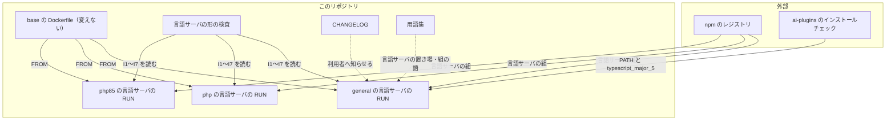
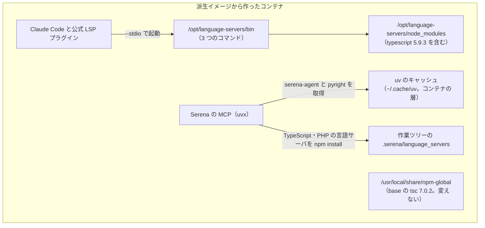
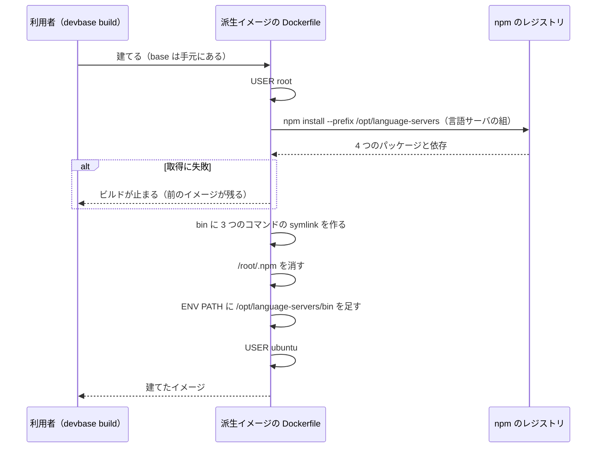
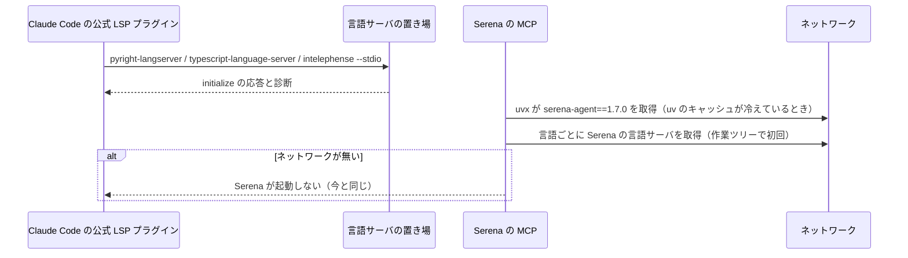

# 派生イメージ: コンテナに入っても Python・TypeScript・PHP の言語サーバが無く、Claude Code の診断が届かない → general・php・php85 の派生イメージに言語サーバを入れ、入った時点で診断が使える（#236）

## 目的

- **何が壊れているか**: base とその派生イメージに言語サーバ（`pyright-langserver`・`typescript-language-server`・`intelephense`）が無い。base の `typescript` は 7.0.2 で `lib/tsserver.js` を持たず、`typescript-language-server` が要る 5 系も無い
- **誰が困るか**: コンテナの中で Claude Code の公式 LSP プラグインを使う利用者。プラグインを入れても言語サーバが見つからず、編集の後の診断が届かない。コンテナを作り直すたびに手で `npm i -g` し直すことになる
- **直すと何が成り立つか**: `general`・`php`・`php85` の派生イメージから作ったコンテナでは、入った時点で 3 つの言語サーバが PATH の上にあり、TypeScript 5 を解決する。base の Dockerfile は変わらず、`tsc` は base と同じ 7.0.2 のまま

## 適用範囲

- **働く範囲**: このリポジトリの `containers/general`・`containers/php`・`containers/php85` の Dockerfile と、その静的な検査（`tests/containers/`）、`CHANGELOG.md`。base（`containers/base/`）とほかの派生イメージは変えない。ai-plugins とプラグインのリポジトリ（`projects/*`）は変えない
- **プロジェクトごとに違うもの**: どの派生イメージを使うかは、各プロジェクトの `compose.yml` の dev サービスの `build.context` で受ける（今のまま）。言語サーバの有無を切り替える引数や環境変数は足さない
- **当たるモード**: `standard`

## あるべき姿の根拠

| 根拠 | 種類 | 何を示すか |
| --- | --- | --- |
| 「言語サーバは base ではなく派生イメージで入れる（P1 に当たらない形）。base の Dockerfile は変えない設計にする」 | 利用者の指示の原文（#236 の 2026-10-13 のコメントと起動指示） | 置き場は派生イメージで、base は変えない |
| 「base を重くしすぎず、重い道具は派生イメージに置く」 | 利用者の指示の原文（MVV 版 1 の Value 1） | 言語サーバの置き場は派生イメージ |
| 既存の `devbase-base:latest`（e10369aa02c4、arm64）の使い捨てのコンテナで、`/opt/language-servers` へ 4 つのパッケージ（`pyright@1.1.414`・`typescript-language-server@6.0.2`・`typescript@5.9.3`・`intelephense@1.18.5`）を root で入れると、`du -sbx /` が 2,948,038,543 → 3,095,975,297 バイト（増分 147,936,754 バイト） | 実測（この設計、2026-10-13、Docker Desktop の containerd のイメージストア） | 3 つの言語を 1 つのイメージに入れても、要求の上限 350,000,000 バイトに収まる |
| 同じコンテナで、3 つのコマンドがそれぞれ `--stdio` で LSP の `initialize` に `capabilities` を持つ応答を返した。`typescript-language-server` の実体から親をたどると `/opt/language-servers/node_modules/typescript`（5.9.3）に当たり、`lib/tsserver.js` があった。`tsc --version` は `Version 7.0.2` のまま | 実測（同上） | 専用の置き場の形で受け入れ条件 3・4・7 が成り立つ |
| 同じ形を `--user root` で `ENV NPM_CONFIG_PREFIX` が効いた状態で打っても、npm のグローバル領域（`/usr/local/share/npm-global`）の `typescript` は 7.0.2 のまま変わらず、`ubuntu` から置き場は書けなかった | 実測（同上） | `--prefix` の取り付けはグローバル領域に触れない |
| Serena 1.7.0（`serena-agent==1.7.0`）の `solidlsp` の実装: Python は `uvx --from pyright==1.1.403 pyright-langserver`、TypeScript は `typescript@5.9.3` と `typescript-language-server@5.1.3`、PHP は `intelephense@1.14.4` を、Serena の置き場（`language_servers/static`）へ自分で npm install する。PATH の上のコマンドは見ない（設定 `ls_path` を書いたときだけ上書きする） | 実測（使い捨てのコンテナで取得したパッケージのソース） | イメージに入れた言語サーバは Serena には使われない（未決 3 の答え） |
| ai-plugins の `docs/specifications/mcp-serena-language-servers.md` の決定 16: `SERENA_HOME` は `.serena`（cwd からの相対）で、worktree ごとに `.serena/language_servers/` を取得する | 外部の一次情報 | Serena が取る言語サーバの置き場は作業ツリーの下で、イメージの外 |
| 冷えた uv のキャッシュから `uvx --from serena-agent==1.7.0 serena --help` が 5 秒で終わった。温めた後の大きさは 130,841,053 バイト。`uv cache prune --ci` で 18,347,459 バイトに減るが、その後の `uvx --offline` は終了コード 1 | 実測（同上） | 温めるなら 131MB が要り、削って小さくする道は無い |

要求と受け入れ条件は #236 の本文にある（コピーは `issues/issue-236-requirements.md`）。この文書は「どう作るか」だけを扱う。
前提・受け入れ条件・ドメインイベント・未決の番号は、要求の番号をそのまま使う。

## ドメインモデル

### コンテキスト

| コンテキスト | 何の語が 1 つの意味に決まるか |
| --- | --- |
| イメージの継承（`image-lineage`） | 派生イメージ・言語サーバ・言語サーバの置き場・言語サーバの組・uv のキャッシュ |

この変更は `image-lineage` の中に収まる。base イメージ（`base-image`）の語は変えない。ai-plugins の mcp-serena（対応表・インストールチェック）とは**順応者**の関係で、派生イメージは ai-plugins のインストールチェックが求める形（PATH の上のコマンド・`typescript_major_5` のたどり方）にそのまま合わせ、翻訳の層を持たない。Serena の起動定義（`.mcp.json`）にも順応し、版の固定を写さない（決定 4）。

### 集約

この変更の集約は Dockerfile の命令の組である。持ち主は、その命令を書き換えてよい Dockerfile を指す。

| 集約 | 持ち主（書き換えてよいもの） | 根 | エンティティ | 値オブジェクト |
| --- | --- | --- | --- | --- |
| 派生イメージの言語サーバ | `containers/general/Dockerfile`・`containers/php/Dockerfile`・`containers/php85/Dockerfile` のそれぞれ | 言語サーバを入れる root の `RUN` | — | 言語サーバの組（パッケージ名と厳密な版の 4 組）・言語サーバの置き場のパス・PATH に出す 3 つのコマンド |
| base の npm のグローバル領域 | `containers/base/Dockerfile`（この変更では変えない） | base の `npm i -g` | — | `typescript` 7.0.2・`NPM_CONFIG_PREFIX` |

3 つの Dockerfile は同じ値（言語サーバの組・置き場・コマンド）を別々に持つ。3 つが同じ値であることは不変条件 I3 が守る。派生イメージの言語サーバは base の npm のグローバル領域を書き換えない（I4）。

### 不変条件

| # | 集約 | 条件 | 破れたときの扱い |
| --- | --- | --- | --- |
| I1 | 派生イメージの言語サーバ | 対象の 3 つの Dockerfile が、`npm install --prefix /opt/language-servers` で `pyright`・`typescript-language-server`・`typescript`・`intelephense` の 4 つを入れる | Dockerfile の形の検査が、欠けたイメージとパッケージの名前を挙げて落ちる |
| I2 | 派生イメージの言語サーバ | 4 つのパッケージの版がすべて厳密な版（`<名前>@<数字>.<数字>.<数字>`）で書かれ、`typescript` の版が `5.` で始まる | Dockerfile の形の検査が、範囲・`latest`・版の無い指定と 5 以外の `typescript` を挙げて落ちる |
| I3 | 派生イメージの言語サーバ | 3 つの Dockerfile の言語サーバの組（名前と版）が同じである | Dockerfile の形の検査が、食い違うイメージと版を挙げて落ちる |
| I4 | 派生イメージの言語サーバ | 言語サーバを入れる `RUN` は `npm i -g` / `npm install -g` を使わず、置き場の `bin` に置くのは 3 つのコマンド（`pyright-langserver`・`typescript-language-server`・`intelephense`）の symlink だけで、`tsc` を PATH に出さない | Dockerfile の形の検査が落ちる。建てたイメージの `tsc --version` が 7.0.2 でなくなる |
| I5 | 派生イメージの言語サーバ | `ENV PATH` が `/opt/language-servers/bin` を含む | Dockerfile の形の検査が落ちる。非対話のシェル（`docker exec`）でコマンドが見つからない |
| I6 | 派生イメージの言語サーバ | 対象の 3 つの Dockerfile に `UV_CACHE_DIR` と `serena-agent` が無い（決定 4 で (b) を選んだ） | Dockerfile の形の検査が落ちる |
| I7 | 派生イメージの言語サーバ | 言語サーバを入れる `RUN` は root で打ち、`USER ubuntu` を後に戻す。npm のキャッシュ（`/root/.npm`）を残さない | Dockerfile の形の検査が落ちる |
| I8 | base の npm のグローバル領域 | `containers/base/` の下は変わらない | 実装の Pull Request の `git diff main -- containers/base/` が空でない（受け入れ条件 1。検査ではなく差分で見る） |

### ドメインイベント

| # | イベント | 発生元 | 受け手 |
| --- | --- | --- | --- |
| E1 | 派生イメージを建てるときに言語サーバを入れた | 対象の 3 つの Dockerfile の root の `RUN` | 言語サーバの置き場。E3 で作るコンテナ |
| E3 | 派生イメージからコンテナを作って起動した | `devbase up`（利用者が打つ） | E4・E5 |
| E4 | Claude Code の公式 LSP プラグインが PATH の上の言語サーバを起動した | 利用者が `.py`・`.ts`・`.php` を開いて編集した | 言語サーバの置き場の 3 つのコマンド |
| E5 | Serena の MCP が `uvx --from serena-agent==1.7.0` で起動した | Claude Code / Codex | uv のキャッシュ（初回は取得。コンテナの層にあり、作り直すと消える） |
| E6 | Serena が言語サーバを使い始めた | Serena が言語のコードを初めて扱った | Serena の置き場（作業ツリーの `.serena/language_servers/`）。イメージの言語サーバは使わない |
| E7 | ai-plugins が `serena-agent` の版の固定を上げた | ai-plugins の配布 | E5 の取得（イメージは版を持たないため、揃える作業は生まれない） |

E2（Serena を建てるときに温める）は (a) のときのイベントで、(b) を選んだため起きない（決定 4）。欠番にした。

### 用語

| 用語 | 意味 | 用語集への反映 |
| --- | --- | --- |
| 言語サーバ | エディタや AI の道具へ、定義・参照・診断を Language Server Protocol で返すプログラム。#236 では `pyright-langserver`・`typescript-language-server`・`intelephense` を `general`・`php`・`php85` の派生イメージの言語サーバの置き場に置く | 意味の変更（`image-lineage`。置くイメージを名指す） |
| 言語サーバの置き場 | 派生イメージが言語サーバとその依存（`typescript` 5 を含む）を入れる `/opt/language-servers`。持ち主は root で利用者は書けない。PATH に出すのは `bin` の 3 つのコマンドだけ | 追加（`image-lineage`） |
| 言語サーバの組 | 言語サーバの置き場へ入れる npm のパッケージの名前と厳密な版の 4 組。対象の派生イメージのすべてで同じ | 追加（`image-lineage`） |
| uv のキャッシュ | uv / uvx が取得したパッケージと作った環境を置く場所。置き場は `UV_CACHE_DIR`、既定は `~/.cache/uv`。base の片付けが消し、コンテナの層にあるため作り直しでも消える。#236 では派生イメージで温めない | 意味の変更（`image-lineage`。作り直しで消えることと、温めないことを足す） |

## 機能一覧

| # | 機能 | 誰が使うか |
| --- | --- | --- |
| F1 | `general`・`php`・`php85` の派生イメージから作ったコンテナで、Python・TypeScript・PHP の言語サーバが PATH の上にあり、`--stdio` で起動できる | コンテナの中で Claude Code の公式 LSP プラグインを使う利用者 |
| F2 | 同じコンテナで、`typescript-language-server` が TypeScript 5 を解決し、ai-plugins のインストールチェックが本体と TypeScript の版の欠けを出さない | 同上。`/mcp-serena:language-servers` を打つ利用者 |
| F3 | 同じコンテナの `tsc` は base と同じ 7.0.2 のままで、利用者の `npm i -g` の領域も変わらない | TypeScript を `tsc` で建てる利用者・道具 |
| F4 | 言語サーバの版はイメージで固定され、3 つの派生イメージで揃う | devbase の保守者 |

## 構成要素

型（クラス）は持たない。Dockerfile の命令と静的な検査だけで構成する。

| 要素 | 置き場所 | 責務 |
| --- | --- | --- |
| general の言語サーバの `RUN` | `containers/general/Dockerfile` | `USER root` で言語サーバの組を置き場へ入れ、3 つのコマンドの symlink を `bin` に作り、npm のキャッシュを消す。`ENV PATH` に置き場の `bin` を足し、`USER ubuntu` へ戻す |
| php の言語サーバの `RUN` | `containers/php/Dockerfile` | 同上。既存の root の区画（Composer の `COPY` の後、`USER ubuntu` の前）に置く |
| php85 の言語サーバの `RUN` | `containers/php85/Dockerfile` | 同上 |
| 言語サーバの形の検査 | `tests/containers/test_language_servers_dockerfile.py`（新設） | I1〜I7 を Docker 無しで縛る。対象の 3 つのイメージの名前を検査の中に持つ。`dockerfile_parse.parse` を使う |
| CHANGELOG | `CHANGELOG.md` の `[Unreleased]` | 3 つの派生イメージに言語サーバが入ったこと、増える大きさ、建て直しで届くこと、Serena は今のまま初回に取得すること |
| 用語集 | `docs/glossary/glossary.json`・`docs/glossary.md` | 用語の表の反映（`glossary.py render` で作り直す） |



配置（どこで動くか）:



Serena はイメージの言語サーバを使わない。配置の図で `SE` から `BIN` への線が無いのはそのためである（決定 4）。

置き場所（変える範囲）:

```text
containers/
├── general/Dockerfile        # 言語サーバの RUN と ENV PATH を足す
├── php/Dockerfile            # 同上
└── php85/Dockerfile          # 同上
tests/containers/
└── test_language_servers_dockerfile.py   # 新設
CHANGELOG.md
docs/glossary/glossary.json
docs/glossary.md
```

## 処理の流れ

派生イメージを建てるとき（E1）:



コンテナの中で使うとき（E3〜E6）:



## 非機能の実現方式

| 大項目 | 要求の条件 | 実現方式 | 確かめ方 |
| --- | --- | --- | --- |
| 性能・拡張性 | 1 つの派生イメージで増える展開後の大きさは 350,000,000 バイト以下（受け入れ条件 12） | 言語サーバの組だけを置き場へ入れ、`--omit=dev` で開発用の依存を外し、npm のキャッシュを消す。uv のキャッシュは温めない（決定 4）。見込みは 147,936,754 バイト | 実装の Pull Request で、3 つのイメージから作ったコンテナの `du -sbx /` を変更の前と後で測り、端末（アーキテクチャ）とイメージストアを書く |
| 運用・保守性 | 言語サーバの版は厳密に固定し、検査で止める（受け入れ条件 6） | 4 つのパッケージを `@<数字>.<数字>.<数字>` で書き、3 つの Dockerfile で同じ組にする。置き場の持ち主は root で、利用者の `npm` では上がらない | 言語サーバの形の検査（I2・I3）と全体の pytest |
| システム環境 | arm64 と amd64 の両方で受け入れ条件 2〜5 が通る | 4 つのパッケージは JavaScript だけで、アーキテクチャごとの取得物を持たない。Node は base のものを使う | arm64 はマージ前の手動確認、amd64 はリリース後テスト |

要求の運用・保守性の「ai-plugins が `serena-agent` の固定を上げたときの揃え方」（未決 2）は、イメージが版を持たないため揃える作業が生まれない（決定 4）。

## 決定の記録

### 決定 1: どのプロジェクトのコードでも同じ診断が使えるよう、general・php・php85 の 3 つに 3 つの言語をすべて入れる

`general` は、この端末で dev サービスを建てる 37 のプロジェクトのうち 24 が使う汎用の派生イメージで、コードはプロジェクトのボリュームの中にあるため、どの言語が書かれているかを手元から数えられない（未確認のまま残ること）。PHP のプロジェクトは画面の側に TypeScript・JavaScript を持つことが多い。3 つの言語を入れても増分は 147,936,754 バイトで上限の半分に収まり、組を 1 つにすれば 3 つの Dockerfile を同じ検査（I3）で揃えられる。

前提 3 の最小の組（`general` に Python と TypeScript、`php`・`php85` に PHP）だけにする形は採らなかった。イメージごとに組が違うと、言語の欠けが利用者の選んだイメージで変わり、PHP のプロジェクトの TypeScript で診断が届かない。`latex`・`bi-tools`・`trygroup`・`browser`・`go` には入れない。`go` は前提 2 の外の言語を主にし、`latex` はコードを扱わず、`bi-tools`・`trygroup` は 1 つのプロジェクトのための派生イメージで、`browser` を使うプロジェクトはこの端末に無い。要るときは同じ `RUN` を写し、検査の対象の一覧に名前を足せば揃う。

根拠: Mission / Value 1（MVV 版 1）

### 決定 2: base の tsc と利用者の npm のグローバル領域を変えないため、言語サーバを専用の置き場 /opt/language-servers に入れ、3 つのコマンドだけを PATH に出す

`typescript-language-server` は TypeScript 5 を要るが、base の npm のグローバル領域の `typescript` は 7.0.2 である。`npm install --prefix /opt/language-servers` で 4 つのパッケージを入れると、`typescript-language-server` は同じ置き場の `typescript` 5.9.3 を解決し、ai-plugins の `typescript_major_5` のたどり方もそこに当たる（実測）。置き場の `bin` には 3 つのコマンドの symlink だけを置き、`ENV PATH` の先頭へ足す。`node_modules/.bin` を PATH に出さないので、置き場の `tsc`・`tsserver` は見えず、`tsc` は base の 7.0.2 のまま（受け入れ条件 7。CHANGELOG に `tsc` の版の変化は書かない）。

グローバル領域へ `npm i -g typescript@5 ...` で入れる形は採らなかった。派生イメージの `tsc` が 5 へ下がり、利用者や Codex の自動の更新が同じ領域の `typescript` を上げると TypeScript 5 の解決が黙って崩れる。`node_modules/.bin` を PATH の末尾へ足す形も採らなかった。`tsc` がどちらに当たるかが PATH の並びだけで決まり、並びを変える変更で崩れる。

根拠: Value 1（MVV 版 1）

### 決定 3: 版の固定を利用者の更新で崩さないため、置き場は root の RUN で作り、利用者は書けない形にする

言語サーバを入れる `RUN` は root で打ち、置き場の持ち主は root、`ubuntu` は読みと実行だけができる（実測で `test -w` が偽）。版を上げるのはイメージの Dockerfile の変更だけで、検査（I2・I3）がその版を縛る。

`bi-tools`・`trygroup` の書き方（`USER ubuntu` で `npm i -g` し、`ubuntu:npm` の領域に置く）に合わせる形は採らなかった。あの領域は利用者が更新するための場所で、版を固定する言語サーバを置くと、固定した版と動いている版が食い違っても検査で気づけない。

根拠: Value 1（MVV 版 1）

### 決定 4: イメージと ai-plugins の版の固定を結び付けないため、Serena の uv のキャッシュは温めず (b) を採る。Serena の初回の起動にはネットワークが要る

Serena 1.7.0 は PATH の上の言語サーバを使わない。Python は `uvx --from pyright==1.1.403` で、TypeScript と PHP は作業ツリーの `.serena/language_servers/` へ npm install して、自分の固定した版を取得する（あるべき姿の根拠の実測と ai-plugins の決定 16）。このため `serena-agent` だけを温めても、Serena が言語を扱い始める時点でネットワークが要ることは変わらない。温めるには 1 つのイメージにつき 130,841,053 バイトが要り（`prune --ci` で削るとオフラインの起動が壊れる）、ai-plugins が版の固定を上げるたびに温めたキャッシュは外れて重さだけが残る（E7）。冷えた状態からの取得は 5 秒で終わった。

**(b) では、Serena の MCP の初回の起動（コンテナを作り直した後の最初の起動を含む）にネットワークが要る。** これは今の base と同じ振る舞いで、この変更で悪くならない。派生イメージには `UV_CACHE_DIR` も `serena-agent` も足さない（I6、受け入れ条件 11）。

(a)（`UV_CACHE_DIR` を `~/.cache` の外に置いて `serena-agent==1.7.0` を温める）は採らなかった。得られるのは `serena-agent` の取得の 5 秒とオフラインでの MCP の起動だけで、言語を扱う時点の取得は残る。代わりに、版を ai-plugins と揃え続ける作業と、`uv` を使うすべての処理のキャッシュの置き場が変わる影響を負う。Serena に `ls_path` でイメージの言語サーバを使わせる形も採らなかった。設定は作業ツリーの `.serena/` にあり、ai-plugins の領分である（対象範囲の「含まない」）。

根拠: Value 1 / Value 3（MVV 版 1）

### 決定 5: 3 つの Dockerfile の言語サーバの組を揃えるため、同じ RUN を各 Dockerfile に書き、検査で同じ組であることを縛る

派生イメージは `containers/<名前>/` をビルドの文脈にして建つ（各プロジェクトの `compose.yml` の `build.context`）。文脈の外のファイルは `COPY` できないため、共通の取り付けのスクリプトを 1 つ置く形は、プロジェクトの `compose.yml` の文脈を変えないと成り立たない。各 Dockerfile に同じ `RUN` を書き、言語サーバの形の検査が 3 つの組（名前と版）の一致を縛る（I3）。

共通のスクリプトを `containers/` の下に置いて文脈を広げる形は採らなかった。プラグインのリポジトリの `compose.yml` を変えることになり、対象範囲の外である。`ARG` で版を外から渡す形も、渡す側が各プロジェクトの `compose.yml` になり同じ理由で採らなかった。

根拠: Value 1（MVV 版 1）

### 決定 6: 受け入れ条件 2・3 の手動確認は、entrypoint を bash に替えて打つ

派生イメージは base の entrypoint を継ぎ、entrypoint は `DEVBASE_ACCOUNT_GROUP` が無いと止まる（`docker run --rm devbase-base:latest bash -c ...` で実測）。受け入れ条件 2・3 の `docker run --rm <イメージ> bash -c '...'` は `--entrypoint bash` を付けて `-c '...'` を渡す形で打つ。`ENV PATH` は entrypoint に依らず効くため、「ログインシェルでない非対話のシェルで見える」という条件の意図は変わらない。`devbase up` で起動したコンテナでは確かめない（P3、AGENTS.md の落とし穴）。

entrypoint へ `DEVBASE_ACCOUNT_GROUP` を渡して通す形は採らなかった。entrypoint がボリュームや機密の用意へ進み、実の環境に触れ得る。

根拠: P3 / Value 3（MVV 版 1）

## テスト設計

| 受け入れ条件・不変条件 | どの振る舞いで縛るか | どう壊したら落ちるべきか |
| --- | --- | --- |
| 受け入れ条件 1・I8 | 実装の Pull Request の `git diff main -- containers/base/` が空 | `containers/base/` の何かを変えると差分に出る（検査ではなく完了判定で見る） |
| I1 | 3 つの Dockerfile のそれぞれに、`npm install --prefix /opt/language-servers` で 4 つのパッケージを入れる `RUN` がある | 1 つのイメージから `intelephense` を外す、`--prefix` を別の置き場にすると落ちる |
| I2・受け入れ条件 6 | 4 つのパッケージの版が `<名前>@<数字>.<数字>.<数字>` で、`typescript` が `5.` で始まる | `typescript@^5`・`pyright@latest`・版の無い `intelephense`・`typescript@7.0.2` のどれでも落ちる |
| I3 | 3 つの Dockerfile の言語サーバの組が同じ | 1 つのイメージだけ `pyright` の版を上げると落ちる |
| I4・受け入れ条件 7 | 言語サーバの `RUN` に `npm i -g` / `npm install -g` が無く、`bin` へ張る symlink が 3 つのコマンドだけ。建てたイメージの `tsc --version` が `Version 7.0.2` | `-g` で入れる、`node_modules/.bin` を丸ごと PATH に出す、`tsc` の symlink を足すと落ちる（建てたイメージの版は手動確認） |
| I5・受け入れ条件 2 | `ENV PATH` が `/opt/language-servers/bin` を含む。建てたイメージで `--entrypoint bash` の `command -v` が 3 つのパスを返す（決定 6） | `ENV PATH` の行を消すと落ちる（建てたイメージは手動確認） |
| I6・受け入れ条件 11 | 3 つの Dockerfile に `UV_CACHE_DIR` と `serena-agent` が無い | `ENV UV_CACHE_DIR=...` か `uvx --from serena-agent==...` を足すと落ちる |
| I7 | 言語サーバの `RUN` が `USER root` の区画にあり、その後に `USER ubuntu` があり、`RUN` が `/root/.npm` を消す | `USER ubuntu` の戻しを消す、`rm -rf /root/.npm` を消すと落ちる |
| 受け入れ条件 3 | 建てたイメージで 3 つのコマンドを `--stdio` で起動し `initialize` を送ると、`result.capabilities` を持つ応答が 30 秒以内に返る | 手動確認（マージ前）。言語サーバの依存が欠けると応答が返らない |
| 受け入れ条件 4 | 建てたイメージで `typescript-language-server` の実体の親をたどった最初の `node_modules/typescript/package.json` が `5.` で始まり、`lib/tsserver.js` がある | 手動確認。グローバル領域に入れる形へ戻すと 7.0.2 に当たる |
| 受け入れ条件 5 | 建てたイメージで ai-plugins の `check`（Claude Code）が 3 つの言語の `binary` と `typescript_major_5` を出さない | 手動確認 |
| 受け入れ条件 8・9・10 | (a) を選ばなかったため対象外（決定 4） | — |
| 受け入れ条件 12 | 3 つのイメージの展開後の大きさを前と後で測り、増分が 350,000,000 バイト以下 | 手動確認。結果は実装の Pull Request の本文 |
| 受け入れ条件 13 | 実装の Pull Request の `git diff main -- containers/{latex,bi-tools,trygroup,browser,go}/` が空 | 完了判定で見る |

手動確認（マージ前）は、手元の `devbase-base:latest` の上に 3 つの派生イメージを作業用のタグで建て、`docker run --rm --entrypoint bash` で打つ。base は建てない。`devbase up` は打たない。`php`・`php85` は `composer:latest` の取得がキーチェーンで止まり得る（AGENTS.md の落とし穴）。建てられなければ「判断が要る」で返す。作業用のタグは記録を書いたら消す。

## 設計の結果

| 課題 | 扱い | 取り込み先 | 触るファイル |
| --- | --- | --- | --- |
| #236 | 実装する | — | `containers/general/Dockerfile`、`containers/php/Dockerfile`、`containers/php85/Dockerfile`、`tests/containers/test_language_servers_dockerfile.py`、`CHANGELOG.md`、`docs/glossary/glossary.json`、`docs/glossary.md` |

## 未確認のまま残ること

| 項目 | 内容 |
| --- | --- |
| `general` を使うプロジェクトの言語 | コードがプロジェクトのボリュームの中にあり、手元から言語の分布を数えなかった（ボリュームを写さないため）。決定 1 は分布に依らず 3 つを入れる |
| 各プロジェクトが別のタグで建てる重さ | 各プロジェクトの `compose.yml` は自分の名前のタグで `containers/general/` などを建てる。ビルドのキャッシュに当たれば層は共有されるが、キャッシュ無しで建て直すとプロジェクトごとに約 148MB の層が別に残り得る。実装の手動確認で、2 つ目のタグの建てがキャッシュに当たるかを見る |
| php・php85 での増分 | 実測は base の上だけで行った。`php`・`php85` の上でも Node は base のものを使うため同じ増分を見込むが、実装の Pull Request で測る（受け入れ条件 12） |
| amd64 | 4 つのパッケージは JavaScript だけだが、amd64 では建てていない。リリース後テストで受け入れ条件 2〜5 を確かめる |
| Serena の MCP の起動の待ち | (b) では冷えたコンテナの最初の起動で `serena-agent` を取得する。この端末で 5 秒だったが、遅い回線で Claude Code の MCP の起動の待ちを超えるかは測っていない。今の base と同じ振る舞いで、この変更では悪くならない |
| 公式 LSP プラグインの診断 | コンテナの中で `.py` を編集して診断が届くことは、リリース後テストで利用者のコンテナで見る |
