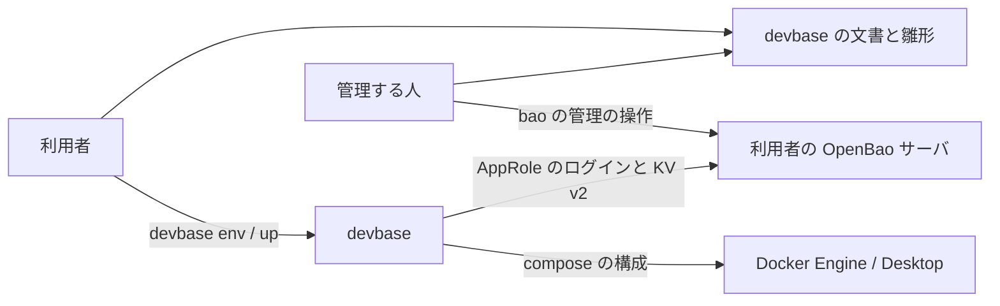
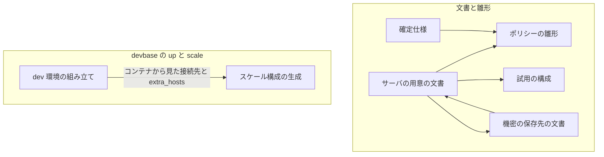
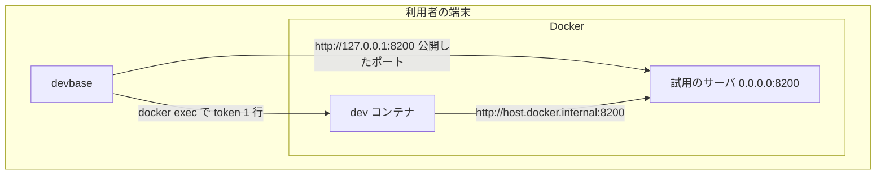
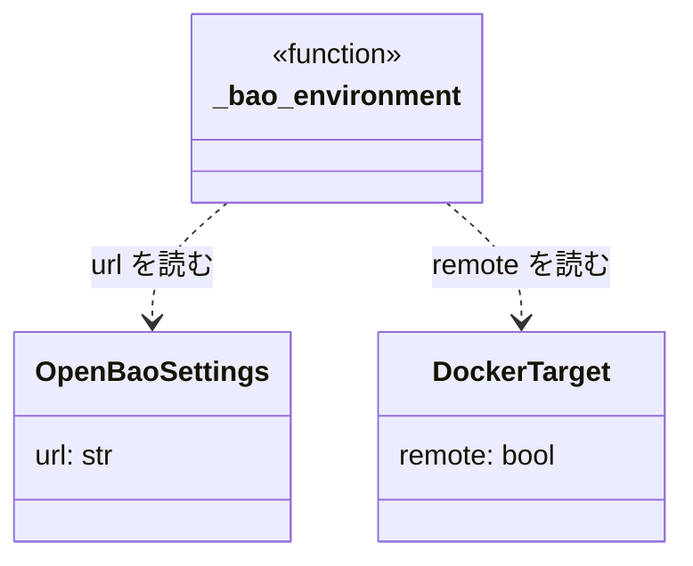
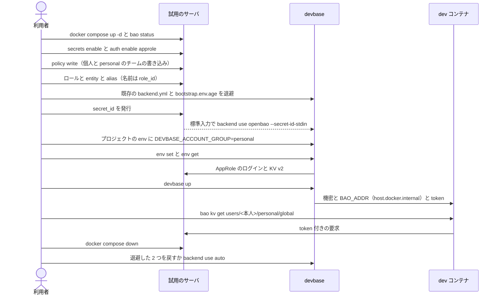
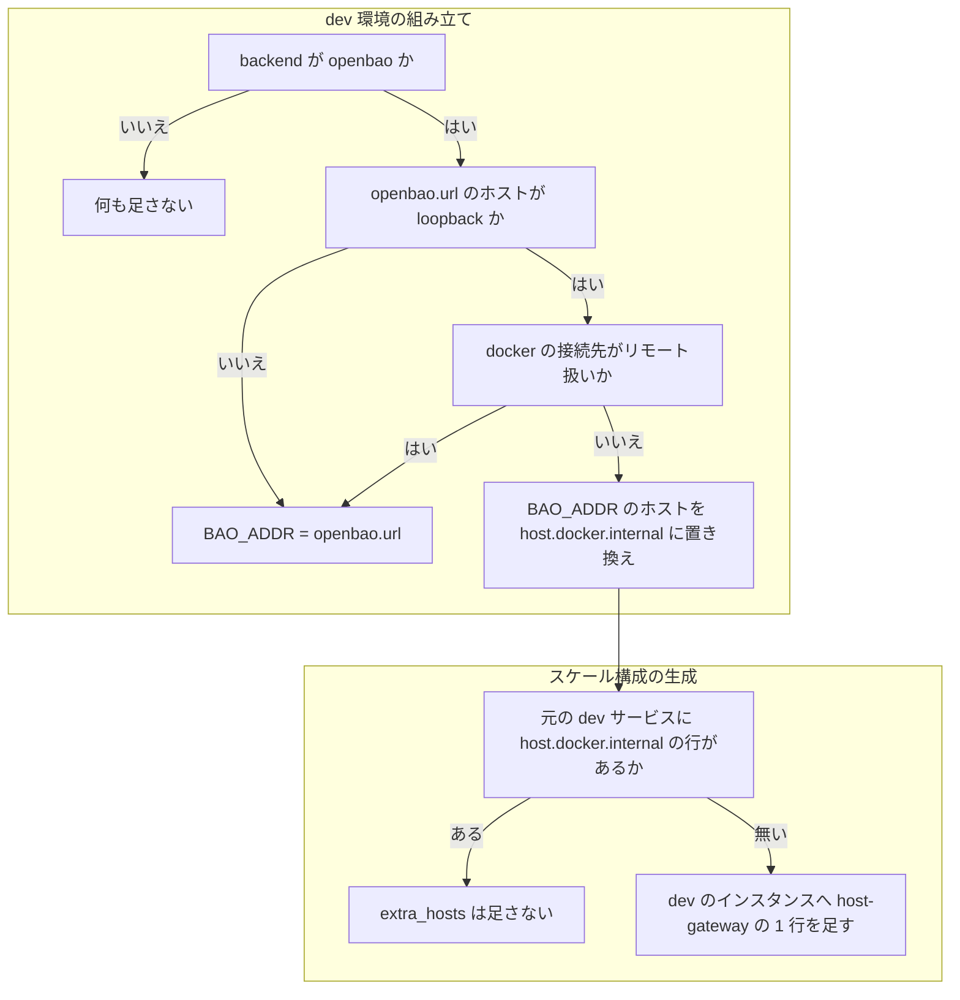

# OpenBao backend: 管理者のいない個人やチームは、サーバの立て方も devbase が前提にする権限も分からず使えない → 公開の文書とポリシーの雛形だけで自分のサーバを立てて接続でき、手元のサーバでもコンテナの中の `bao` が届く（#295）

## 目的

- **何が壊れているか**: 利用者向けの文書と確定仕様が、ある組織の運用するサーバと非公開の運用の決まりを前提にしている。サーバの用意の手順も、devbase が前提にするポリシーも公開されていない。手元のサーバ（`http://127.0.0.1:8200`）では、コンテナへ渡す `BAO_ADDR` がコンテナ自身を指し、コンテナの中の `bao` が届かない
- **誰が困るか**: 管理者のいない個人と小さなチーム。既存のサーバへ接続している利用者は困っていない
- **直すと何が成り立つか**: 公開の文書と雛形だけで、試用の構成か自分のサーバを立て、`devbase env backend use openbao` から `devbase up` の機密の読み込みまで通せる。手元のサーバでも、dev コンテナの中の `bao kv get` が本人の置き場を読める

## 適用範囲

- **働く範囲**: このリポジトリの利用者向けの文書・確定仕様・ポリシーの雛形・試用の構成と、`devbase up` / `devbase scale` が組む dev コンテナの構成（`BAO_ADDR` と `extra_hosts`）。プラグインのリポジトリは変えない
- **プロジェクトごとに違うもの**: 無し（接続先は端末ごとの `secrets/backend.yml`、グループは今どおりプロジェクトの `env` の宣言で受ける）
- **当たるモード**: `standard`

## あるべき姿の根拠

| 根拠 | 種類 | 何を示すか |
| --- | --- | --- |
| 「OSS として多くの人が利用する場合は、利用者が個人・チームでそれぞれのサーバを立てる前提での運用が必要」（2026-09-26） | 利用者の指示の原文 | 文書と雛形をセルフホストの前提に揃える |
| 「個人の形も `version: 2` にそろえ、宣言するアカウントグループの名前は `personal` にする」「認証は AppRole だけにする」（2026-10-11） | 利用者の指示の原文 | 個人の形の既定と、token の認証を足さないこと |
| OpenBao 2.6.2 の開発モードのサーバで、決定 6・7 のポリシーを書き込み、`member01`・`member02` の 2 人で読み書きを打った（2026-10-12、macOS の Docker Desktop の端末） | 実測 | 他人の個人の置き場の読み取りが 403（`version: 1` / `2` とも）、権限の無い者のチーム共通への書き込みが 403、`version: 2` で別のグループの `team/<group>/` の読み取りが 403、`users/` 直下の一覧が 403、本人の置き場の未作成のパスが 404、`cas: 0` の書き込みが 200。`secret_id` を accessor で失効させると、その `secret_id` のログインが 400、同じ利用者の別の `secret_id` は通る |
| 同じ端末で、ホストの loopback（`127.0.0.1:18200`）で待つサーバへ、base イメージ（`devbase-base:latest`）のコンテナから `bao status` を打った | 実測 | `BAO_ADDR=http://127.0.0.1:18200` は届かない。`http://host.docker.internal:18200` は、`--add-host host.docker.internal:host-gateway` の有無によらず届く |
| 同じ端末で、公式イメージ `openbao/openbao:2.6.2` を compose の 1 ファイルで開発モードに起動した | 実測 | `docker compose exec openbao bao …` が、root token を画面に出さずに管理の操作を通す（開発モードのサーバがコンテナの中の `~/.vault-token` へ root token を書く）。ホストへ `127.0.0.1` だけで公開したポートへ、別のコンテナから `host.docker.internal` で届く |
| [OpenBao: AppRole auth](https://openbao.org/docs/auth/approle/) / [Identity](https://openbao.org/docs/concepts/identity/) / [Policies](https://openbao.org/docs/concepts/policies/) | 外部の一次情報 | AppRole の entity alias の名前は `role_id` である。ポリシーの `{{identity.entity.name}}` で本人のパスを絞れる |

要求と受け入れ条件は #295 の本文にある（コピーは `issues/issue-295-requirements.md`）。この文書は「どう作るか」だけを扱う。

## ドメインモデル

### コンテキスト

| コンテキスト | 何の語が 1 つの意味に決まるか |
| --- | --- |
| 機密の置き場（`secret`） | 利用の形・ポリシーの雛形・試用の構成・利用者の識別子・コンテナから見た接続先 |
| docker の接続先（`docker-context`） | ローカル扱い・リモート扱い |

機密の置き場が docker の接続先に順応する（順応者）。コンテナから見た接続先は、docker の接続先が決めた「ローカル扱いかどうか」をそのまま受け取り、自分では判定しない。

### 集約

| 集約 | 持ち主（書き換えてよいもの） | 根 | エンティティ | 値オブジェクト |
| --- | --- | --- | --- | --- |
| ポリシーの雛形 | `docs/user/openbao/policies/` のファイル | 雛形の組 | 個人の雛形・チームの読み取りの雛形・チームの書き込みの雛形（`version: 1` / `2`） | パスの規則・許す操作（capabilities）・グループの置き換え語 `__GROUP__` |
| 試用の構成 | `docs/user/openbao/compose.yml` | 試用のサーバ | — | OpenBao の版・公開するポート |
| dev コンテナの接続先 | dev 環境の組み立て（`commands/container.py` の `_bao_environment`） | dev サービスへ足す設定 | — | コンテナから見た接続先・`extra_hosts` の 1 行 |

サーバの上の権限の構成（マウント・AppRole・entity・alias・ロール・`secret_id`）は利用者のサーバの持ち物で、devbase は持たない。文書は管理する人が打つ手順を示すだけで、devbase のコードはサーバの構成を書き換えない（前提 5）。

### 不変条件

| # | 集約 | 条件 | 破れたときの扱い |
| --- | --- | --- | --- |
| I1 | ポリシーの雛形 | 個人の雛形は、本人（`{{identity.entity.name}}`）の `users/<本人>/` の下だけを読み書きさせる。他人の `users/<名前>/` と `users/` 直下の一覧は許さない | 他人の置き場の読み取りが通る → 実機の確認（受け入れ条件 14）で落ちる |
| I2 | ポリシーの雛形 | チームの読み取りの雛形は読み取りだけを許す。チーム共通へ書けるのは、書き込みの雛形を付けた者だけ | 書き込みの雛形の無い者の書き込みが通る → 受け入れ条件 14 で落ちる |
| I3 | ポリシーの雛形 | `version: 2` の雛形は、`__GROUP__` を置き換えたグループの `team/<group>/` の下だけに効く | 別のグループの `team/` が読める → 受け入れ条件 14 で落ちる |
| I4 | ポリシーの雛形 | どの雛形も `sys/` と `auth/` と `identity/` の経路を含まず、KV v2 のマウント `devbase` の `data/` と `metadata/` の下だけを書く。特定の組織の名前を含まない | 雛形の検査（テスト設計）で落ちる |
| I5 | 試用の構成 | OpenBao の版は `compose.yml` の `image` の 1 行だけにあり、base イメージの `BAO_VERSION` と同じ 2.6 系である | 雛形の検査で落ちる |
| I6 | 試用の構成 | サーバのポートはホストの loopback（`127.0.0.1`）にだけ公開する | 雛形の検査で落ちる |
| I7 | dev コンテナの接続先 | `openbao.url` のホストが loopback で、docker の接続先がローカル扱いのときだけ、コンテナから見た接続先のホストを `host.docker.internal` に置き換える。スキーム・ポートは保つ。それ以外は `openbao.url` のまま | pytest で落ちる |
| I8 | dev コンテナの接続先 | 置き換えたときだけ、dev のインスタンスへ `host.docker.internal:host-gateway` の 1 行を足す。元の dev サービスが `host.docker.internal` の行を持っていれば足さない | pytest で落ちる |
| I9 | dev コンテナの接続先 | ホストの devbase が使う URL（`openbao.url`）・URL の検査・`secrets/backend.yml` の形は変わらない | pytest で落ちる（既存のテストが変わらず通る） |
| I10 | 試用の構成・文書 | 文書の例に実の token・`secret_id`・root token の値を書かず、`secret_id` をコマンド引数で渡す手順と、devbase の接続に root token を使う手順を書かない | 文書の検査（テスト設計）で落ちる |

### ドメインイベント

| # | イベント | 発生元 | 受け手 |
| --- | --- | --- | --- |
| E1 | 利用者が利用の形を選んだ | 利用者（サーバの用意の文書の冒頭の表） | 選んだ形の節 |
| E2 | 利用者が OpenBao サーバを起動した | 試用の構成の `docker compose up` か、利用者の自分のサーバ | E3 の手順 |
| E3 | 管理する人が KV v2 を既定の `devbase` にマウントした | `bao secrets enable` | E4 の手順 |
| E4 | 管理する人が AppRole を有効にし、雛形のポリシーを書き込んだ | `bao auth enable` / `bao policy write` | E5 の手順 |
| E5 | 管理する人が利用者の entity・alias・ロールを作った | `bao write identity/entity` ほか | E6 の手順 |
| E6 | 管理する人が端末の `secret_id` を発行した | `bao write … /secret-id` | E7（`--secret-id-stdin` へ直に渡す） |
| E7 | 利用者が `devbase env backend use openbao` で接続した | 利用者 | `secrets/backend.yml` / `secrets/bootstrap.env.age` |
| E8 | 利用者がプロジェクトで `DEVBASE_ACCOUNT_GROUP=personal` を宣言した | 利用者 | 機密のコマンドと `up` のグループの決定（今の振る舞い） |
| E9 | 利用者が `env set` / `env get` で機密を読み書きした | 利用者 | サーバ（ポリシーが通すか拒む） |
| E10 | `devbase up` がコンテナへ機密を入れた | `devbase up` | dev コンテナの環境変数と、コンテナから見た接続先（I7・I8） |
| E11 | コンテナの中の `bao` がサーバへ届いた | コンテナの中の利用者 | サーバ |
| E12 | 管理する人が端末の `secret_id` を失効させた | `bao write … /secret-id-accessor/destroy` | その端末の次のログイン（400 で止まる） |
| E13 | 利用者が試用の構成を片付けた | 利用者 | 試用のサーバ（消える）と、端末の backend の設定（元へ戻る） |

### 用語

| 用語 | 意味 | 用語集への反映 |
| --- | --- | --- |
| 利用の形 | OpenBao サーバの持ち方の 3 つの区分。個人の形・チームの形・既存のサーバの形 | 意味の変更（出所を確定仕様へ） |
| ポリシーの雛形 | devbase が前提にする権限を OpenBao のポリシー（HCL）として書いた、`docs/user/openbao/policies/` のファイル | 意味の変更（置き場と出所を確定する） |
| 試用の構成 | `docs/user/openbao/compose.yml` で開発モードの OpenBao を手元に立て、接続を試して片付けるまでの最小の構成 | 意味の変更（置き場と出所を確定する） |
| 利用者の識別子 | `secrets/backend.yml` の `openbao.user`。サーバの entity 名と同じ値にし、個人単位の置き場のパスに使う | 追加 |
| コンテナから見た接続先 | dev コンテナへ `BAO_ADDR` として渡す接続先。`openbao.url` が loopback でローカル扱いのときはホストを `host.docker.internal` に置き換えた値、それ以外は `openbao.url` のまま | 追加 |
| 管理する人 | 利用者のサーバで、マウント・AppRole・ポリシー・entity を作る人。個人の形では利用者本人 | 追加 |

## 機能一覧

| # | 機能 | 誰が使うか |
| --- | --- | --- |
| F1 | 利用の形の 3 つの違いと、形ごとに用意するものを読み、形を選ぶ | 利用者 |
| F2 | 試用の構成でサーバを手元に立て、接続を試し、片付ける | 個人の利用者 |
| F3 | サーバへ KV v2・AppRole・ポリシー・entity・alias・ロールを用意し、端末の `secret_id` を発行して接続する | 管理する人（個人の形では本人） |
| F4 | 利用者と端末を足し、チーム共通への書き込みを許し、端末 1 台の `secret_id` を失効させる | チームの管理する人 |
| F5 | ポリシーの雛形（`version: 1` / `2`）をサーバへ書き込む | 管理する人 |
| F6 | 既存のサーバへ、管理者から受け取った値で接続する | 既存のサーバの利用者 |
| F7 | 手元のサーバ（loopback の `openbao.url`）でも、dev コンテナの中の `bao` がサーバへ届く | 個人の利用者 |
| F8 | devbase がサーバに求める条件を確定仕様で読む | 管理する人・開発者 |

## 構成要素

| 要素 | 責務 | 機能 |
| --- | --- | --- |
| サーバの用意の文書（`docs/user/openbao-server.md`、新設） | 利用の形の 3 つを見出しで分け、形ごとの用意・試用の構成・管理の手順・片付けを示す | F1〜F6 |
| 機密の保存先の文書（`docs/user/env-backend.md`） | 接続する側の手順だけを持つ。「OpenBao 側で用意するもの」をサーバの用意の文書への案内と受け取る値の表に変え、管理者から受け取るのは既存のサーバの形だけにする。コンテナから見た接続先を書く | F1・F6・F7 |
| ポリシーの雛形（`docs/user/openbao/policies/`、新設） | 個人・チームの読み取り・チームの書き込みの権限を HCL で持つ | F5 |
| 試用の構成（`docs/user/openbao/compose.yml`、新設） | 開発モードの OpenBao を、版を 1 か所に書いて loopback にだけ公開して立てる | F2 |
| dev 環境の組み立て（`commands/container.py` の `_bao_environment`） | コンテナから見た接続先を決め、置き換えたかを返す | F7 |
| スケール構成の生成（`volume/compose.py`） | 受け取った `extra_hosts` の行を、元の行と重ねずに dev のインスタンスへ足す | F7 |
| 確定仕様（`docs/specifications/secret-backend.md`） | サーバに求める条件・雛形の置き場・利用者の識別子・コンテナから見た接続先を持つ。非公開のリポジトリへの参照を外す | F8 |
| 文書の目次（`docs/README.md`）と `CHANGELOG.md` | 新しい文書への入口と、利用者に見える変更の記入 | F1 |

文脈（外部との関係）:



OpenBao サーバと Docker は devbase が変えられない外部である。文書・雛形・試用の構成・`devbase` は同じ変更で変える内部である。

構成要素:



配置（手元のサーバ、ローカル扱い）:



境界をまたぐのは、ホストからサーバへの AppRole のログインと KV v2 の要求（`role_id` / `secret_id` / token）、ホストからコンテナへの 1 時間の token（今と同じ `~/.vault-token`）、コンテナからサーバへの token 付きの要求である。`secret_id` はホストから出ない（今と同じ）。

置き場所（新設は `+`、変更は `~`）:

```text
docs/
├── README.md                          ~ 新しい文書を目次に足す
├── specifications/secret-backend.md   ~ サーバに求める条件・コンテナから見た接続先
└── user/
    ├── env-backend.md                 ~ 接続する側だけにする
    ├── openbao-server.md              + サーバの用意（利用の形の 3 つ）
    └── openbao/
        ├── compose.yml                + 試用の構成
        └── policies/
            ├── devbase-user.hcl       + 個人の雛形（version 1 / 2 共通）
            ├── v1/team-read.hcl       +
            ├── v1/team-write.hcl      +
            ├── v2/team-read.hcl       + __GROUP__ を置き換えて使う
            └── v2/team-write.hcl      +
lib/devbase/
├── commands/container.py              ~ _bao_environment
└── volume/compose.py                  ~ extra_hosts を dev のインスタンスへ足す
tests/
├── commands/test_container_bao.py     ~
├── volume/                            ~ 生成のテスト（既存のファイルへ足す）
└── docs/test_openbao_templates.py     + 雛形と試用の構成の検査
CHANGELOG.md                           ~ [Unreleased]
```

## 構造

型は足さず、変えない。`_bao_environment` は `BAO_ADDR` を返す今の役目に、置き換えたときの `extra_hosts` の 1 行を返す役目を足し、スケール構成の生成がその行を dev のインスタンスへ足す（入出力の契約の表）。返し方の形は実装で決める。読む型は次の 2 つだけである。



## 入出力の契約

コンテナへ渡す設定（`devbase up` / `devbase scale` の dev のインスタンス）:

| `openbao.url` | docker の接続先 | `BAO_ADDR` | dev のインスタンスへ足す `extra_hosts` |
| --- | --- | --- | --- |
| `http://127.0.0.1:8200` | ローカル扱い | `http://host.docker.internal:8200` | `host.docker.internal:host-gateway` |
| `http://localhost:8200` / `http://[::1]:8200` | ローカル扱い | `http://host.docker.internal:8200` | 同上 |
| `http://localhost`（ポートなし） | ローカル扱い | `http://host.docker.internal` | 同上 |
| loopback のどれか | リモート扱い | `openbao.url` のまま | 足さない |
| `https://openbao.example.com` | どちらでも | `openbao.url` のまま | 足さない |
| backend が `openbao` でない | — | 渡さない（今と同じ） | 足さない |

- 元の dev サービスの `extra_hosts` は、リストの形（`"name:ip"`）と辞書の形（`name: ip`）の両方を受け、元の形を保って足す。`host.docker.internal` の行が既にあれば、どちらの形でも足さない（I8）
- コンテナから見た接続先は `up` のたびに組み直す。今動いているコンテナは、次の `up` で新しい `BAO_ADDR` になる
- `devbase env token` と `project post-start` が書く `~/.vault-token` は変えない

ポリシーの雛形と試用の構成の約束（文書が指すもの）:

| もの | 約束 |
| --- | --- |
| 雛形のファイル名 | 上の置き場所のツリーの 5 つ。書き込むポリシーの名前は文書が決める（個人 `devbase-user`、`version: 1` は `devbase-team-read` / `devbase-team-write`、`version: 2` は `devbase-team-read-<group>` / `devbase-team-write-<group>`） |
| 置き換え語 | `version: 2` の雛形の `__GROUP__` だけ。`sed 's/__GROUP__/personal/g'` の 1 回で使える形にする |
| マウント名 | 雛形は `devbase` を書く。ほかのマウント名を使う管理する人は、同じく `sed` で置き換える（文書に書く） |
| 試用の構成の名前 | compose のプロジェクト名 `devbase-openbao-trial`、サービス名 `openbao`、ホストのポート `127.0.0.1:8200` |

## 処理の流れ

試用の構成で個人の形を通す流れ（サーバの用意の文書の手順の順序）:



`devbase up` / `scale` でコンテナから見た接続先を決める流れ:



1 枚目は、サーバの用意の文書が並べる手順を、試用の構成・ポリシーの雛形・機密の保存先の文書（接続の手順）の順にたどる。確定仕様・文書の目次・`CHANGELOG.md` は処理に現れないため、どちらの図にも含めない。

## 非機能の実現方式

| 大項目 | 要求の条件 | 実現方式 | 確かめ方 |
| --- | --- | --- | --- |
| セキュリティ | ポリシーの雛形は、受け入れ条件 12 に並べた権限のほかを許さない（本人以外の個人の置き場・`sys/` の管理の経路を利用者のポリシーに含めない） | 雛形は `devbase/data/` と `devbase/metadata/` の下だけを書く。個人の雛形は `users/{{identity.entity.name}}/` の下に限り、チームの読み取りの雛形は `read` だけにする。利用者のロールの `token_policies` は `default` だけにし、雛形は entity へ付ける | 雛形の検査（パスの接頭辞と capabilities）と、実機の 2 人の読み書き（受け入れ条件 14） |
| セキュリティ | 文書の例に実の token・`secret_id`・root token の値を書かない。devbase の接続に root token を使う手順を示さない。`secret_id` をコマンド引数で渡す手順を示さない | 試用の構成は root token を決めず、管理の操作はサーバのコンテナの中の `bao`（開発モードが書いた `~/.vault-token`）で打つ。`secret_id` は発行のコマンドの出力を `devbase env backend use … --secret-id-stdin` へパイプで渡し、画面にも引数にも出さない | 文書の検査（`--secret-id ` の後に値を置く形・`root` の token の値・`BAO_TOKEN=` の値の無いこと）と、レビュー |
| 運用・保守性 | 雛形と試用の構成は OpenBao の版を 1 か所に書き、base イメージの `BAO_VERSION` と同じ 2.6 系に揃える | 版は `compose.yml` の `image: openbao/openbao:<版>` の 1 行だけに書き、文書は版を写さずその行を指す。雛形は版を持たない | 雛形の検査が、`image` の版と `containers/base/Dockerfile` の `ARG BAO_VERSION` の 2 つ目までの数字を比べる |
| システム環境 | 試用の構成は macOS の Docker Desktop と Linux の Docker の両方で動く手順を示す。片方でしか確かめていなければ、文書に確かめた環境を書く | 試用の構成は Docker と compose だけを使い、ホストに `bao` を求めない。コンテナの中の `bao` の到達は、Linux の Docker では、ホストの loopback にだけ公開したポートへ `host-gateway` から届かない見込みのため、文書に「確かめた環境」と「Linux の Docker での扱い」を分けて書く（未確認のまま残ること） | 実装で Linux の Docker の端末を使えれば試用の構成とコンテナの中の `bao` を打つ。使えなければ文書に確かめた環境（macOS の Docker Desktop）を書く |

## 決定の記録

### 決定 1: 雛形を文書から相対リンクで開けるようにするため、ポリシーの雛形と試用の構成を `docs/user/openbao/` に置く

雛形と試用の構成はサーバの側で使うもので、devbase の実行時には読まない。`install.sh` は `git clone` でリポジトリ全体を配るため、`docs/` に置いても利用者の `$DEVBASE_ROOT` に届き、手順は `$DEVBASE_ROOT/docs/user/openbao/…` を指せる。GitHub の上でも文書から相対リンクで開ける。

`etc/` は devbase が実行時に使う補完のファイルの置き場で、サーバへ書き込むファイルを混ぜると「devbase が読むもの」の境界が崩れるため採らない。

根拠: Mission / Value 1（MVV 版 1）

### 決定 2: 接続する側とサーバを用意する側の読み手を分けるため、サーバの用意を新しい文書 1 本にまとめ、利用の形の 3 つを見出しで分ける

`docs/user/openbao-server.md` を新しく置き、冒頭に利用の形の 3 つ（個人・チーム・既存のサーバ）の違いと用意するものの表、続けて形ごとの見出しを置く。個人とチームの手順は同じ管理のコマンドを共有し、チームの節は利用者と端末を足す・書き込みを許す・失効させる手順だけを足す。`env-backend.md`（619 行）は接続する側の手順に絞り、「OpenBao 側で用意するもの」はこの文書への案内と受け取る値の表にする。

形ごとに 3 本へ分けると、個人とチームで同じ管理のコマンドを 2 か所に写すことになる。`env-backend.md` へ足すと、接続する利用者がサーバの構築の手順を読み飛ばす分量になる。

根拠: Mission（MVV 版 1）

### 決定 3: 公開インタフェースを増やさないため、雛形を書き出す副命令を足さず、文書と雛形のファイルだけにする

雛形は `$DEVBASE_ROOT/docs/user/openbao/` に既にあり、管理する人は `bao policy write <名前> - < <ファイル>` で書き込める。副命令が代わりにできるのはファイルの写しだけで、サーバの構成は管理する人の `bao` が書く（前提 5）。

副命令を足すと、既存のサーバの形の利用者にも見えるコマンドが増え、雛形の版と devbase の版の組み合わせを持つことになる。

根拠: Mission / Value 1（MVV 版 1）

### 決定 4: 手元のサーバでもコンテナの中の `bao` を使えるようにするため、loopback の `openbao.url` はローカル扱いのときだけ、コンテナへ渡す `BAO_ADDR` のホストを `host.docker.internal` に置き換え、`host-gateway` の行を足す

コンテナの中の `127.0.0.1` はコンテナ自身を指し、loopback の `openbao.url` をそのまま渡すと届かない。Docker Desktop で `host.docker.internal` がホストの loopback のサーバへ届くことを実測した（あるべき姿の根拠）。`host-gateway` の行は Linux の Docker で `host.docker.internal` を引けるようにするためで、Docker Desktop でも行の有無によらず届いた。リモート扱いでは loopback がホストの端末を指し、コンテナのある端末から届かないため置き換えない。ホストの devbase の URL と検査は変えない（I9）。

文書で「コンテナの中では `export BAO_ADDR=…` を打つ」と案内する形は、シェルを開くたびに打つことになり、`devbase up` だけで使える今の形と揃わない。「使えない」と書く形は、試用の構成で dev コンテナの `bao` を確かめられない。

根拠: Mission / Vision（MVV 版 1）

### 決定 5: ホストに `bao` を入れずに試せるようにするため、試用の構成を compose の 1 ファイルにし、管理の操作をサーバのコンテナの中の `bao` で打つ

`openbao/openbao:<版>` を開発モードで起動し、ポートを `127.0.0.1:8200` にだけ公開する。管理の操作は `docker compose … exec -T openbao bao …` を包むシェル関数（文書では `bao_admin`）で打つ。開発モードのサーバがコンテナの中に root token を置くため、root token を画面にも文書にも出さずに済む。自分のサーバの節では同じ関数を `bao` の呼び出しに替えるだけで、以後の手順を共有する。

`bao server -dev` をホストで起動する形は、ホストへ `bao` を入れる手順と、root token を画面から写す手順が要る。`compose.yml` の `image` の 1 行に版を書けば、版を 1 か所に保てる（I5）。

根拠: Value 1 / Mission（MVV 版 1）

### 決定 6: 利用者ごとの権限を他の利用者の設定に触れずに変えられるようにするため、雛形のポリシーを利用者の entity へ直に付け、identity group を使わない

利用者 1 人につき、AppRole のロール（`token_policies=default`）・entity（名前は利用者の識別子、`policies` に雛形のポリシー）・entity alias（名前は `role_id`、AppRole のマウントの accessor）を作る。チーム共通への書き込みを許すのは、その利用者の entity の `policies` に書き込みのポリシーを足すことである。個人の形も同じ手順で、`personal` の書き込みのポリシーを付ける。

identity group で束ねると、メンバーの一覧を書き直す操作が他の利用者の権限を巻き込み、1 人を足すときに既存のメンバーを落とし得る。ロールの `token_policies` に付ける形でも権限は効くが、1 人の権限がロールと entity の 2 か所に分かれ、チーム共通への書き込みを誰に許したかを entity の一覧だけで読めなくなる。

根拠: Value 3（MVV 版 1）

### 決定 7: `version: 2` の雛形をグループ名の書き換えだけで使えるようにするため、グループごとのポリシーを置き換え語 `__GROUP__` から作る

OpenBao のポリシーのテンプレートは、entity の属するグループを列挙してパスへ入れる書き方を持たない。`team/__GROUP__/` を書いた雛形を `sed` で置き換え、`devbase-team-read-<group>` / `devbase-team-write-<group>` として書き込む。個人の雛形は `users/{{identity.entity.name}}/` の下を許すため、`version: 1` と `2` で 1 つを共有する。

entity の metadata にグループ名を持たせて `{{identity.entity.metadata.…}}` で組む形は、1 人が複数のグループに属せず、チームの形で 2 つのグループを持つ利用者を表せない。

根拠: Value 3（MVV 版 1）

### 決定 8: 試用で既存の接続設定を失わないため、試用の前に `secrets/backend.yml` と `secrets/bootstrap.env.age` を退避し、片付けで戻す

`devbase env backend use openbao` は 2 つのファイルを上書きする。既存のサーバの形の利用者が試用の構成を試すと、今の接続設定と資格情報を失う。片付けは、退避があれば戻し、無ければ `devbase env backend use auto` で設定なしへ戻して試用の `bootstrap.env.age` を消す。どちらも最後に `devbase env backend status` で OpenBao を指していないことを確かめる（受け入れ条件 7）。手元のキャッシュ（`secrets/cache/`）は、退避を戻すときは消さない（元の接続の控えが入っており、試用の控えは接続先と `role_id` の指紋が違うため元の接続では使われない）。`use auto` で戻すときは、控えが試用のものだけなので丸ごと消す。

試用を別の `DEVBASE_ROOT` で行う形は、作業用のプロジェクトとプラグインを別に用意することになり、数分で試せる構成にならない。

根拠: Value 2 / Value 3（MVV 版 1）

### 決定 9: 失効させる端末を `secret_id` の値を持たずに選べるようにするため、端末の名前を `secret_id` の metadata に入れて発行し、失効は accessor で行う

発行のときに `metadata='{"terminal":"<端末の名前>"}'` を付け、失効は `secret-id` の一覧（accessor）と `secret-id-accessor/lookup` で端末の名前を確かめてから `secret-id-accessor/destroy` で行う。管理する人は発行した `secret_id` の値を控えずに済む。

`secret_id` の値で失効させる形は、管理する人が全端末の `secret_id` を保管することになり、漏れたときの範囲が広がる。

根拠: Value 3（MVV 版 1）

## テスト設計

| 受け入れ条件・不変条件 | どの振る舞いで縛るか | どう壊したら落ちるべきか |
| --- | --- | --- |
| 受け入れ条件 1 | サーバの用意の文書に、個人・チーム・既存のサーバの 3 つの見出しと、形ごとに用意するものの表がある（レビュー） | 見出しを 2 つにまとめると落ちる |
| 受け入れ条件 2 | 個人とチームの手順が、マウント・AppRole・ポリシーの書き込み・entity と alias・ロール・`secret_id` を `bao` のコマンドで順に並べ、実機で上から打って通る（手動確認） | entity の名前を利用者の識別子（`--user`）と違えて作ると、本人の置き場が 403 になって打鍵で止まる |
| 受け入れ条件 3 | チームの節の、利用者と端末を足す・失効させる手順が実機で通る（手動確認。受け入れ条件 15 と同じ打鍵） | accessor の取り違えで別の端末が失効すると落ちる |
| 受け入れ条件 4・I4・I5・I6 | 雛形と試用の構成の検査（pytest）: 5 つの雛形がある、どの `path` も `devbase/data/` か `devbase/metadata/` で始まる、`sys/` `auth/` `identity/` を含まない、`compose.yml` の版が `BAO_VERSION` と 2 つ目まで同じ、ポートが `127.0.0.1:` で始まる。`bao policy write` で拒まれないことは実機（手動確認） | `path "sys/*"` を足す、`image` の版を 2.5 にする、ポートを `8200:8200` にすると落ちる |
| 受け入れ条件 5・I3 | `version: 2` の雛形の `__GROUP__` を `personal` に置き換えると、`team/personal/` の下だけを指す（pytest）。組織の名前が無いことは固有の語の検査 | `team/*` を書くと落ちる |
| 受け入れ条件 6・7 | 試用の構成の起動・確かめ（`bao status`）・片付けの後の `devbase env backend status` が OpenBao を指さないことを、作業用の端末で通す（手動確認） | 片付けで退避を戻し忘れると、`status` が試用の URL を指して落ちる |
| 受け入れ条件 8・I7・I8・I9 | `_bao_environment` と生成した構成（pytest）: 入出力の契約の表の各行、`extra_hosts` のリストと辞書の形、既にある `host.docker.internal` の行。実機ではコンテナの中の `bao kv get` が本人の個人共通を読める（手動確認） | 置き換えを常に行う・リモート扱いでも行う・`https` でも行う・行を重ねて足す・`openbao.url` 自体を書き換えると落ちる |
| 受け入れ条件 9・10・11 | `grep -rn '社内メールアドレス\|運用側のリポジトリ' docs/user docs/specifications/secret-backend.md` が 0 件。`env-backend.md` の「管理者から」が既存のサーバの形の記述だけにある（レビュー） | 語を 1 つ残すと grep が当たる |
| 受け入れ条件 12 | 確定仕様の「OpenBao との契約」に、サーバに求める条件の表と雛形の置き場がある（レビュー） | 条件の 1 つ（`users/` 直下の一覧の拒否など）を落とすとレビューで落ちる |
| 受け入れ条件 13 | 作業用のプロジェクトで、試用の構成から `env set` → `env get` → `devbase up` を通し、コンテナの環境変数に値がある（手動確認。非対話で base を建てられなければ「判断が要る」で返す） | 文書の手順のどこかが欠けると打鍵が止まる |
| 受け入れ条件 14・I1・I2 | `version: 2` と `version: 1` の雛形を書き込んだサーバで、`member01`・`member02` の読み書きが 403 / 通る の組になる（手動確認） | 個人の雛形の `{{identity.entity.name}}` を `*` にする、読み取りの雛形に `update` を足すと落ちる |
| 受け入れ条件 15 | `member02` の端末 A の `secret_id` を accessor で失効させると、A の `devbase env backend test` がログインの失敗で止まり、端末 B は通る（手動確認） | ロールごと消すと B も止まって落ちる |
| 受け入れ条件 16 | `https` の `openbao.url` で、生成した構成の `BAO_ADDR` と `extra_hosts` が今と同じ（pytest）。`env-backend.md` の接続の手順のコマンドと引数が変わらない（レビュー） | `https` の URL を書き換えると落ちる |
| 受け入れ条件 17・18 | `env -u DEVBASE_ROOT uv run --locked pytest tests/ -q` と、語の一覧のある端末での `proper_term_check.py` | — |
| I10 | 文書の検査（pytest）: サーバの用意の文書と `env-backend.md` に、`--secret-id` の後に値を置く形・`BAO_TOKEN=` に値を置く形・`root` の token の値が無い | 手順に `--secret-id xxxx` を書くと落ちる |

## 設計の結果

| 課題 | 扱い | 取り込み先 | 触るファイル |
| --- | --- | --- | --- |
| #295 | 実装する | — | `docs/user/openbao-server.md`、`docs/user/openbao/`、`docs/user/env-backend.md`、`docs/specifications/secret-backend.md`、`docs/README.md`、`docs/glossary/glossary.json`、`docs/glossary.md`、`lib/devbase/commands/container.py`、`lib/devbase/volume/compose.py`、`tests/commands/test_container_bao.py`、`tests/volume/`、`tests/docs/`、`CHANGELOG.md` |

確定仕様（`secret-backend.md`）で書き直す箇所は、393 行（グループのポリシーの持ち主）・922 行（利用者の識別子）・926-929 行（サーバ側の構成）・974 行（`bao` を入れる理由の「管理スクリプト」）・「コンテナの中の `bao`」の `BAO_ADDR` の行・1418-1420 行（運用の「範囲外」）・1652 行（関連リンク）と、「テスト観点」の手動確認の行である。`env-backend.md` は 36-47 行・133-134 行・「コンテナの中から `bao` を使う」の表・578 行の注釈・607 行を書き直す。

## 未確認のまま残ること

| 項目 | 内容 |
| --- | --- |
| Linux の Docker でのコンテナの中の `bao` | 試用の構成はポートをホストの `127.0.0.1` にだけ公開する。Linux の Docker では、コンテナから `host-gateway`（ブリッジのゲートウェイ）宛ての要求が、`127.0.0.1` にだけ公開したポートへ届かない見込みである。実装で Linux の Docker の端末を使えれば確かめ、届かなければ文書に「Linux の Docker では試用の構成でコンテナの中の `bao` は使えない。使うにはサーバをブリッジから届くアドレスでも待たせる」と書く。使えなければ確かめた環境（macOS の Docker Desktop）を文書に書く |
| `network_mode: host` の dev サービス | 手元のプラグインに `network_mode` を使う dev サービスは無い（`repos/*/` を探した。プラグインの中のプロジェクトのコードの compose は devbase が生成しない）。Linux でこの形の dev サービスでは loopback がそのまま届くが、置き換えで `host.docker.internal` 宛てになる。実装で `network_mode: host` の dev サービスには置き換えないかを、生成の側で判定できるか確かめる |
| 本番のサーバの構築 | 冗長化・バックアップ・監査ログ・TLS の証明書・seal の扱いは範囲外で、OpenBao の公式の文書へのリンクにとどめる。自分のサーバの節は、起動と初期化が済んだサーバを入口の前提にする |
| `secret_id` の受け渡しの経路 | チームの形で、管理する人が発行した `secret_id` を利用者へ渡す経路（応答の包み込み・対面など）は文書の範囲外とし、「安全な経路で渡す」とだけ書く |
