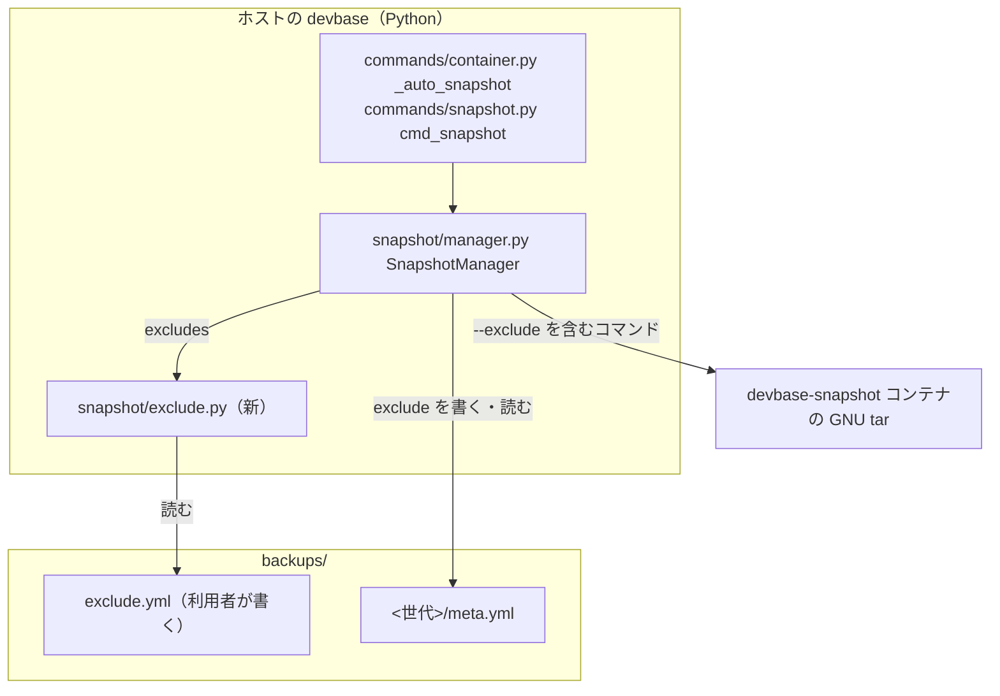
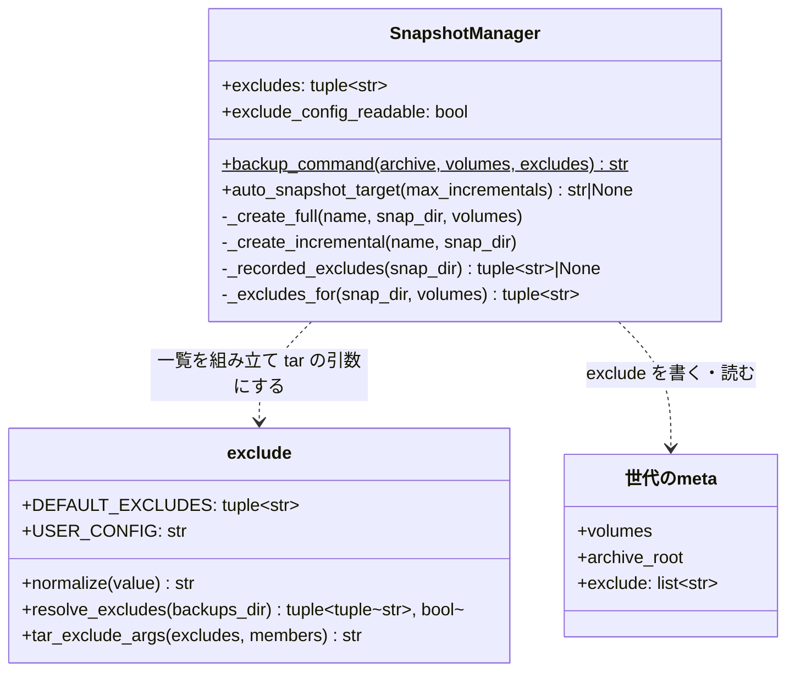
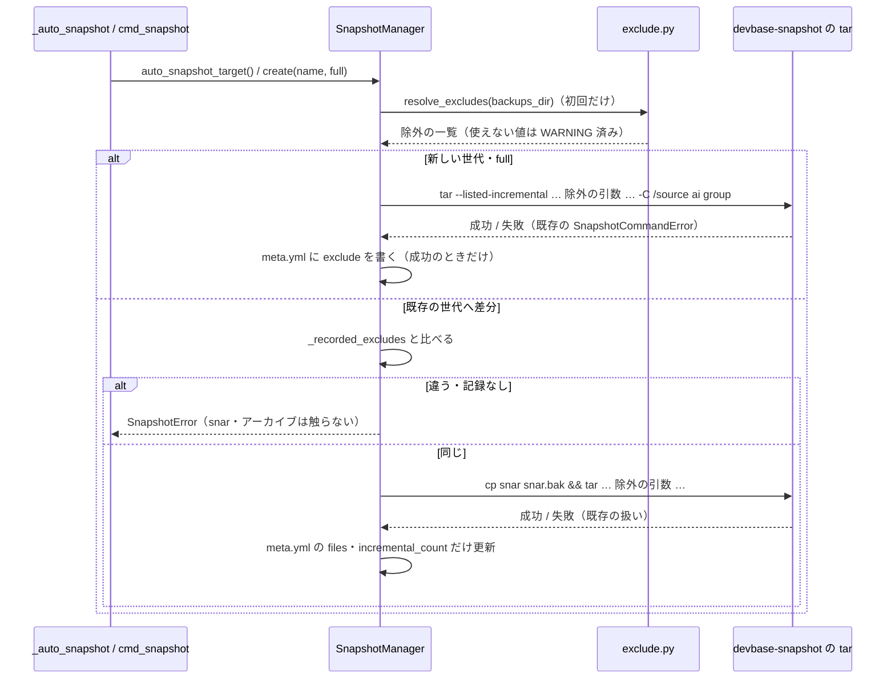

# スナップショット: 作り直せるキャッシュ・一時ファイル・ログまで毎回控え、フルの世代と差分が大きくなる → 本体が持つ既定の除外と利用者が足した除外を控えから外し、除外が違う世代へは差分を積まない（#368）

## 目的

- **何が壊れているか**: スナップショットは対象のボリュームを丸ごと控え、除外の仕組みを持たない。Codex の動作ログ・プラグインの取得物・Serena のログなど、作り直せるもの（手元の測定で合計約 1.9GB）を毎回控える
- **誰が困るか**: `devbase up` のたびに自動スナップショットを待つ利用者。使う間ずっと書き換わる `.codex/logs_2.sqlite`（602MB）が、差分のたびに丸ごと入る
- **直すと何が成り立つか**: 既定の除外と利用者の除外がフル・差分・復元前バックアップのアーカイブから外れる。会話の記録・入れたプラグインの一覧はこれまでどおり控えて復元で戻る。除外が途中で変わった世代へ差分を積まず、復元の結果が除外の一覧と食い違わない

## 適用範囲

- **働く範囲**: devbase の本体（`lib/devbase/snapshot/`）。配布先の利用者の端末で、`devbase snapshot create`・`devbase up` の自動スナップショット・`restore` の復元前バックアップに働く
- **プロジェクトごとに違うもの**: 無し。利用者の除外は devbase のルートに 1 つだけ置く設定ファイル（`backups/exclude.yml`）で受け、プロジェクトの設定や環境変数では受けない（決定 3）
- **当たるモード**: `standard`

## あるべき姿の根拠

| 根拠 | 種類 | 何を示すか |
| --- | --- | --- |
| 利用者の決定（#368 のコメント、2026-10-11）「除外の一覧は本体に既定の一覧を持ち、利用者が設定で足せる形にする。既定の一覧は本文の『控えなくてよいもの』の表から作る（`.gemini/tmp/<プロジェクト>/chats/` は外さない）」 | 利用者の指示の原文 | 既定の除外を本体に持つこと・利用者は足すだけであること・既定の除外の中身 |
| 課題の本文の測定（2026-10-02）: `.codex/logs_2.sqlite` 602MB、`.claude/plugins/cache` 約 607MB、`.gemini/tmp` 約 1.3GB のうち `chats/` が約 984MB | 実測 | 既定の除外の大きさと、`.gemini/tmp` を丸ごと外してはいけないこと |
| `devbase-snapshot:latest` の GNU tar 1.35 で測った除外の効き方（下の「測った tar の振る舞い」） | 実測 | 除外のオプションの組み合わせと置く位置（決定 2）、世代の途中で除外を変えると復元が除外の一覧と食い違うこと（決定 5） |
| 手元の `~/.codex` に `logs_2.sqlite-wal`・`logs_2.sqlite-shm` がある（2026-10-12） | 実測 | 本体だけを外すと WAL が残ること（決定 6） |

要求と受け入れ条件は #368 の本文にある（コピーは `issues/issue-368-requirements.md`）。この文書は「どう作るか」だけを扱う。

### 測った tar の振る舞い

作業用のディレクトリだけを使い、利用者のボリュームには触れていない（2026-10-12、`devbase-snapshot:latest`、`tar (GNU tar) 1.35`）。`ai/` と `group/` の下に同じ木を置き、`-C /source ai group` で控えた。

| 試したこと | 結果 |
| --- | --- |
| `--anchored --no-wildcards-match-slash --exclude=ai/.gemini/tmp/*/logs.json --exclude=ai/.codex/cache …`（`group/` も同じ）をメンバーより前に置く | 外したパスとその下が一覧に無い。`ai/.gemini/tmp/p1/chats/logs.json`・`ai/.gemini/tmp/p1/chats/logs/x`・`ai/work/.codex/cache/keep` は残る |
| 既定のまま（アンカーなし）`--exclude=.codex/cache` | `ai/work/.codex/cache` まで外れる（ボリュームの下の深い場所の同じ名前に当たる） |
| `--anchored --exclude=…` をメンバーの後に置く | `tar: --exclude 'ai/.codex/cache' has no effect` と出て除外が効かず、終了コードが 0 でない |
| 端末に無いパスを除外する（`--exclude=ai/nope`） | 終了コード 0、警告なし |
| 除外なしで full を作り、同じ snar へ `ai/.codex/cache` を除外して差分を積み、空の先へ順に展開する | `ai/.codex/cache/c` が full の時点の中身で残る（消えも更新もされない） |
| 同じ除外で full と差分を作り、順に展開する | 除外したパスは無く、ほかのファイルは差分の時点の中身 |

課題の本文は、世代の途中で除外を足すと差分の復元で「そのパスが消える」と推していた。測った結果は「full の時点の中身で残る」であり、どちらにせよ復元の結果が除外の一覧と合わない（受け入れ条件 8）。

## ドメインモデル

### コンテキスト

| コンテキスト | 何の語が 1 つの意味に決まるか |
| --- | --- |
| スナップショット（`snapshot`） | 世代・系列・除外の一覧・既定の除外・利用者の除外・除外のパターン |

1 つのコンテキストで閉じる。ボリュームの名前（`volume` の語）は既存どおり `snapshot` が順応者として受け取り、この変更で関係を変えない。

### 集約

| 集約 | 持ち主（書き換えてよいもの） | 根 | エンティティ | 値オブジェクト |
| --- | --- | --- | --- | --- |
| 世代 | `SnapshotManager`（`lib/devbase/snapshot/manager.py`） | 世代のディレクトリ（`backups/<名前>/` と `meta.yml`） | アーカイブ（`full.tar.zst`・`incr-NNN.tar.zst`）・`snapshot.snar` | 対象ボリュームの組・**除外の一覧**（この変更で足す） |
| 利用者の除外の設定 | 利用者（devbase は読むだけで書かない） | `backups/exclude.yml` | — | 除外のパターン |

除外の一覧は値オブジェクトで、`exclude.py`（新しく作る）が既定の除外と利用者の除外の設定から組み立てる。世代はそれを受け取って `meta.yml` に写し、比べるだけで、中身を変えない。

### 不変条件

| # | 集約 | 条件 | 破れたときの扱い |
| --- | --- | --- | --- |
| I1 | 世代 | 1 つの世代のアーカイブ（full と各差分）は、すべて同じ除外の一覧で作る | 自動スナップショットは差分を積まず新しい世代を作る（理由の INFO 1 行）。名前を指定した差分は `SnapshotError`（終了コード 1）で止め、アーカイブ・`snapshot.snar`・`meta.yml` を変えない |
| I2 | 世代 | `meta.yml` の `exclude` は、その世代の full を作ったときの除外の一覧に等しい。差分を積んでも書き換えない | — （full を作るときにだけ書く） |
| I3 | 世代 | `meta.yml` に `exclude` が無い世代（この変更より前に作った世代）は、今の除外の一覧と違うものとして扱う | I1 と同じ |
| I4 | 利用者の除外の設定 | 除外のパターンはボリュームの中だけを指す（絶対パス・`..` の要素・空・`*` 以外のワイルドカードの文字を含まない） | その値を採らず WARNING 1 行。残りで控えを作る |
| I5 | 世代 | 除外のパターンは各ボリュームの頭（`ai/`・`group/`・旧レイアウトの `./`）からだけ当たり、`*` は 1 つの要素の中だけに当たる | — （tar へ渡す形で守る。破るとボリュームの下の深い場所や `chats/` の下を外す） |
| I6 | 世代 | 既定の除外は常に効く。利用者の除外の設定は足すだけで、既定の除外を外せない | — （設定に「外す」書き方を持たない） |
| I7 | 世代 | 既定の除外は、会話の記録・プラグインの状態のファイル・`.serena/language_servers` に当たらない | — （既定の一覧を変えたときにテストで落ちる） |
| I8 | 世代 | 復元は除外の一覧を読まない。除外を持たない世代も持つ世代も同じ手順で戻す | — |
| I9 | 世代 | 利用者の除外の設定が読めない間は、除外の一覧の違いを理由に新しい世代を作らず、控えを今の世代の記録の一覧で作る。`exclude` の記録を持つ世代へはその記録の一覧で差分を積み、新しい世代のフル（差分の上限に達したとき・snar 無しのフォールバック・復元前バックアップ）も、作り直す世代か系列の最新の世代が記録を持てばその記録の一覧で作る（決定 4） | — （読めない設定で I1 の比較を飛ばし、記録の一覧を使う。系列のどの世代も記録を持たないとき（この変更より前の世代だけ）は I3 のとおり新しい世代になり、既定の除外だけで控える） |

### ドメインイベント

| # | イベント | 発生元 | 受け手 |
| --- | --- | --- | --- |
| E1 | 除外の一覧を決めた | `exclude.resolve_excludes`（`SnapshotManager.excludes` の初回の参照） | `SnapshotManager`（作成・積み先の判定） |
| E2 | 積み先の世代の除外の一覧と今の除外の一覧を比べた | `auto_snapshot_target`・`_create_incremental` | `_auto_snapshot`（`None` なら新しい世代）・CLI（`SnapshotError` なら終了コード 1） |
| E3 | 新しいフルの世代を作った（除外を適用した） | `_create_full` | E5 |
| E4 | 差分を積んだ（同じ除外を適用した） | `_create_incremental` | E5（`exclude` は書き換えない） |
| E5 | 世代に除外の一覧を記録した | `_create_full`（`meta.yml` の `exclude`） | 次の E2 |
| E6 | 世代を復元した | `restore` | 利用者（除外したパスは復元後に無い） |
| E7 | 復元後に CLI が要るものを作り直した | 利用者の CLI の起動（devbase の外） | 受け入れ条件 9 の確認（前提 4） |

### 用語

| 用語 | 意味 | 用語集への反映 |
| --- | --- | --- |
| 除外のパターン | 除外の一覧の 1 項目。ボリュームの中の相対のパスで、`*` は 1 つの要素の中の任意の文字列に当たる。当たったパスとその下を控えない | 追加（`snapshot`） |
| 除外の一覧 | スナップショットのアーカイブに入れないパスの一覧。既定の除外と利用者の除外を合わせたもの | 変えない（要求で足した語） |
| 既定の除外 | devbase の本体が持つ除外の一覧 | 変えない（要求で足した語） |
| 利用者の除外 | 利用者が `backups/exclude.yml` で既定の除外に足すパス | 意味の変更（置き場を書き足す） |

## 機能一覧

| # | 機能 | 誰が使うか |
| --- | --- | --- |
| F1 | 控え（フル・差分・復元前バックアップ）から既定の除外のパスを外す | `devbase up`・`snapshot create`・`snapshot restore` を使う利用者 |
| F2 | 利用者が `backups/exclude.yml` に書いたパスを控えから外す。使えない値は警告して外す | 控えを小さくしたい利用者 |
| F3 | 世代ごとに、作ったときの除外の一覧を `meta.yml` に残す | 世代の中身を確かめたい利用者・保守する開発者 |
| F4 | 除外の一覧が違う世代へ差分を積まない（自動は新しい世代を作り、名前の指定は止める） | `devbase up`・`snapshot create --name` を使う利用者 |

## 構成要素

| 要素 | 責務 |
| --- | --- |
| `lib/devbase/snapshot/exclude.py`（新しく作る） | 既定の除外（`DEFAULT_EXCLUDES`）を持つ。利用者の除外の設定を読み、パターンを正規化・検査し、使えない値と読めない設定を WARNING にし、除外の一覧と設定を読めたかを返す（`resolve_excludes`）。除外の一覧から tar の引数を組み立てる（`tar_exclude_args`）。Docker を呼ばない |
| `SnapshotManager.excludes`（`manager.py`、足す） | 除外の一覧と設定を読めたか（`exclude_config_readable`）を初回の参照で 1 回だけ組み立てて持つ。同じ実行で警告を 2 度出さない |
| `SnapshotManager.backup_command`（変える） | 引数に除外の一覧を足し、`tar_exclude_args` の結果を `-C` とメンバーより前に置く |
| `SnapshotManager._excludes_for`（`manager.py`、足す） | 控えに使う除外の一覧を決める。設定を読めたら `excludes`。読めなければ、作り直す世代（`snap_dir`）の記録 → `volumes` の系列の最新の世代の記録の順に最初にある記録の一覧、どちらも無ければ `excludes`（既定の除外だけ）（I9） |
| `SnapshotManager._create_full`（変える） | `_excludes_for` の一覧を適用して控え、`meta.yml` の `exclude` にその一覧を書く。差分の上限で作る新しい世代・snar 無しのフォールバック・復元前バックアップもこの経路を通る |
| `SnapshotManager._create_incremental`（変える） | `snapshot.snar` を触る前に、世代の `exclude` と今の一覧を比べ、違えば `SnapshotError`。設定が読めず世代に記録があれば、比べずに記録の一覧で差分を積む。snar 無しのフォールバックは `_create_full` へ渡し、同じ記録の一覧でフルを作る（I9） |
| `SnapshotManager.auto_snapshot_target`（変える） | 順 4 の後に除外の一覧の比較を足し、違えば理由の INFO 1 行と `None`。設定が読めず世代に記録があれば比べない（I9） |
| `docs/user/snapshot-guide.md`・`docs/user/cli-reference/05-snapshot.md`・`CHANGELOG.md` | 既定の除外の一覧・`backups/exclude.yml` の書き方・更新後の最初の自動スナップショットが新しい世代を作ること。`snapshot-guide.md` には、`backups/exclude.yml` で除外の一覧を変えるたびに次の自動スナップショットが新しい世代を作り、系列ごとの保持数（3）を超えた最も古い世代がローテーションで消えること、読めない設定の間は今の世代の除外の一覧のまま控える（差分も、差分の上限で作る新しい世代も）ことを書く |

変えないもの: `restore`・`_apply_incrementals`・`restore_command`・`clear_command`（I8）、`copy`（`meta.yml` ごと写すため `exclude` も写る）、`list`・`rotate`・系列の規則、`commands/snapshot.py` と CLI の引数、`devbase-snapshot` イメージ（GNU tar 1.35 の既存の機能だけを使う）。



### パッケージ・モジュール構成

```text
lib/devbase/snapshot/
├── __init__.py
├── exclude.py      # 新: 既定の除外・利用者の除外の設定の読み込み・tar の引数
└── manager.py      # 変: excludes・backup_command・_create_full・_create_incremental・auto_snapshot_target
tests/snapshot/
├── test_exclude.py               # 新: 正規化・検査・設定の読み込み・tar の引数
├── test_exclude_generations.py   # 新: meta.yml の記録・積み先の判定・名前を指定した差分
└── test_backup_real_tar.py       # 変: 実の GNU tar で除外の効き目と復元
```

## 構造



- `normalize(value)` は使えない値で `ValueError`（理由つき）を投げる純粋な関数。WARNING は `resolve_excludes` が出す
- `resolve_excludes` は既定の除外と利用者の除外を合わせ、重複を除いて並べ替えたタプルと、設定を読めたか（ファイルが無いときは `True`、下の表の「読めない」の行に当たるときだけ `False`）を返す。比較は並びに依らない（I1）
- `_recorded_excludes` は `meta.yml` の `exclude` を読み、無ければ `None`（I3）。リストでない・文字列でない要素を含むときも `None`（違うものとして扱う）
- `_excludes_for(snap_dir, volumes)` は `exclude_config_readable` が真なら `excludes` を返す。偽なら `_recorded_excludes(snap_dir)`、続けて `series_latest(volumes)` の世代のディレクトリの `_recorded_excludes` を見て最初の記録を返し、どちらも `None` なら `excludes`（既定の除外だけ）を返す。新しい世代は `_update_global_metadata` より前に呼ぶため、`series_latest` は 1 つ前の世代を指す

## データ構造

### 世代の `meta.yml`

| 列 | 型 | 空を許すか | 意味 |
| --- | --- | --- | --- |
| `exclude`（足す） | 文字列のリスト（並べ替え済み・重複なし） | 無いことを許す | full を作ったときの除外の一覧（正規化したパターン。マウント名の頭は付けない）。**無いのは「この変更より前に作った世代（除外を持たない）」**で、「何も外していない」ではない。空のリストは「何も外していない」 |

既存の列（`name`・`created_at`・`type`・`volumes`・`files`・`incremental_count`・`archive_root`）は変えない。`backups/snapshot.yml` も変えない（系列の判定は `snapshot.yml` だけで行い、除外の比較は積む直前に `meta.yml` で行う。`volumes` の照合と同じ置き方）。

| 機能 | `meta.yml` の `exclude` | `snapshot.snar` | `backups/exclude.yml` |
| --- | --- | --- | --- |
| F1・F2 フルを作る | C | C | R |
| F1・F2 差分を積む | R | U | R |
| F3 記録を読む | R | — | — |
| F4 積み先の判定 | R | — | R |
| 復元（変えない） | — | — | — |

- **時系列の扱い**: 世代ごとに作ったときの一覧を残し、上書きしない（差分は `exclude` を書かない）。一覧が変われば新しい世代になり、前の世代の記録はそのまま残る
- **移行**: 既存の世代は書き換えない。`exclude` が無い世代は I3 により、更新後の最初の自動スナップショットで系列ごとに新しい世代へ倒れる（前提 6）
- **切り戻し**: 変更前の devbase は `exclude` を読まずに無視する（`yaml.safe_load` の未知のキー）。変更後の世代を変更前の devbase で復元すると、除外したパスは無い（非機能の移行性の条件のとおり）

### 利用者の除外の設定 `backups/exclude.yml`

```yaml
# スナップショットの控えから外すパス（ボリュームの中の相対のパス）
exclude:
  - .cache/pip
  - work/*/node_modules
```

| 項目 | 規則 |
| --- | --- |
| 置き場 | `$DEVBASE_ROOT/backups/exclude.yml`。devbase は作らず書かない |
| 形 | 最上位が辞書で、`exclude` が文字列のリスト |
| ファイルが無い | 既定の除外だけ。警告を出さない（受け入れ条件 12） |
| YAML として読めない・最上位が辞書でない・`exclude` がリストでない | WARNING `backups/exclude.yml を読めないため、今の世代の除外の一覧のまま控えます（記録の無い世代だけなら既定の除外だけで作ります）: {理由}` を 1 行。設定を読めなかったことを返し、控えは続ける。記録を持つ世代へ積む差分も、差分の上限・snar 無しのフォールバック・復元前バックアップで作る新しい世代のフルも、`_excludes_for` が返す記録の一覧で作る（I9） |
| `exclude` のキーが無い・`null`・空のリスト | 既定の除外だけ。警告を出さない |
| 要素が文字列でない・空・使えない値 | WARNING `backups/exclude.yml の除外 {値!r} を採りません: {理由}` を要素ごとに 1 行。残りで続ける（受け入れ条件 11） |

### 除外のパターンの正規化と検査（`normalize`）

| 順 | 入力の形 | 扱い |
| --- | --- | --- |
| 1 | 文字列でない | 採らない（理由: 文字列でない） |
| 2 | 前後の空白を落として空 | 採らない（理由: 空） |
| 3 | `/` で始まる | 採らない（理由: 絶対パス） |
| 4 | `?`・`[`・`]`・`\` を含む | 採らない（理由: 使えない文字。`*` 以外のワイルドカードは持たない） |
| 5 | `/` で分けた要素に `..` がある | 採らない（理由: ボリュームの外を指す） |
| 6 | 空の要素と `.` の要素を落とす（`./a//b/` → `a/b`） | 落とした後に要素が無ければ採らない（理由: 空） |
| 7 | それ以外 | 要素を `/` でつないだ文字列を返す |

### 既定の除外（`DEFAULT_EXCLUDES`）

| パターン | 出所 |
| --- | --- |
| `.gemini/tmp/*/logs.json` | 課題の表（S1） |
| `.gemini/tmp/*/logs` | 課題の表（S1） |
| `.codex/logs_2.sqlite` | 課題の表（S2） |
| `.codex/logs_2.sqlite-wal` | **課題の表に無い**（決定 6） |
| `.codex/logs_2.sqlite-shm` | **課題の表に無い**（決定 6） |
| `.codex/.tmp` | 課題の表（S3） |
| `.codex/cache` | 課題の表（S3） |
| `.claude/plugins/cache` | 課題の表（S4） |
| `.claude/plugins/marketplaces` | 課題の表（S4） |
| `.serena/logs` | 課題の表（S5） |

10 個。共通ボリュームとグループのボリュームの両方に当てる（課題の表は `.gemini/tmp` を両方、ほかを共通と書くが、グループのボリュームに同じパスがあれば同じく作り直せるため、分けない）。

## 入出力の契約

CLI の引数・終了コードの体系は変えない。変わる約束は次の 3 つである。

| 名前 | 入力 | 出力 | 失敗の形 | 互換性 |
| --- | --- | --- | --- | --- |
| `backups/exclude.yml` | 上の「利用者の除外の設定」の形 | 次に作る控えから外れる | 読めない・使えない値は WARNING で、控えは続ける（終了コードを変えない）。読めない間は除外の違いで新しい世代を作らない（I9） | 新しい設定。無ければこれまでと同じく既定の除外だけ |
| `devbase snapshot create --name <除外の一覧が違う世代>`（`--full` なし） | 既存の世代の名前 | — | `SnapshotError` `スナップショット '{名前}' は今と違う除外の一覧で作られています。新しい世代を作成してください (devbase snapshot create)` → 終了コード 1。アーカイブ・`snapshot.snar`・`meta.yml` は変わらない | 変更前は積めた。この変更より前の世代へ名前で積むと止まるようになる |
| `devbase up` の自動スナップショットのログ | — | INFO `世代 {名前} は今と違う除外の一覧で作られているため、新しい世代を作成します`（`exclude` の無い世代も同じ文） | — | 更新後の最初の 1 回は系列ごとにこの行が出る |

`tar_exclude_args(excludes, members)` が返す形（`members` は `backup_command` が使うメンバー名 `ai`・`group`、旧レイアウトは `.`）:

```text
--anchored --no-wildcards-match-slash --exclude=<メンバー>/<パターン> ...（メンバー × パターン）
```

各 `--exclude=…` は `shlex.quote` する（`*` をシェルに展開させない）。`backup_command` はこれを `tar --listed-incremental=… ` の直後、`-cf - -C /source <メンバー>` より前に置く（測った tar の振る舞いの 3 行目）。

## 処理の流れ

### 自動スナップショットの積み先の判定

既存の順 1〜5（`docs/specifications/snapshot-series.md` の「差分の積み先」）のうち、順 4 と順 5 の間に 1 つ足す。

| 順 | 条件 | 結果 | ログ |
| --- | --- | --- | --- |
| 1〜4 | 既存どおり | 既存どおり | 既存どおり |
| 4a（足す） | 最新の世代のディレクトリがあり、`_recorded_excludes` が `None` か、`exclude_config_readable` が真で `set(self.excludes)` と違う | `None` | INFO `世代 {名前} は今と違う除外の一覧で作られているため、新しい世代を作成します` |
| 5〜6 | 既存どおり | 既存どおり | 既存どおり |

順 4 の後に置くのは、`archive_root` の古い世代は除外の記録も持たず、既存の理由の行を変えないためである。設定が読めないとき（`exclude_config_readable` が偽）は、記録を持つ世代を違うと判定せず、順 5 以降へ進む（I9）。順 5（差分の上限）で新しい世代へ倒すときも、そのフルは `_excludes_for` で系列の最新の世代の記録の一覧になり、新しい世代の `meta.yml` の `exclude` も同じ一覧になる。設定を直した次の `up` では、直した一覧が記録と同じなら同じ世代へ積み続け、順 4a でもう 1 世代を作らない。



- 比べる順は `volumes` の照合 → `archive_root` → 除外の一覧で、`_create_incremental` も同じ順に止める。snar が無いときのフルへの切り替えは、除外の比較より後に置く（記録の違う世代へ名前で積もうとしたら、snar の有無に関わらず止める）
- 設定が読めないときは、`_create_incremental` は記録を持つ世代と比べずに、その記録の一覧を tar の除外の引数に使う（I1 と I9 を同時に守る）。記録の無い世代へ名前で積むときは、読めない設定でも I3 のとおり `SnapshotError` で止める。snar 無しのフォールバックは `_create_full(name, snap_dir)` へ渡し、`_excludes_for` が同じ世代の記録を返すため、作り直したフルの `exclude` も記録のまま変わらない
- 復元前バックアップは `_backup_before_restore` → `_create_full(name, snap_dir, volumes)` を通るため、同じ除外が効き `exclude` も書かれる。旧レイアウトの世代の復元前バックアップはメンバーが `.` なので、パターンの頭は `./` になる

## 非機能の実現方式

| 大項目 | 要求の条件 | 実現方式 | 確かめ方 |
| --- | --- | --- | --- |
| 性能・拡張性 | 課題の本文の測定（2026-10-02）と同じ構成で、フルの世代の展開前の控えの対象から、既定の除外のパスの合計（約 1.9GB）が減る。測った端末とボリュームの大きさを記録に残す | tar の `--exclude` で既定の除外を辿らない。差分では `logs_2.sqlite` とその WAL が入らない | リリース後テストで、利用者の端末の `devbase snapshot create --full` の大きさを変更前の世代と比べ、端末とボリュームの大きさを記録に残す |
| 運用・保守性 | 除外の一覧が前の控えと違うために新しい世代を作るときは、理由をログの 1 行で示す（受け入れ条件 6）。世代ごとの除外の一覧が後から読める（受け入れ条件 14） | 積み先の判定の順 4a の INFO 1 行。`meta.yml` の `exclude` | 単体テストでログの行と `meta.yml` を見る |
| 移行性 | 既存の世代は書き換えずにそのまま一覧・復元できる（受け入れ条件 10）。更新後の最初の自動スナップショットで、系列ごとに新しいフルの世代を作る（前提 6）。切り戻し（変更前の devbase へ戻す）で、変更後に作った世代を復元すると除外したパスは無い | 復元・一覧の経路を変えない（I8）。`exclude` の無い世代を違うものとして扱う（I3）。変更前の devbase は未知のキーを読み捨てる | 既存の復元のテストを変えずに通す。`exclude` の無い世代で順 4a が `None` を返すテスト |

## 決定の記録

### 決定 1: 世代の規則と除外の規則を分けて読めるよう、除外の一覧の組み立てを `exclude.py` に置き、`manager.py` は受け取って使うだけにする

既定の除外・設定の読み込み・パターンの検査・tar の引数の組み立ては、世代の状態に依らない処理で、Docker も `meta.yml` も要らない（副作用は設定ファイルを読むことと WARNING を出すことだけ）。`manager.py` は 1,226 行あり、世代の規則（積み先・保持・場所の検証）を持つ。除外の規則を足すと、世代の規則を読む人が検査の細部まで読むことになる。世代に関わる判断（記録・比較・積み先）は確定仕様のとおり `manager.py` に残す。

`manager.py` の中に関数として足す形は採らない。テストが `SnapshotManager` を組まずに検査だけを縛れなくなる。

根拠: Value 1（MVV 版 1）

### 決定 2: ボリュームの下の深い場所や `chats/` の下を外さないよう、パターンにメンバー名を頭に付け、`--anchored --no-wildcards-match-slash` でメンバーより前に渡す

GNU tar の除外は既定でアンカーが無く、`--exclude=.codex/cache` は `ai/work/.codex/cache` にも当たる（測った）。利用者のプロジェクトの中の同じ名前を黙って外すと、会話の記録や作業のファイルを失う。`*` が `/` に当たると `.gemini/tmp/*/logs.json` が `chats/` の下の `logs.json` に当たりうる。オプションはメンバーの後では効かず tar が失敗するため、`-C` より前に置く。除外の単位は「パスとその下」で、ディレクトリの中の一部だけを残すには、外したいものを個別に挙げる（`.gemini/tmp/*/logs.json` と `.gemini/tmp/*/logs`、`.claude/plugins/cache` と `.claude/plugins/marketplaces`）。

「外さないもの」を挙げて残りを外す形（否定のパターン）は採らない。GNU tar の `--exclude` は否定を持たず、`chats/` 以外に何があるかを列挙する前提が要る。

根拠: Value 2 / Value 3（MVV 版 1）

### 決定 3: 系列ごとの除外の一覧が起動のたびに揺れないよう、利用者の除外を devbase のルートに 1 つの設定ファイル `backups/exclude.yml` で受ける

`bin/devbase` は実行したディレクトリのプロジェクトの `env` を読み込む。環境変数で受けると、同じグループのボリュームを使うプロジェクトのどれから `up` したかで除外の一覧が変わり、そのたびに I1 で新しいフルの世代ができる。`backups/` はスナップショットの置き場で、devbase のルートに 1 つしかなく、プロジェクトの境界をまたがない。YAML のリストにするのは、空の値・文字列でない値を値として見分けて警告できる（受け入れ条件 11）ためで、`secrets/host-import.yml` と同じ書き方である。

環境変数（`DEVBASE_SNAPSHOT_EXCLUDE`）は上の揺れのため採らない。`project.yml` は 1 つのプロジェクトの設定で、グループのボリュームと共通ボリュームを控える除外を持つ場所ではない。

根拠: Value 2 / Value 3（MVV 版 1）

### 決定 4: 使えない値や読めない設定で控えが止まらず古い世代も消えないよう、警告して続け、読めない間は今の世代の除外の一覧のまま差分を積む

使えない値は、その値を採らずに残りで続ける。値ごとに警告するのは、どの行を直せばよいかを示すためである。止めると `devbase up` の自動スナップショットが無くなり、利用者が設定を直すまで控えが取れない。

読めない設定を「既定の除外だけ」として比べると、除外の一覧が変わったと判定して I1 で新しいフルの世代ができ、`_auto_snapshot` の直後の `rotate()`（系列ごとに 3 世代）が最も古い世代を消す。設定を直した次の `up` でも一覧が戻ってもう 1 世代消え、編集の誤り 1 回で復元点を 2 つ失う。そこで読めない間は除外の違いを理由に新しい世代を作らず、記録を持つ世代へはその記録の一覧で差分を積む（I9）。読めない間に差分の上限・snar 無しのフォールバック・復元前バックアップで新しいフルを作るときも、既定の除外だけで作ると設定を直した次の `up` で順 4a が違うと判定してもう 1 世代でき、同じく復元点を 2 つ失う。そのため新しいフルも、作り直す世代か系列の最新の世代の記録の一覧で作る（`_excludes_for`）。I1（1 つの世代は同じ除外の一覧）はそのまま守られ、直した設定が前と同じなら同じ世代へ積み続ける。系列のどの世代も記録を持たない（この変更より前の世代だけの）ときは読めるかどうかによらず I3 で新しい世代になり、引き継ぐ記録が無いため、そのフルは既定の除外だけで作る。

読めない設定で止める形は採らない。控えの無い期間を作るほうが、控えが一時的に大きくなるより戻す費用が高い。読めない設定を「既定の除外だけ」として比べる形も上の理由で採らない。利用者が読める設定で除外の一覧を変えたときに新しい世代ができ古い世代がローテーションで消えるのは、I1 から外せないため、`snapshot-guide.md` に書いて利用者が変える前に知れるようにする。

根拠: Value 2（MVV 版 1）

### 決定 5: 復元の結果が除外の一覧と食い違わないよう、世代の `meta.yml` に full を作ったときの一覧を残し、違う世代へは差分を積まない

測った結果、除外なしの full の後に除外つきの差分を積むと、外したパスは full の時点の中身で復元される。復元の結果が「除外したパスは無い」（受け入れ条件 8）とも「控えた時点の中身」とも合わない。比べるのは正規化した一覧そのもので、版の番号ではない。既定の除外を将来変えても、利用者が設定を変えても、同じ比較で新しい世代へ倒れる。並びに依らないよう並べ替えて残し、集合として比べる。

一覧のハッシュだけを残す形は採らない。受け入れ条件 14（後から読める）を満たさない。除外を変えたら既存の世代を作り直す形は、前提 6 と対象範囲（既存の世代を書き換えない）に反する。

根拠: Value 2（MVV 版 1）

### 決定 6: 外した SQLite の本体に古い WAL が残らないよう、既定の除外に `.codex/logs_2.sqlite-wal` と `-shm` を足す

SQLite は WAL モードで `<名前>-wal`・`<名前>-shm` を本体の横に置く（手元の `~/.codex` にもある）。本体だけを外すと、復元後に本体が無く WAL だけが残り、Codex が新しく作った本体へ古い WAL を当てようとする形になる。どちらも本体と同じく作り直せるログで、控える理由が無い。課題の表に無いパスを既定の除外に足すため、要求の「確認してから行う」に当たり、承認ゲート 1 で人が見る。

本体だけを外す形は採らない。WAL は使う間ずっと書き換わり、差分のたびに入る点も本体と同じである。

根拠: Value 2（MVV 版 1）

### 決定 7: 既定の除外を共通ボリュームとグループのボリュームの両方に当てる

課題の表は `.gemini/tmp` だけを両方とし、ほかを共通ボリュームと書くが、これは測った端末でそこにあったことを示すだけである。同じパスがグループのボリュームにあれば、同じく作り直せる。ボリュームごとに一覧を分けると、利用者の除外の設定にも置き場を書き分ける形が要り、間違える場所が増える。

根拠: Value 1（MVV 版 1）

## テスト設計

| 受け入れ条件・不変条件 | どの振る舞いで縛るか | どう壊したら落ちるべきか |
| --- | --- | --- |
| 受け入れ条件 1・I5 | 実の GNU tar（`test_backup_real_tar.py`、無ければ飛ぶ）で既定の除外のパスを `ai`・`group` に置いて full を作ると、中身の一覧にどのパスもその下も無い | `backup_command` が除外の引数を渡さない・メンバーの後に置く・メンバー名を頭に付けない |
| 受け入れ条件 2・I5・I7 | 同じ full に `.gemini/tmp/<p>/chats/` の下（`chats/logs.json` を含む）・`.claude/plugins/installed_plugins.json`・`known_marketplaces.json`・`data/`・`.claude/projects`・`.codex/sessions`・`thread_history_1.sqlite`・`state_5.sqlite`・`.serena/language_servers`・`work/.codex/cache` がある | `--anchored` か `--no-wildcards-match-slash` を外す。既定の除外に `.gemini/tmp` や `.claude/plugins` を丸ごと入れる |
| 受け入れ条件 3 | 実の tar で full の後に `.codex/logs_2.sqlite` とほかのファイルを書き換えて差分を作ると、差分の一覧に `logs_2.sqlite` が無く、ほかのファイルはある | 差分のコマンドに除外を渡さない |
| 受け入れ条件 4 | 復元前バックアップの tar のコマンドに除外の引数があり、`meta.yml` に `exclude` がある | `_backup_before_restore` が除外を通らない経路で控える |
| 受け入れ条件 5・I6 | `backups/exclude.yml` に 1 つ足すと、次の full のコマンドにそのパターンと既定の除外の両方が `ai/`・`group/` を頭にして入る | 利用者の除外で既定の除外を置き換える。足した値を落とす |
| 受け入れ条件 6・I1・I3 | 最新の世代の `meta.yml` に `exclude` が無い・違うとき `auto_snapshot_target` が `None` と INFO 1 行。同じなら名前を返す | 順 4a を外す。リストの並びの違いを違うと判定する。記録の無い世代を同じとみなす |
| 受け入れ条件 7・I1 | 名前を指定した差分で記録が違う・無いと `SnapshotError`、`cmd_snapshot` は終了コード 1。tar を呼ばず、`snapshot.snar` と `meta.yml` のバイト列が変わらない。snar が無い世代でも止まる | 比較を `cp snar snar.bak` の後に置く。snar が無いときのフルへの切り替えを比較より前に置く |
| 受け入れ条件 8・I8 | 実の tar で除外つきの full と差分を順に展開すると、除外の外のパスは差分の時点の中身で、除外したパスは無い | 復元のコマンドを変える。差分で除外を落とす |
| 受け入れ条件 9 | マージ前の手動確認（下の「未確認のまま残ること」） | — |
| 受け入れ条件 10・I8 | 既存の復元のテスト（`test_restore_incremental.py`・`test_manager_volumes.py`）を変えずに通る。`exclude` の無い世代の復元のコマンドが変更前と同じ | 復元で `exclude` を読む・無いと止める |
| 受け入れ条件 11・I4 | 絶対パス・`..` を含む値・空・`null`・数・`?[]\` を含む値をそれぞれ書くと、値ごとに WARNING 1 行で採らず、残りの値は効く。`./a//b/` は `a/b` になる | 検査を外す。1 つの不正な値で設定全体を捨てる |
| 受け入れ条件 11（読めない設定） | YAML として壊れた設定・最上位がリスト・`exclude` が文字列で、WARNING 1 行、`resolve_excludes` の一覧は既定の除外だけで、設定を読めたかが偽 | 例外で控えを止める。読めない設定を「読めた」と返す |
| 受け入れ条件 11（読めない設定）・I9・I1 | 最新の世代の `meta.yml` に既定の除外と違う `exclude` があり設定が読めないとき、`auto_snapshot_target` は INFO を出さずにその世代の名前を返し、`_create_incremental` の tar の除外の引数は記録の一覧で、`meta.yml` の `exclude` は変わらない。直した設定（記録と同じ一覧）の次の判定も同じ名前を返す。記録の無い世代では読めない設定でも `None` | 順 4a で読めない設定を既定の除外だけとして比べる。差分の tar に既定の除外だけを渡す。記録の無い世代を引き継ぐ |
| 受け入れ条件 11（読めない設定）・I9・I1（新しいフル） | 系列の最新の世代の `meta.yml` に既定の除外と違う `exclude` があり設定が読めないとき、(a) `incremental_count` が上限に達して `auto_snapshot_target` が `None` を返した後の新しい世代のフル、(b) snar を消した世代への差分（フォールバックのフル）、(c) 復元前バックアップで、tar の除外の引数と `meta.yml` の `exclude` が記録の一覧である。(a) の後に直した設定（記録と同じ一覧）で判定すると新しい世代の名前を返す。系列のどの世代も記録を持たないときは既定の除外だけ | 新しいフルを既定の除外だけで作る。直した設定の次の判定で `None` を返す |
| 受け入れ条件 12 | `backups/exclude.yml` が無い・`exclude` が無い・空のリストで、既定の除外だけで警告が出ない | 無いときに警告を出す |
| 受け入れ条件 13 | 実の tar で既定の除外のパスが 1 つも無い木を控えて、終了コード 0 で警告が無い | 除外の対象の有無を事前に確かめて止める |
| 受け入れ条件 14・I2 | full の `meta.yml` の `exclude` が並べ替えた一覧で、差分を積んでも変わらない | 差分で `exclude` を上書きする。記録を書かない |
| I5（旧レイアウト） | 旧レイアウト（`{'': …}`）の復元前バックアップのコマンドでは、パターンの頭が `./` | メンバー名をいつも `ai`・`group` にする |
| 同じ実行で警告を 2 度出さない | `auto_snapshot_target` と `create` を同じ `SnapshotManager` で呼んでも、使えない値の WARNING は 1 回 | `excludes` を参照のたびに組み立てる |

## 設計の結果

| 課題 | 扱い | 取り込み先 | 触るファイル |
| --- | --- | --- | --- |
| #368 | 実装する | — | `lib/devbase/snapshot/`、`tests/snapshot/`、`docs/user/snapshot-guide.md`、`docs/user/cli-reference/05-snapshot.md`、`CHANGELOG.md` |

## 未確認のまま残ること

| 項目 | 内容 |
| --- | --- |
| 除外したパスが無い状態での各 CLI の起動（受け入れ条件 9・前提 4） | 実装の担当がマージ前に、使い捨てのホームのボリュームから既定の除外のパスを消して dev コンテナを起動し、Claude Code・Codex・Gemini CLI・Serena を起動して確かめる。起動できない CLI があれば、そのパスを既定の除外から外し、実装の PR に決定の番号と理由を書く |
| `.claude/plugins/marketplaces` が無いときにプラグインを使えるか | `known_marketplaces.json` は取得先の場所を指す。Claude Code が取り直すかは受け入れ条件 9 で確かめる |
| `.codex/.tmp` の中の取得物 | Codex は `.codex/.tmp/marketplaces/` にマーケットプレイスの写しを置く（NDF の `scripts` の探し方の候補 4 がそこを見る）。復元後に Codex が取り直すまで写しが無い。受け入れ条件 9 で Codex のプラグインが使えるかを見る |
| `.gemini/tmp/<プロジェクト>/` の `chats/`・`logs.json`・`logs/` 以外（前提 3） | 外さない（既定の除外に入れない）。`logs.json`・`logs/` を外して Gemini CLI が会話を再開できるかは受け入れ条件 9 で見る |
| 性能の条件 | 利用者の端末でのリリース後テスト（非機能の実現方式） |
| 既存の世代の名前で `--full` を打つと full が変更分だけになる | 範囲外として #458 に起票した。除外の一覧が違う世代へ名前で `--full` を打つ利用者がこの不具合に当たりうる。案内は「新しい世代を作成してください (devbase snapshot create)」とし、`--name` に既存の名前を勧めない |
