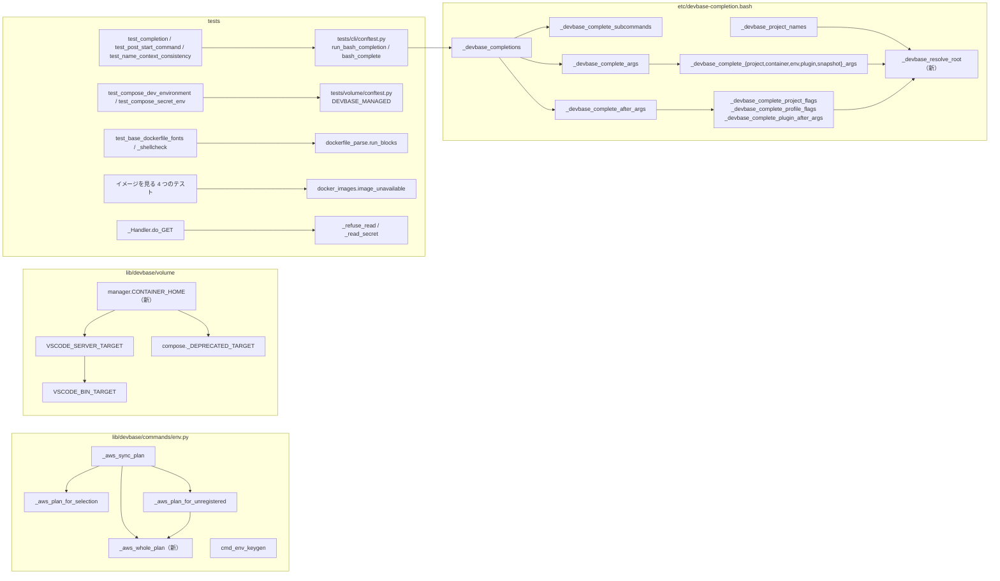
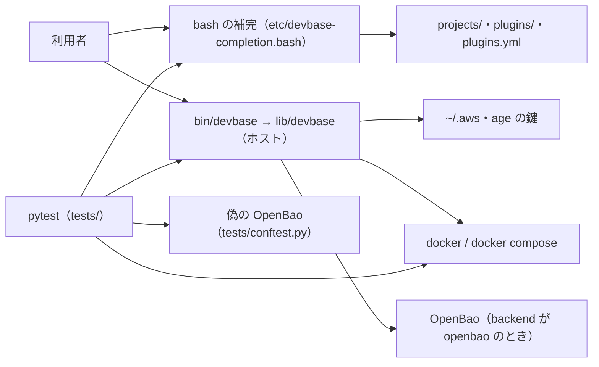
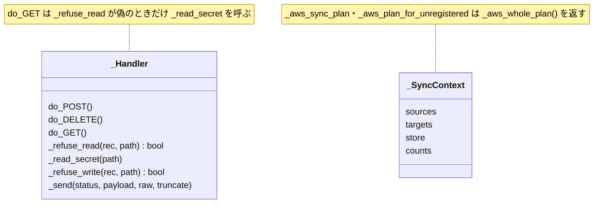
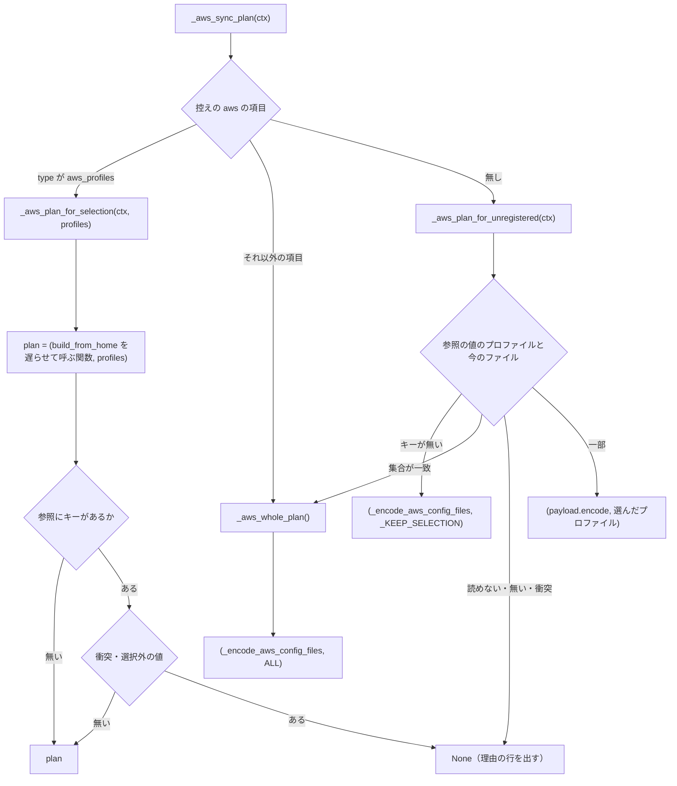
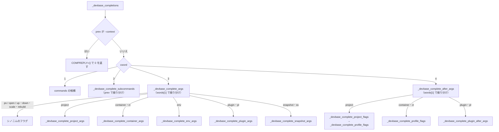
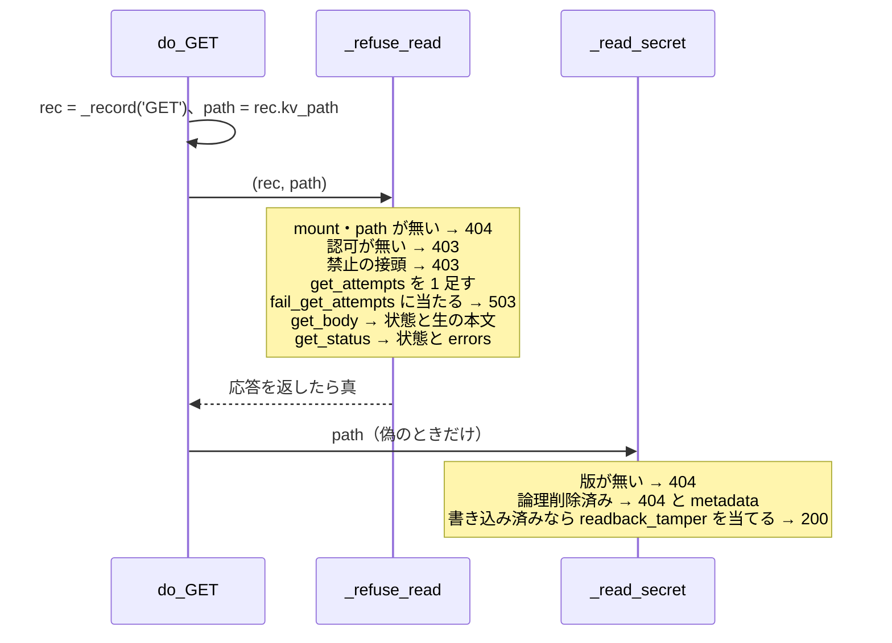

# devbase: `env sync` の AWS の経路・bash の補完・偽の OpenBao・テストの補助に、同じ式の重なりと長い関数が 15 件残る → 11 件を振る舞いを変えずに直し、4 件は直さない理由を残す（#452）

## 目的

- **何が壊れているか**: PR #450 の構造改善で時間の枠に入らなかった 15 件（R1〜R15）が残る。同じ式の重なり・長い関数・語の位置とグループの分岐の連なりで、振る舞いは正しいが読み解くのに手間がかかる
- **誰が困るか**: 次に `env sync` の AWS の経路・bash の補完・偽の OpenBao・`tests/containers/` の Docker の検査を触る devbase の開発者と AI エージェント
- **直すと何が成り立つか**: 直す 11 件の兆候が要求の基準で消え、直さない 4 件は理由とともに残る。利用者から見える出力・終了コード・書き込み・補完の候補は変わらない

## 適用範囲

- **働く範囲**: このリポジトリの `lib/devbase/`・`etc/devbase-completion.bash`・`tests/`。配布先は `install.sh` で `main` を取る利用者の端末だが、振る舞いは変わらない。プラグインのリポジトリ（`projects/*`）・base イメージ・`etc/_devbase` は触らない
- **プロジェクトごとに違うもの**: 無し（新しい設定と引数を足さない）
- **当たるモード**: `standard`（本番の振る舞いを変えない構造の変更で、対象に既存のテストがある。要求と受け入れ条件は #452 の本文）

## あるべき姿の根拠

| 根拠 | 種類 | 何を示すか |
| --- | --- | --- |
| 課題 #452 の本文の「兆候が消えたと見なす基準」と前提 1〜7 | 利用者の指示の原文（起動指示を課題へ写したもの） | 直した後の形を数値（50 行・認知的複雑度 15・シェルの関数 60 行）と定義の場所で決める |
| HEAD（= `main` `04f7228` + 要求の写し）で測った値が要求の「現状」と一致した（`uvx complexipy`: `do_GET` 16・`SnapshotManager.list` 14・`cmd_env_keygen` 6・`_aws_plan_for_unregistered` 6・`_aws_plan_for_selection` 4・`check_group_option` 2。`uvx ruff check --select C901`: 12・4・5・6・4・3。2026-10-15） | 実測 | 設計の前提にした大きさは今のコードのものである |
| `tests/cli/test_name_context_consistency.py` の `_zsh_branch` が `etc/_devbase` の `case` の入れ子を字面で辿り、`('project', 'profile', 'up')` などで本体に `'--context[...]:context:'` があることを見る（`CONTEXT_PATHS` に `profile` の 6 つの道がある。2026-10-15 に実行して確かめた） | 実測 | R8 を関数へ移すと、テストを変えずには通らない（決定 5） |
| `etc/devbase-completion.bash` を見るテストは、どれもスクリプトを読み込んで `_devbase_completions` を実行する（字面を読むのは `bash -n` だけ） | 既存の形 | R9・R10 の関数の組み直しは、候補が同じなら既存のテストを変えずに通る |
| #444 の設計（`_refuse_write`・`_write_secret` の分け方、`tests/volume/conftest.py` の補助を取り込む形）と、`tests/containers/dockerfile_parse.py`（`test_` で始まらない共通の部品） | 既存の形 | R13 の分け方と、R11・R12・R14・R15 の補助の置き場 |

要求と受け入れ条件は #452 の本文にある（写しは `issues/issue-452-requirements.md`）。この文書は「どう作るか」だけを扱う。

## ドメインモデル

### コンテキスト

| コンテキスト | 何の語が 1 つの意味に決まるか |
| --- | --- |
| 機密の置き場（`secret`） | `env keygen`・`env sync` の AWS の入れ直しの計画・`--group` の検証（R1〜R4） |
| Compose の構成（`compose`） | スケールで作るファイルのマウント先と機密の伏せ方（R5・R6）。テストの補助（R12）もこの構成を読む |
| スナップショット（`snapshot`） | `snapshot list` の一覧（R7） |
| シェルの補完（`completion`） | bash と zsh の補完の候補（R8〜R10）。テストの補助（R11）も補完を実行する |
| テストの実行環境（`test`） | 偽の OpenBao の読み出しの経路（R13）・イメージを見るテストの飛ばし方と Dockerfile の読み方（R14・R15） |

15 件はそれぞれ 1 つのコンテキストの中で閉じる。コンテキストの間の呼び出し（`compose.py` が `manager.py` の定数を取り込む・
`editor/vscode_server.py` が同じ定数を取り込むなど）は今の形のまま変えず、関係も新しく結ばない。

### 集約

構造の変更は集約の境界と持ち主を変えない。下の表は、変更が触る単位と、その単位を書き換えてよい構成要素である。

| 集約 | 持ち主（書き換えてよいもの） | 根 | エンティティ | 値オブジェクト |
| --- | --- | --- | --- | --- |
| 1 回の `sync` | `commands/env.py` の sync の関数 | `_SyncContext` | 書き込み先（`SyncTargets`）・控え（`SourcesManager`） | AWS の入れ直しの計画 `(encode_fn, selection)` |
| age の鍵 | `commands/env.py` の `cmd_env_keygen` | 鍵ファイルのパス | — | 公開鍵 |
| スケールで作るファイルの dev サービス | `volume/compose.py` | サービスの辞書 | — | マウント先のパス（`CONTAINER_HOME`（新）から作る 3 つの定数） |
| 補完の 1 回 | `etc/devbase-completion.bash` の `_devbase_completions` | 語の並び `words` と位置 `cword` | — | 候補 `COMPREPLY` |
| 偽の OpenBao の 1 回の読み出し | `tests/conftest.py` の `_Handler` | 受けた要求 `Received` | 状態 `server_state` | 応答（状態と本文） |

### 不変条件

すべて「変更の前と同じ」を縛る。I1〜I8 は振る舞い、I9・I10 は構造の条件である。

| # | 集約 | 条件 | 破れたときの扱い |
| --- | --- | --- | --- |
| I1 | 1 回の `sync` | AWS の入れ直しは、控えの項目（`aws_profiles` / それ以外 / 無し）ごとに変更の前と同じ計画（選んだプロファイルとその連なりだけ・丸ごと・書かない）を作り、同じ行を出す | `test_env_host_import.py`・`test_env_sync_group.py`・`test_env_sync_owner.py` が落ちる |
| I2 | age の鍵 | 鍵がある・読めない・同意しない・生成に失敗する、の各経路で出力・終了コード・鍵ファイルが変更の前と同じである | `tests/commands/test_env_keygen.py` が落ちる |
| I3 | スケールで作るファイルの dev サービス | `_DEPRECATED_TARGET`・`VSCODE_SERVER_TARGET`・`VSCODE_BIN_TARGET` の値は `'/home/ubuntu'`・`'/home/ubuntu/.vscode-server'`・`'/home/ubuntu/.vscode-server/bin'` のままで、生成するファイルのマウントと旧マウントの除去が変わらない | `tests/volume/` の compose と VS Code Server のテスト、`tests/editor/` の VS Code Server のテストが落ちる |
| I4 | 補完の 1 回 | bash の補完は、語の位置（1〜4）とグループ・サブコマンドのどの組でも、変更の前と同じ候補を同じ順で返し、終了の状態が 0 である（テストのスクリプトは `set -e` で実行する） | 既存の bash の補完のテストと、足す現状固定のテスト（決定 12）が落ちる |
| I5 | 補完の 1 回 | zsh の補完（`etc/_devbase`）はファイルごと変わらない | `git diff --stat` に `etc/_devbase` が出る |
| I6 | 偽の OpenBao の 1 回の読み出し | 拒否（mount・認可・禁止）・失敗と応答の注入・無い・論理削除済み・読み戻しの改ざん、の各経路で応答の状態と本文と `get_attempts` の数え方が変更の前と同じである | 偽の OpenBao を使う `tests/` のテストが落ちる |
| I7 | テストの補助 | 補助を移した後も、`DEVBASE_MANAGED` の値・RUN ブロックへの分け方・Docker とイメージが使えないときの飛ばす理由の文（イメージの名前と建て方の案内を含む）が変更の前と同じである | 補助を使うテストが落ちる。飛ばす理由は Docker の無い端末の `-rs` の出力で比べる |
| I8 | 1 回の `sync`・age の鍵 | R1〜R3 の後も、`env sync` が AWS の設定と認証情報を書く条件と、`env keygen` が鍵を書く先と出す範囲が変わらない | I1・I2 と同じテストが落ちる |
| I9 | すべて | 直した関数と抜き出した関数が要求の「兆候が消えたと見なす基準」を満たし、対象のファイルの関数で C901 と認知的複雑度が変更の前より上がったものが無い | 測定の値が基準を超える（Pull Request の本文の表で見える） |
| I10 | スケールで作るファイルの dev サービス | `lib/devbase/volume/manager.py` の変更がモジュールの先頭の定数に限られ、`VolumeManager.__init__`・`ensure_volumes` と #490 が期待を直すテストを変えない | `git diff` の hunk が先頭の定数の外にかかる |

### ドメインイベント

要求のドメインイベントの番号を引き継ぐ。

| # | イベント | 発生元 | 受け手 |
| --- | --- | --- | --- |
| E1 | 着手前の全体のテストと基準の値を記録した | 実装の担当（`tdd-cycle` の着手） | E2 を確定させた設計の結果（既存の失敗があれば人へ戻す） |
| E2 | 15 件のそれぞれを直すか直さないかに確定した | この設計（決定 1） | 実装の計画 |
| E3 | 本番のコードと補完のスクリプトの構造を、`tests/` を変えずに変えた | 実装の担当 | 全体のテスト（E5） |
| E4 | テストの補助を共通の置き場へ移した | 実装の担当 | 全体のテスト（E5） |
| E5 | 変更の後の全体のテストと検査が通り、直した件の基準を測った | 検査と測定 | Pull Request の本文の測定の表（満たさない件は E3 / E4 へ戻すか「直さない」へ移す） |

E3 の前に、bash の補完の現状固定のテストを足す（決定 12）。足すテストは E3 の確かめに使うもので、E3 のコミットには含めない。

### 用語

| 用語 | 意味 | 用語集への反映 |
| --- | --- | --- |
| 同期済みハッシュの控え | `env sync` がソースファイルの位置とハッシュを記録する `.env.sources[.<g>].yml` | 無し（既存の語） |

兆候の名前（long_method・duplication など）と測定の語（認知的複雑度・C901）は構造改善の工程の語で、devbase の振る舞いの語では
ないため用語集へ足さない。「スケールで作るファイル」（`.docker-compose.scale.yml`）と「偽の OpenBao」（`tests/conftest.py` の
HTTP サーバ）は要求と #444 の設計で使ってきた説明の言い回しで、語として用語集へ足さない。`CONTAINER_HOME` は定数の名前で、
新しい語ではない。

## 機能一覧

利用者から見える機能は変わらない。この変更が中身を組み直す機能を並べる。

| # | 機能 | 誰が使うか |
| --- | --- | --- |
| F1 | `env keygen` が age の鍵を作る（R1） | 機密を暗号化する利用者 |
| F2 | `env sync` が AWS の認証情報を控えの選択の範囲で入れ直す（R2・R3） | 機密を同期する利用者 |
| F3 | `up` / `scale` がスケールで作るファイルで VS Code Server のマウントを足し、旧マウントを除く（R5） | プロジェクトの利用者 |
| F4 | bash の補完がサブコマンド・プロジェクト名・フラグ・プラグイン名・リポジトリ名を出す（R9・R10） | bash の利用者 |
| F5 | `tests/cli/` の補完のテスト・`tests/volume/` の compose のテスト・偽の OpenBao・`tests/containers/` のイメージと Dockerfile のテストが、補助を 1 か所から使う（R11〜R15） | devbase の開発者 |

直さない 4 件（R4・R6・R7・R8）の機能（`--group` の検証・機密の伏せ方・`snapshot list`・zsh の補完）は変えないため載せない。

## 15 件の振り分け

決定 1 の結論を件ごとに並べる。「直さない」の理由は要求の理由 1〜3 と決定 5 にある。

| # | 対象 | 兆候 | 扱い | 直し方 / 直さない理由 |
| --- | --- | --- | --- | --- |
| R1 | `cmd_env_keygen` | dead_code | 直す | 関数の中の `from devbase.errors import DevbaseError` を消す（決定 3） |
| R2 | `_aws_plan_for_selection` | duplication | 直す | 選んだプロファイルの計画を関数の先頭で 1 回だけ組み、2 つの `return` で返す（決定 3） |
| R3 | `_aws_plan_for_unregistered` | duplication | 直す | 丸ごとの計画を `_aws_whole_plan()`（新）に置き、`_aws_sync_plan` と `_aws_plan_for_unregistered` が呼ぶ（決定 3） |
| R4 | `check_group_option` | feature_envy | 直さない | 要求の理由 1（文言と終了コードはコマンドの層の知識。#444 決定 4 で CLI と TUI の 1 か所として置いた） |
| R5 | `_DEPRECATED_TARGET`・`VSCODE_SERVER_TARGET`・`VSCODE_BIN_TARGET` | magic_value | 直す | `manager.py` の先頭に `CONTAINER_HOME`（新）を置き、3 つの定数をそれから作る（決定 4） |
| R6 | `_mask_env_none` | inconsistent_naming | 直さない | 要求の理由 2（`_ENV_MASKERS` の 4 つの関数の名前と引数の揃い） |
| R7 | `SnapshotManager.list` | long_method | 直さない | 要求の理由 3（27 行・認知的複雑度 14 で基準の内） |
| R8 | `_devbase`（`project` / `container` の `profile`） | duplication | 直さない | 決定 5（既存のテストが `case` の入れ子を字面で辿る） |
| R9 | `devbase-completion.bash` の `devbase_root` の解決 | duplication | 直す | `_devbase_resolve_root`（新）に置き、3 つの使い手が呼ぶ（決定 6） |
| R10 | `_devbase_completions` | conditional_chain | 直す | 語の位置ごとの振り分けと、グループごとの関数に分ける（決定 7） |
| R11 | `test_completion.py#_bash_complete` | duplication | 直す | `tests/cli/conftest.py` に補完を実行する補助を置く（決定 8） |
| R12 | `test_compose_dev_environment.py#DEVBASE_MANAGED` | duplication | 直す | `tests/volume/conftest.py` に置いて取り込む（決定 9） |
| R13 | `_Handler.do_GET` | long_method | 直す | 拒否と注入の `_refuse_read`（新）と、応答の組み立ての `_read_secret`（新）に分ける（決定 10） |
| R14 | `test_base_dockerfile_fonts.py#_run_blocks` | duplication | 直す | `tests/containers/dockerfile_parse.py` に `run_blocks`（新）を置く（決定 11） |
| R15 | `test_base_image_font_matching.py#_docker_unavailable` | duplication | 直す | `tests/containers/docker_images.py`（新）に `image_unavailable`（新）を置く（決定 11） |

直すのは 11 件（R1・R2・R3・R5・R9〜R15）、直さないのは 4 件（R4・R6・R7・R8）である。

## 構成要素

| 要素 | 責務 | 件 |
| --- | --- | --- |
| `commands/env.py` の `cmd_env_keygen` | 関数の中の `DevbaseError` の取り込み直しを消すだけ。注記と段の順は変えない | R1 |
| `commands/env.py` の `_aws_plan_for_selection(ctx, profiles)` | 先頭で `plan = (lambda: aws_profiles.build_from_home(profiles).encode()), profiles` を組み、`holder` が無いときと検査を通ったときの 2 か所で `plan` を返す | R2 |
| `commands/env.py` の `_aws_whole_plan()`（新） | 丸ごとの計画 `(_encode_aws_config_files, ALL)` を返す。取り込みは今と同じく関数の中で遅らせる | R3 |
| `commands/env.py` の `_aws_sync_plan(ctx)` | 控えの項目が `aws_profiles` 以外のとき `_aws_whole_plan()` を返す。`_encode_aws_config_files`・`ALL` の取り込みを外す | R3 |
| `commands/env.py` の `_aws_plan_for_unregistered(ctx)` | 集合が一致したとき `_aws_whole_plan()` を返す。`ALL` の取り込みを外す（`_KEEP_SELECTION` の組に使う `_encode_aws_config_files` の取り込みは残す） | R3 |
| `volume/manager.py` の `CONTAINER_HOME`（新。`HOME_UBUNTU_VOLUME` の隣） | コンテナの中の利用者 `ubuntu` のホーム `'/home/ubuntu'` の唯一の定義 | R5 |
| `volume/manager.py` の `VSCODE_SERVER_TARGET`・`VSCODE_BIN_TARGET` | `f'{CONTAINER_HOME}/.vscode-server'`・`f'{VSCODE_SERVER_TARGET}/bin'` で作る。値は変えない | R5 |
| `volume/compose.py` の `_DEPRECATED_TARGET` | `manager` から取り込んだ `CONTAINER_HOME` をそのまま指す。値は変えない | R5 |
| `etc/devbase-completion.bash` の `_devbase_resolve_root`（新） | `devbase_root` を解決し、呼び出し元の `local devbase_root` へ入れる（標準出力へは出さない） | R9 |
| `etc/devbase-completion.bash` の `_devbase_project_names` と、プラグイン名・リポジトリ名を出す 2 か所 | `local devbase_root` の後に `_devbase_resolve_root` を呼ぶ形に変えるだけ | R9 |
| `etc/devbase-completion.bash` の `_devbase_completions` | 補完の変数の初期化・`--context` の値の守り・語の位置（`cword`）の振り分けだけを持つ。フラグの一覧（`ctx_flags`・`ps_flags`・`logs_flags`・`open_flags`）を `local` で持ち、呼ぶ関数が読む | R10 |
| `_devbase_complete_subcommands`（新） | 位置 2: 1 語目ごとのサブコマンド・フラグ・プロジェクト名。サブコマンドの一覧（`commands` を除く 5 つ）をここで `local` に持つ | R10 |
| `_devbase_complete_args`（新） | 位置 3: 1 語目（グループ）で振り分ける。トップレベルのシノニム（`ps`・`open`・`up|down|scale|rebuild`）のフラグはこの中で出す | R10 |
| `_devbase_complete_project_args`・`_devbase_complete_container_args`・`_devbase_complete_env_args`・`_devbase_complete_plugin_args`・`_devbase_complete_snapshot_args`（新） | 位置 3: グループごとに、2 語目（`prev`）のサブコマンドの引数を出す。`repo_subcommands` は `_devbase_complete_plugin_args` が `local` に持つ | R10 |
| `_devbase_complete_after_args`（新） | 位置 4: 1 語目で振り分ける | R10 |
| `_devbase_complete_project_flags`・`_devbase_complete_profile_flags`・`_devbase_complete_plugin_after_args`（新） | 位置 4: `project` の名前の後のフラグ、`project` / `container` の `profile up|down|list` の後の `--context`、`plugin install` の後のフラグと `plugin repo` の引数 | R10 |
| `tests/cli/conftest.py` の `run_bash_completion(comp_words, cword, devbase_root)`・`bash_complete(comp_words, cword, devbase_root)`（新） | 前者は補完を読み込んで `_devbase_completions` を実行するスクリプトの唯一の定義で、`CompletedProcess` を返す。後者は終了コード 0 を確かめて候補の list を返す | R11 |
| `tests/cli/test_completion.py`・`test_post_start_command.py` | 自分の `_bash_complete` の定義を消し、`from tests.cli.conftest import bash_complete as _bash_complete` で取り込む | R11 |
| `tests/cli/test_name_context_consistency.py` の `_bash_complete(words, devbase_root, cur)` | 語の並びを組み、`run_bash_completion` を呼ぶ形に変える。自分の失敗の文と set を返す形は残す | R11 |
| `tests/volume/conftest.py` の `DEVBASE_MANAGED`（移す） | dev サービスへ devbase が入れる 4 つの変数の唯一の定義 | R12 |
| `tests/volume/test_compose_dev_environment.py`・`test_compose_secret_env.py` | 自分の定義を消し、`from tests.volume.conftest import DEVBASE_MANAGED` で取り込む | R12 |
| `tests/conftest.py` の `_Handler.do_GET` | 記録 → `_refuse_read` → `_read_secret` を呼ぶだけ | R13 |
| `tests/conftest.py` の `_Handler._refuse_read(rec, path)`（新） | 読み出しの前の拒否（mount・認可・禁止）と、失敗と応答の注入（`fail_get_attempts`・`get_body`・`get_status`）。応答を返したら真 | R13 |
| `tests/conftest.py` の `_Handler._read_secret(path)`（新） | 無い・論理削除済み・読み戻しの改ざんを当てた値、の応答を組み立てて返す | R13 |
| `tests/containers/dockerfile_parse.py` の `run_blocks(text)`（新） | 行の継続を含む RUN の 1 命令分ずつに分け、1 つも無ければ `assert` で落ちる | R14 |
| `tests/containers/test_base_dockerfile_fonts.py`・`test_base_dockerfile_shellcheck.py` の `_run_blocks()` | `return run_blocks(_statements())` だけにする（呼び出し側は変えない） | R14 |
| `tests/containers/docker_images.py`（新）の `image_unavailable(image, missing_suffix="")` | docker の有無 → daemon → イメージの有無を調べ、使えない理由の文を返す。イメージが無いときの文は `f"{image} が無い{missing_suffix}"` | R15 |
| 4 つのファイル（`test_base_image_font_matching.py`・`test_base_image_link_stage.py`・`test_browser_image.py`・`test_base_image_without_browser.py`）の `_docker_unavailable()` | `image_unavailable(IMAGE, <各ファイルの接尾>)` を返すだけにする（呼び出し側は変えない） | R15 |
| `tests/cli/test_completion.py` の現状固定のテスト（足す） | bash の補完の各分岐の候補を、変更の前のコードで通る形で縛る（決定 12） | R9・R10 |

変えないもの: `check_group_option`（R4）・`_mask_env_none` と `_ENV_MASKERS`（R6）・`SnapshotManager.list`（R7）・`etc/_devbase`
の全体（R8。同じ形の `devbase_root` の解決 3 か所も、前提 6 で扱わない）・`env.py` のほかの関数の `DevbaseError` の取り込み直し
（`_issue_or_error`・`_edit_via_tempfile`。前提 6）・`env/collectors/google.py` の `/home/ubuntu`（前提 6）・`VolumeManager` と
`ensure_volumes`（前提 7）・各ファイルの `_statements()`・`tests/conftest.py` の `do_POST`・`do_DELETE`。

### 構成要素図



`GRP` から `_devbase_resolve_root` へ辺があるのはプラグイン名（`_devbase_complete_plugin_args`）、`FL` からの辺はリポジトリ名
（`_devbase_complete_plugin_after_args`）である。R1 は関数の中の 1 行を消すだけで、要素どうしの関係を変えない（図の `KG` は位置だけ示す）。

### システム構成図

外部の系との関係と配置は変わらない。利用者の端末のホストで動く `devbase` の Python が、docker・OpenBao・`~/.aws` などを
今と同じ順で同じ回数だけ呼ぶ。bash の補完は利用者のシェルの中で動き、`DEVBASE_ROOT` か `devbase` の位置から
`projects/`・`plugins/`・`plugins.yml` を読む。



### パッケージ・モジュール構成

```text
lib/devbase/
├── commands/
│   └── env.py              # R1・R2・R3（_aws_whole_plan を足す）
└── volume/
    ├── manager.py          # R5（先頭の定数だけ。CONTAINER_HOME を足す）
    └── compose.py          # R5（_DEPRECATED_TARGET）
etc/
└── devbase-completion.bash # R9・R10
tests/
├── conftest.py             # R13
├── cli/
│   ├── conftest.py         # R11（run_bash_completion・bash_complete を足す）
│   ├── test_completion.py  # R11・現状固定のテストを足す（決定 12）
│   ├── test_post_start_command.py      # R11
│   └── test_name_context_consistency.py # R11
├── volume/
│   ├── conftest.py         # R12（DEVBASE_MANAGED を足す）
│   ├── test_compose_dev_environment.py # R12
│   └── test_compose_secret_env.py      # R12
└── containers/
    ├── dockerfile_parse.py # R14（run_blocks を足す）
    ├── docker_images.py    # R15（新）
    ├── test_base_dockerfile_fonts.py / test_base_dockerfile_shellcheck.py   # R14
    └── test_base_image_font_matching.py / test_base_image_link_stage.py /
        test_browser_image.py / test_base_image_without_browser.py         # R15
```

## 構造

変更が触る型だけを載せる（変更後）。新しい型は無い。`_Handler` にメソッドが 2 つ増える。

### クラス図



## 処理の流れ

### R2・R3: AWS の入れ直しの計画

振り分けの条件と、各経路が返す組は変更の前と同じである（I1）。丸ごとの計画を作る式は `_aws_whole_plan` の 1 か所、
選んだプロファイルの計画を作る式は `_aws_plan_for_selection` の先頭の 1 か所になる。



`plan` を先頭で組んでも、`build_from_home` を呼ぶのは返した関数を `_sync_source` が呼んだときだけで、呼ぶ時点と回数は
変わらない（今の 2 つの `lambda` と同じ形の 1 つの `lambda` を返す）。

### R10: bash の補完の振り分け

語の位置ごとの振り分けを本体に残し、グループごとの分岐を位置ごとの振り分けの関数とグループの関数へ移す。
各関数の中の分岐（`case` の見出しと、呼ぶ `_devbase_complete_flags` の引数）は今の分岐をそのまま移す。



今の位置 3 は、シノニムの `case` の後にグループごとの `if` を順に評価する。グループの値は互いに重ならないため、1 つの
`case` で 1 つへ振り分けても当たる分岐は変わらない。位置 4 の `project` は、今は名前の後のフラグの `case` と `profile` の
`if` を順に評価する（2 語目が `profile` のときは前者に当たらない）。変更の後も同じ順で 2 つを呼ぶ。

呼ばれる関数は、`cur`・`prev`・`words`・`cword` とフラグの一覧を `_devbase_completions` の `local` から読む（bash の動的な
スコープ。決定 7）。どの関数も最後の文を `if` / `case` にし、当たらないときも終了の状態を 0 に保つ。

### R13: 偽の OpenBao の読み出し

段の順は変えない（I6）。



### R1・R5・R9・R11・R12・R14・R15

いずれも定義を 1 か所へ移すか 1 行を消すだけで、呼ぶ順・回数・出力の順は変えない。

| 件 | 変更の後の形 |
| --- | --- |
| R1 | `cmd_env_keygen` の先頭の取り込みは `from devbase.env import agekeys` だけになる。`except (DevbaseError, OSError)` はモジュールの先頭の `DevbaseError`（同じクラス）を指す |
| R5 | `CONTAINER_HOME = '/home/ubuntu'` → `VSCODE_SERVER_TARGET = f'{CONTAINER_HOME}/.vscode-server'` → `VSCODE_BIN_TARGET = f'{VSCODE_SERVER_TARGET}/bin'`。`compose.py` は `CONTAINER_HOME` を `.manager` から取り込み、`_DEPRECATED_TARGET = CONTAINER_HOME` にする |
| R9 | `_devbase_resolve_root() { devbase_root="${DEVBASE_ROOT:-$(dirname "$(dirname "$(command -v devbase 2>/dev/null)")" 2>/dev/null)}"; }`。使い手は `local devbase_root` → `_devbase_resolve_root` の 2 行にする |
| R11 | `run_bash_completion` が今の 3 つと同じスクリプト（`set -e` → `source` → `COMP_WORDS=(…)` → `COMP_CWORD=…` → `_devbase_completions` → `printf`）を `DEVBASE_ROOT` 付きで実行する。`test_name_context_consistency.py` は今と同じく語を `"…"` で囲んで渡し、位置は語の数 + 1 にする |
| R12 | `DEVBASE_MANAGED` を `tests/volume/conftest.py` へ値ごと移す |
| R14 | `run_blocks(text)` が今の 2 つと同じ走査をする。`assert blocks, "RUN が 1 つも見つからない"` も移す |
| R15 | `image_unavailable` が `docker` の有無 → `docker info`（30 秒）→ `docker image inspect <image>`（30 秒）を `host_docker_env()` で調べる。接尾は、`font_matching` が `f"。{BUILD_HINT}"`、`link_stage` が空、`browser_image`・`without_browser` が `"" if IMAGE_IS_EXPLICIT else f"。{BUILD_HINT}"` |

## 非機能の実現方式

| 大項目 | 実現方式 |
| --- | --- |
| 運用・保守性 | Python は要求の「検証手段」のコマンド（`uvx complexipy`・`uvx ruff check --select C901 --config 'lint.mccabe.max-complexity=0'`・`ast` の行数）で、対象のファイル（`commands/env.py`・`volume/manager.py`・`volume/compose.py`・`tests/conftest.py`）の全関数を変更の前後に測る。シェルは `etc/devbase-completion.bash` の関数ごとの行数（関数名の行から `}` の行まで）を `awk` で数え、`devbase_root` を解決する式の数を `grep -c` で数える。重なりの件（R2・R3・R11・R12・R14・R15）は、式・定義の数を `grep -n` で数える。前後の値を Pull Request の本文に並べる |
| セキュリティ | R2・R3 は計画の組を作る場所だけを変え、選択の値と書く条件を決める式（`_aws_selection_covers`・衝突の検査・`chosen_in_value`）には触らない。R1 は鍵を書く `agekeys.generate_key_file` と公開鍵だけを出す `_print_key_backup_notice` を変えない |

## 決定の記録

### 決定 1: 15 件を片付けるため、11 件を「直す」、R4・R6・R7・R8 の 4 件を「直さない」に分ける

要求の見立てのうち、R8 だけを「直す」から「直さない」へ変える（理由は決定 5）。ほかの 14 件は見立てのとおりにする。
直す 11 件は、1 行を消すか、定義を 1 か所へ移すか、段を同じファイルの関数へ移すかで基準を満たせ、出力・終了コード・
書き込み・補完の候補を変える必要がない。

直さない 3 件（R4・R6・R7）は要求の理由 1〜3 をそのまま採る。設計で読み直して、覆す材料は見つからなかった。R7 は
基準の内にあるため、測定の表に変更の前の値（27 行・認知的複雑度 14）だけを載せる。

実装で基準を満たせない件は、要求の E3 のとおり変更を戻して「直さない」へ移し、理由を Pull Request の本文に書く。

根拠: Vision（MVV 版 1）

### 決定 2: 要求の基準をそのまま使い、数値と定義の場所を設計で変えない

R8 の行は直さないため使わない。ほかの行はいずれも今の基準で達成できる見込みで、変える理由が無い。R10 の
「`etc/devbase-completion.bash` のどの関数も 60 行以下」は、抜き出した関数にも当てる。

根拠: 根拠なし（MVV 版 1）

### 決定 3: R1〜R3 は `env.py` の中で閉じる最小の形にし、R2 は関数を足さず、R3 は `_aws_whole_plan` を足す

R1 はモジュールの先頭の `DevbaseError` と同じクラスを取り込み直しているだけで、消しても `except` が捕まえるものは変わらない。

R2 の 2 つの式は同じ関数の中にあり、引数も同じ `profiles` である。先頭で 1 回組んで 2 か所で返せば、関数を足さずに 1 か所に
なる。モジュールの関数（`_aws_selection_plan(profiles)` など）へ出す形は、使い手が 1 つの関数だけで、読む場所を増やすだけ
のため採らない。

R3 の 2 つの式は別の関数にあるため、組を返す関数を 1 つ足す。モジュールの定数にする形は、`devbase.env.collectors.aws` と
`devbase.env.host_import` の取り込みを関数の中で遅らせている今の形（起動の時間と循環の取り込みを避ける）を崩すため採らない。
`_aws_plan_for_unregistered` の `(_encode_aws_config_files, _KEEP_SELECTION)` は選択が違う別の計画で、表の重なりではないため
残す。

この変更は AWS の設定と認証情報を書くコードの近くを触るが、書く条件を決める式は変えない（非機能の実現方式）。

根拠: Vision / C1（MVV 版 1）

### 決定 4: ホームのパスを 1 か所にするため、`manager.py` の先頭に `CONTAINER_HOME` を置き、`compose.py` が取り込む

要求の未決の 1 つ（置くモジュール）への答えである。`VSCODE_SERVER_TARGET`・`VSCODE_BIN_TARGET` は `manager.py` にあり、
`compose.py` と `editor/vscode_server.py` が取り込んでいる。ホームのパスを `compose.py` に置くと、`manager.py` が `compose.py`
を取り込む向きになり、今の取り込みの向き（`compose` → `manager`）と逆になって循環する。`manager.py` に置けば向きは変わらない。

置き場は、ホームのボリューム `HOME_UBUNTU_VOLUME` の隣（モジュールの先頭の定数の並び）にする。前提 7 の「モジュールの先頭の
定数」の範囲で、#490 が変える `VolumeManager.__init__`・`ensure_volumes` とは離れている。名前は、ボリュームの名前
（`HOME_UBUNTU_VOLUME`）と混ざらないよう、コンテナの中のパスであることを示す `CONTAINER_HOME` にする。

確定仕様 `docs/specifications/vscode-server-volume.md` の「名前とパスの定数」の行は、3 つの定数の置き場と値を書いており、
どちらも変わらないため直さない。

根拠: Vision（MVV 版 1）

### 決定 5: R8 は「直さない」にする。既存のテストが `etc/_devbase` の `case` の入れ子を字面で辿るため

`tests/cli/test_name_context_consistency.py` の `test_zsh_completion_offers_context` は、`_zsh_branch` で `case "$words[2]"`
から `project` → `profile` → `up` のように `case` の見出しを字下げの深さで辿り、行き着いた本体に
`'--context[...]:context:'` があることを確かめる。`profile` の補完を関数へ移すと、`profile)` の本体は関数の呼び出しの 1 行に
なり、`up|down|list)` の見出しが見つからずに 6 つの道（`project` / `container` × `up` / `down` / `list`）で落ちる。

通すには `_zsh_branch` を関数の定義まで辿るように変える必要があり、受け入れ条件の「R8〜R10 を入れたコミットで手を入れずに
通る」を破る。zsh の補完の候補が同じであることを、変えたテストで確かめることになる。重なりは 2 か所の約 10 行で、直して
得るものがこの費用に見合わない。

採らなかった形: 関数へ移し、テストの変更を R11〜R15 のコミットへ回す形は、R8 のコミットの時点でテストが落ちる。
`case` の入れ子を両方に残したまま `_devbase_arguments` の引数だけを配列へ出す形は、重なりが `case` の骨組みとして残り、
基準（定義が 1 つの関数）を満たさない。

根拠: Vision（MVV 版 1）

### 決定 6: `devbase_root` の解決は、呼び出し元の `local devbase_root` へ入れる関数にする（標準出力で返さない）

`devbase_root="$(_devbase_resolve_root)"` の形にすると、コマンド置換が 1 段増え、`DEVBASE_ROOT` の値の末尾の改行が落ちる
（今の `${DEVBASE_ROOT:-…}` は落とさない）。呼び出し元の変数へ入れれば、式も値も今と同じになる。bash の関数は呼び出し元の
`local` を読み書きでき（動的なスコープ）、bash 3.2 でも同じである。

根拠: Vision（MVV 版 1）

### 決定 7: `_devbase_completions` は語の位置で振り分け、位置 3・4 はグループごとの関数へ移す

要求の未決（語の位置ごとか、グループごとか、その両方か）への答えで、両方にする。今の関数は位置の `case` が外側にあり、
位置 3・4 の中でグループを見る。外側を位置のまま残すと、各関数の中身は今の分岐をそのまま移せ、候補の順と当たる分岐を
1 つずつ突き合わせられる。

グループを外側にして、各グループの関数が位置 3・4 を持つ形は採らない。位置 4 の `profile` の `--context` は `project` と
`container` にまたがり、位置 2 のサブコマンドの一覧はグループの関数の外（1 語目の位置）で出すため、グループの関数が位置ごとに
さらに分かれる。`project` の位置 3 と 4 を 1 つの関数に入れると 60 行を超える見込みでもある。グループの名前を連想配列の表で
関数へ写す形は、bash 3.2（macOS）に連想配列が無いため採らない。

呼ばれる関数は引数を取らず、`cur`・`prev`・`words`・`cword` とフラグの一覧を `_devbase_completions` の `local` から読む。
`_init_completion` が呼び出し元の `local` を書く bash-completion の作法と同じで、フラグの一覧を関数ごとに書き直すと
`--context` の付け忘れが起きる。サブコマンドの一覧は使う関数が 1 つずつのため、使う関数の `local` へ移す。
どの関数も、当たらないときに終了の状態が 0 になる形（`if` / `case` で終わる）を保つ。`[[ … ]] && …` で終えると、当たらない
ときに 1 を返し、`set -e` で実行するテストのスクリプトが止まる。

根拠: Vision（MVV 版 1）

### 決定 8: 補完を実行する補助は `tests/cli/conftest.py` に置き、2 つのファイルは元の名前で取り込む

要求の未決（`conftest.py` か取り込み用のモジュールか）への答えで、`tests/cli/` では `python_args`・`stdout_field` を
`from tests.cli.conftest import ...` で取り込む形が既にあるため `conftest.py` にする。`zsh_completion_harness.py` は zsh の
起動の部品で、bash の補完を足すと名前と中身がずれるため使わない。

スクリプトを実行して `CompletedProcess` を返す `run_bash_completion` と、終了コード 0 を確かめて list を返す `bash_complete` の
2 段にする。`test_name_context_consistency.py` は語の並びの渡し方・失敗の文・set を返す形が違い、`run_bash_completion` だけを
使う。`assert` の文を補助へ移さずに済み、ファイルごとの失敗の文が変わらない。

`test_completion.py`・`test_post_start_command.py` は `bash_complete as _bash_complete` で取り込み、呼び出しの行を変えない。
`assert` の行が変更の前と同じ文字列のまま残り、受け入れ条件の「assert の中身を変えていない」を `git diff` で機械的に確かめられる。
呼び出しを新しい名前へ書き換える形（#444 の決定 9）は、`assert` の行が全部 diff に出て確かめに手間がかかるため採らない。

根拠: Vision（MVV 版 1）

### 決定 9: `DEVBASE_MANAGED` は `tests/volume/conftest.py` へ移して取り込む

`tests/volume/conftest.py` は #444 で compose のテストの補助を置いた場所で、`from tests.volume.conftest import ...` の形が
既にある。値は `DEVBASE_ACCOUNT_GROUP` を `acme` にする同じファイルの自動の fixture と対応しており、同じ場所に並ぶ。

根拠: Vision（MVV 版 1）

### 決定 10: 偽の OpenBao の `do_GET` は、拒否と注入の `_refuse_read` と、応答の組み立ての `_read_secret` に分ける

要求の未決（前段の検査と応答の組み立てをどう分けるか）への答えである。#444 の `do_POST` で、書き込みの前の拒否と失敗の注入を
`_refuse_write` にまとめた形に揃える。`get_attempts` の加算は失敗の注入の判定の直前にあり、拒否のあと・注入の前という今の
位置のまま `_refuse_read` に入れる（拒否された要求は数えない）。応答の注入（`get_body`・`get_status`）も「保存した値を見ずに
返す」点で注入と同じ側に置き、`_read_secret` は保存した値だけを見る。

拒否と注入を別のメソッドに分ける形は、どちらも 15 以下に収まる見込みのメソッドを 3 つに増やすだけのため採らない。

根拠: Vision（MVV 版 1）

### 決定 11: `tests/containers/` の補助は `test_` で始まらないモジュールに置き、各ファイルの関数は薄い入口として残す

要求の未決（`conftest.py` か取り込み用のモジュールか）への答えである。`tests/containers/` には `conftest.py` が無く、
`dockerfile_parse.py`・`tmux_harness.py` のような取り込み用のモジュールを置く形が既にある。R14 の分け方は Dockerfile の
文字列を命令に分ける部品で、`dockerfile_parse.py` の責務（Docker を起動せずに Dockerfile の形を読む）に入る。R15 は Docker を
起動して調べる部品で、`dockerfile_parse.py` の「Docker を起動しない」と合わないため、新しいモジュール `docker_images.py` にする。

各ファイルの `_run_blocks()`・`_docker_unavailable()` は、自分の入力（`_statements()`・`IMAGE` と接尾）を渡す 1 行の関数として
残す。呼び出し側（fixture と各テスト）を変えずに済む。`_statements()` も 2 つのファイルで同じだが、表に無いため触らない（前提 6）。
`link_stage` は今 `text=True` で `docker` を呼ぶが、終了コードしか見ないため、共通の補助が `text` を付けなくても理由の文は同じになる。

根拠: Vision（MVV 版 1）

### 決定 12: bash の補完の各分岐を縛る現状固定のテストを、R9・R10 の前に足す

要求のテスト戦略のとおり、既存のテストで縛られていない経路にだけテストを足す。既存の bash の補完のテストは、プロジェクト名・
`--context`・`project` / `container` / `env` のサブコマンドの一覧・`ps` / `logs` / `open` のフラグ・`profile` の操作の候補・
`project list` のフラグ・`post-start` を見るが、`env` のサブコマンドのフラグ（`init`・`list`・`set`・`export`・`import`）・
`plugin` と `snapshot` の引数・`container scale` の `1 2 3 4 5`・`login` の `1 2`・トップレベルの `list` のフラグ・
プラグイン名を見ていない（2026-10-15 に `tests/cli/` の `_bash_complete` の呼び出しを並べて確かめた。`profile up|down|list` の
後の `--context` は `test_name_context_consistency.py` の `CONTEXT_PATHS` が縛る）。R10 はこれらの分岐を全部別の関数へ移すため、変更の前のコードで通るテストを先に足す。

足すテストは `test_completion.py` の既存の `_bash_complete` を使う（R11 の後は取り込んだ補助を使う）。既存のテストは変えない。
足したテストのコミットを R1〜R10 のコミットより前に置き、R1〜R10 のコミットが `tests/` を変えない形を保つ。

根拠: Vision（MVV 版 1）

### 決定 13: コミットを 3 つに分け、#490 とは `manager.py` の先頭の定数だけで接する

| 順 | コミット | 触るもの |
| --- | --- | --- |
| 1 | 現状固定のテスト（決定 12） | `tests/cli/test_completion.py`（テストを足すだけ） |
| 2 | 本番のコードと補完（R1・R2・R3・R5・R9・R10） | `lib/devbase/commands/env.py`・`lib/devbase/volume/manager.py`・`lib/devbase/volume/compose.py`・`etc/devbase-completion.bash`。`tests/` を変えない |
| 3 | テストの補助（R11〜R15） | `tests/conftest.py`・`tests/cli/`・`tests/volume/`・`tests/containers/` |

2 は件ごとにさらに分けてよいが、どれも `tests/` を変えない。3 で `assert` の中身を変えない。

#490 は `VolumeManager.__init__`・`ensure_volumes`・`lib/devbase/commands/container.py` と 3 つのテスト
（`tests/commands/test_container_scale_order.py`・`tests/volume/test_manager_vscode.py`・`tests/volume/test_manager_ensure_volumes.py`）
を変える。#452 が `manager.py` で変えるのは `HOME_UBUNTU_VOLUME` の隣の 1 つの定数と `VSCODE_SERVER_TARGET`・`VSCODE_BIN_TARGET`
の 2 行だけで、#490 の hunk と重ならない。触るテストのファイルも重ならない（#452 の `tests/volume/` は `conftest.py` と compose の
2 つのテストだけ）。`main` は strict のため、後からマージする方が `main` を取り込み、全体のテストを通してからマージする。
#365（`tests/editor/test_opener.py`）とは触るファイルが重ならない。

根拠: Vision（MVV 版 1）

## テスト設計

### 受け入れ条件

| 受け入れ条件 | どの振る舞いで縛るか | どう壊したら落ちるべきか |
| --- | --- | --- |
| 15 件が「直す」か「直さない」に分かれ、「直さない」に理由がある | 「15 件の振り分け」の表と決定 1・5。実装で移した件は Pull Request の本文 | —（文書の確認） |
| 「直す」件が基準を満たし、測ったコマンドと前後の値が本文にある | 非機能の実現方式の測定（I9） | 抜き出した先へ長さを移しただけの関数が 50 行か 15、シェルの関数が 60 行を超える |
| 抜き出した関数も long_method の基準を満たす | 同上（抜き出した関数も測定の表に載せる） | 同上 |
| `env keygen`・`env sync`（AWS）・`--group` の検査・スケールで作るファイル・`snapshot list` の出力・終了コード・書き込みが同じ | I1〜I3・I8。コミット 2 で `tests/` を変えずに全体のテストが通る。`--group` の検査（R4）と `snapshot list`（R7）は変えない | 各行の壊し方 |
| bash と zsh の補完の候補が同じ | I4・I5 | I4・I5 の壊し方 |
| R11〜R15 の移動を除き、`tests/` の既存のテストを変えていない。移動でも `assert` を変えていない | `git diff <コミット 1 の後>..` で `tests/` の `assert` の行が増減しないこと（決定 8 で呼び出しの名前を残す） | `assert` の期待値を書き換えて通す |
| R15 の後も、Docker かイメージが無い端末で 4 つのファイルが飛ばされ、理由の文が同じ | I7 | 接尾を落とす（`BUILD_HINT` が消える）/ `IMAGE_IS_EXPLICIT` のときも案内を付ける |
| `manager.py` の変更が先頭の定数に限られる | I10 | `ensure_volumes` の引数に触る |
| 表に無い関数と前提 6 の同じ形のものを変えていない | `git diff` の hunk の関数名を、構成要素の表の「変えないもの」と突き合わせる | `_issue_or_error` の取り込みや `etc/_devbase` を直す |
| 全体のテストが通る | `env -u DEVBASE_ROOT uv run --locked pytest tests/ -q` | どれかが落ちる |
| lint と固有の語の検査が通る | `uvx ruff check --select=E9,F63,F7,F82 lib`・`python3 .github/scripts/proper_term_check.py`（「語の一覧が無いため飛ばした」と出たら、通ったと扱わず本文に書く） | 未定義の名前を残す（R3 で `ALL` の取り込みを外したのに使う） |
| `bash -n`・`zsh -n` と shellcheck の指摘が増えない | `bash -n etc/devbase-completion.bash`・`zsh -n etc/_devbase`・`devbase-base:latest` の shellcheck（`-s bash`。手元のイメージで打ち、建て直さない）の指摘の数を前後で比べる | 引用符の無い展開を足す |
| `devbase up` を打たず、base を建て直していない | 実装の確かめは pytest と静的解析だけで行う | — |

### 不変条件

| 不変条件 | どの振る舞いで縛るか | どう壊したら落ちるべきか |
| --- | --- | --- |
| I1 | 既存の `test_env_host_import.py`・`test_env_sync_group.py`・`test_env_sync_owner.py`（控えが `aws_profiles`・`tar_base64`・無しの各経路） | `plan` を検査の前に返す（選択外の値で書く）/ 集合が一致しても丸ごとにしない / `_aws_whole_plan` が `_KEEP_SELECTION` を返す |
| I2 | 既存の `tests/commands/test_env_keygen.py` | 生成の失敗で `DevbaseError` を捕まえない（例外が漏れる） |
| I3 | 既存の `tests/volume/` の compose と VS Code Server のテスト、`tests/editor/` の VS Code Server のテスト | `VSCODE_BIN_TARGET` を `CONTAINER_HOME` から直に作って `/.vscode-server` を落とす / `_DEPRECATED_TARGET` の末尾に `/` を足す |
| I4 | 既存の bash の補完のテストと、足す現状固定のテスト: 位置 2〜4 の分岐ごとに 1 つ以上の語の並びで、候補の list を丸ごと比べる（プラグイン名は `plugins/` を持つ偽の root で比べる。リポジトリ名は端末の `python3` と `yaml` の有無に依るため、無いときに飛ばす） | `_devbase_complete_args` で `ct` を `container` へ振り分け忘れる / `env init` の `-*` の守りを落とす / 関数を `[[ … ]] && …` で終えて終了の状態が 1 になる |
| I5 | `etc/_devbase` を変えない（`git diff --stat`）。既存の zsh のテスト（`test_zsh_completion_run.py` ほか）が通る | `etc/_devbase` に手を入れる |
| I6 | 偽の OpenBao を使う既存のテスト（`tests/env/`・`tests/commands/` の openbao の系） | 拒否された要求でも `get_attempts` を数える / 論理削除済みで 200 を返す / 書き込みの前でも改ざんを当てる |
| I7 | 補助を使う既存のテスト。飛ばす理由は Docker の無い端末（または `PATH` から `docker` を外した実行）で `pytest -rs tests/containers/` の出力を前後で比べる | `DEVBASE_MANAGED` の値を変える / `run_blocks` が最後の継続行を落とす / 接尾を取り違える |
| I8 | I1・I2 と同じ | I1・I2 と同じ |
| I9 | 非機能の実現方式の測定 | 抜き出した関数が基準を超える / 対象のファイルのほかの関数の値が上がる |
| I10 | `git diff lib/devbase/volume/manager.py` の hunk が先頭の定数の範囲だけにある | `VolumeManager.__init__` に触る |

## 設計の結果

| 課題 | 扱い | 取り込み先 | 触るファイル |
| --- | --- | --- | --- |
| #452 | 実装する | — | `lib/devbase/commands/env.py`、`lib/devbase/volume/manager.py`、`lib/devbase/volume/compose.py`、`etc/devbase-completion.bash`、`tests/conftest.py`、`tests/cli/`、`tests/volume/`、`tests/containers/` |

## 未確認のまま残ること

| 項目 | 内容 |
| --- | --- |
| R10 で抜き出した関数の行数 | 設計の時点では見込みで、`_devbase_complete_project_args`（今の分岐で約 40 行）・`_devbase_complete_env_args`（約 36 行）・`_devbase_complete_subcommands`（一覧の `local` を含めて約 52 行）が 60 行以下に収まるかは実装で数える。超えたら同じ位置の中でさらに分ける。それでも満たせなければ決定 1 の「直さない」へ移す |
| shellcheck の指摘の数 | 動的なスコープで読む変数（`cur`・`ctx_flags` など）は同じファイルの中で代入されるため、未代入の指摘（SC2154）は出ない見込みである。実際の数は手元の `devbase-base:latest` で前後に打って比べる |
| 飛ばす理由の比べ方 | Docker のある端末では 4 つのファイルが飛ばされないため、`docker` を `PATH` から外した実行で理由の文を比べる。イメージが無いときの文（接尾）を比べるには、存在しないイメージの名前を `DEVBASE_TEST_BASE_IMAGE` などで渡す形を実装（`tdd-cycle`）で決める |
| 足す現状固定のテストの数 | 分岐ごとに 1 つ以上とし、組み方（パラメータ化の表など）は実装で決める。変更の前のコードで通ることを先に確かめる |
