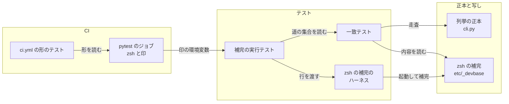
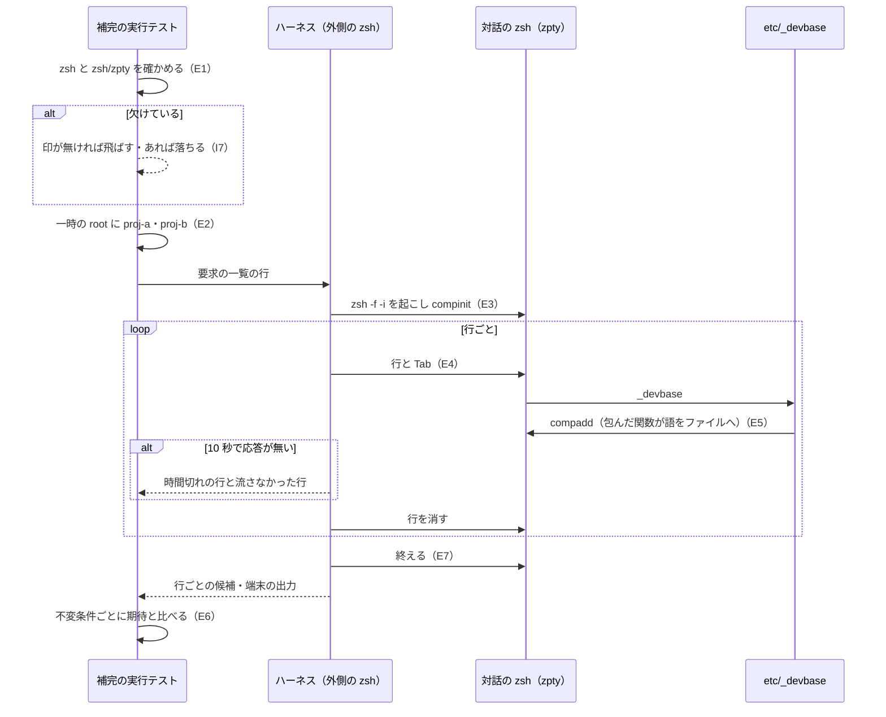

# zsh の補完: 分岐の文字列がそろっていれば候補が出なくても検査を通る → zsh を起動して全道の実際の候補を比べ、手元と CI で退行を落とす（#455）

## 目的

- **何が壊れているか**: zsh の補完（`etc/_devbase`）の検査は、道の分岐の本体に決まった文字列があるかしか見ない。#449 で `devbase up <TAB>` がプロジェクト名を出さなくなった退行は、一致テストをすべて通った
- **誰が困るか**: zsh を使う利用者が、検査を通った補完の退行を自分の端末で初めて踏む。補完の分岐を書き換えた開発者は、候補が出なくなっても気づけない
- **直すと何が成り立つか**: pytest が zsh を起動して `etc/_devbase` を補完として読み込み、`[name]` と `--context` の集合のすべての道で実際の候補を比べる。候補が出なくなると、打った行・期待・実際の候補を挙げて落ちる。CI（Linux）でも同じテストが走り、zsh が無ければ飛ばさずに落ちる

## 適用範囲

- **働く範囲**: このリポジトリのテスト（`tests/cli/`）・CI の pytest のジョブ・確定仕様と開発参加ガイド。`etc/_devbase` と利用者の環境（rc・base イメージ）は変えない。プラグインのリポジトリには及ばない
- **プロジェクトごとに違うもの**: 無し（候補の比べ方はプロジェクトに依らない。テストのプロジェクト名は一時の root の `proj-a`・`proj-b`）
- **当たるモード**: `standard`

## あるべき姿の根拠

| 根拠 | 種類 | 何を示すか |
| --- | --- | --- |
| #450 のリリース後テストの記録（https://github.com/devbasex/devbase/pull/450#issuecomment-6062408599）: `zsh/zpty` で対話の zsh を起こし `compadd` を包む形が macOS の zsh 5.9 で動き、`54ed5bf^` では `devbase up <TAB>` の候補が `--context` だけになる | 実測 | 方法が動き、#449 の退行を拾えること |
| この設計で同じ形を走査の集合の全 122 行へ広げた試し（下の「実測の記録」）: macOS の zsh 5.9 で 0.78 秒、全行が期待どおり。`54ed5bf^` では 27 行が落ちる | 実測 | 全道を回しても所要が 30 秒の上限に遠いこと。全道で回すと退行の広がりが道ごとに見えること |
| 同じ試しを Docker の `ubuntu:26.04`（aarch64、apt の zsh 5.9）で流し、macOS と同じ候補が出た。`54ed5bf^` でも同じ行が落ちた | 実測 | Linux の zsh でも同じ形が動くこと（要求の未決 2） |
| GitHub の `actions/runner-images` の `images/ubuntu/Ubuntu2404-Readme.md`（Image Version 20261004.327.1）に `zsh` の語が 1 つも無い（`grep -i zsh` が 0 行） | 外部の一次情報 | CI の ubuntu ランナーには zsh が入っておらず、走らせるには入れる手順が要ること |

要求と受け入れ条件は #455 の本文にある（コピーは `issues/issue-455-requirements.md`）。この文書は「どう作るか」だけを扱う。

## ドメインモデル

### コンテキスト

| コンテキスト | 何の語が 1 つの意味に決まるか |
| --- | --- |
| コマンドの入口（`cli`） | 列挙の正本・写し・一致テスト・補完の例外・補完の実行テスト。`[name]` と `--context` を受け付ける道の集合 |
| 継続的インテグレーション（`ci`） | CI の pytest のジョブが用意する実行環境（zsh の有無） |

`cli` が顧客、`ci` が供給者の関係（顧客 / 供給者）。補完の実行テストが「zsh が要る」ことを求め、`ci` の pytest のジョブがランナーへ zsh を入れて応える。`ci` は `cli` の語（道・候補）を知らない。

### 集約

| 集約 | 持ち主（書き換えてよいもの） | 根 | エンティティ | 値オブジェクト |
| --- | --- | --- | --- | --- |
| 補完の実行テスト（新規） | `tests/cli/test_zsh_completion_run.py` と `tests/cli/zsh_completion_harness.py` | 補完の要求の一覧（打つ行と期待の組を 1 か所で作る関数） | zsh のセッション（1 回のテストの実行で 1 つ） | 打った行・期待（含む語の集合か 0 件）・実際の候補の集合・欠けたもの（zsh / `zsh/zpty`） |
| 列挙の正本 | `lib/devbase/cli.py`（この変更では書き換えない） | `_create_parser()` の木 | サブコマンドの parser | 道・`[name]` の集合・`--context` の集合 |
| zsh の補完の写し | `etc/_devbase`（この変更では書き換えない） | `_devbase` | 道の分岐 | — |
| CI の pytest のジョブ | `.github/workflows/ci.yml` の `pytest` | ジョブ | 手順 | zsh を入れる手順・zsh を必須とする印（環境変数） |

補完の実行テストは、道の集合を一致テスト（`tests/cli/test_name_context_consistency.py`）の走査の結果から読むだけで、列挙の正本と zsh の補完の写しを書き換えない。CI の pytest のジョブは補完の実行テストを名前で知らず、印の環境変数だけでつながる。

### 不変条件

| # | 集約 | 条件 | 破れたときの扱い |
| --- | --- | --- | --- |
| I1 | 補完の実行テスト | `[name]` の集合から補完の例外を引いたすべての道で、`devbase <道> ` の候補に `proj-a` と `proj-b` が入る | 落ちた行ごとに、打った行・期待・実際の候補を挙げて落ちる |
| I2 | 補完の実行テスト | `devbase login ` の候補に `1` と `2` が入る | 同上 |
| I3 | 補完の実行テスト | `--context` の集合のすべての道（`container` の道は `ct` で始めても）で、`devbase <道> -` の候補に `--context` が入る | 同上 |
| I4 | 補完の実行テスト | `[name]` の集合から補完の例外を引いた道のうち `--context` の集合にもある道で、`devbase <道> proj-a -` の候補に `--context` が入る | 同上 |
| I5 | 補完の実行テスト | `--context` の集合のすべての道（`ct` で始めても）で、`devbase <道> --context ` の候補が 0 件である | 同上（実際の候補を挙げる） |
| I6 | 補完の実行テスト | 1 回の補完の要求に 10 秒以内の応答が無ければ打ち切って落ち、テストの後に起動した zsh のプロセスが残らない | 打ち切った行と、それより後で流さなかった行を挙げて落ちる |
| I7 | 補完の実行テスト | zsh が無い・`zsh/zpty` を読み込めない環境では、zsh を必須とする印が無ければ飛ばし、印があれば落ちる。どちらも欠けたものの名前を `pytest tests/ -q` の既定の出力に出す。ほかのテストは止めない | — |
| I8 | 補完の実行テスト | 起動する zsh は利用者の rc を読まず、`DEVBASE_ROOT` は一時の root を指し、`HOME` も一時のディレクトリを指す | — |
| I9 | CI の pytest のジョブ | pytest を走らせる前に zsh を入れ、zsh を必須とする印を立てる | `tests/ci/` のテストが、欠けた手順か印を挙げて落ちる |

### ドメインイベント

| # | イベント | 発生元 | 受け手 |
| --- | --- | --- | --- |
| E1 | zsh と `zsh/zpty` を使えるかを確かめた | 補完の実行テスト（テストを走らせる前） | 補完の実行テスト（欠けていれば I7） |
| E2 | 一時の root にプロジェクトを置き、`DEVBASE_ROOT` を向けた | 補完の実行テストのフィクスチャ | zsh のセッション |
| E3 | zsh を起こし、`etc/_devbase` を補完として読み込んだ | zsh のセッション | 補完の実行テスト（読み込めなければ端末の出力を挙げて落ちる） |
| E4 | 行を打って補完を求めた | zsh のセッション | `etc/_devbase` の `_devbase` |
| E5 | 補完が候補を書き出した | 包んだ `compadd` | zsh のセッション（10 秒で来なければ I6） |
| E6 | 書き出した候補を期待と比べた | 補完の実行テスト | 開発者（手元の pytest か CI の出力） |
| E7 | zsh を終えた | 補完の実行テストのフィクスチャ（正常の後も失敗の後も） | — （プロセスが残らないこと。I6） |

### 用語

| 用語 | 意味 | 用語集への反映 |
| --- | --- | --- |
| 補完の実行テスト | zsh を起動して補完のファイルを読み込み、行を打って補完が実際に出した候補（`compadd` が加えた語）を期待と比べるテスト。一致テストが内容を読んで比べるのに対し、候補そのものを見る | 追加（`cli`） |
| 一致テスト | 列挙の正本を走査して得た集合と写しを比べるテスト。zsh の写しは今までどおり内容を読んで比べる | 変えない |
| 補完の例外 | 補完がプロジェクト名を出さないと決めた道と理由の組。補完の実行テストも I1・I4 で同じ一覧を引く | 変えない |

## 機能一覧

| # | 機能 | 誰が使うか |
| --- | --- | --- |
| F1 | zsh の補完が `[name]`・`--context` の集合のすべての道で出す候補を、zsh を起動して比べる | devbase の開発者（手元の pytest） |
| F2 | 候補が期待と違うと、打った行・期待・実際の候補を並べて落ちる | 同上 |
| F3 | zsh か `zsh/zpty` が無い手元では、欠けたものを出して飛ばす | 同上 |
| F4 | CI の pytest のジョブが zsh を入れて F1 を走らせ、zsh が無ければ落ちる | Pull Request を出す開発者とレビューする人 |

## 構成要素

| 要素 | 責務 | 変え方 |
| --- | --- | --- |
| zsh の補完のハーネス `tests/cli/zsh_completion_harness.py`（新規） | 外側の zsh から `zsh/zpty` で対話の zsh（`zsh -f -i`）を 1 つ起こし、`etc/` を `fpath` に入れて `compinit` する。`compadd` を包んで加えた語を行ごとのファイルへ書き、受け取った行を順に打って補完を求める。行ごとの候補・時間切れ・端末の出力を返す。zsh と `zsh/zpty` の有無を確かめる関数も持つ | 新しく作る。`tests/containers/tmux_harness.py` と同じく、テストから使う部品として置く |
| 補完の実行テスト `tests/cli/test_zsh_completion_run.py`（新規） | 補完の要求の一覧を 1 か所で作り（I1〜I5）、ハーネスで 1 回流して、不変条件ごとのテストで比べる。欠けた環境の扱い（I7）を持つ | 新しく作る。道の集合と補完の例外は一致テストのモジュールの `NAME_PATHS`・`CONTEXT_PATHS`・`COMPLETION_NAME_EXCEPTIONS` を読む（書き写さない） |
| `tests/cli/test_completion.py` | 補完の個々の振る舞いを固定する | モジュールの説明の「zsh 補完はランナー非依存にするため静的内容チェックのみ」を、候補の確認は補完の実行テストが持つ旨に直す。テストは変えない |
| `.github/workflows/ci.yml` の `pytest` のジョブ | pytest を走らせる | `uv sync` の前に zsh を apt で入れて版をログへ出す手順を足し、ジョブの `env` に zsh を必須とする印 `DEVBASE_TEST_REQUIRE_ZSH: "1"` を置く |
| `tests/ci/test_ci_workflow.py` | `ci.yml` の形を固定する | I9 を見るテストを足す |
| `docs/specifications/cli-argument-resolution.md` | 確定仕様 | 下の「確定仕様の改め」 |
| `docs/specifications/ci-checks.md` | CI の確定仕様 | 「検査ジョブ」の表の `pytest` の行に、zsh を入れる手順と印を足す。「テスト観点」に I9 の行を足す |
| `docs/developer/contributing.md` | 開発参加ガイド | 「CI が実行するもの」に、pytest の前に zsh を入れること、手元で zsh が無ければ補完の実行テストが飛ぶことを足す |
| `docs/glossary/glossary.json`・`docs/glossary.md` | 用語集 | 「補完の実行テスト」を `cli` に足し、`glossary.py render` で作り直す |

`etc/_devbase`・`etc/devbase-completion.bash`・`lib/`・`bin/`・`containers/` は変えない。`CHANGELOG.md` は書かない（テストと開発者向けの文書だけの変更）。



文書（確定仕様・開発参加ガイド・用語集）と `tests/cli/test_completion.py` の説明の直しは、テストの実行時の関係を持たないため図に含めない。

### 確定仕様の改め

`docs/specifications/cli-argument-resolution.md` から、zsh を起動するテストが無いことを前提にした 3 か所を消し、補完の実行テストを書く。

| 場所 | 今 | 改めた後 |
| --- | --- | --- |
| 「一致テストが比べる写し」の表の `etc/_devbase` の行 | zsh を起動せず内容を読む | そのまま残す（前提 1）。表の下に「zsh の候補そのものは補完の実行テストが見る」の 1 文と、次の小節への参照を足す |
| 新しい小節「zsh の補完の実行テスト」（`#### 補完が --context を出す位置` の後） | 無し | 何を確かめるか（I1〜I5 の行の作り方と期待）、どの環境で走るか（手元の macOS は zsh があれば走り、無ければ飛ぶ。CI は zsh を入れ、無ければ落ちる）、時間切れ（10 秒）、利用者の rc を通した見た目はリリース後テストで見ること |
| 「テスト観点」の最後の行（「zsh を起動するテストが無いため手元の zsh で確かめる」） | 手元の zsh で確かめる | 補完の実行テストが確かめる I1〜I7 の行に置き換える（`tests/cli/test_zsh_completion_run.py`） |
| 決定 9 の最後の文（「zsh を起動する形は、CI のランナーに zsh があることを前提にするため採らない」） | 起動する形を採らない | 「候補そのものは補完の実行テストが zsh を起動して見る。一致テストが内容を読むのは、zsh の無い環境でも分岐の記述を確かめるためである」に改める |
| 決定 13 の「zsh を起動する検査が無く番号の誤りを拾えないため」 | 検査が無いことを理由にする | 「番号を分岐ごとに数える形は、数える場所が分岐の数だけ増えるため」に改める。番号の誤りは補完の実行テストが道ごとに拾うことを添える |
| 「決定の記録」の冒頭の文と「関連リンク」 | #214・#435 の決定 | 補完の実行テスト（#455）の決定として、この文書の決定 1〜4 を決定 14〜17 に写して足し、実装 PR のリンクを足す |

## 処理の流れ

補完の実行テストの 1 回の実行（`pytest` のワーカーの 1 つで、要求の一覧のすべての行を 1 つの zsh のセッションで流す）。



- **E3 で読み込めない**（`etc/_devbase` の構文の誤りなど）とき、包んだ `compadd` はどの行でも呼ばれない（実測の記録）。テストは比べる前に、どの行でも包んだ `compadd` が 1 回も呼ばれていなければ、端末の出力の末尾を挙げて落ちる
- **時間切れ**のとき、ハーネスはその行で流すのをやめ、外側の zsh とその子をプロセスのグループごと終える。時間切れの行とそれより後の行は、候補ではなく「時間切れ」「流していない」として返す
- **E7 は正常の後も失敗の後も通る。** フィクスチャの後始末で、起動したプロセスのグループが残っていれば強制的に終える

## 非機能の実現方式

| 大項目 | 要求の条件 | 実現方式 | 確かめ方 |
| --- | --- | --- | --- |
| 性能・拡張性 | 足したテストの全体で、手元（macOS）の `pytest tests/cli -q` の所要の増分が 30 秒以内。CI の pytest のジョブの `timeout-minutes: 15` を越えない | すべての行を 1 つの zsh のセッションで流し、`compinit` を 1 回にする。テストを 1 つの `xdist_group` に寄せ、セッションを 1 ワーカーで 1 回だけ起こす。時間切れを確かめるテストは短い待ち時間をハーネスへ渡す | 手元で `pytest tests/cli -q` を足す前と後で測り、実装 PR に載せる。CI のジョブの所要を実装 PR で見る |
| 運用・保守性 | 確かめる道と期待する候補を、テストの中の 1 か所の一覧で持つ。道を足すときはその一覧に 1 行足せば済む | 要求の一覧を作る関数を 1 つ置く。走査の集合から作る行と、走査に無い行（`login` の `1 2`）を同じ関数で並べる。走査の集合に入る道は、サブコマンドを足せば一覧を直さずに入る | テストのファイルを読んで、行と期待を作る場所が 1 つであることをレビューで見る |
| システム環境 | macOS の zsh 5.9 で走る。CI（ubuntu ランナー）で走るかは未決 1 による | CI でも走らせる（決定 3）。ハーネスは macOS と Linux で振る舞いが分かれるオプションを使わない | 手元の macOS の実行と、実装 PR の CI の Pytest（3.10・3.13）の両方で、補完の実行テストが飛ばされずに通ったことをログで見る |

## 決定の記録

### 決定 1: 利用者の端末と同じ経路で候補を取るため、zpty で対話の zsh を起こし `compadd` を包む

`compadd` に渡った語を取るには、行を打って補完を求める経路（zle の `complete-word`）を通す必要がある。`zsh/zpty` は zsh 自身のモジュールで、macOS と Linux の zsh 5.9 で同じスクリプトが同じ候補を出した（下の「実測の記録」）。包んだ `compadd` は `builtin compadd -O` で加わる語を受け取ってファイルへ書き、元の `compadd` も呼ぶため、補完の振る舞いを変えない。

Python の `pty` で zsh を操作する形は、端末の制御の文字を読み分ける処理をテストの側に持つことになり、zpty より部品が増えるため採らない。`script` コマンドで端末を作る形は、macOS と Linux で引数の形が違うため採らない。

根拠: Mission（MVV 版 1）

### 決定 2: 分岐ごとの誤りを道ごとに見つけるため、走査の集合のすべての道を zsh で回す

`_devbase_arguments` へ渡す深さの誤りのように、退行は分岐ごとに起き得る。`54ed5bf^` では、代表の 10 行が落とすのは 3 行だけで、`container`・`ct`・`env token` の直後の `-` で `--context` が出ない 13 行は、全道を回したときにだけ見えた（実測の記録）。全道（実測で 122 行）を回しても macOS で 0.78 秒で、30 秒の上限に遠い。行は一致テストの走査の集合（`NAME_PATHS`・`CONTEXT_PATHS`・`COMPLETION_NAME_EXCEPTIONS`）から作り、期待の集合を書き写さない（確定仕様の決定 2 と同じ理由）。走査に無い `login` の `1 2` だけを名指しで足す。

代表の道（受け入れ条件 2〜5 の 10 行）に留める形は、時間の節約が 1 秒に満たず、拾える退行が狭まるため採らない。

根拠: Mission（MVV 版 1）

### 決定 3: Pull Request の検査で退行を落とすため、CI の pytest のジョブに zsh を入れ、CI では zsh が無ければ落とす

#449 の退行はマージ前の検査をすり抜けた。手元だけで走らせると、zsh の無い環境や手元で流し忘れた Pull Request で同じことが起きる。ubuntu ランナーには zsh が無い（あるべき姿の根拠）ため、pytest のジョブの手順で apt から入れて `zsh --version` をログへ出す。ジョブの `env` に印 `DEVBASE_TEST_REQUIRE_ZSH=1` を置き、印があるのに zsh か `zsh/zpty` が欠けていればテストを落とす。印が無い手元では飛ばし、欠けたものを既定の出力（`-q` でも出る警告の要約）に出す。手順と印が消えていないことは `tests/ci/` が見る。

手元だけで走らせて CI では飛ばす形は、検査をすり抜ける経路が残るため採らない。GitHub が立てる `CI` の環境変数で落とすかを決める形は、手元で `CI` を立てた開発者まで zsh を必須にし、何のための値かが `ci.yml` から読めないため採らない。zsh の版を公式の配布物で固定する形（ShellCheck の扱い）は、zsh の公式の配布がソースで建てる手順が増える一方、比べるのは候補の有無で、ShellCheck の指摘の数のように版で揺れるものではないため採らない。

根拠: Mission / Vision（MVV 版 1）

### 決定 4: zsh が無い環境で静的な検査まで飛ばないよう、補完の実行テストを別のファイルに置く

zsh が無いときの飛ばしは、ファイルの単位で掛けるのが漏れにくい。一致テストのファイルに足すと、同じファイルの静的な zsh の検査（zsh が無い環境で唯一の検査。前提 1）と飛ばす範囲の境目を関数ごとに持つことになる。ハーネスは `tests/containers/tmux_harness.py` と同じく部品のファイルに分け、テストのファイルには要求の一覧と比べ方だけを置く。

一致テストのファイルに足す形は、上の理由で採らない。

根拠: 根拠なし（MVV 版 1）

## テスト設計

| 受け入れ条件・不変条件 | どの振る舞いで縛るか | どう壊したら落ちるべきか |
| --- | --- | --- |
| 受け入れ条件 1 | 補完の実行テストが zsh を起動し、`compadd` が加えた語を候補として比べる | `etc/_devbase` の `_devbase_project_names` を空の関数にすると I1 が落ちる（内容を読む一致テストは通る） |
| 受け入れ条件 2・I1 | `[name]` の集合から補完の例外を引いた 14 の道で `devbase <道> ` の候補に `proj-a`・`proj-b` | `_devbase_arguments` が `words` を詰めないように戻す（`54ed5bf^` の形）と、14 の道すべてが落ち、`devbase up ` の実際の候補が `--context` だけと出る |
| 受け入れ条件 2・I2 | `devbase login ` の候補に `1`・`2` | `login` の分岐の位置引数の番号をずらすと落ちる |
| 受け入れ条件 3・I3 | `--context` の集合の 35 の道と `ct` で始めた 12 の道で `devbase <道> -` の候補に `--context` | 道 1 つの分岐から `--context` の指定を外すと、その道（`ct` の道を含む）だけを挙げて落ちる |
| 受け入れ条件 4・I4 | `[name]` と `--context` の両方を取る道で `devbase <道> proj-a -` の候補に `--context` | `up` の分岐の `--context` の指定を外すと、`devbase up proj-a -` を挙げて落ちる |
| 受け入れ条件 5・I5 | `--context` の集合のすべての道で `devbase <道> --context ` の候補が 0 件 | `--context` の指定に `:_devbase_project_names` を足すと、その道を挙げ、実際の候補に `proj-a`・`proj-b` が出て落ちる |
| 受け入れ条件 6 | 落ちたときの出力に、行ごとに打った行・期待・実際の候補が並ぶ | マージ前の手動確認: `etc/_devbase` を `git show 54ed5bf^:etc/_devbase` に一時に差し替えて流し、I1 が落ちて `devbase up ` の実際の候補が `--context` だけと出ることを実装 PR に貼る |
| 受け入れ条件 7・I7 | 有無の確かめが「zsh が無い」「`zsh/zpty` が無い」を返したとき、印が無ければ欠けたものの名前を理由に飛ばし、印があれば同じ名前を挙げて落ちる。ほかのテストは走る | 印を読まずに常に飛ばすように壊すと、印がある側のテストが落ちる。欠けたものの名前を理由から落とすと、名前を見る行が落ちる。マージ前の手動確認: zsh を `PATH` から外して流した `-q` の出力を実装 PR に貼る |
| 受け入れ条件 8・I6 | 応答しない補完（`fpath` の先頭に置いた、眠り続ける `_devbase`）で、ハーネスが待ち時間で打ち切って時間切れを返し、終わった後に起動した zsh のプロセスが残らない。待ち時間の既定が 10 秒 | 時間切れの打ち切りを外すと、テストが待ち続けて pytest の外側の時間で落ちる。後始末の強制の終了を外すと、プロセスが残ることを確かめる行が落ちる |
| 受け入れ条件 9 | 確定仕様の 3 か所が改まり、補完の実行テストの小節がある | 文書の変更。承認ゲート 2 で人が見る |
| 受け入れ条件 10 | 既存の `test_name_context_consistency.py`・`test_completion.py` のテストが残り、全体のテストが手元と CI（3.10・3.13）で通る | 既存のテスト関数の数が減ると、実装 PR の差分で見える。全体のテストの結果を実装 PR に載せる |
| 受け入れ条件 11・I8 | 一時の `HOME` に印を書き出す `.zshrc` を置いて流しても、印が書かれない。I1 の候補が一時の root の `proj-a`・`proj-b` だけである | zsh を起こすときの `-f` を外すと、印が書かれて落ちる。`HOME` か `DEVBASE_ROOT` を継いだ値のまま渡すと、ハーネスに渡した環境を見る行が落ちる |
| I9 | CI の pytest のジョブに zsh を入れる手順があり、印 `DEVBASE_TEST_REQUIRE_ZSH` が `"1"` である | 手順か印を `ci.yml` から消すと `tests/ci/` のテストが落ちる |
| E3（読み込めない） | どの行でも包んだ `compadd` が呼ばれていなければ、端末の出力の末尾を挙げて落ちる | 一時の `fpath` に構文の誤りを入れた `_devbase` を置くと、「補完を読み込めない」と端末の出力を挙げて落ちる（比べる前に止まり、行ごとの違いを並べない） |

## 設計の結果

| 課題 | 扱い | 取り込み先 | 触るファイル |
| --- | --- | --- | --- |
| #455 | 実装する | — | `tests/cli/zsh_completion_harness.py`、`tests/cli/test_zsh_completion_run.py`、`tests/cli/test_completion.py`、`tests/ci/test_ci_workflow.py`、`.github/workflows/ci.yml`、`docs/specifications/cli-argument-resolution.md`、`docs/specifications/ci-checks.md`、`docs/developer/contributing.md`、`docs/glossary/glossary.json`、`docs/glossary.md` |

## 未確認のまま残ること

| 項目 | 内容 |
| --- | --- |
| CI のランナー（ubuntu-24.04・x86_64）の zsh | Linux での実測は Docker の `ubuntu:26.04`（aarch64）だけである。24.04 の apt の zsh の版と、zpty の振る舞いが同じかは、実装 PR の最初の CI で確かめる |
| CI で zsh を入れる時間 | apt の取得の時間は測っていない。実装 PR の CI のジョブの所要で見る。15 分の上限には余裕がある見込み |
| `pytest-xdist` の下での起動 | 試しは pytest の外で流した。1 つの `xdist_group` に寄せたときの所要と、ワーカーの終了でプロセスが残らないことは実装で走らせて確かめる |
| 利用者の rc を通した見た目 | 対象外（要求の前提 3）。リリース後テストで利用者の端末で確かめる |

## 実測の記録

決定 1〜3 の根拠に使った試しである。2026-10-12 に、macOS の zsh 5.9（arm64）と、Docker の `ubuntu:26.04` に apt で入れた zsh 5.9（aarch64）で流した。一時の root に `projects/proj-a`・`projects/proj-b` を置き、`env -i` で `PATH`・`HOME`（一時）・`TERM=xterm`・`DEVBASE_ROOT`（一時）だけを渡した。引数は「行ごとの出力の置き場・`fpath` に入れる場所・打つ行…」である。

```zsh
zmodload zsh/zpty || { print -r -- "zsh/zpty を読み込めない" >&2; exit 3; }
outdir=$1 fp=$2; shift 2
zpty z zsh -f -i
local buf; integer k=0
cmd() { (( k++ )); zpty -w z "$1; print __S\"\"${k}__"; zpty -r z buf "*__S${k}__*"; zpty -r z buf '*<P> *'; }
cmd "PS1='<''P> '; unsetopt auto_list list_ambiguous beep"
cmd "fpath=($fp \$fpath); autoload -Uz compinit; compinit -u -D -d /dev/null"
cmd "compadd() { local -a __m; builtin compadd -O __m \"\$@\"; print -rl -- \$__m >> \$PROBE_OUT; builtin compadd \"\$@\"; }"
cmd "_probe() { zle complete-word; print -r -- __DONE__ >> \$PROBE_OUT; }; zle -N _probe; bindkey '^I' _probe"
integer n=0
for line in "$@"; do
  (( n++ ))
  : > $outdir/$n
  cmd "PROBE_OUT=$outdir/$n"
  zpty -w -n z "$line"$'\t'
  integer i; for ((i=0;i<200;i++)); do grep -q __DONE__ $outdir/$n && break; sleep 0.05; done
  zpty -w -n z $'\x15'
  cmd ":"
done
zpty -d z
```

| 試し | 結果 |
| --- | --- |
| 受け入れ条件 2〜5 の 10 行、今の `etc/_devbase`（macOS） | 0.44 秒。`devbase up `・`devbase project up ` は `proj-a proj-b`、`devbase login ` は `1 2`、`-` で終わる 5 行は `--context` を含む（`env exec -` は `-` も出る）、`--context ` で終わる 2 行は 0 件 |
| 同じ 10 行、`54ed5bf^` の `etc/_devbase`（macOS） | `devbase up `・`devbase project up `・`devbase login ` の候補が `--context` だけ。ほかの 7 行は今と同じ |
| 同じ 10 行、今と `54ed5bf^`（Linux） | macOS と同じ候補 |
| 走査の集合から作った 122 行（`[name]` 14・`--context` の道の直後 47・名前の後 14・`--context` の値 47）、今の `etc/_devbase`（macOS） | 0.78 秒。すべて期待どおり |
| 同じ 122 行、`54ed5bf^`（macOS） | 0.84 秒。27 行が落ちる。`[name]` の 14 行すべて（`devbase up ` などの候補が `--context` と旗だけ）と、`container`・`ct` の 12 の道と `env token` の道の直後の `-` の 13 行（候補が 0 件） |

試しの途中で分かったこと（実装の手がかり。上のスクリプトはこれを踏まえた形）:

- 包んだ `compadd` が加える語が無いとき `print -rl --` は空の行を 1 つ書く。候補の集合からは空の文字列を除いて数える
- `TERM=dumb` では zle が動かず、候補が書かれなかった。`TERM=xterm` で動いた
- 前のコマンドの後のプロンプトを待たずに行と Tab を送ると、候補が書かれずに待ちが尽きた。コマンドごとに印とプロンプトの両方を待つと 122 行が通った
- `etc/_devbase` の末尾に構文の誤りを足すと、`devbase up `・`devbase up -` のどちらでも包んだ `compadd` が 1 回も呼ばれなかった（ファイルの補完などへ落ちて別の候補が出ることは無かった）
- `auto_list` が有効なままだと、曖昧な候補の一覧を描き直したプロンプトが次の待ちの印と取り違えられ、2 行目の後で止まった。`unsetopt auto_list list_ambiguous` で止まらなくなった
