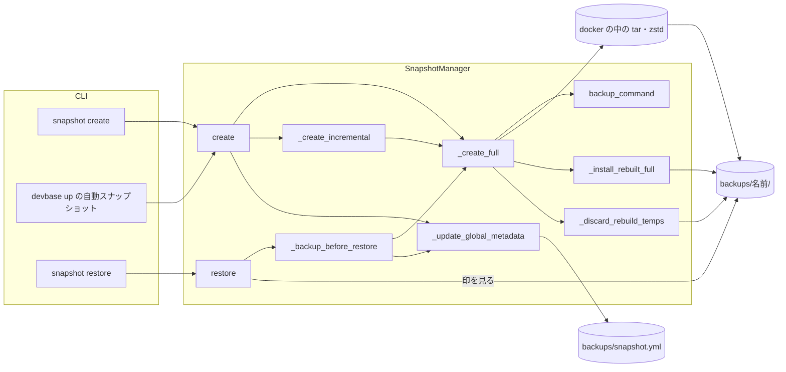
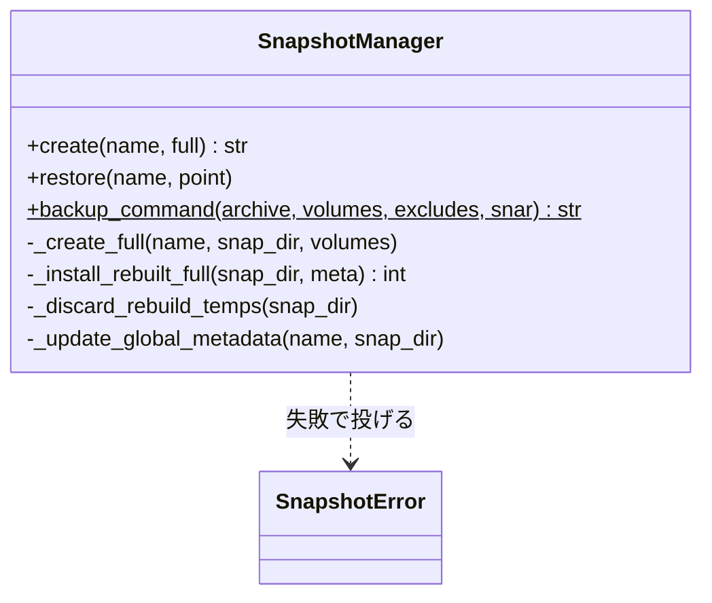
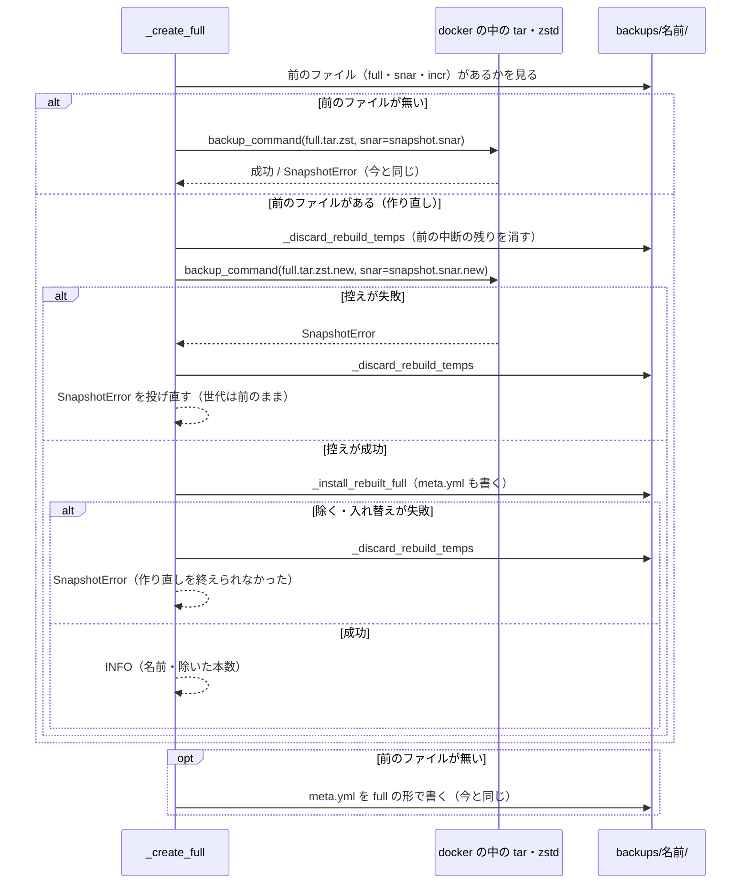
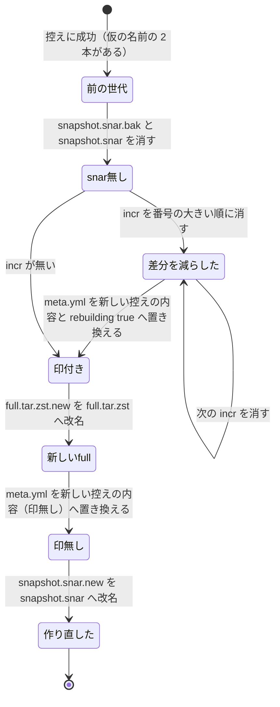

# snapshot create: 既にある世代の名前で --full を打つと失敗し、その後の差分が失敗の前の変更を落とす → その世代を今のボリュームの全体で作り直し、失敗しても前の控えを保つ（#458）

## 目的

- **何が壊れているか**: 既にある世代の名前で `devbase snapshot create --name <名前> --full` を打つと、`full.tar.zst` を作り直せずに失敗し、
  そのとき `snapshot.snar` だけが進む。その後に積んだ差分は、前の控えから失敗した回までの変更を含まない
- **誰が困るか**: 名前を付けて取り直す利用者（文書が `--name before-upgrade --full` を例に挙げる）。失敗の後に `devbase up` が同じ世代へ差分を積むと、
  その世代を復元したときにファイルが無いか古い中身になる
- **直すと何が成り立つか**: その世代は打った時点のボリュームの全体を 1 本の `full.tar.zst` で持ち、前の差分は残らない。作り直しに失敗しても、世代のファイルは打つ前と同じである

## 適用範囲

- **働く範囲**: devbase の CLI（`lib/devbase/snapshot/manager.py`）。配布先の利用者の `backups/` の世代に効く。プラグインのリポジトリは触らない
- **プロジェクトごとに違うもの**: 無し（世代の形はプロジェクトに依らない。対象ボリュームの組と除外の一覧は今のとおり `--group` と `backups/exclude.yml` で受ける）
- **当たるモード**: `standard`

## あるべき姿の根拠

| 根拠 | 種類 | 何を示すか |
| --- | --- | --- |
| `docs/user/cli-reference/05-snapshot.md` の `--full`「フルバックアップを強制作成」と例 `--name before-upgrade --full` | 外部の一次情報（利用者の文書） | 既にある名前でも、打った時点の全体を控えると約束している |
| `docs/user/snapshot-guide.md`「差分ではなく、強制的にフルバックアップを作成します」 | 外部の一次情報（利用者の文書） | 同上 |
| `devbase-snapshot:latest`（GNU tar 1.35・zstd 1.5.7）で、今のコマンドの形を作業用のディレクトリへ 2 回打った（2026-10-12） | 実測 | 2 回目は zstd が `already exists; stdin is an input - not proceeding.` で終了コード 1。`full.tar.zst` は前のまま、`snapshot.snar` は 76 → 80 バイトに進んだ。その後に打った差分の中身は `ai/` だけで、間に足した `ai/c` が無かった |

要求と受け入れ条件は #458 の本文にある（コピーは `issues/issue-458-requirements.md`）。この文書は「どう作るか」だけを扱う。

課題の本文の「何を見つけたか」は、`full.tar.zst` が変更分だけで上書きされると書く。実際のコマンドの形（`tar -cf - | zstd -o`）では
zstd が上書きを拒み、上の実測の形になる。直す向きと受け入れ条件は変わらない。受け入れ条件 5（失敗しても世代のファイルを保つ）は、
今の実装では `snapshot.snar` の点で破れている。

## ドメインモデル

### コンテキスト

| コンテキスト | 何の語が 1 つの意味に決まるか |
| --- | --- |
| スナップショット（`snapshot`） | 世代・系列・除外の一覧・復元前バックアップ、と今回足す「世代の作り直し」 |

1 つのコンテキストで閉じる。

### 集約

| 集約 | 持ち主（書き換えてよいもの） | 根 | エンティティ | 値オブジェクト |
| --- | --- | --- | --- | --- |
| 世代 | `SnapshotManager._create_full`（作る・作り直す）と `_create_incremental`（差分を積む）。この変更で触るのは前者だけ | 世代のディレクトリ `backups/<名前>/` | — | `full.tar.zst`・`incr-NNN.tar.zst`・`snapshot.snar`・`meta.yml` |
| 世代の一覧 | `SnapshotManager._update_global_metadata` | `backups/snapshot.yml` | 世代のエントリ（`name` で識別） | `created_at`・`updated_at`・`incremental_count`・`volumes` |

世代の一覧は世代を名前で参照する。作り直しは世代を書き終えてから一覧を更新する（今の順のまま）。

### 不変条件

| # | 集約 | 条件 | 破れたときの扱い |
| --- | --- | --- | --- |
| I1 | 世代 | 作り直しが成功した世代は、`full.tar.zst` と `snapshot.snar` が同じ 1 回の控えから作られ、`incr-*.tar.zst` と `snapshot.snar.bak` を持たない | 成功として返さない（I3） |
| I2 | 世代 | 作り直しの控えのコマンドが失敗したら、世代の既存のファイルはバイト列が打つ前と同じで、ファイルが増えない | `SnapshotError`。仮の名前のファイルを消してから返す |
| I3 | 世代 | 控えに成功した後、前の差分を除く・入れ替えるのに失敗したら `SnapshotError` を返す。途中のどの状態でも、世代は `snapshot.snar` を持たず、次のどちらかである: (a) `meta.yml` に作り直しの途中の印（`rebuilding: true`）が無く、`full.tar.zst` と `meta.yml` の対象ボリューム（`volumes`）・アーカイブの起点（`archive_root`）・除外の一覧（`exclude`）が同じ 1 回の控えのもので、ある時点へ順に戻せる組である。(b) `meta.yml` が印を持ち、`restore` はその世代を復元しない | 次の `create`（自動スナップショットを含む）が snar 無しの経路で full を作り直す。印のある世代の `restore` は、復元前バックアップとボリュームの消去の前に `SnapshotError` で止まる |
| I4 | 世代の一覧 | 作り直してもエントリは 1 件のままで、`created_at` は変わらない | 今の `_update_global_metadata` の既存エントリの更新で守る（この変更で触らない） |
| I5 | 世代 | 前のファイルを持たない世代の full の作成（新しい名前・`devbase up` の新しい世代・新しい復元前バックアップ）は、コマンド・アーカイブ・`meta.yml` が今と同じ | 退行。今のテストが落ちる |

### ドメインイベント

| # | イベント | 発生元 | 受け手 |
| --- | --- | --- | --- |
| E1 | 利用者が既存の世代の名前で `snapshot create --full` を打った | 利用者（`devbase snapshot create`） | `SnapshotManager.create` |
| E2 | 前の `snapshot.snar` を引き継がずに、ボリュームの全体を新しい full として仮の名前で控えた | `_create_full`（docker の中の tar・zstd） | `_create_full`（入れ替えへ進む） |
| E3 | 前の差分アーカイブと前の状態の控えを世代から除き、仮の名前のファイルを本来の名前へ入れ替えた | `_install_rebuilt_full` | `_create_full`（INFO を出す） |
| E4 | 世代の `meta.yml` を full の形で書いた（作り直しでは E3 の中で、印付き → 印無しの 2 回に分けて書く） | `_create_full`（新しい世代）・`_install_rebuilt_full`（作り直し） | `create`（一覧の更新へ進む） |
| E5 | `snapshot.yml` のその世代の `incremental_count` と `updated_at` を更新した | `_update_global_metadata` | `restore`・`auto_snapshot_target`・`rotate`（読む側） |
| E6 | 利用者がその世代を復元し、ボリュームが E2 の時点の中身になった | 利用者（`devbase snapshot restore`） | 利用者 |
| E7 | 次の `devbase up` の自動スナップショットが、その世代へ `incr-001` を積んだ | `_auto_snapshot` → `create(name)` | `_create_incremental` |

E3 は要求の E3（差分を除く）に、仮の名前からの入れ替えを含めた。入れ替えを先にすると、除けなかったときに新しい full へ前の差分が当たるためである（決定 2）。

### 用語

| 用語 | 意味 | 用語集への反映 |
| --- | --- | --- |
| 世代の作り直し | 既にある世代のディレクトリへ、前の `snapshot.snar` を引き継がずに新しい full を作り、前の差分と状態のファイルを除くこと。`--full` を既存の名前へ打ったとき・snar の無い世代への差分の指定・同じ秒に重なった復元前バックアップで起きる | 追加（`snapshot`） |
| 世代 | `backups/<名前>/` の 1 つ。`full.tar.zst` 1 つと、0 個以上の `incr-NNN.tar.zst` からなる | 変更なし |
| 復元前バックアップ | `restore` が書き戻す前に自動で作るフルの世代 `pre-restore-<時刻>` | 変更なし |
| 除外の一覧 | スナップショットのアーカイブに入れないパスの一覧 | 変更なし |

## 機能一覧

| # | 機能 | 誰が使うか |
| --- | --- | --- |
| F1 | 既にある世代を `--full` で今のボリュームの全体に作り直す | `devbase snapshot create --name <既存> --full` を打つ利用者 |
| F2 | `snapshot.snar` の無い世代への差分の指定を、作り直しとして full に切り替える | `create --name <既存>` を打つ利用者と `devbase up` の自動スナップショット |
| F3 | 同じ秒に重なった復元前バックアップを、作り直しとして作る | `devbase snapshot restore` を打つ利用者 |
| F4 | 作り直しに失敗しても前の控えを保ち、失敗を終了コード 1 で知らせる | F1〜F3 の利用者 |
| F5 | 作り直したことを INFO の 1 行で知らせる | F1〜F3 の利用者 |
| F6 | 既存の名前への `--full` の結果を利用者の文書に書く | 利用者 |

## 構成要素

| 要素 | 責務 |
| --- | --- |
| `SnapshotManager._create_full`（変更） | 世代に前のファイル（`full.tar.zst`・`snapshot.snar`・`incr-*.tar.zst` のどれか）があれば仮の名前で控え、新しい控えの `meta.yml` の内容を組んで `_install_rebuilt_full` へ渡す。無ければ今のとおり本来の名前で控え、最後に今と同じ形の `meta.yml` を書く |
| `SnapshotManager.backup_command`（変更） | 状態ファイルの名前を引数 `snar`（既定 `snapshot.snar`）で受ける。既定のままなら今と同じ文字列を返す |
| `SnapshotManager._install_rebuilt_full`（追加） | 控えの成功の後に、前の状態ファイルと差分を除き、`meta.yml` を印付きの新しい内容へ置き換え、仮の名前の full を本来の名前へ入れ替え、`meta.yml` を印無しへ置き換え、最後に仮の名前の状態ファイルを入れ替える（決定 2）。`meta.yml` の置き換えは仮の名前 `meta.yml.new` へ書いて `os.replace` する。除いた差分の本数を返す。途中で失敗したら `SnapshotError` |
| `SnapshotManager.restore`（変更） | 書き戻す組を読む前に、世代の `meta.yml` が印（`rebuilding: true`）を持てば `SnapshotError` で止める。復元前バックアップもボリュームの消去も行わない |
| `SnapshotManager._discard_rebuild_temps`（追加） | 仮の名前のファイル（3 本）を消す。控えの前（前の中断の残り）と失敗の後に呼ぶ。消せなければ警告して続ける |
| 定数 `FULL_ARCHIVE_TMP`・`SNAR_FILE_TMP`・`META_FILE_TMP`（追加） | 仮の名前 `full.tar.zst.new`・`snapshot.snar.new`・`meta.yml.new`。`is_archive_file` と `incr-*.tar.zst` の glob に当たらない |
| `create`・`_create_incremental`・`_backup_before_restore`・`_update_global_metadata`（変更なし） | 今のとおり `_create_full` を呼び、その後に一覧を更新する。作り直しは `_create_full` の中で決まる |
| `docs/user/cli-reference/05-snapshot.md`・`docs/user/snapshot-guide.md` | 既存の名前への `--full` の結果（作り直し、前の差分は消え前の時点へは戻せない） |
| `docs/specifications/snapshot-series.md` | 「世代の作り直し」の節（手順・失敗の扱い・ログ）。`snapshot-exclude.md` の運用の節の #458 の行を書き換える |
| `CHANGELOG.md` の `[Unreleased]`・`docs/glossary/glossary.json`・`docs/glossary.md` | 利用者に見える変更（決定 5 の案内を含む）と、語「世代の作り直し」 |

図は処理の要素だけを描き、定数（仮の名前）と文書・`CHANGELOG.md`・用語集を含めない。`_create_full` を呼ぶのは `create`（新しい名前・`--full`）、`_create_incremental`（snar 無しの切り替え）、`_backup_before_restore` の 3 つで、ほかに無い
（`grep -n "_create_full" lib/` で `manager.py` の 3 か所）。

## 構造

触る型は `SnapshotManager` だけで、型の関係は変わらない。触るメソッドと定数を示す。

## データ構造

`snapshot.yml` の形は変えない。`meta.yml` は作り直しの途中だけ真偽値のキー `rebuilding: true` を持ち得る（作り直しを終えた世代と新しい世代は持たない）。
キーを持たない今の世代は今のとおり読めるため、移行は無い。ほかは世代のディレクトリに置くファイルの扱いだけが変わる。

| ファイル | 今 | 作り直しの後 |
| --- | --- | --- |
| `full.tar.zst` | 作り直せない（zstd が上書きを拒む） | 新しい控え |
| `snapshot.snar` | 失敗した回の状態へ進む | 新しい控えの状態（前の snar を引き継がない） |
| `incr-*.tar.zst` | 残る | 無い |
| `snapshot.snar.bak` | 残る | 無い |
| `meta.yml` | 前のまま（失敗のため） | `type: full`・`files: [full.tar.zst]`・`incremental_count: 0`・今の `exclude`・`volumes`・`created_at`（作り直した時刻） |
| `meta.yml` の `rebuilding` | 無い | 作り直しの途中（新しい控えの内容を書いてから印を外すまで）だけ `true`。作り直した後は無い |
| `full.tar.zst.new`・`snapshot.snar.new`・`meta.yml.new` | 無い | 作り直しの間だけある。成功でも失敗でも残さない |
| `snapshot.yml` のエントリ | 前のまま | `incremental_count: 0`・`updated_at` を更新、`created_at` は前のまま |

`meta.yml` の `created_at` は今の `_create_full` のとおり作り直した時刻を書く。系列の新旧とローテーションは `snapshot.yml` の `created_at`
だけで決まり（`snapshot-series.md` の「データ・設定」）、`meta.yml` の `created_at` を読む処理は無い。

| 機能 | `full.tar.zst` | `incr-*` | `snapshot.snar`（`.bak`） | 仮の名前のファイル | `meta.yml` | `snapshot.yml` |
| --- | --- | --- | --- | --- | --- | --- |
| F1〜F3 の成功 | 更新 | 削除 | 更新（`.bak` は削除） | 作成 → 改名 | 更新 | 更新 |
| F4（控えの失敗） | — | — | — | 作成 → 削除 | — | — |
| F4（除く・入れ替えの失敗） | 止まった所により更新 | 削除（止まった所まで） | 削除 | 削除 | 止まった所により印付き・印無しで更新 | — |

## 入出力の契約

`devbase snapshot create` の引数・終了コードは変えない。`--full` を既存の名前へ打った結果と、出す文言だけが変わる。

| 場面 | 結果 | 出力 |
| --- | --- | --- |
| 作り直しに成功 | 終了コード 0 | INFO `フルバックアップを作成中: {名前}`（今の行）の後に INFO `世代 {名前} を今のボリュームの全体で作り直しました（前の差分 {本数} 本を除きました）` |
| 控えのコマンドが失敗 | `SnapshotError` → 終了コード 1 | 今の `Dockerでのtar操作に失敗しました: {stderr}`。世代は打つ前のまま |
| 除く・入れ替えに失敗 | `SnapshotError` → 終了コード 1 | `世代 '{名前}' の作り直しを終えられませんでした: {理由}。もう一度 devbase snapshot create --name {名前} --full を打ってください` |
| 前のファイルを持たない世代の full | 今と同じ | 今と同じ（作り直しの行を出さない） |
| 作り直しの途中の印を持つ世代の `restore` | `SnapshotError` → 終了コード 1。復元前バックアップを作らず、ボリュームを消さない | `世代 '{名前}' は作り直しの途中で止まっているため復元できません。devbase snapshot create --name {名前} --full を打って作り直してください` |

復元前バックアップ（F3）の失敗は、今のとおり `_backup_before_restore` が警告 1 行に変えて復元を続ける。既にあった同名のディレクトリは消さない（今の振る舞い）。

## 処理の流れ

`_install_rebuilt_full` は次の順で 1 つずつ行う。どこで止まっても、世代は `snapshot.snar` を持たず、「印が無く、`full.tar.zst` と `meta.yml` が同じ控えのもので、
ある時点へ順に戻せる組」か「`meta.yml` が印を持ち、復元しない組」のどちらかである（I3・決定 2）。

| 止まった状態 | 復元で戻る時点 | 次の `create`（名前の指定・自動スナップショット） |
| --- | --- | --- |
| snar 無し | 前の世代と同じ（前の full と全部の差分。`meta.yml` は前のまま） | snar 無しの経路で作り直す（F2） |
| 差分を減らした | 前の full と残った番号の小さい差分の時点（`meta.yml` は前のまま） | 同上 |
| 印付き | 復元しない（`meta.yml` は新しい組、`full.tar.zst` は前の組で、合わない） | 同上 |
| 新しい full | 復元しない（両方とも新しい組だが、印を外す前に止まった） | 同上 |
| 印無し | 新しい full の時点 | 同上 |

## 非機能の実現方式

| 大項目 | 要求の条件 | 実現方式 | 確かめ方 |
| --- | --- | --- | --- |
| 可用性 | 作り直しに失敗しても、その世代は作り直す前と同じに復元できる（受け入れ条件 5） | 新しい控えは仮の名前へ書き、前の `snapshot.snar` を tar に渡さない。控えが成功するまで前のファイルに触らない | 控えのコマンドを失敗させ、前の 4 ファイルのバイト列と一覧が同じことを見る（受け入れ条件 5） |
| 性能・拡張性 | 一時に要るディスクは最大で「前の世代の大きさ + 新しい full の大きさ」で、これを超える置き場を足さない | 仮の名前のファイルは同じ世代のディレクトリに置き、改名で入れ替える（写さない）。前の差分は入れ替えの前に消す | 実装で写す処理（`shutil.copy*`）を使っていないことをレビューで見る。大きさは測らない |
| 運用・保守性 | 作り直したことが INFO の 1 行で分かる（世代の名前と、除いた差分の本数を含む） | `_install_rebuilt_full` の成功の後に `_create_full` が INFO を 1 行出す | ログを捕まえ、名前と本数を含む 1 行があることを見る |

## 決定の記録

### 決定 1: 作り直しで前の控えを失わないため、新しい full を仮の名前と新しい状態ファイルで作ってから入れ替える

控えのコマンドに前の `snapshot.snar` を渡すと、tar は zstd の成否に関わらず snar を書き換える（実測）。仮の名前
`full.tar.zst.new` と新しい状態ファイル `snapshot.snar.new` へ書けば、控えが失敗しても前のファイルは 1 バイトも変わらず、
仮の 2 本を消すだけで打つ前に戻る。新しい状態ファイルは空から始まるため、tar はレベル 0（全体）で控える。入れ替えはホストの
`os.replace` で同じディレクトリの中の改名にし、写さない（一時のディスクを要求の上限に収める）。

採らなかった形: 前の snar を消してから同じ名前へ控える形は、控えが失敗すると前の snar を失い、zstd も既存の `full.tar.zst` を
上書きしない。zstd に `-f` を足して上書きさせる形は、失敗した控えが前の full を壊す。

根拠: Value 2（MVV 版 1）

### 決定 2: 入れ替えの途中で止まっても誤った中身を復元しないため、状態ファイル → 差分（番号の大きい順）→ 印付きの meta.yml → full → 印無しの meta.yml → 状態ファイルの順で入れ替える

前の差分が新しい full の上に当たると、変わっていないファイルが前の中身へ戻り、差分の削除の記録で新しいファイルが消える。最初に
`snapshot.snar` を消すと、以後どこで止まっても世代は snar を持たず、次の `create` が今ある snar 無しの経路で作り直す。差分を番号の
大きい順に消すと、残るのは前の full から番号の小さい順に続く差分で、ある時点へ順に戻せる組になる。

`restore` は消すボリュームと書き戻す起点を `meta.yml` の `volumes`・`archive_root` から読む。別のボリュームの組で作り直すと、`full.tar.zst` と
`meta.yml` の入れ替えの間は 2 つが別の組を指し、そこで止まった世代を復元すると、前の組のボリュームを消して新しい組のデータを書き戻す。
2 つのファイルを 1 回の改名で同時に入れ替える手段は無いため、合わない間は `meta.yml` に印 `rebuilding: true` を立て、`restore` が
消去の前に拒む。印を立てる前は前の full と前の `meta.yml`、印を外した後は新しい full と新しい `meta.yml` が揃う。`meta.yml` の書き換えは
仮の名前へ書いてから改名し、途中まで書いた `meta.yml` を残さない。状態ファイルを最後に入れ替えるのは、印を外せずに止まった世代へ
次の `create` が差分を積まず、snar 無しの経路で作り直して印を外すためである。

採らなかった形: full を先に入れ替える形は、差分を除けなかったときに前の差分が新しい full へ当たる。差分を番号の小さい順に消す形は、
残った大きい番号の差分が飛んだ番号の差分を前提にして当たる。`meta.yml` を最後に 1 回だけ書く形は、full の入れ替えの後に止まると
新しい full と前の `meta.yml` が残り、前の組のボリュームを消して別の組のデータを書き戻す。`meta.yml` を先に消して印の代わりにする形は、
`meta.yml` の無い世代を `snapshot_volumes` が旧レイアウト（`devbase_home_ubuntu` をルートへ）として読み、同じ取り違えが起きる。

根拠: Value 2（MVV 版 1）

### 決定 3: 新しい世代の作成を今と同じに保つため、作り直しの手順は世代に前のファイルがあるときだけ通す

前のファイル（`full.tar.zst`・`snapshot.snar`・`incr-*.tar.zst` のどれか）が無ければ、今のとおり本来の名前へ直接控える。
新しい世代の控えのコマンド・アーカイブ・`meta.yml` は 1 文字も変わらず、受け入れ条件 9 と今のテスト（コマンドの文字列を比べる
`test_archive_layout.py` を含む）がそのまま通る。判定は `_create_full` の中に置き、呼び出し元 3 つ（F1〜F3）は変えない。

採らなかった形: すべての full を仮の名前で作る形は、規則が 1 つになるが、新しい世代の控えのコマンドが変わり、今のテストの期待を書き換えることになる。
`create` の `is_new` で分ける形は、snar 無しの切り替え（F2）と同じ秒の復元前バックアップ（F3）を拾えない。

根拠: Value 2（MVV 版 1）

### 決定 4: 既存の名前への `--full` を止めずに受け付け、前の差分は消して前の時点へは戻せないと文書に書く

要求の前提 1・2 のとおり。文書が `--name before-upgrade --full` を例に挙げ、同じ名前で取り直す使い方を禁じていない。前の時点を残したい
利用者は別の名前で作るか、作り直す前に `snapshot copy` で写す。文書の書き先は `05-snapshot.md` の `--name` の説明の後の段落と、
`snapshot-guide.md` の「名前付きフルバックアップ」の例の後である。

採らなかった形: 既存の名前を拒んで新しい名前を求める形は、文書の例と利用者の取り直しの使い方を壊す。

根拠: Value 2（MVV 版 1）

### 決定 5: すでに傷んだ世代を見つける処理は足さず、`CHANGELOG.md` で条件と取り直しを案内する（要求の未決 1 の案）

実測では、今の実装は `full.tar.zst` を差分で上書きしない（zstd が拒む）。要求の未決 1 が想定する「`full.tar.zst` が差分で `incr-*` が残る世代」は
この経路では生じない。実際に生じる傷みは「失敗した回の後に積んだ差分が、その前の変更を落とす」で、世代のファイルの形（`meta.yml`・
ファイルの一覧・mtime）から区別できない。見つける処理を `list` や `restore` に足しても当たる世代を示せないため、`CHANGELOG.md` に
「既存の世代の名前へ `--full` を打って失敗したことがあり、その後に同じ世代へ差分が積まれていれば、その世代の差分は失敗の前の変更を
欠き得る。新しい世代を作り直す（`devbase snapshot create`）」と書く。

採らなかった形: `list` に警告の列を足す形は、判定の材料が無く、どの世代にも出すか出さないかの 2 つしか取れない。

根拠: Value 2（MVV 版 1）

## テスト設計

| 受け入れ条件・不変条件 | どの振る舞いで縛るか | どう壊したら落ちるべきか |
| --- | --- | --- |
| 受け入れ条件 1 | 実の GNU tar と zstd で、`a`・`b` の full と `incr-001` を持つ世代へ `c` を足して作り直すと、`full.tar.zst` の一覧に `a`・`b`・`c` がある | 前の snar を tar へ渡す・仮の名前を使わず zstd に上書きさせない、と落ちる |
| 受け入れ条件 2 | 同じ世代を実の tar で復元すると `a`・`b`・`c` があり、`a`・`b` は作り直した時点の中身である | `incr-001` を残すと（前の中身へ戻る・消える）落ちる |
| 受け入れ条件 3・I1 | 作り直した後の世代に `incr-*`・`snapshot.snar.bak`・仮の名前のファイルが無く、`meta.yml` が full の形で今の除外の一覧を持つ | 差分を消さない・`.bak` を残す・`meta.yml` の `exclude` を前の記録から取る、と落ちる |
| 受け入れ条件 4・I4 | `snapshot.yml` の `g` が 1 件で、`incremental_count` が 0、`created_at` が作り直す前と同じ | エントリを足し直す・`created_at` を書き換える、と落ちる |
| 受け入れ条件 5・I2 | 控えのコマンドが失敗すると `SnapshotError` になり、4 ファイルのバイト列とディレクトリの一覧と `snapshot.yml` が打つ前と同じ | 前の snar を tar に渡す・失敗の後に仮の名前のファイルを消さない・先に差分を消す、と落ちる |
| 受け入れ条件 6・I3 | 控えは成功し、差分を消す・`meta.yml` を書く・改名するところで失敗させると `SnapshotError` になる。止まった世代は snar を持たず、次の `create(name='g')` が full を作り直して印を外す | 消す失敗を握りつぶす・snar を最初に消さない・番号の小さい順に消す・snar を印を外す前に入れ替える、と落ちる |
| I3（組の整合） | 前の世代と別のボリュームの組で作り直し、full の改名の前後・印を外す前で止めると、`meta.yml` が印を持ち、`restore('g')` が `SnapshotError` になって docker（復元前バックアップ・消去・展開）を 1 回も呼ばない。印を外した後に止めた世代は新しい組で復元する | 印を立てない・full の後で `meta.yml` を 1 回だけ書く・`restore` が印を見ずに消去へ進む、と落ちる |
| 受け入れ条件 7 | 実の tar で、作り直した後に `d` を足して `create(name='g')` を打つと `incr-001.tar.zst` ができ、中身は `d` だけ | 新しい snar を本来の名前へ入れ替えない・前の snar を残す、と落ちる |
| 受け入れ条件 8 | snar の無い世代（`incr-*` を持つ）へ `create(name='g')` を打つと full へ切り替わり、`incr-*` が残らない | 作り直しの判定を `full=True` の経路だけに置く、と落ちる |
| 受け入れ条件 9・I5 | 新しい名前の `create`（`--full` の有無）・自動スナップショット・新しい復元前バックアップの控えのコマンドと `meta.yml` と `snapshot.yml` が今と同じ。`tests/snapshot/`・`tests/commands/` が通る | すべての full を仮の名前で作る・作り直しの INFO を新しい世代でも出す、と落ちる |
| 受け入れ条件 10 | `05-snapshot.md` と `snapshot-guide.md` に、既存の名前への `--full` が世代を作り直し、前の差分が消え前の時点へは戻せないことがある | 文書の段落を書かないと、文書の差分のレビューで落ちる（自動のテストは置かない） |
| 運用・保守性（INFO） | 作り直しで、名前と除いた本数を含む INFO が 1 行出る | 本数を数えない・行を出さない、と落ちる |
| 同じ秒の復元前バックアップ（F3） | 既にある `pre-restore-<時刻>` へ作り直すと、復元前バックアップが作られて名前が返る（今は失敗して `None`） | 作り直しを `create` の経路だけに置く、と落ちる |

受け入れ条件 1・2・7 は `tests/snapshot/test_backup_real_tar.py` の形（実の tar・zstd。無ければ飛ぶ）で、ほかは docker を差し替えたテストで縛る。
CI（ubuntu）で飛ばずに走ったことを、実装の Pull Request の CI の記録で確かめる（要求の前提 4）。

## 設計の結果

| 課題 | 扱い | 取り込み先 | 触るファイル |
| --- | --- | --- | --- |
| #458 | 実装する | — | `lib/devbase/snapshot/manager.py`、`tests/snapshot/`、`docs/user/cli-reference/05-snapshot.md`、`docs/user/snapshot-guide.md`、`docs/specifications/snapshot-series.md`、`docs/specifications/snapshot-exclude.md`、`CHANGELOG.md`、`docs/glossary/glossary.json`、`docs/glossary.md` |

## 未確認のまま残ること

| 項目 | 内容 |
| --- | --- |
| 要求の本文と実測の差 | 課題の本文の「何を見つけたか」は上書きの形を書く。実測は失敗と snar の進みである（あるべき姿の根拠）。本文を直すかは承認ゲート 1 で利用者が決める。受け入れ条件は変わらない |
| 未決 1 の扱い | 決定 5 の案（見つける処理を足さず `CHANGELOG.md` で案内）を承認ゲート 1 で利用者が決める |
| 仮の名前のファイルを消せないとき | `_discard_rebuild_temps` は警告して続けるため、そのときは受け入れ条件 5 の「ファイルが増えない」が守れない。同じディレクトリに作ったファイルを消せない場面は確かめていない。次の作り直しが控えの前に消す |
| Linux でのファイルの持ち主 | コンテナが root で書いた仮の名前のファイルを、ホストの利用者が改名・削除する。ディレクトリの書き込みの権限で足り、`delete` の `shutil.rmtree` が同じ形で動いている。Linux の実機での作り直しはリリース後テストで見る |
| 差分の経路の失敗 | `_create_incremental` で控えが失敗すると snar が進んだまま残る。範囲外として #466 に残した |
| 控えのパイプの終了コード | `tar ... | zstd` は `pipefail` を持たず、tar の失敗を zstd の成功が隠す。今の新しい世代の作成と同じ振る舞いで、この変更では変えない |
| 実機の確かめ | 作業用の名前の世代へ `--full` を 2 回打ち、作業用のボリュームへ復元して全ファイルが戻ることは、リリース後テストで見る（要求の検証手段） |
