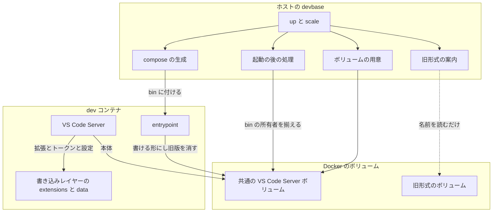
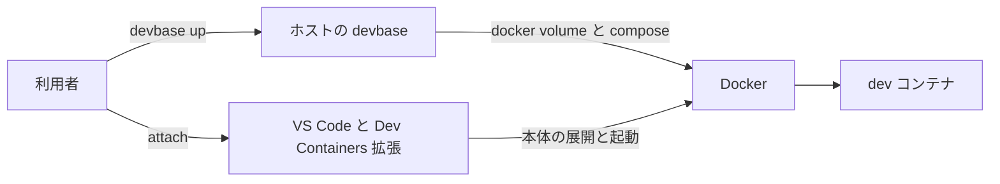
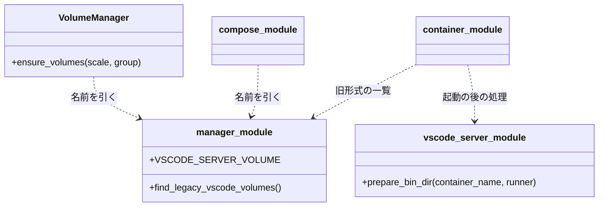
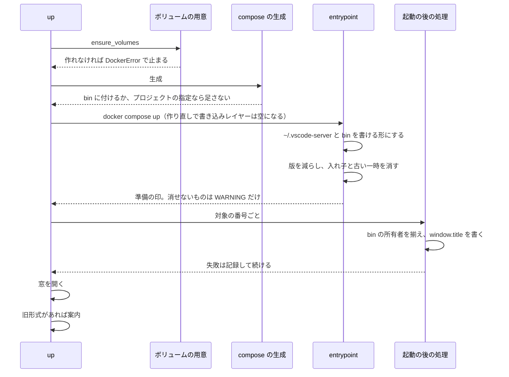
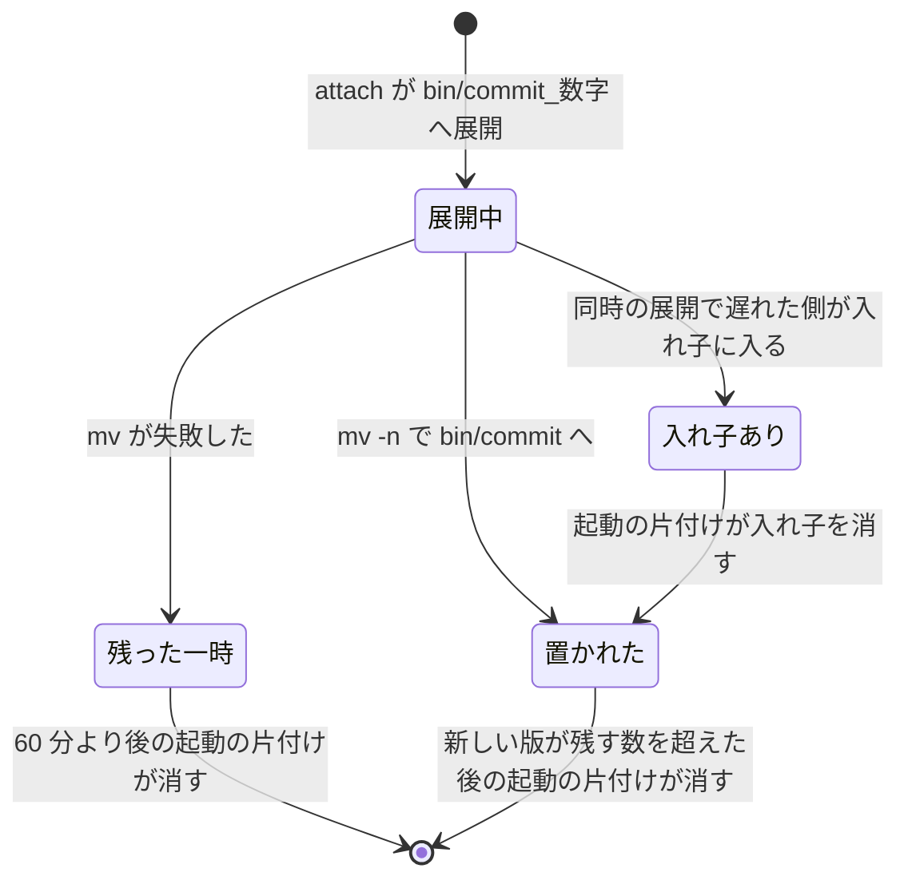

# VS Code Server: コンテナごとのボリュームが本体を重ねて持ち、更新のたびに旧版が溜まる → 本体（`bin/`）だけを全コンテナで 1 本のボリュームに置いて版の数に上限を置き、拡張と状態はコンテナの書き込みレイヤーに残す（#463）

## 目的

- **何が壊れているか**: `devbase_vscode_<project>_<index>` はコンテナ 1 つに 1 本で、VS Code Server の本体（`bin/<commit>`）と拡張を各ボリュームが別々に持つ。
  VS Code の更新のたびに約 0.6GB の版が各ボリュームへ溜まり、手で消さない限り減らない（手元で 17 本・約 40GB、うち `bin/` の旧版が約 21GB）
- **誰が困るか**: 複数のプロジェクト・インスタンスへ VS Code を attach する利用者。ホストのディスクが埋まると Docker Desktop が止まり、動いているコンテナが落ちる
- **直すと何が成り立つか**: 本体は全コンテナで 1 組になり、本体の版の数はコンテナの起動で上限（5 版）に収まる。拡張・リモート側の設定と状態はコンテナの
  書き込みレイヤーに残り、`devbase up` の作り直しで消える（利用者が承認ゲート 1 で受け入れた）。窓のタイトルと窓の再接続は、今と同じくコンテナごとに働く

## 適用範囲

- **働く範囲**: devbase の CLI（ボリュームの用意・compose の生成・起動の後の処理・`devbase up` の案内）と、base イメージの entrypoint。配布先の利用者の
  ボリュームの構成が変わる。entrypoint の変更は、利用者が base と派生イメージを建て直した後から効く。プラグインのリポジトリ（`projects/*`）は触らない
- **プロジェクトごとに違うもの**: 無し。プロジェクトの compose が `~/.vscode-server` か `~/.vscode-server/bin` を自分で付けているときに devbase が何も足さない
- **当たるモード**: `standard`

## あるべき姿の根拠

| 根拠 | 種類 | 何を示すか |
| --- | --- | --- |
| 利用者の決定（承認ゲート 1、2026-10-14） | 利用者の判断 | 共有するのは `bin/` だけ。`extensions/`・`extensionsCache/`・`data/` はボリュームにせず、作り直しで消えてよい。失うものは conductor が動いているコンテナ 2 つで測った値（要求の前提 7） |
| 要求の「実機で確かめることの扱い」の 1・2（`devbase-base:latest` の `docker run --rm` で VS Code Server 1.140.0 を 2 つ同時に展開した記録と、Dev Containers 拡張のコード、2026-10-13） | 実測・外部の一次情報 | `bin/` は共有して壊れないが、同時の展開で入れ子の本体と一時のディレクトリが残る。devbase の attach の形では旧版を誰も消さない |
| 下の「実測 D3〜D5」 | 実測 | `bin` を入れ子のマウントにすると、今の entrypoint では `bin` が root のままで開発ユーザーが書けない（D4）。ホストから所有者を直すと書ける（D5）。版を `product.json` の更新時刻で並べると同時の片付けでも残す版が減らない（D3） |
| `ms-vscode-remote.remote-containers-0.469.0` の `dist/extension/extension.js`（要求の 1・2 で読んだ箇所） | 外部の一次情報 | 本体は `test -d bin/<commit>` が偽のときだけ `bin/<commit>_<ミリ秒>` へ展開し、`mv -n` で `bin/<commit>` へ置く。一時のディレクトリは `bin/` の中にあり、同じファイルシステムの中の改名で済む |
| `lib/devbase/editor/window_title.py` | 既存の実装 | devbase は `devbase up` のたびに `window.title` を `~/.vscode-server/data/Machine/settings.json` へ書く。`data/` が作り直しで消えても次の `up` で書き直る |

要求と受け入れ条件は #463 の本文にある（コピーは `issues/issue-463-requirements.md`）。この文書は「どう作るか」だけを扱う。

### 実測 D3〜D5

すべて手元の `devbase-base:latest`（この課題より前の entrypoint を持つ。arm64、macOS の Docker Desktop）を `docker run --rm` で、新しく作った空の作業用ボリュームを
付けて打った。既存の `devbase_vscode_*` は写さず・付けず・消していない。`devbase up` は打っていない。作業用のボリュームは記録の後に消した。
イメージの `Id` は 2026-10-13 が `sha256:2bf59f64…`、2026-10-14 が `sha256:e66aeb95…` で、`Created` はどちらも 2026-10-12T17:19:13Z である
（建て直していない。containerd のイメージストアで ID だけが変わった。AGENTS.md の落とし穴）。

| # | 日付 | 形 | 結果 |
| --- | --- | --- | --- |
| D3 | 2026-10-13 | `bin/` に 40 桁の版を 8 つ（更新時刻を 1 か月ずつずらす）、最も新しい版に入れ子の本体、`<commit>_<ミリ秒>` の一時のディレクトリを古いもの・新しいもの 1 つずつ置き、残す数を 5 とした片付けの試作を 2 つのコンテナで同時に走らせた。並べ方 2 通りで 5 回ずつ | 並べ方が「`ls -t`（ディレクトリの更新時刻）、入れ子を先に片付ける」の試作は 5 回中 2 回で 4 版だけが残った。並べ方が「`bin/<commit>/product.json` の更新時刻、同じ時刻は名前の順、入れ子は版を減らした後」の試作は 5 回とも 5 版が残った。どちらも WARNING は 0 行、入れ子の本体は残らず、古い一時のディレクトリだけが消えた |
| D4 | 2026-10-14 | 空の作業用ボリューム `issue463e-bin` を `/home/ubuntu/.vscode-server/bin` だけに付けた。entrypoint を通さないときと、今の entrypoint を通したとき（`DEVBASE_ACCOUNT_GROUP=team-a`）に、開発ユーザーで `touch ~/.vscode-server/bin/x` と `mkdir -p ~/.vscode-server/data ~/.vscode-server/extensions` | entrypoint を通さないと `~/.vscode-server` と `bin` はどちらも `root:root 755`（Docker がマウント先の親を作る）。今の entrypoint を通すと `~/.vscode-server` は `ubuntu:ubuntu` になり `data`・`extensions` は作れたが、`bin` は `root:root 755` のままで `touch` が `Permission denied` |
| D5 | 2026-10-14 | D4 のボリュームへ root で `~/.vscode-server` と `bin` の所有者を、違うときだけ開発ユーザーへ `chown`（再帰しない）し、開発ユーザーで `touch bin/y` と `mkdir data` | `bin` は `ubuntu:ubuntu 755` になり、どちらも通った |

D3 で前者の試作が減らした原因は切り分けていない。入れ子を消すと `bin/<commit>` の更新時刻が変わり、同時に走る片付けどうしで並びが変わり得ることと、
並べる途中で消えた項目を `ls` が扱えないことの 2 つが候補になる。後者の試作はどちらにも当たらない並べ方である（決定 4）。
2026-10-13 に `data/` を入れ子のマウントにした形で打った D1・D2 は、`data/` をボリュームにしなくなったため使わない。

## ドメインモデル

### コンテキスト

| コンテキスト | 何の語が 1 つの意味に決まるか |
| --- | --- |
| Compose の構成（`compose`） | dev インスタンスへ付けるボリュームとマウント先 |
| コンテナの起動（`container-start`） | entrypoint が起動のたびに行う、`~/.vscode-server` と `bin` の用意と本体の版の片付け |
| 起動の後の処理（`post-start`） | ホストから行う、`bin` の所有者の直しと `window.title` の書き込み |
| エディタで開く（`editor`） | 共通の VS Code Server ボリューム・コンテナごとの VS Code Server の状態・旧形式の VS Code Server ボリューム |

`compose` と `container-start`・`post-start` は**公開された言語**で繋ぐ。共有する言語はマウント先のパス `/home/ubuntu/.vscode-server/bin` で、
compose の生成がこのパスへ付け、entrypoint と起動の後の処理はこのパスと親の `/home/ubuntu/.vscode-server` だけを見て、ボリュームの名前を知らない。

VS Code Server と Dev Containers 拡張（外部の系）に対して devbase は**順応者**である。`bin/<commit>/product.json` を持つディレクトリが 1 版、
`bin/<commit>_<数字>` が展開の途中という向こうの形をそのまま受け入れ、`extensions/` と `data/` の中身には手を入れない（`window.title` の 1 キーを除く。今と同じ）。

### 集約

| 集約 | 持ち主（書き換えてよいもの） | 根 | エンティティ | 値オブジェクト |
| --- | --- | --- | --- | --- |
| dev インスタンスのボリュームの構成 | compose の生成（`compose.py` の `_vscode_volume` と `_replace_volumes_for_instance`） | 生成した compose の `dev-<index>` の `volumes` | — | マウント（ボリューム名とマウント先の組） |
| VS Code Server のボリュームの実体 | ボリュームの用意（`manager.py` の `VolumeManager.ensure_volumes`）。作るだけで、消さない | Docker のボリューム | 共通の VS Code Server ボリューム（1 本） | ボリューム名 |
| 本体の版の集まり | 足すのは VS Code Server（外部）、消すのは entrypoint の片付け（`devbase_prune_vscode_server_bin`）だけ | 共通の VS Code Server ボリュームの根（`~/.vscode-server/bin`） | 本体の版 `bin/<commit>`（commit で識別） | `product.json` の更新時刻・残す版の数 |
| `bin` の置き場の所有者 | entrypoint の `devbase_setup_vscode_server_dir` と、起動の後の処理の所有者の直し。どちらも「開発ユーザーが書ける」へ揃えるだけ | `~/.vscode-server/bin` のマウント先 | — | 所有者（uid:gid） |

コンテナごとの VS Code Server の状態（`extensions/`・`extensionsCache/`・`data/`）は VS Code Server の持ち物で、コンテナの書き込みレイヤーにある。
この変更は書き換えず、ボリュームにも置かない。

### 不変条件

| # | 集約 | 条件 | 破れたときの扱い |
| --- | --- | --- | --- |
| I1 | dev インスタンスのボリュームの構成 | devbase が足すのは、共通の VS Code Server ボリュームを `~/.vscode-server/bin` に付けるマウント 1 つだけである。`~/.vscode-server` と `~/.vscode-server/data` には何も足さない。プロジェクトの指定と合わせた最終の構成で、`~/.vscode-server/bin` のマウントは 1 つまでである | `~/.vscode-server` に付けると拡張と状態が共有され、`.devport` と `window.title` が後勝ちになる（要求の 7・10）。同じパスに 2 つ付くと compose が弾く。compose の生成のテストが落ちる |
| I2 | dev インスタンスのボリュームの構成 | プロジェクトの dev サービスが `~/.vscode-server` か `~/.vscode-server/bin` を付けていれば、devbase は何も足さない。`~/.vscode-server/data` などほかの下のパスだけを付けていれば、共通の VS Code Server ボリュームを足す | プロジェクトの指定を奪う。compose の生成のテストが落ちる |
| I3 | dev インスタンスのボリュームの構成 | 生成した compose のマウントと `volumes:` の節に、旧形式の VS Code Server ボリュームが現れない | 旧形式を付け続け、移らない。compose の生成のテストが落ちる |
| I4 | VS Code Server のボリュームの実体 | 共通の VS Code Server ボリュームの名前は 1 つの定数で、`devbase_vscode_` で始まらず、旧形式を選ぶ形（`^devbase_vscode_.+_[0-9]+$`）に当たらない | 旧形式の案内が共通のボリュームを消すよう勧める。名前のテストが落ちる |
| I5 | VS Code Server のボリュームの実体 | devbase は旧形式の VS Code Server ボリュームを作らず、消さず、付けず、中身を読まない。名前の一覧を読むだけ | C4 に触れる。案内のテストが `docker volume rm`・`run`・`create` の呼び出しで落ちる |
| I6 | 本体の版の集まり | コンテナの起動の後、`bin/` の版（`product.json` を持つ 40 桁の 16 進の名前のディレクトリ）は残す版の数以下で、残るのは `product.json` の更新時刻（同じなら名前）で並べた新しい側である。片付けが同時に走っても、残る版は残す版の数より少なくならない（片付けの前に残す版の数以上あったとき） | 版が溜まるか、使っている版を消す。片付けのテストが落ちる |
| I7 | 本体の版の集まり | コンテナの起動の後、`bin/<commit>/` の直下に入れ子の本体（`product.json` を持つディレクトリ）が無い。`bin/<commit>/` の直下のほかのものは残る | 1.2GB の版が残るか、本体を消す。片付けのテストが落ちる |
| I8 | 本体の版の集まり | 片付けは、版・入れ子の本体・60 分より古い一時の展開のディレクトリ（`bin/<commit>_<数字>`）だけを消す。`bin/` のほかのもの、`~/.vscode-server` の `bin` 以外に触らない | VS Code Server の持ち物を消す。片付けのテストが落ちる |
| I9 | 本体の版の集まり | 片付けで消せないものがあってもコンテナの起動は止まらない。消せずに残ったパスだけを WARNING の行に出し、ほかのコンテナが先に消したものは出さない | 起動が止まるか、同時起動のたびに WARNING が出る。片付けのテストが落ちる |
| I10 | `bin` の置き場の所有者 | 新しい entrypoint のコンテナは起動の後、古い entrypoint のコンテナは起動の後の処理の後に、`~/.vscode-server` と `~/.vscode-server/bin` を開発ユーザーが書ける | VS Code Server が本体を置けず attach が失敗する（D4）。entrypoint と起動の後の処理のテストが落ちる |
| I11 | VS Code Server のボリュームの実体 | 共通の VS Code Server ボリュームは、スナップショットの対象にならない | 本体がスナップショットへ入る。スナップショットの対象のテストが落ちる |

### ドメインイベント

| # | イベント | 発生元 | 受け手 |
| --- | --- | --- | --- |
| E1 | 共通の VS Code Server ボリュームを用意した | `VolumeManager.ensure_volumes`（`up` の [1/6]・`scale` の [2/5]） | compose の生成（E2） |
| E2 | 生成した compose が、共通の VS Code Server ボリュームを dev インスタンスの `~/.vscode-server/bin` へ付けた | `generate_scaled_compose` | `docker compose up` |
| E3 | entrypoint が `~/.vscode-server` と `~/.vscode-server/bin` を開発ユーザーが書ける形にした | `devbase_setup_vscode_server_dir`（新しい entrypoint） | E4・VS Code Server（E5） |
| E4 | entrypoint が `bin/` の旧版と、同時の展開の残りを片付けた | `devbase_prune_vscode_server_bin` | 次の attach（E5） |
| E12 | 起動の後の処理が `~/.vscode-server/bin` の所有者を `~/.vscode-server` の所有者へ揃えた（揃っていれば何もしない） | `_prepare_vscode_server_bin`（起動の後の処理の段、`window.title` の前） | VS Code Server（E5） |
| E5 | VS Code の attach が本体を `bin/<commit>` に置いた（無いときだけ） | Dev Containers 拡張 | E6・次の起動の E4 |
| E6 | VS Code Server が接続トークンと `.devport` を書き込みレイヤーの `data/Machine` に書いた | VS Code Server | 同じコンテナの窓の再接続 |
| E7 | `window.title` を `data/Machine/settings.json` に書いた | `_apply_window_titles`（今と同じ） | VS Code の窓 |
| E8 | 拡張を書き込みレイヤーの `extensions/` に入れた・更新した・消した | 利用者の操作・自動更新・Dev Containers の既定の拡張の導入 | 同じコンテナの窓 |
| E10 | `devbase up` が旧形式の VS Code Server ボリュームを見つけ、名前と消し方を案内した | `_report_legacy_vscode_volumes`（`cmd_up` の最後） | 利用者（E11） |
| E11 | 利用者が旧形式の VS Code Server ボリュームを消した | 利用者の `docker volume rm` | — |
| E13 | `devbase up` の作り直しで、書き込みレイヤーの `extensions/`・`extensionsCache/`・`data/` が消えた | `docker compose` の down → up | 次の attach（E5 は本体があるので展開しない。E8 で既定の拡張が入り直す） |

E12 は要求に無く、この設計で足した（決定 3）。要求の E3 は新しい entrypoint だけが起こし、この課題より前の entrypoint のコンテナでは E12 が代わりに
`bin` を書ける形にする。要求の E9 は 2026-10-14 に削除した（拡張を共有しない）。

### 用語

| 用語 | 意味 | 用語集への反映 |
| --- | --- | --- |
| 共通の VS Code Server ボリューム | すべての dev コンテナが `~/.vscode-server/bin` に付ける 1 本のボリューム `devbase_vscode-server-bin`。本体の版（`bin/<commit>`）だけを持つ | 意味の変更（マウント先・名前・中身） |
| コンテナごとの VS Code Server の状態 | `~/.vscode-server` のうち `bin/` 以外（`extensions/`・`extensionsCache/`・`data/`）。どのボリュームにも置かず、コンテナの書き込みレイヤーに残る。`devbase up` の作り直しで消え、`docker restart` では残る | 意味の変更（ボリュームにしない） |
| 旧形式の VS Code Server ボリューム | この課題より前の `devbase_vscode_<project>_<index>`。`~/.vscode-server` を丸ごと持つ | 変更なし |
| 入れ子の本体 | 本体の同時の展開で、遅れた側の中身が `bin/<commit>/vscode-server-linux-<arch>/` に入れ子で残ったもの。`product.json` を持つ | 変更なし |
| 残す版の数 | コンテナの起動の片付けが `bin/` に残す本体の版の数。5 | 変更なし |

## 機能一覧

| # | 機能 | 誰が使うか |
| --- | --- | --- |
| F1 | 全コンテナで 1 本の共通の VS Code Server ボリュームを用意し、どの dev インスタンスの `~/.vscode-server/bin` にも付ける | `devbase up` / `devbase scale` を打つ利用者 |
| F3 | 本体の旧版・入れ子の本体・古い一時の展開をコンテナの起動で片付ける | VS Code を attach する利用者（base を建て直した後） |
| F4 | `~/.vscode-server` と `~/.vscode-server/bin` を開発ユーザーが書ける形にする（新しい entrypoint と、古いイメージ向けの起動の後の処理） | VS Code を attach する利用者 |
| F5 | 旧形式の VS Code Server ボリュームの名前と消し方を `devbase up` の最後に案内する | 移った利用者 |
| F6 | 「VS Code Server の永続化」とボリュームの表を新しい構成へ書き直し、`CHANGELOG.md` に移り方と作り直しで消えるものを書く | 利用者 |

F2（コンテナごとの VS Code Server の状態のボリューム）は 2026-10-14 に削除した（決定 1）。ほかの番号はレビューの指摘と合わせるため変えない。

## 構成要素

| 要素 | 責務 |
| --- | --- |
| `manager.py` の名前の定数と関数（変更） | `VSCODE_SERVER_VOLUME = "devbase_vscode-server-bin"`、`LEGACY_VSCODE_VOLUME_PREFIX = "devbase_vscode_"`（今の `VSCODE_VOLUME_PREFIX` を改名）。今の `get_vscode_volume_for` は消す。インスタンスごとの名前を返す関数は持たない（決定 2） |
| `VolumeManager.ensure_volumes`（変更） | 共通の VS Code Server ボリュームを 1 回だけ用意する（あれば作らない）。作れなければ今と同じく `DockerError`。旧形式とインスタンスごとのボリュームは作らない。プロジェクトが `~/.vscode-server` を自分で付けていても作る（今と同じ。付けない 1 本が残るだけで害が無い） |
| `find_legacy_vscode_volumes()`（`manager.py` に追加） | `docker volume ls --format {{.Name}}` の名前のうち `^devbase_vscode_.+_[0-9]+$` に当たるものを名前の順で返す。一覧が取れなければ空を返す（例外を出さない）。消す・付ける・中身を読む呼び出しを持たない（I5） |
| `compose.py` の `_vscode_volume`（今の `_vscode_volumes` を置き換える） | dev サービスの宣言から、足すボリュームの名前か `None` を返す。`~/.vscode-server` か `~/.vscode-server/bin` を宣言していれば `None`、それ以外は `VSCODE_SERVER_VOLUME`（I1・I2）。インスタンスの数に依らず同じ値 |
| `compose.py` の `_replace_volumes_for_instance`・`_build_dev_instance`・`_build_scaled_services`・`_build_volumes_section`（変更） | 各インスタンスへ `<名前>:/home/ubuntu/.vscode-server/bin` を追加し、`volumes:` の節にその名前を 1 回だけ `external: true` で宣言する。引数は今のインスタンスごとの列から 1 つの名前（または `None`）に変わる。マウントは短い書式で、新しい Compose のオプションを使わない |
| `compose.py` の定数（変更） | `VSCODE_SERVER_TARGET`（宣言の判定に使う）に加えて `VSCODE_BIN_TARGET = '/home/ubuntu/.vscode-server/bin'` |
| `editor/vscode_server.py` の `prepare_bin_dir(container_name, runner=None)`（追加） | `docker exec -u 0 <コンテナ> sh -c <直しの手順>` を 1 回打つ。手順は D5 の形で、`~/.vscode-server/bin` が無ければ何もせず、所有者が `~/.vscode-server` と同じなら何もしない。パスは `/home/ubuntu` の絶対パスで書く（root の `$HOME` は `/root`）。成否を真偽で返し、例外を出さない |
| `commands/container.py` の `_prepare_vscode_server_bin`（追加） | 起動の後の処理の対象の番号ごとに、コンテナ名を `opener.resolve_container_name` で引いて `prepare_bin_dir` を呼ぶ。失敗は debug の記録にとどめ、起動の後の処理を止めない |
| `commands/container.py` の `_run_post_start`（変更） | `_apply_window_titles` の直前に `_prepare_vscode_server_bin` を呼ぶ。`up`・`scale`・`project post-start` が同じ段を通る |
| `commands/container.py` の `_report_legacy_vscode_volumes`（追加）と `cmd_up`（変更） | `cmd_up` の `_maybe_open_editor` の後、`_finish_partial` の前に呼ぶ。`find_legacy_vscode_volumes()` が空でなければ下の「入出力の契約」の案内を出す。`scale` と `project post-start` は呼ばない（決定 6） |
| `entrypoint.sh` の `devbase_setup_vscode_server_dir`（変更） | `~/.vscode-server` と `~/.vscode-server/bin` をこの順に `devbase_ensure_persistent_root` で用意してから、`devbase_prune_vscode_server_bin` を呼ぶ。マウントが無い構成でもディレクトリを作るだけで、VS Code の動作は変わらない |
| `entrypoint.sh` の `devbase_prune_vscode_server_bin`（追加） | `~/.vscode-server/bin` が無ければ何もしない。(1) 版を `product.json` の更新時刻の新しい順（同じなら名前の順）に並べ、残す版の数を超えた古い版を消す。(2) 残った版の直下の入れ子の本体を消す。(3) 60 分より古い `bin/<commit>_<数字>` を消す。終了コードは常に 0 |
| `entrypoint.sh` の `devbase_remove_vscode_server_path`（追加） | 1 つのパスを消す。消せなかったときは、そのパスがまだあるときだけ `WARNING: …: <パス> (<理由>)` を標準エラーへ出す（I9） |
| `entrypoint.sh` の定数 `DEVBASE_VSCODE_SERVER_KEEP=5`（追加） | 残す版の数（決定 4）。環境変数で変えられる形にしない |
| `docs/user/container-operations.md`（変更） | 「VS Code Server の永続化」・ボリュームの表・「使わなくなった VS Code Server ボリュームを消す」を書き直す（受け入れ条件 14） |
| `CHANGELOG.md` の `[Unreleased]`（変更） | ボリュームの構成が変わること、最初の attach で本体を取り直すこと、拡張とリモート側の設定・状態が `devbase up` の作り直しのたびに消えるようになること、旧形式のボリュームを利用者が消すこと、本体の旧版の片付けは base と派生イメージを建て直した後から効くこと |
| スナップショット（変更なし） | 対象は `devbase_home_*` のままで、共通の VS Code Server ボリュームの名前は当たらない（I11） |

### 構成要素図



### 文脈と配置



外部の系は VS Code と Dev Containers 拡張（本体の展開の手順・`bin/` の形・拡張の導入）と Docker で、この変更は変えない。ボリュームは Docker の
daemon の側にあり、リモートの docker context でも同じく daemon の側に作る（今と同じ）。

### 置き場所

```text
lib/devbase/
├── volume/
│   ├── manager.py          # 名前・用意・旧形式の一覧（変更）
│   └── compose.py          # bin へのマウント（変更）
├── editor/
│   └── vscode_server.py    # bin の所有者の直し（新設）
└── commands/
    └── container.py        # 起動の後の処理の段・up の案内（変更）
containers/base/entrypoint.sh  # devbase_setup_vscode_server_dir と片付け（変更）
docs/user/container-operations.md
CHANGELOG.md
tests/volume/  tests/containers/  tests/editor/  tests/commands/
```

## 構造



`compose_module` は `volume/compose.py`、`container_module` は `commands/container.py` で、中身は書かない。`get_vscode_volume_for` は消す（呼ぶのは
`compose.py` と `tests/volume/test_manager_vscode.py` だけ）。

## データ構造

永続データは Docker のボリュームである。

| 置き場 | 数 | マウント先 | 中身 | 書くもの | 消えるとき |
| --- | --- | --- | --- | --- | --- |
| `devbase_vscode-server-bin`（共通の VS Code Server ボリューム） | 端末（daemon）に 1 本 | `/home/ubuntu/.vscode-server/bin` | `<commit>/`（本体の版）・`<commit>_<数字>/`（展開の途中） | VS Code Server・entrypoint（所有者と片付け）・起動の後の処理（所有者） | 片付けが版を消す。ボリュームは利用者だけが消す |
| コンテナの書き込みレイヤーの `~/.vscode-server`（ボリュームではない） | dev コンテナごと | — | `extensions/`・`extensionsCache/`・`data/`（接続トークン・`.devport`・`Machine/settings.json`・ログ・`User/`）・その他の直下の置き場。`bin` はマウント先 | VS Code Server・Dev Containers 拡張・`window.title`・entrypoint（所有者） | `devbase up` の作り直し。`docker restart` と端末の再起動では残る |
| `devbase_vscode_<project>_<index>`（旧形式） | 今あるだけ | 付けない | 今の `~/.vscode-server` 丸ごと | 何も書かない | 利用者だけが消す |

| 機能 | 共通 | 書き込みレイヤー | 旧形式 |
| --- | --- | --- | --- |
| F1 ボリュームの用意と付け | 作る（無いとき）・付ける | — | — |
| F3 片付け | `bin/` の一部を消す | — | — |
| F4 書ける形にする | 根の所有者を変える | `~/.vscode-server` の所有者を変える | — |
| F5 案内 | — | — | 名前を読む |

## 入出力の契約

### 生成した compose（dev インスタンス 1 つ分）

```yaml
services:
  dev-1:
    volumes:
      # …プロジェクトのマウントと /persistent/ai・/persistent/group・/work（今のまま）
      - devbase_vscode-server-bin:/home/ubuntu/.vscode-server/bin
volumes:
  devbase_vscode-server-bin: {external: true}
```

互換性: 生成物の形が変わる。読む側は `docker compose` だけで、短い書式の入れ子のマウント先は Compose の版を選ばない（新しいオプションを使わない）。
Docker はマウント先の親 `~/.vscode-server` を root の所有で書き込みレイヤーに作る（D4）。devbase をこの課題より前の版へ戻すと、旧形式を付ける生成物に戻る。

### `devbase up` の案内（旧形式があるときだけ、`cmd_up` の最後）

`logger.warning` で次の内容を出す。文言は実装で決めてよいが、次の 4 つを欠かさない。

1. 使わなくなった VS Code Server のボリュームがあること（本数）
2. その名前（1 行に 1 つ、名前の順）
3. 消すコマンド `docker volume rm <名前> …`（見つけたすべての名前を並べた 1 行）
4. コンテナが付けているボリュームは `docker volume rm` が断ること。そのプロジェクトで `devbase up` を打った後に消せること

旧形式が無い・一覧が取れないときは何も出さない。終了コードは変わらない。

### entrypoint の出力

片付けで消せずに残ったパスだけを、1 つにつき `WARNING: VS Code Server の片付けで消せなかった: <パス> (<理由>)` の形で標準エラーへ出す。
終了コードとほかの出力は変わらない。

### 起動の後の処理が打つコマンド

`docker exec -u 0 <コンテナ名> sh -c '<直しの手順>'`。手順は `/home/ubuntu/.vscode-server` と `/home/ubuntu/.vscode-server/bin` の 2 つのパスだけを見て、
`chown` を `bin` 1 つにだけ打つ（再帰しない）。`~/.vscode-server` は今の entrypoint が既に直している（D4）ため、起動の後の処理は触らない。

## 処理の流れ



`scale` は同じ段を [2/5]・起動の後の処理で通り、旧形式の案内だけを持たない。`project post-start` は起動の後の処理だけを通る。
構成要素の表のうち、文書・`CHANGELOG.md`・スナップショット（変更なし）は実行の流れに現れないため、この図に含めない。

### 本体の版の状態



置かれた版を、残す版の数に入っている間に消す遷移は無い。`devbase up` の作り直しは書き込みレイヤーだけを消し、この図の版には触らない。

## 非機能の実現方式

| 大項目 | 要求の条件 | 実現方式 | 確かめ方 |
| --- | --- | --- | --- |
| 性能・拡張性 | `bin/` に残る版の数は、コンテナの数・プロジェクトの数・VS Code の更新の回数に依らず残す数を超えない。コンテナの起動の後に入れ子の本体が残らない | 共通の VS Code Server ボリュームを 1 本にし、どのコンテナの起動でも同じ並べ方で版を残す数まで減らす（決定 4）。入れ子は残った版ごとに消す | 片付けのテスト（版が 8 つ・入れ子・一時）と、作業用のボリュームで新しい関数を 2 つのコンテナで同時に走らせる確かめ（D3 と同じ形） |
| 移行性 | 移る対象は無い（写さない）。切り戻しで旧形式を前と同じく付ける。共通は残るだけで害が無い | 旧形式は名前の一覧を読むだけで触らない（I5）。共通の名前は旧形式の形に当たらない（I4）ため、切り戻した版の devbase は共通のボリュームを見ない | 案内のテストが Docker の呼び出しを数える。名前のテスト |
| セキュリティ | 共通の VS Code Server ボリュームに本体のほかのものが入らない | マウント先を `bin` にし（I1）、拡張・接続トークン・状態・設定は `bin` の外の書き込みレイヤーに入る。起動の後の処理の `chown` は `bin` 1 つで、再帰しない | compose の生成のテスト（`~/.vscode-server` と `data` に付けない） |
| システム環境 | macOS の Docker Desktop と Linux の Docker で同じ振る舞い。新しい Compose のオプションを使うなら版と扱いを決める | 短い書式の入れ子のマウント先だけを使い、新しいオプションを使わない。entrypoint の片付けは GNU だけのオプションに頼らず、手元（macOS）のテストと CI（Linux）で同じ結果にする | macOS の Docker Desktop での D3〜D5 と、CI の entrypoint のテスト |

## 決定の記録

### 決定 1: 作り直しで消えてよいものは共有もボリュームにもせず、共有を `bin/` に絞って `~/.vscode-server/bin` に付ける（利用者の決定、2026-10-14）

利用者が承認ゲート 1（2026-10-14）で決めた。共通の VS Code Server ボリューム 1 本を `~/.vscode-server/bin` に付け、`extensions/`・`extensionsCache/`・`data/`
はどのボリュームにも置かない。これらはコンテナの書き込みレイヤーに残り、`docker restart` と端末の再起動では残り、`devbase up` の作り直しで消える。
失うものは conductor が動いているコンテナ 2 つで測り、利用者が見て受け入れた（要求の前提 7: ローカル履歴 約 300KB、拡張のリモート側の状態 約 250KB、
ログ 約 16MB、手で入れたリモート側の設定と拡張）。接続トークンと `.devport` は作り直され、`window.title` は `devbase up` が毎回書き直す。
`data/` はコンテナごとに分かれたままなので、`.devport` と `window.title` の後勝ち（要求の 7・10）は起きない。

これで次が要らなくなる。拡張の同時の操作の確かめ（要求の M2）、`.obsolete` の消去と動いている窓の確かめ（M3）、版の違うサーバーで同じ `extensions/`
を使う確かめ（要求の 6）、拡張の共有の前提（要求の前の前提 7）、`data/` の所有者の直し（前の決定 3）。窓のタイトルと再接続の確かめ（M1）は、`data/`
の扱いが今と同じになったため確かめる中身が減る。M1 は残し、実の Dev Containers 拡張が `bin` を入れ子のマウント先として使えることと、作り直しの後に
既定の拡張が入り直すことを見る項目にする（「実機で確かめることの扱い」）。

`data/` をコンテナごとのボリュームに置く形（2026-10-13 の版。`devbase_vscode-data_<project>_<index>` を `~/.vscode-server/data` へ入れ子で付ける）は
採らない。dev インスタンスの数だけボリュームが増え、devbase は作るだけで消さないため、使わなくなったボリュームが溜まるこの課題と同じ形が残る。
`data/logs` は約 16MB で、ボリュームに置くと消えずに溜まる。守れるものはローカル履歴と拡張のリモート側の状態の約 0.5MB で、利用者は失ってよいとした。
`bin` に加えて `data` の所有者の直しも要り、古いイメージ向けの起動の後の処理が 2 つのパスを扱う。

`extensions/` も共有する形（2026-10-13 の版）は採らない。別のコンテナのサーバーの起動が `.obsolete` の付いた拡張の版を消し、動いている窓の拡張を
消し得る（要求の 5。窓への影響は未確認のまま M3 に回っていた）。あるプロジェクトのためだけに入れた拡張がすべてのコンテナの拡張ホストに読み込まれ、
Value 3 との突き合わせに想定が要る（前の前提 7）。版の違うサーバーで同じ `extensions/` を使えるかは、エンジンの版で入る版が変わる拡張を試していない（要求の 6）。
拡張は作り直しの後に入れ直せる。

根拠: 利用者の承認（2026-10-14） / Value 3 / Value 2（作り直しで失うものを利用者が受け入れた）（MVV 版 1）

### 決定 2: 旧形式と取り違えず中身が分かる名前にするため、共通の VS Code Server ボリュームを `devbase_vscode-server-bin` にする

名前は `devbase_vscode-server-bin` にする。旧形式はどれも `devbase_vscode_` で始まり、この名前は 15 文字目が `-` で必ず違う。旧形式の案内は名前の形
（`^devbase_vscode_.+_[0-9]+$`）だけで旧形式を選ぶため、共通のボリュームを消すよう勧めることが無い。`docker volume ls --filter name=devbase_vscode_`
（部分一致）にも当たらず、今の文書の一覧のコマンドが旧形式だけを出す。末尾の `-bin` は、中身が `~/.vscode-server` 丸ごとではなく `bin/` だけであることを
名前で示す。インスタンスごとの名前は持たない（決定 1）。

`devbase_vscode-server`（2026-10-13 の版）は採らない。`~/.vscode-server` に付けていた版の名前で、`bin` だけを持つ今の中身と合わず、名前から
拡張や状態も入っていると読める。`devbase_vscode_server` と `devbase_vscode_bin` は採らない。旧形式の部分一致の一覧に混ざる。

根拠: Value 3 / C4（MVV 版 1）

### 決定 3: 建て直していないイメージでも attach できるよう、起動の後の処理で `bin` の所有者を `~/.vscode-server` の所有者へ揃える

`bin` は共通の VS Code Server ボリュームの根で、空のボリュームは root の所有で付く。この課題より前の entrypoint は `~/.vscode-server` しか直さず、`bin`
は root のままで開発ユーザーが本体を置けない（D4）。entrypoint の変更は base と派生イメージを建て直すまで効かず、派生イメージはプラグインのリポジトリが
建てるため、devbase の更新と同時には揃わない。起動の後の処理は窓を開く前に走り、どのイメージにも `docker exec -u 0` で届く（D5）。揃える先は
`~/.vscode-server` の所有者で、起動の後の処理の時点では今の entrypoint がそれを開発ユーザーへ直している（D4）。所有者が揃っていれば何もしないため、
新しい entrypoint のコンテナでは何も変えない。

所有者はボリュームの根に残るため、1 つのコンテナで揃えば、後から付けるコンテナは古いイメージでも書ける。それでもこの直しは移行の間だけのものにせず残す。
利用者がボリュームを消して作り直したとき、最初に付けるコンテナが古いイメージなら再び要り、費用はコンテナ 1 つにつき `docker exec` 1 回である。
2026-10-13 の版の直しの先は `data` だったが、`data/` をボリュームにしないため `bin` へ移した。`~/.vscode-server` は書き込みレイヤーにあり、今の entrypoint
が直すため、起動の後の処理は触らない。

ボリュームを作るときに一時のコンテナで所有者を直す形は採らない。`up` の [1/6] ではまだ使うイメージが決まらず、開発ユーザーの uid も分からない。
base イメージに開発ユーザーの所有の `~/.vscode-server/bin` を置き、Docker が空のボリュームへ所有者を写す振る舞いに頼る形も採らない。base を建て直す
まで効かない点で entrypoint の変更と同じで、古いイメージを救わない。建て直すまで attach できないと文書で案内する形も採らない。devbase を更新しただけの
利用者の attach が失敗する。

根拠: Value 1（MVV 版 1）

### 決定 4: 同時に走っても使っている版を消さないため、残す版の数を 5 にし、版を `product.json` の更新時刻で並べる

残す版の数は 5 にする。上限は約 3GB（1 版約 0.6GB）で、今の約 21GB の旧版より十分に小さい。VS Code はおおむね月に 1 版で、5 版なら別の端末の VS Code
が数か月更新されずに古い版で attach していても、その版を消しにくい。並べ方は `bin/<commit>/product.json` の更新時刻（同じなら名前）にする。
`product.json` は片付けが書き換えないため、同時に走る片付けどうしで並びが同じになり、残る版が残す版の数より減らない（D3 の後者）。入れ子の本体は
版を減らした後に消す。

ディレクトリの更新時刻（`ls -t`）で並べる形は採らない。D3 で 5 回中 2 回、残す版が 1 つ減った。最後に使った時刻で並べる形も採らない。Dev Containers
拡張は devbase の attach の形ではその時刻を残さず（要求の 2）、devbase が使用を記録する置き場も無い。残す数を 3 にする形は、上の別の端末の場面で
使っている版を消す見込みが上がるため採らない。

根拠: Value 1 / Vision（MVV 版 1）

### 決定 5: VS Code Server の持ち物を消さないため、片付けを共通の VS Code Server ボリュームの `bin/` の 3 種に限る

片付けが消すのは、残す版の数を超えた版、残った版の直下の入れ子の本体（`product.json` を持つディレクトリ）、60 分より古い `bin/<commit>_<数字>`
だけである。最後のものは本体の同時の展開で `mv` が失敗したときの残り（要求の 1）で、展開に 60 分かかることは無いため、動いている展開を消さない。
入れ子の本体は、`bin/<commit>/` 自身が `product.json` を持つときだけ消す。片付けは共通の VS Code Server ボリュームの根（`~/.vscode-server/bin`）の
下だけを見て、`~/.vscode-server` の `bin` 以外には入らない。

`extensions/` の旧版と `extensionsCache/` を片付ける形は採らない。2026-10-14 からはどちらも書き込みレイヤーにあり、`devbase up` の作り直しで消えるため、
作り直しをまたいで溜まらない。中身の寿命は VS Code Server が決めており、消してよい条件を devbase が持たない。

根拠: Value 2（MVV 版 1）

### 決定 6: 利用者が移った後の後片付けを忘れないよう、旧形式の案内を `devbase up` のたびに最後に出し、印を持たない

旧形式が残っている限り、`devbase up` の出力の最後（窓を開いた後）に名前と消すコマンドを出す。利用者が消せば次から出ない。案内を 1 回で止める印の
ファイルを持たないため、印を消した・別の端末へ移ったといった状態を考えなくてよい。`scale` と `project post-start` は出さない。どちらも `up` の後に打つ
ため、同じ案内を重ねない。

初回だけ出す形は採らない。ほかのプロジェクトのコンテナが付けている間は `docker volume rm` が断るため、1 回目には消せないことがある。消す前に
付けているコンテナを調べて案内を分ける形も採らない。`docker volume rm` 自身が断り、devbase が別に判定を持つ理由が無い。

根拠: C4 / Value 2（MVV 版 1）

## テスト設計

| 受け入れ条件・不変条件 | どの振る舞いで縛るか | どう壊したら落ちるべきか |
| --- | --- | --- |
| 受け入れ条件 1 | `ensure_volumes` を 2 つのプロジェクト名・違うグループ・scale 2 で呼ぶと、共通の VS Code Server ボリュームの作成は 1 回、名前は同じ。あれば作らない。インスタンスごとの VS Code Server のボリュームを作らない | プロジェクト名やグループを名前に混ぜる。毎回作る。インスタンスごとに作る |
| 受け入れ条件 2・I1 | scale 2 の生成物の各 dev インスタンスに、同じ名前の共通の VS Code Server ボリュームが `/home/ubuntu/.vscode-server/bin` に 1 つ付き、`/home/ubuntu/.vscode-server` と `/home/ubuntu/.vscode-server/data` へのマウントが無い。`volumes:` に共通の名前が `external: true` で 1 回だけある | マウント先を `~/.vscode-server` にする。`data` にも足す。共通を `volumes:` に 2 回書く |
| 受け入れ条件 3・I4 | 共通の名前が `devbase_vscode_` で始まらず、`find_legacy_vscode_volumes` の形に当たらない。一覧に共通の名前と旧形式が混ざっても、旧形式だけを返す | 名前を `devbase_vscode_server` にする。旧形式の形を接頭辞だけにする |
| 受け入れ条件 4 | 実装の担当が作業用のボリュームを `~/.vscode-server/bin` の形で 2 つのコンテナに付け、片方で置いた `bin/<commit>/bin/code-server` をもう片方が `--version` で起動できる | （実機の確かめ。単体のテストは受け入れ条件 2 が名前の同一を縛る） |
| 受け入れ条件 5・I2 | dev サービスが `~/.vscode-server` か `~/.vscode-server/bin` を宣言していれば、マウントも `volumes:` の宣言も足さない。`~/.vscode-server/data` だけを宣言していれば共通を `bin` に足す | 宣言を見ずに足す。`bin` の宣言を見落とす。`data` の宣言で止める |
| 受け入れ条件 6・I3 | 生成物のマウントと `volumes:` に `devbase_vscode_` で始まる名前が無い | 旧形式の名前を付け続ける |
| 受け入れ条件 7・I6 | 一時のディレクトリを `$HOME` にして `product.json` の時刻をずらした 8 版を置いて片付けを呼ぶと、新しい 5 版が残る。2 つを同時に呼んでも 5 版が残る。版が 5 以下なら何も消さない | 並べ方をディレクトリの時刻にする。残す数を変える。`product.json` の無いディレクトリを版に数える |
| 受け入れ条件 8・I7 | `bin/<commit>/` の直下に `product.json` を持つディレクトリを置いて呼ぶと、それが消え、`bin/<commit>/bin/code-server` と `bin/<commit>/product.json` が残る。`bin/<commit>/` 自身に `product.json` が無いときは入れ子を消さない | 入れ子の判定を外す。`bin/<commit>` ごと消す |
| I8 | 60 分より古い `bin/<commit>_<数字>` は消え、新しいものは残る。`bin/` のほかの名前と、`~/.vscode-server` の `extensions/`・`extensionsCache/`・`data/` の中身は残る | 時刻の条件を外す。`bin/` の外を見る |
| 受け入れ条件 9・I9 | 消せないパス（書けないディレクトリの下）があると、関数は 0 で終わり、そのパスを含む WARNING が 1 行出る。片付けの途中で別のプロセスが先に消したパスは WARNING に出ない | 失敗で関数を非 0 にする。`rm` の失敗をそのまま WARNING にする |
| 受け入れ条件 10・I10（新しい entrypoint） | 一時の `$HOME` で `devbase_setup_vscode_server_dir` を呼ぶと、`.vscode-server` と `.vscode-server/bin` があり書ける。root 所有の `bin` からの `chown` は実装の担当が `docker run --rm` で確かめる | `bin` を用意しない。`~/.vscode-server` だけを直す |
| 受け入れ条件 10・I10（古いイメージ） | `prepare_bin_dir` が `docker exec -u 0 <名前> sh -c …` を 1 回打ち、手順を一時のディレクトリに当てると、所有者の違う `bin` だけを `~/.vscode-server` の所有者へ揃え、揃っていれば・無ければ何もしない。`_run_post_start` が `_apply_window_titles` より前に対象の番号ごとに呼び、失敗しても続ける。実機は実装の担当が今の `devbase-base:latest` で D4・D5 の形を打つ | `-u 0` を外す。`data` を直す。再帰で `chown` する。失敗で起動の後の処理を止める |
| 受け入れ条件 11・I5 | 旧形式が 2 本ある一覧で `cmd_up` を最後まで通すと、案内に 2 つの名前と `docker volume rm` の行が出る。Docker の呼び出しは `volume ls` だけで、`rm`・`create`・`run` と旧形式の名前を付けた呼び出しが無い | 案内で消す。案内を出さない |
| 受け入れ条件 12 | 旧形式が無い一覧、または一覧の失敗で、案内が出ない。`scale` と `project post-start` は旧形式があっても出さない | 一覧の失敗で例外を出す。`scale` で出す |
| 受け入れ条件 13・I11 | スナップショットの対象を決める関数が、共通の VS Code Server ボリュームの名前を対象に入れない | 対象の判定を `devbase_` の接頭辞だけにする |
| 受け入れ条件 14 | 文書の節に、共有するのは `bin/` だけ・書き込みレイヤーに残るものと消えるとき（作り直しで消え、`docker restart` では残る）・作り直しで失うもの・既定の拡張が入り直すこと・最初の attach の取り直し・旧形式の消し方・残す版の数 5 があり、「奪い合う」が無い | （`tests/docs/` に同じ形の検査があれば足す。無ければレビューで見る） |
| 受け入れ条件 15 | `CHANGELOG.md` の `[Unreleased]` の記入 | （レビューで見る） |

## 実機で確かめることの扱い

課題の 10 項目の確かめ方と結果は要求の「実機で確かめることの扱い」にある。この設計で決めたこと・足したことだけを並べる。

| # | 確かめること | この設計での扱い | 誰がいつ |
| --- | --- | --- | --- |
| 1 | 本体の同時の展開 | 入れ子の本体と残った一時を片付けで消す（決定 5）。片付けの同時の実行は D3 で確かめた | 実装の担当が新しい関数で D3 の形を打つ。窓を一度に復元する場面は M5（リリース後） |
| 2 | 古い版を消すとき、ほかのコンテナの版まで消すか | devbase の片付けが消す。並べ方と残す数は決定 4 | 実装の担当（D3 の形）。版の違う窓が並ぶ場面は M4（リリース後） |
| 3 | 既存からの移り方 | 写さずに取り直し、案内で消し方を出す（決定 6） | 単体のテスト（受け入れ条件 11・12） |
| 4〜6 | 拡張の同時の操作・`.obsolete` の版の消去・版の違うサーバーで同じ `extensions/` | 拡張を共有しないため当たらない（決定 1） | 確認は要らない |
| 7〜10 | 接続トークン・`state.vscdb`・`data/logs/`・`data/Machine/settings.json` | `data/` を共有しないため当たらない（決定 1） | 確認は要らない |

実装の担当が確かめられるのは、新しく作った空の作業用ボリュームと手元の `devbase-base:latest` の `docker run --rm` の範囲である。既存の `devbase_vscode_*`
は写さない・消さない・付けない。`devbase up` は作業用のプロジェクトでも打たない。base は建て直さない。新しい entrypoint の関数は、イメージを建てずに
ボリュームを付けたコンテナへ `entrypoint.sh` を読み取り専用で付けて呼ぶ。

**手動確認 M1（マージ前）は、利用者か conductor へ回す。** 実の VS Code からの attach と新しい devbase の `devbase up` が要り、`devbase up` は P3 に
当たるため、conductor は P3 の承認を取ってから打つ。M1 を残すのは、実の Dev Containers 拡張が入れ子のマウント先の `bin` と書き込みレイヤーの
`~/.vscode-server` の組で attach できること・2 つ目のコンテナが本体を取り直さないこと・作り直しの後に既定の拡張が入り直すことを、担当の
`docker run --rm` では確かめられないためである。窓のタイトルと再接続は `data/` が今と同じくコンテナごとにあるため変わる要素が無く、同じ attach で
見るだけにする。M1 の前提に「base と派生イメージを建て直す前のイメージのままで attach できる（決定 3）」を加える。M2・M3 は 2026-10-14 に削除した
（決定 1）。M4・M5 はリリース後テストで確かめる。手順は要求の「検証手段」のとおり。

## 設計の結果

| 課題 | 扱い | 取り込み先 | 触るファイル |
| --- | --- | --- | --- |
| #463 | 実装する | — | `lib/devbase/volume/manager.py`、`lib/devbase/volume/compose.py`、`lib/devbase/editor/vscode_server.py`、`lib/devbase/commands/container.py`、`containers/base/entrypoint.sh`、`docs/user/container-operations.md`、`CHANGELOG.md`、`docs/glossary/glossary.json`、`docs/glossary.md`、`tests/volume/`、`tests/containers/`、`tests/editor/`、`tests/commands/` |

## 未確認のまま残ること

| 項目 | 内容 |
| --- | --- |
| 実の Dev Containers 拡張と入れ子のマウント先（M1） | 拡張が `~/.vscode-server/bin` をマウント先のまま扱えるか（`bin` を消す・改名する手順を持たないか）は、コードを読んだ範囲（要求の 1・2）で当たる箇所が無いことだけを見た。実の attach で M1 が確かめる |
| 作り直しの後の既定の拡張の入れ直しにかかる時間 | 測っていない。`devbase up` のたびに attach の初回が遅くなる量は M1 で記録する |
| 別の端末の古い VS Code（M4） | 5 版より古い版で attach したままの窓があると、その版を片付けが消す。月 1 版の前提で数か月の差が要り、M4 で起き方を見る |
| 片付けが効き始める時点 | entrypoint の片付けは base と派生イメージを建て直した後から効く。建て直すまでは共通の VS Code Server ボリュームの `bin/` に版が溜まる（1 本分で、今のようにプロジェクトとインスタンスの数だけ重ならない） |
| 開発ユーザーの uid が派生イメージで違う場合 | 共通の VS Code Server ボリュームの根の所有者は 1 つで、揃える先はコンテナごとの `~/.vscode-server` の所有者である。派生イメージが開発ユーザーの uid を変えると、起動の後の処理が付けるたびに所有者を入れ替える。このリポジトリの `containers/` で開発ユーザーを作るのは base の `useradd` だけで、`usermod` は群の追加だけだった（2026-10-14 に `grep` で確かめた）。プラグインのリポジトリ（`repos/`）の派生イメージは調べていない |
| D3 の前者の試作が版を減らした原因 | 切り分けていない。採った並べ方は候補の 2 つのどちらにも当たらない |
