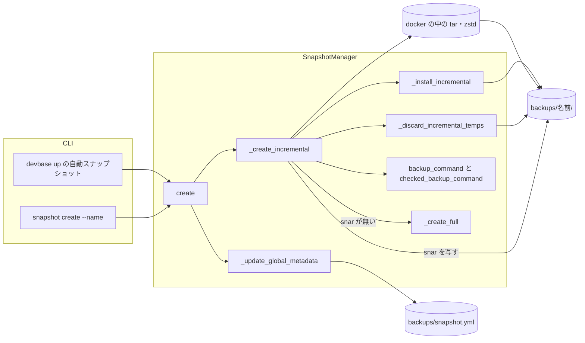
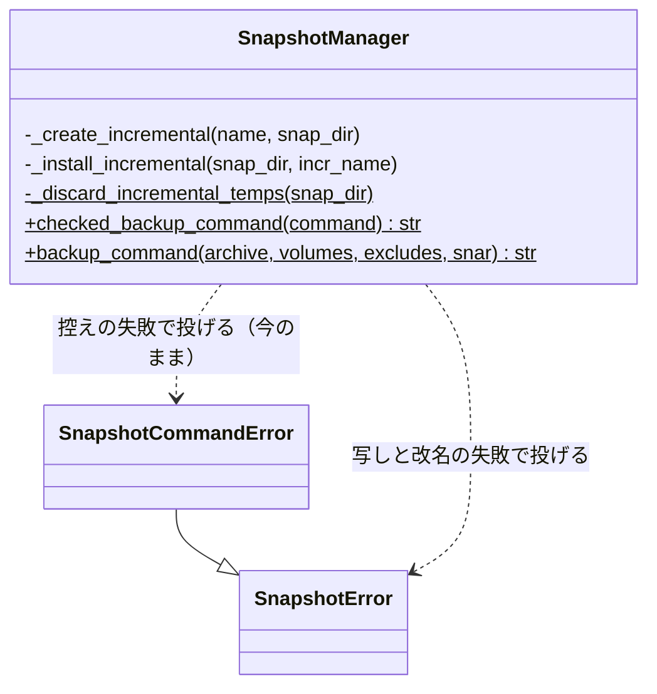
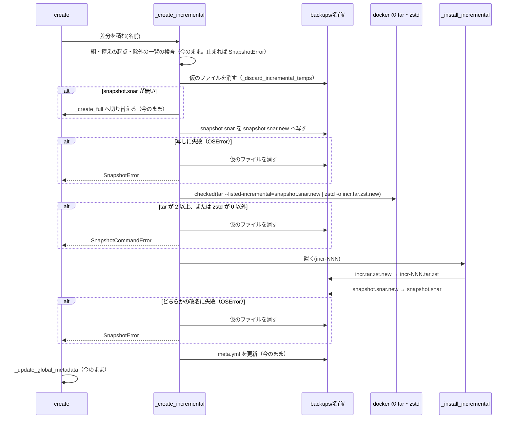
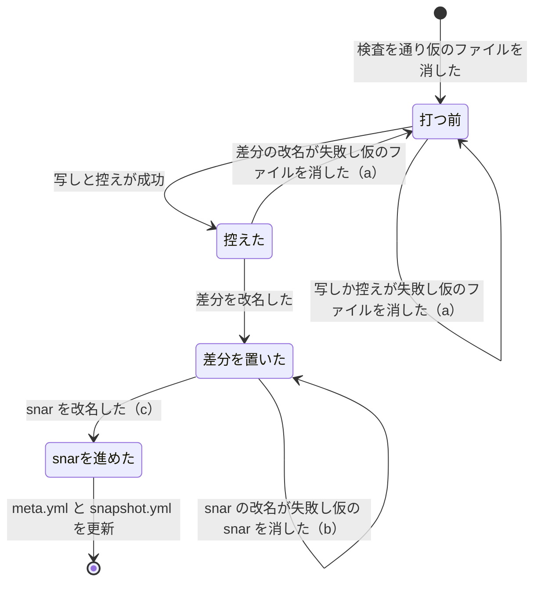

# snapshot: 差分の作成が失敗すると snapshot.snar だけが進み、その後の差分が失敗の前の変更を落として復元でファイルを失う → 失敗しても snar と差分の列を打つ前のまま保ち、作りかけの差分を残さない（#466）

## 目的

- **何が壊れているか**: 既存の世代へ差分を積むとき（`devbase snapshot create --name <名前>`・`devbase up` の自動スナップショット）、控えの
  コマンドが失敗すると `snapshot.snar` だけが失敗した回の状態へ進む。zstd が書く途中で止まると、作りかけの `incr-NNN.tar.zst` も世代に残る
- **誰が困るか**: 差分の作成が一度失敗した世代（ディスクの不足・docker の失敗など）を復元する利用者。失敗の後の差分は失敗の前の変更を
  含まず、復元でファイルが無いか古い中身になる。作りかけの差分があると、復元はそのアーカイブで止まる
- **直すと何が成り立つか**: 失敗しても世代の `snapshot.snar` と差分の列は打つ前のままで、作りかけの差分は残らない。次の差分は失敗の前の
  変更も含み、復元は最後の差分の時点になる

## 適用範囲

- **働く範囲**: devbase の CLI（`lib/devbase/snapshot/manager.py` の差分の経路）。配布先の利用者の `backups/` の世代に効く。プラグインのリポジトリと
  `devbase-snapshot` イメージは触らない
- **プロジェクトごとに違うもの**: 無し（世代の形はプロジェクトに依らない）
- **当たるモード**: `standard`

## あるべき姿の根拠

| 根拠 | 種類 | 何を示すか |
| --- | --- | --- |
| #466 の本文の実測 R1〜R5（`devbase-snapshot:latest`、2026-10-13） | 実測 | 今の控えの形では、zstd がすぐ失敗すると tar が snar を進め（R3・R4）、書く途中で失敗すると作りかけの差分が残って復元が止まり（R1・R2）、tar の致命的な失敗をパイプの終了コードが隠す（R5） |
| この設計の控えの形を同じイメージで打った記録（下の「実測 V1〜V7」） | 実測 | 写した仮の snar と仮の名前の差分へ控えると、R1・R3 と同じ失敗でも世代の snar と差分の列が打つ前のまま残り、次の差分が失敗の前の変更を含んで、復元で元のツリーと同じになる |
| `docs/specifications/snapshot-series.md` の「世代の作り直し」の常に成り立つ条件（控えのコマンドが失敗したら、世代の既存のファイルは 1 バイトも変わらない） | 既存の仕様 | 同じ世代の full の経路で既に約束している条件を、差分の経路へ揃える |

要求と受け入れ条件は #466 の本文にある（コピーは `issues/issue-466-requirements.md`）。この文書は「どう作るか」だけを扱う。

### 実測 V1〜V7

2026-10-13、`devbase-snapshot:latest`（Id `b19bbbecb642`、GNU tar 1.35・zstd 1.5.7）を `docker run --rm` で、`/tmp` の作業用のディレクトリを
`/source/ai:ro`・`/source/group:ro`・`/backup` に付けて打った。利用者のボリュームと `devbase up` は使っていない。各回の差分は、ホストで
`snapshot.snar` を `snapshot.snar.new` へ写し、`checked_backup_command(backup_command('incr.tar.zst.new', …, snar='snapshot.snar.new'))` と同じ形を
docker で打ち、成功したらホストで `incr.tar.zst.new` → `incr-NNN.tar.zst`、`snapshot.snar.new` → `snapshot.snar` の順に改名した。失敗したら 2 つの仮の
ファイルを消した。

| # | 形 | 結果 |
| --- | --- | --- |
| V1 | full（`ai/a`・`group/g`）→ `incr-001`（`ai/b`）の後に 3MB の `ai/c` を足し、`ulimit -f 100` で zstd が書く途中に止まる形で打つ | `PIPESTATUS=141 153`、判定は失敗。仮のファイルを消した後の世代は `full.tar.zst incr-001.tar.zst snapshot.snar` で、snar は 120 バイト・sha の先頭 `cd657425b788` のまま（打つ前と同じ） |
| V3 | `ai/e` を足し、zstd がすぐ失敗する形（`incr.tar.zst.new` が既にある）で打つ | `PIPESTATUS=141 1`、判定は失敗。仮の snar は 120 バイト、世代の snar は打つ前と同じ（3MB の `ai/c` を含むため、tar は R3 と違い SIGPIPE で止まった） |
| V3' | V7 の後に小さいファイル `ai/k` を足し、V3 と同じ形で打つ | `PIPESTATUS=0 1`、判定は失敗。tar は仮の snar を 129 → 132 バイトに進めた（R3 と同じ振る舞い）が、世代の snar は打つ前と同じで、仮のファイルを消した後の一覧も打つ前と同じ |
| V5 | 存在しないメンバーを渡し、tar が致命的に失敗する形で打つ | `PIPESTATUS=2 0`、判定の終了コードは 1（失敗）。世代の snar は打つ前と同じ |
| V4 | V1・V3・V5 の後に次の差分を打つ | `incr-002.tar.zst` ができ、中身は `ai/ group/ ai/c ai/e`。失敗した回の前に足した `ai/c` と後に足した `ai/e` の両方を含む |
| V6 | full → `incr-001` → `incr-002` の順に展開する | 終了コード 0。復元先は `ai/a ai/b ai/c ai/e group/g`、`ai/c` は元とバイト列が同じ |
| V7 | `ai/f` を足して `ai/b` を消し、差分を `incr-003` として置いて snar を進めずに止める（受け入れ条件 4 の (b)）。続けて `ai/h` を足し `ai/f` を書き換えて `incr-004` を打ち、full から `incr-004` まで展開する | `incr-004` の中身は `ai/ group/ ai/f ai/h`（`incr-003` の分を重ねて含む）。復元先は `ai/a ai/c ai/e ai/f ai/h group/g`、`ai/f` は書き換えた後の中身で、消した `ai/b` は無い。`diff -r` で元のツリーと同じ |

## ドメインモデル

### コンテキスト

| コンテキスト | 何の語が 1 つの意味に決まるか |
| --- | --- |
| スナップショット（`snapshot`） | 世代・系列・世代の作り直し・復元前バックアップ。この変更は世代の中の「差分の作成」の手順だけを変える |

1 つのコンテキストで閉じる。

### 集約

| 集約 | 持ち主（書き換えてよいもの） | 根 | エンティティ | 値オブジェクト |
| --- | --- | --- | --- | --- |
| 世代 | `SnapshotManager._create_full`（作る・作り直す）と `_create_incremental`（差分を積む）。この変更で触るのは後者と、後者だけが呼ぶ新しい関数 | 世代のディレクトリ `backups/<名前>/` | — | `full.tar.zst`・`incr-NNN.tar.zst`・`snapshot.snar`・`meta.yml` |
| 世代の一覧 | `SnapshotManager._update_global_metadata` | `backups/snapshot.yml` | 世代のエントリ（`name` で識別） | `updated_at`・`incremental_count` |

`create` は世代を書き終えてから一覧を更新する（今の順のまま）。差分の作成が例外で止まると、一覧は更新されない。

### 不変条件

| # | 集約 | 条件 | 破れたときの扱い |
| --- | --- | --- | --- |
| I1 | 世代 | 差分の控えのコマンドが失敗したら（tar が 2 以上、または zstd が 0 以外）、または控えの前の snar の写しに失敗したら、世代のファイルの一覧と各ファイルのバイト列は打つ前と同じで、`snapshot.yml` も変わらない | `SnapshotError`。差分の作成の仮のファイルを消してから返す。消せないときだけは仮のファイルが残る（決定 6） |
| I2 | 世代 | `snapshot.snar` は、その状態を作った控えの差分が `incr-NNN.tar.zst` として世代に置かれた後でだけ進む。どこで止まっても、世代は (a) snar も差分の列も打つ前と同じ、(b) 新しい差分が置かれ snar は打つ前と同じ、(c) 新しい差分が置かれ snar が進んだ、のどれかである | (b) で止まったら `SnapshotError`。次の差分は打つ前の snar から控え、(b) の差分の分を重ねて含む |
| I3 | 世代 | 差分の作成の仮のファイル（`incr.tar.zst.new`・`snapshot.snar.new`）は、`incr-*.tar.zst` の glob・`is_archive_file`・`_has_previous_files` のどれにも当たらない。前の中断で残っていれば、次の差分の作成の控えの前に消える | 当たれば番号の決め方・最小間隔・復元の列が仮のファイルを拾う。名前の定数のテストが落ちる |
| I4 | 世代 | 成功した差分の作成の結果（アーカイブの一覧・`snapshot.snar`・`meta.yml`・`snapshot.yml` のエントリ）は今と同じ。差分の作成は `snapshot.snar.bak` を作らない（既にあるものには触らない） | 退行。成功の経路の既存のテストが落ちる |
| I5 | 世代 | 差分の作成の失敗は、`create --name` では終了コード 1、`devbase up` の自動スナップショットでは警告 1 行で起動を続ける | 失敗が素の `OSError` のまま外へ出ると、`cmd_snapshot` が受けずに異常終了する。改名と写しの `OSError` は `SnapshotError` に包む |

### ドメインイベント

| # | イベント | 発生元 | 受け手 |
| --- | --- | --- | --- |
| E1 | 差分の作成を始めた（組・控えの起点・除外の一覧の検査を通った） | `create --name <名前>`（`--full` なし、既存の世代）・`_auto_snapshot` → `create(name)` | `_create_incremental` |
| E2 | 前の中断の残りの仮のファイルを消した | `_discard_incremental_temps` | `_create_incremental`（snar の有無の判定へ進む） |
| E3 | 写した仮の snar と仮の名前の差分へ控えた（tar と zstd が終わった） | `_create_incremental`（docker の中の tar・zstd） | `_install_incremental` |
| E4 | 差分を世代の `incr-NNN.tar.zst` として置いた | `_install_incremental` | `_install_incremental`（snar の改名へ進む） |
| E5 | 世代の `snapshot.snar` を差分の後の状態へ進めた | `_install_incremental` | `_create_incremental`（`meta.yml` の更新へ進む） |
| E6 | `meta.yml` と `snapshot.yml` を更新した | `_create_incremental`・`_update_global_metadata` | `restore`・`auto_snapshot_target`・`rotate`（読む側） |
| E7 | 失敗の後に次の差分を作った | 利用者の次の `create`・次の `devbase up` | `_create_incremental`（E1 から） |

要求の E2 は「E1 の検査を通った」後に置く。この設計では snar の有無の判定（無ければ full へ切り替える）より前に消す（決定 4）。

### 用語

| 用語 | 意味 | 用語集への反映 |
| --- | --- | --- |
| 世代 | `backups/<名前>/` の 1 つ。`full.tar.zst` 1 つと、0 個以上の `incr-NNN.tar.zst` からなる | 変更なし |
| 系列の最新の世代 | 自動スナップショットが差分を積む世代 | 変更なし |
| 世代の作り直し | 既にある世代へ、前の snar を引き継がずに新しい full を作ること | 変更なし（この変更で手順を変えない） |
| 復元前バックアップ | `restore` が書き戻す前に自動で作るフルの世代 | 変更なし（#473 が触る） |

## 機能一覧

| # | 機能 | 誰が使うか |
| --- | --- | --- |
| F1 | 既存の世代へ差分を積む（成功したときの結果は今と同じ） | `create --name <名前>` を打つ利用者と `devbase up` の自動スナップショット |
| F2 | 差分の作成が失敗しても、世代の snar と差分の列を打つ前のまま保ち、作りかけの差分を残さない | F1 の利用者 |
| F3 | 差分の作成の途中で止まった世代へ、次の差分を欠けなく積む | F1 の利用者 |
| F4 | 差分の作成の失敗を、`create` は終了コード 1、`devbase up` は警告 1 行で知らせる（今と同じ） | F1 の利用者 |
| F5 | この変更より前の devbase で傷んだ世代の扱いを確定仕様と `CHANGELOG.md` で案内する | 利用者 |

## 構成要素

| 要素 | 責務 |
| --- | --- |
| `SnapshotManager._create_incremental`（変更） | 組・控えの起点・除外の一覧の検査（今のまま）の後に `_discard_incremental_temps` を呼ぶ。snar があれば、ホストで `snapshot.snar` を `snapshot.snar.new` へ写し、`checked_backup_command(backup_command(INCR_ARCHIVE_TMP, volumes, excludes, snar=SNAR_FILE_TMP))` を docker で打つ。成功したら `_install_incremental` で置き、`meta.yml` を今と同じ形で更新する。写し・控え・置くのどこで失敗しても、仮のファイルを消して `SnapshotError` を返す。`snapshot.snar.bak` を作る `cp` は外す |
| `SnapshotManager._install_incremental`（追加） | 控えの成功の後に、`incr.tar.zst.new` → `incr-NNN.tar.zst`、`snapshot.snar.new` → `snapshot.snar` の順に `os.replace` で改名する（決定 2）。途中の失敗は `OSError` のまま外へ出す |
| `SnapshotManager._discard_incremental_temps`（追加） | 差分の作成の仮のファイル（`incr.tar.zst.new`・`snapshot.snar.new`）を消す。控えの前（前の中断の残り）と失敗の後に呼ぶ。消せなければ警告して続ける |
| 定数 `INCR_ARCHIVE_TMP`（追加） | 差分の仮の名前 `incr.tar.zst.new`。状態ファイルの仮の名前は作り直しと同じ `SNAR_FILE_TMP`（`snapshot.snar.new`）を使う（決定 4） |
| `backup_command`・`checked_backup_command`（呼ぶだけ） | 形を変えない。`checked_backup_command` の docstring の「世代の作り直し用」を、差分の経路でも使う旨へ直す |
| `_create_full`・`_install_rebuilt_full`・`_discard_rebuild_temps`・`_backup_before_restore`・`restore`・`_apply_incrementals`・`create`・`_update_global_metadata`（変更なし） | 今のまま。`create` が `SnapshotError` を受けずに外へ出すため、失敗では `_update_global_metadata` に届かない |
| `cmd_snapshot`・`_auto_snapshot`（変更なし） | 今のまま `SnapshotError` を終了コード 1・警告 1 行に変える（I5） |
| `docs/specifications/snapshot-series.md` | 差分の作成の手順と失敗の扱い（下の「#473 との境界」の箇所） |
| `CHANGELOG.md` の `[Unreleased]` の `### Fixed` | 利用者に見える変化と、前の devbase で傷んだ世代の案内 |

図は処理の要素だけを描き、定数・文書・`CHANGELOG.md` を含めない。`_create_incremental` を呼ぶのは `create` だけである
（`grep -n "_create_incremental" lib/` で `manager.py` の定義と `create` の 1 か所）。`_auto_snapshot` は `create(name=…, full=False)` を通る。

## #473 との境界

#473（復元前バックアップの名前の重なり。設計なし）は同じスプリントで `manager.py`・`snapshot-series.md`・テスト・`CHANGELOG.md` を触る。
触る範囲を次のとおり分け、同じ行と隣り合う行を両方が書き換えないようにする。

| 置き場 | #466 が触る | #473 が触る |
| --- | --- | --- |
| `manager.py` の関数 | `_create_incremental`、追加する `_install_incremental`・`_discard_incremental_temps`、定数 `INCR_ARCHIVE_TMP`（作り直しの仮の名前の定数の下に足す）、`checked_backup_command` の docstring | `_backup_before_restore` と、名前を決める関数（足すなら `_backup_before_restore` の近くに置く） |
| `manager.py` で両方が触らない | `_create_full`・`_install_rebuilt_full`・`_discard_rebuild_temps`・`backup_command`・`restore`・`_apply_incrementals`・`create`・`_update_global_metadata` | 同左 |
| `snapshot-series.md` | 「構成要素」の表に「差分の作成」の行（「世代の場所の検証」の行の下）、「仕様」に `### 差分の作成` の節（「差分の積み先」の節の末尾の段落の後、「最小間隔」の前）、「データ・設定」の保存先の表の末尾（「アーカイブの mtime」の行の後）に仮のファイルの行、「エラー処理」の表の末尾に差分の経路の行、「運用」の #466 の行（今の 422〜424 行）の置き換え、「テスト観点」の末尾（「関連リンク」の前）に差分の作成の項、「世代の作り直し」の常に成り立つ条件の仮の名前のファイルの文言（今の 326〜327 行）と「テスト観点」の作り直しの項の残るファイルの文言（今の 484 行）を作り直しの仮の名前のファイルへ絞る（決定 4） | 「用語」の表の「復元前バックアップ」の行、「世代の作り直し」の場面の表の復元前バックアップの行、節の末尾の重なりの段落（今の 346〜348 行）、「テスト観点」の作り直しの項のうち重なった復元前バックアップの行（今の 498 行） |
| テスト | 新しいファイル `tests/snapshot/test_incremental_failure.py`、`test_archive_layout.py` の `test_create_and_restore_go_through_the_helpers` の差分の控えのコマンドの行 | `test_rebuild_generation.py` の `test_pre_restore_backup_rebuilds_an_existing_generation`（と #473 が足すテスト） |
| `CHANGELOG.md` の `[Unreleased]` | `### Fixed` に 1 項 | 同じく 1 項。並行してぶつかったら両方の記入を残す |
| `docs/glossary/glossary.json` | 触らない（新しい語を足さない） | 「復元前バックアップ」の意味を変えるなら触る |

どちらかが境界を越えて触る必要が出たら、越える側の Pull Request の本文に書く。`snapshot-series.md` で #466 が足す節と行は、
#473 が触る行から 10 行以上離れた所に置く（git の 3 方向のマージは、隣り合う行の変更をぶつかりとして扱うため）。

## 構造

触る型は `SnapshotManager` だけで、型の関係は変わらない。触るメソッドと定数を示す。

## データ構造

`snapshot.yml` と `meta.yml` の形は変えない。世代のディレクトリに置くファイルの扱いだけが変わる。移行は無い。

| ファイル | 今（差分の作成の後） | この変更の後 |
| --- | --- | --- |
| `incr-NNN.tar.zst` | 控えのコマンドが直接書く。失敗で作りかけが残り得る | 控えに成功した後に仮の名前から改名して置く。失敗では作らない |
| `snapshot.snar` | tar が直接書き換える。失敗でも進み得る | 差分を置いた後に仮の名前から改名して進める。失敗では打つ前のまま |
| `snapshot.snar.bak` | 差分のたびに `cp` で作る（戻す処理は無い） | 作らない。前の devbase で作られたものは残る（作り直しが消す） |
| `incr.tar.zst.new`・`snapshot.snar.new` | 無い（`snapshot.snar.new` は作り直しの間だけ） | 差分の作成の間だけある。成功でも失敗でも残さない。プロセスが殺されたときだけ残り、次の差分の作成の控えの前に消える |
| `meta.yml` | 差分の成功で `type: incremental`・`files` に足す・`incremental_count` を更新 | 同じ |
| `snapshot.yml` のエントリ | 差分の成功で `updated_at`・`incremental_count` を更新 | 同じ |

差分の番号は今のとおり `incr-*.tar.zst` の本数から決める。(b) の状態（差分を置いたが snar を進めずに止まった）では `meta.yml` の `files`
と `incremental_count` がその差分を数えない。`files` を読む処理は無く（`grep -rn "'files'" lib/devbase/snapshot` は full の `meta.yml` を組む行と差分の追記の行の 2 か所だけ）、
`incremental_count` は次の差分の成功で本数どおりに戻る。

| 機能 | `incr-NNN` | `snapshot.snar` | 仮のファイル | `snapshot.snar.bak` | `meta.yml` | `snapshot.yml` |
| --- | --- | --- | --- | --- | --- | --- |
| F1（成功） | 作成（改名） | 更新（改名） | 作成 → 改名 | — | 更新 | 更新 |
| F2（写し・控えの失敗） | — | — | 作成 → 削除 | — | — | — |
| F2（差分の改名の失敗） | — | — | 削除 | — | — | — |
| F2（snar の改名の失敗） | 作成（改名） | — | 削除 | — | — | — |
| F3（前の中断の残り） | — | — | 削除（控えの前） | — | — | — |

## 入出力の契約

`devbase snapshot create` の引数・出力・終了コードと、`devbase up` の出力は変えない。失敗したときの文言は次のとおり。

| 場面 | 例外 | 文言 | CLI |
| --- | --- | --- | --- |
| 控えのコマンドの失敗（tar が 2 以上、または zstd が 0 以外） | `SnapshotCommandError`（今のまま） | `Dockerでのtar操作に失敗しました: {stderr}` | `create` は終了コード 1、`up` は警告 1 行 |
| snar の写し・差分の改名・snar の改名の失敗（`OSError`） | `SnapshotError` | `世代 '{名前}' に差分を作れませんでした: {理由}` | 同上 |
| 仮のファイルを消せない | 例外にしない | WARNING `差分の作成の仮のファイル {パス} を消せませんでした: {理由}` | 続ける |

`create` の終了コード 1 の前に出る行は、今のとおり `cmd_snapshot` の `スナップショット操作に失敗: {文言}` である。

## 処理の流れ

差分の作成の間の世代の状態:

「打つ前」「控えた」の間、世代の本来の名前のファイルは 1 つも変わらない（仮のファイルだけが増減する）。「snar を進めた」の後で
`meta.yml` か `snapshot.yml` の書き込みに失敗する扱いは今のまま（要求の対象範囲の外）。描いていない遷移
（「打つ前」から snar だけが進む、「控えた」から snar が先に進む）は起こらない。

## 非機能の実現方式

| 大項目 | 要求の条件 | 実現方式 | 確かめ方 |
| --- | --- | --- | --- |
| 性能・拡張性 | 差分の作成で写すのは `snapshot.snar`（KB の桁）だけで、full と差分のアーカイブを写さない。世代のディレクトリが一時に使うディスクは今と同じ（差分 1 本分） | ホストで写すのは `snapshot.snar` 1 本だけ。差分は仮の名前へ 1 本書き、同じディレクトリの中の `os.replace` で改名する（中身を写さない）。`snapshot.snar.bak` を作らなくなる分だけ今より小さい | テストで、控えの前後に世代のディレクトリに増えたファイルが仮のファイル 2 本だけであることを見る。実測 V1〜V7 の一覧 |
| 移行性 | 世代と `snapshot.yml` の形は変えない。この変更の前の devbase へ戻しても、この変更の後に作った世代を読める。仮の名前のファイルが残っていても、前の devbase の glob に当たらない | 世代のファイルの名前と中身の形を変えない。仮の名前は `incr.tar.zst.new`・`snapshot.snar.new` で、前の devbase の `incr-*.tar.zst` の glob・`is_archive_file` に当たらない | I3 のテスト。前の devbase の glob（`incr-*.tar.zst`）と正規表現に仮の名前を当てるテスト |
| 運用・保守性 | 失敗は `SnapshotError` の文言（`Dockerでのtar操作に失敗しました: {stderr}` の形）で、tar と zstd のどちらで止まったかを stderr から読める | 控えの失敗は今の `SnapshotCommandError` の文言のまま返す（tar・zstd の stderr を含む）。写しと改名の失敗は「入出力の契約」の文言で、`OSError` の理由を含む | 控えの失敗のテストで、文言に差し替えた stderr が入ることを見る |

## 決定の記録

### 決定 1: 控えが失敗しても世代の snar を変えないため、写した仮の snar と仮の名前の差分へ控え、成功してから改名で置く

tar は zstd の成否に関わらず `--listed-incremental` に渡した snar を書き換える（実測 R3）。世代の `snapshot.snar` を tar に渡さず、ホストで写した
`snapshot.snar.new` を渡せば、控えの間に世代の本来の名前のファイルは 1 つも変わらない。控えが失敗したときに戻す処理が要らず、プロセスが
殺されても世代は打つ前のまま残る。世代の作り直しが full の経路で同じ形を採っており、仮の名前・消す時点・失敗の定義を揃えられる。

要求の未決 1 のもう 1 つの案（今のとおり `snapshot.snar.bak` を作り、失敗したら `.bak` から snar を戻す）は採らない。戻す操作そのものが
失敗し得て、プロセスが殺されたときは戻す処理が走らず、snar が進んだまま残る。

根拠: Vision / Value 2（MVV 版 1）

### 決定 2: 「snar が進み新しい差分が無い」世代を作らないため、差分を置いてから snar を進める

改名は 1 本ずつしかできないため、2 本の間で止まる場面が残る。差分を先に置けば、間で止まった世代は「新しい差分が置かれ snar は打つ前と同じ」
（受け入れ条件 4 の (b)）になる。次の差分は打つ前の snar から控えるため、(b) の差分の分を重ねて含み、変更を欠かない（実測 V7。消したファイルも
復元で消える）。snar を先に進めると、間で止まった世代は「snar が進み差分が無い」になり、#466 と同じ欠け方をする。

(b) で止まったときに置いた差分を消して (a) へ戻す処理は足さない。消す操作も失敗し得て、(b) は消さなくても安全なためである。

根拠: Vision / Value 2（MVV 版 1）

### 決定 3: 控えのコマンドの形を作り直しと同じに保つため、snar の写しはホストで取る

`shutil.copyfile` で写してから docker を打つ。控えのコマンドは `checked_backup_command(backup_command(…))` そのままの形になり、テストが
組み立ての関数との一致で縛れる。写しの失敗は docker の前の `OSError` として分かれ、「入出力の契約」の文言で知らせる。写すのは KB の桁の
snar 1 本で、ホストの利用者が書ける世代のディレクトリの中で完結する（作り直しの仮のファイルの改名と同じ前提）。

今のようにコンテナの中で `cp … && ` を前に付ける形は採らない。`checked_backup_command` は直前のパイプの `PIPESTATUS` を読むため、`cp` が
失敗すると `PIPESTATUS` が `cp` の 1 要素になり、判定が `[ "" -eq 0 ]` の評価の誤りで偽になるという読みにくい経路で失敗を返す。

根拠: Value 2（MVV 版 1）

### 決定 4: 前の中断の残りを 1 か所で確実に消すため、差分の仮の名前を固定の `incr.tar.zst.new` にし、状態ファイルの仮の名前を作り直しと共有する

番号を含まない固定の名前にすれば、前の中断の残りは名前 1 つを消すだけで片づき、番号が変わった後の残りを glob で探す処理が要らない。
`incr.tar.zst.new` は `incr-*.tar.zst` の glob（末尾が `.tar.zst`）にも、`is_archive_file` の正規表現（`incr-<数字>.tar.zst` の全体一致）にも
当たらない。状態ファイルの仮の名前は作り直しの `snapshot.snar.new` を使う。作り直しは控えの前に `snapshot.snar.new` を消すため（今の
`_discard_rebuild_temps`）、差分の作成の残りを空の状態ファイルと取り違えない。差分の作成も控えの前に消してから写すため、作り直しの残りを
引き継がない。

前の中断の残りは、snar の有無の判定（無ければ full へ切り替える）より前に消す。snar の無い世代の作り直しにも、差分の作成の残りを
持ち込まないためである。名前を指定した `--full` で作り直す経路（`create` → `_create_full`）は `incr.tar.zst.new` を消さない。作り直しの経路を
変えない前提（要求の前提 3）による。残っても世代のどの読み手にも当たらず、次の差分の作成が消す。`_discard_rebuild_temps` へ
`incr.tar.zst.new` を足さない。

このため、作り直しに成功した世代にも `incr.tar.zst.new` が残り得る。`snapshot-series.md` の「世代の作り直し」の常に成り立つ条件
（今の 326〜327 行「…`snapshot.snar.bak`・仮の名前のファイルを持たない」）と、「テスト観点」の作り直しの項（今の 484 行「…`meta.yml` だけを持ち
（…仮の名前のファイルが無い）」）は、この残りを含めると偽になる。2 か所とも、持たないファイルを「作り直しの仮の名前のファイル（`full.tar.zst.new`・
`snapshot.snar.new`・`meta.yml.new`）」へ絞り、前の中断で残った `incr.tar.zst.new` は作り直しが消さず次の差分の作成が消すと書き足す
（484 行は「`full.tar.zst`・`snapshot.snar`・`meta.yml` だけを持ち」を、前の中断の `incr.tar.zst.new` を除く形にする）。
`snapshot.snar.new` は作り直しが控えの前に消すため、差分の作成の残りでも作り直しの後には残らず、絞った条件に入れたままでよい。

番号付きの仮の名前（`incr-NNN.tar.zst.new`）は採らない。前の中断の番号と今回の番号が違い得て、消すのに glob が要る。

根拠: Value 2（MVV 版 1）

### 決定 5: 戻す手がかりに見えて使われないファイルを増やさないため、差分の作成は `snapshot.snar.bak` を作らない

決定 1 で、差分の作成は世代の snar を失敗で変えなくなり、`.bak` から戻す場面が無くなる。作り続けると、読む処理の無いファイルが差分のたびに
書き換わり、利用者が戻す手がかりと読み違える。前の devbase で作られた `.bak` は消さない。差分の作成の仕事の外で、世代の作り直しが今のとおり消す。
前の devbase も `.bak` を読まないため、作らなくなっても戻した devbase で困らない。

根拠: Value 2（MVV 版 1）

### 決定 6: 受け入れ条件 4 の (a)〜(c) を外れないため、仮のファイルを消せないときは警告して続け、改名の失敗は `SnapshotError` に包む

世代の本来の名前のファイルを変えるのは 2 回の `os.replace` だけで、それぞれは同じファイルシステムの中で一度に入れ替わる。仮のファイルの
削除は本来の名前のファイルに触らないため、消せなくても世代は (a)〜(c) のどれかのままである。消せない残りは控えの前に消え直し、それでも消せなければ
zstd が既にある出力を拒んで控えが失敗する（実測 V3 の形）ため、残りが差分として使われることは無い。作り直しの仮のファイルと同じ扱いにそろえる
（要求の未決 2）。

`OSError` をそのまま外へ出す案は採らない。`cmd_snapshot` は `SnapshotError` しか受けず、`create --name` が終了コード 1 でなく異常終了になる。

根拠: Value 2（MVV 版 1）

## テスト設計

単体のテストは `_run_docker_tar` を差し替え、控えのコマンドが書く仮のファイルをコマンドから拾って置く（`tests/snapshot/fake_tar.py` の今の形）。
実の GNU tar と zstd のテストは `test_backup_real_tar.py` の `LocalTarManager` を使い、どちらかが無ければ飛ぶ。

| 受け入れ条件・不変条件 | どの振る舞いで縛るか | どう壊したら落ちるべきか |
| --- | --- | --- |
| 受け入れ条件 1・I1 | full と差分 N 本（N = 0・2）の世代へ差分を作り、控えが失敗する（tar が 2・zstd が 1 のそれぞれ。失敗の前に仮のファイルを書く形）と `SnapshotError` になり、世代のファイルの一覧と各ファイルのバイト列と `snapshot.yml` が打つ前と同じ | 世代の `snapshot.snar` を tar に渡す（今の形）、失敗で仮のファイルを消さない、tar の 2 を通すと落ちる |
| 受け入れ条件 1・I1（写しの失敗） | snar の写しが `OSError` で失敗すると `SnapshotError` になり、docker を呼ばず、世代が打つ前と同じ | 写しの失敗を包まない、写しの前に docker を呼ぶと落ちる |
| 受け入れ条件 2 | 実の tar で、`c` を足して控えを失敗させた後に `e` を足して次の差分を作ると、`incr-(N+1).tar.zst` ができ、中身に `c` と `e` の両方がある | 今の形に戻すと `c` が無くて落ちる |
| 受け入れ条件 3 | tar が 1・zstd が 0 の控えは成功として扱い、`incr-(N+1).tar.zst` と進んだ snar が残る | 判定を「tar が 0 のときだけ成功」にすると落ちる |
| 受け入れ条件 4・I2 | 差分の改名・snar の改名のそれぞれで `OSError` を起こすと `SnapshotError` になり、世代は前者で (a)、後者で (b) になる。どちらでも「snar が進み新しい差分が無い」にならない | 改名の順を snar → 差分にすると後者で落ちる。仮のファイルを消さないと落ちる |
| 受け入れ条件 5 | 実の tar で (b) の世代へ次の差分を作ると成功し、full から最後の差分まで復元すると、(b) の前後の変更（追加・書き換え・削除）が最後の時点の中身になる | (b) の後の差分の番号が重なる、または (b) の差分を復元の列から落とすと落ちる |
| 受け入れ条件 6・I3 | 仮の名前の定数が `incr-*.tar.zst` の glob・`is_archive_file`・`_has_previous_files` に当たらない。前の中断の仮のファイルを置いた世代へ差分を作ると、控えの前に消え、`last_snapshot_time` と復元の差分の列に入らない | 仮の名前を `incr-NNN.tar.zst` の形にする、控えの前に消さないと落ちる |
| 受け入れ条件 7・I4 | 成功した差分の作成の後の世代のアーカイブの一覧・`snapshot.snar`・`meta.yml`・`snapshot.yml` のエントリが今と同じで、`snapshot.snar.bak` が無い。前からある `.bak` は残る | `.bak` を作り続ける、`meta.yml` の更新を変えると落ちる |
| 受け入れ条件 8・I5 | 差分の作成が失敗すると `cmd_snapshot` の `create --name` が終了コード 1、`_auto_snapshot` が警告 1 行で続ける。写しと改名の失敗も同じ | `OSError` を包まずに外へ出すと落ちる |
| 受け入れ条件 9 | 作り直し・新しい世代への full・復元前バックアップ・`restore` の既存のテストが変えずに通る。`test_create_and_restore_go_through_the_helpers` の差分の行は `checked_backup_command(backup_command(INCR_ARCHIVE_TMP, …, snar=SNAR_FILE_TMP))` との一致に書き換える | 作り直しの経路のコマンドや仮のファイルの扱いを変えると落ちる |
| 受け入れ条件 11 | 上の 1〜6 の行のテストは、`_create_incremental` を今の形（`cp … .bak && backup_command(incr-NNN)`、失敗で何も戻さない）に戻すと落ちる。実装で戻して落ちることを確かめ、PR に書く | — |
| 受け入れ条件 10 | `snapshot-series.md` の「運用」から #466 の既知の欠陥の行が消え、「エラー処理」に差分の経路の行があり、前の devbase の世代の案内（`--point <その前の番号>`）が「運用」と `CHANGELOG.md` にある | 文書の確認（レビュー） |
| 受け入れ条件 12 | 実装の控えのコマンドを `devbase-snapshot:latest` の `docker run --rm` と作業用のディレクトリで打ち、R1・R3 の形の失敗の後の snar のバイト列・ファイルの一覧・次の差分の中身を PR に記録する（設計の実測 V1〜V7 と同じ形を実装の関数の出力で打つ） | 手動確認 |

## 設計の結果

| 課題 | 扱い | 取り込み先 | 触るファイル |
| --- | --- | --- | --- |
| #466 | 実装する | — | `lib/devbase/snapshot/manager.py`、`tests/snapshot/`、`docs/specifications/snapshot-series.md`、`CHANGELOG.md` |

## 未確認のまま残ること

| 項目 | 内容 |
| --- | --- |
| Linux の実機での改名と写し | コンテナが root で書いた `incr.tar.zst.new`・`snapshot.snar.new` をホストの利用者が改名・削除でき、root が書いた `snapshot.snar` をホストで写せること。実測は macOS の Docker Desktop だけで、作り直しの経路と同じく Linux の実機では確かめていない |
| 要求の未決 3 | 利用者のボリュームで tar が 2 以上を返す常の場面があるか（前提 1）。実装の担当が受け入れ条件 12 の記録で確かめ、見つけたら人へ戻す |
| 前の devbase で傷んだ世代 | snar が進んだ世代・作りかけの差分を持つ世代は、ファイルの形から見分けられない。見つける処理は持たず、`CHANGELOG.md` と確定仕様の「運用」で、新しい世代を作り直すことと `--point <その前の番号>` で戻すことを案内する |
