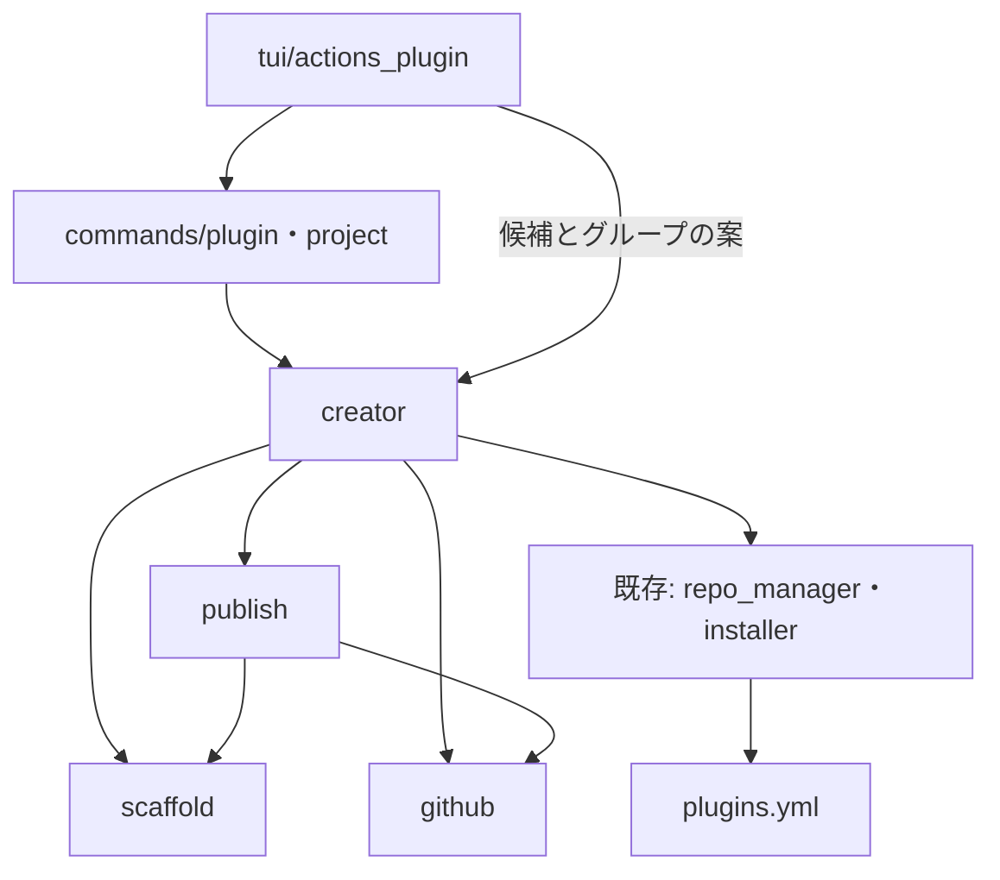
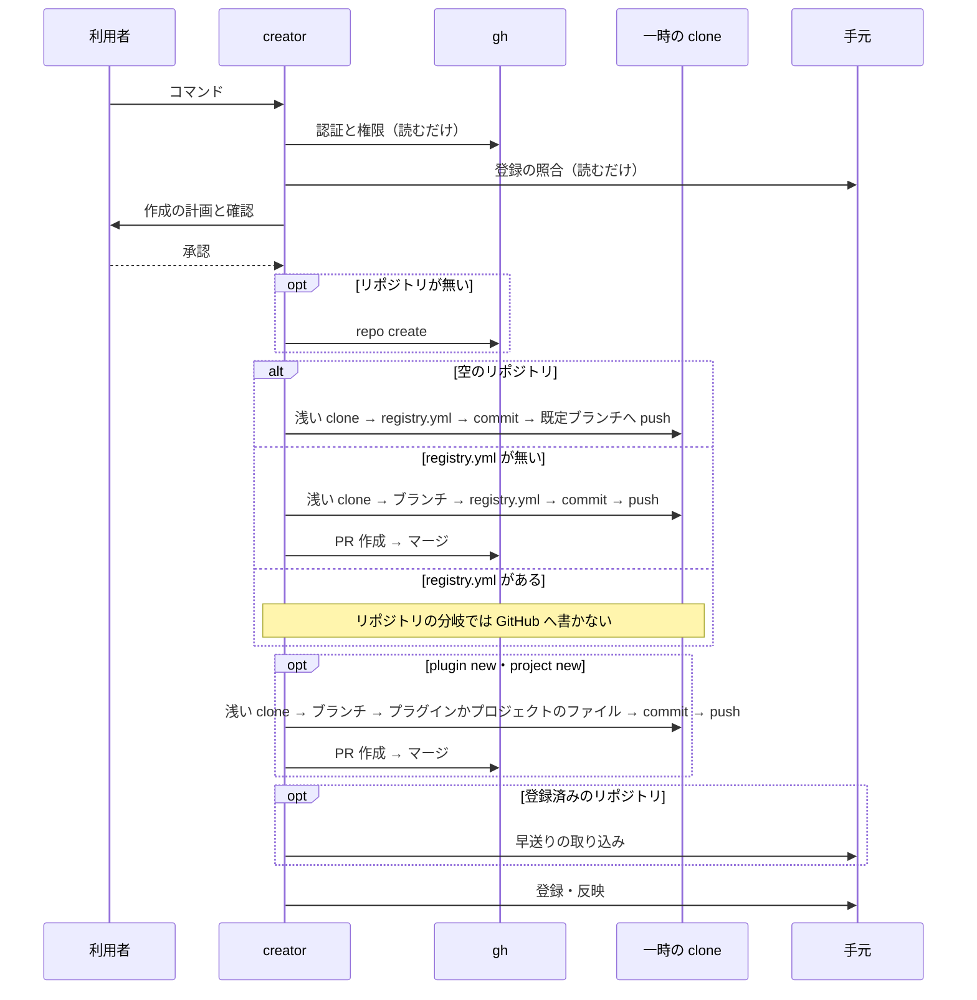

# リポジトリ・プラグイン・プロジェクトの新規追加: 1 回の操作でマージと手元の取り込みまで済ませる（#514）

## 目的

- **今どうなっているか**: 新しいリポジトリを devbase で使い始めるには、`registry.yml`・`plugin.yml`・`project.yml` などを手で置き、PR を出してマージし、`plugin update` まで打つ必要がある
- **誰に効くか**: プラグインの保守者と、社内のプラグインリポジトリへプロジェクトを足す開発者
- **変えると何が成り立つか**: 引数 1 つのコマンドか `devbase list` の TUI で、権限の確認から手元の `projects/` への反映までが終わる

## 適用範囲

- **働く範囲**: devbase の CLI と TUI。書き込む先は利用者が指定した GitHub のリポジトリと手元の `repos/`・`projects/`・`plugins.yml`
- **プロジェクトごとに違うもの**: 入れ先のプラグイン・アカウントグループ・名前は引数で受け、無ければ決定の規則で決める
- **当たるモード**: `standard`

## あるべき姿の根拠

| 根拠 | 種類 | 何を示すか |
| --- | --- | --- |
| 「PRを作成してmerge、手元に取り込むところまで実施して完了」 | 利用者の指示の原文 | 完了の位置 |
| `gh repo view <repo> --json isEmpty,defaultBranchRef,viewerPermission` は権限と空かどうかを 1 回で返し、無いリポジトリでは `Could not resolve to a Repository` で終了コード 1 になる（gh 2.103.2 で実行） | 実測 | 権限の判定に追加の API の組み合わせが要らないこと |
| `git pull` は `lib/devbase/plugin/repo_manager.py` の `_git_pull` で `--ff-only` を付けずに実行される | 実測（コードの読み取り） | 取り込みの前に早送りの確認が別に要ること |
| `add_repository` は `registry.yml` が無いと登録せず clone を消す（`repo_manager.py`） | 実測（コードの読み取り） | 登録より先に `registry.yml` を入れる順序が要ること |

要求と受け入れ条件は #514 の本文にある（コピーは `issues/issue-514-requirements.md`）。この文書は「どう作るか」だけを扱う。

## ドメインモデル

### コンテキスト

| コンテキスト | 何の語が 1 つの意味に決まるか |
| --- | --- |
| プラグインの配布 | プラグインリポジトリ・プラグイン・プロジェクト・登録・導入・作成フロー |
| 機密の置き場（`secret`） | アカウントグループとその宣言 |
| コマンドの入口（`cli`） | 名前の形 |

変更はプラグインの配布の中で閉じ、ほかの 2 つのモデルを変えない。コンテキストマップの関係は**順応者**である。プラグインの配布が下流になり、グループの規則（`validate_account_group`）と名前の形（`names.is_single_segment_name`）をそのまま受け入れて、独自の規則を持たない。

### 集約

| 集約 | 持ち主（書き換えてよいもの） | 根 | エンティティ | 値オブジェクト |
| --- | --- | --- | --- | --- |
| プラグインリポジトリ（GitHub の既定ブランチ） | 中身は `publish` が PR のマージと、空のリポジトリの最初のコミットで書く。リポジトリの作成は `creator` が `GhClient.create_repo` を呼んで行う | リポジトリ | プラグイン・プロジェクト | `GitHubRef`・`registry.yml` の項目 |
| 手元の登録（`plugins.yml`） | 既存の `PluginRegistry`（`add_repository`・`install_plugin`・`refresh_repository` 経由だけ） | `plugins.yml` | 登録済みリポジトリ・導入済みプラグイン | — |
| 手元の clone（`repos/` の clone と `projects/` への反映） | `_pull_ff_only`（取り込み）と、既存の `add_repository`（clone）・`install_plugin`・`refresh_repository`（`projects/` への反映） | `repos/` の clone | 作業ツリー | — |

`creator` と `publish` は手元の `repos/` の clone へファイルを置かない。手元が変わるのは、既定ブランチへの反映の後に上の持ち主を呼ぶときだけである。

### 不変条件

| # | 集約 | 条件 | 破れたときの扱い |
| --- | --- | --- | --- |
| I1 | 全体 | 計画の確定（解決と確認）が終わるまで、GitHub にも手元にも書かない | 実装の誤り。テストで止める |
| I2 | 手元の登録 | 作成フローが既定ブランチへ入れる変更がすべて反映される（最初のコミットの push かマージが成功する）まで `plugins.yml` を変えない。入れる変更が無い経路は、確認の後にそのまま登録する | 同上 |
| I3 | プラグインリポジトリ | `registry.yml` の編集の前後で既存の項目が同じで、増えるのは 1 項目だけである | 検証で不一致なら push せず止める |
| I4 | 手元の clone | 未コミットの変更を失わない | 取り込みが変更とぶつかれば止める |
| I5 | プラグインリポジトリ | リポジトリの公開は `--public` のときだけである | テストで止める |
| I6 | 全体 | 作成フローはコンテナを起動しない（`AGENTS.md` の P3: 利用者の環境の `devbase up` は人の承認が要る） | テストで止める |
| I7 | プラグインリポジトリ | 既定ブランチへの直接の push は、空のリポジトリの最初のコミットだけである | テストで止める |
| I8 | 手元の clone | 手元の clone の取り込みは早送りだけである | 早送りできなければ止める |
| I9 | 全体 | グループ（`--group`・最多の値・TTY で聞いた値）は `validate_account_group` を、プラグインとプロジェクトの名前は `names.is_single_segment_name` を通してから計画へ入れる | 通らなければ何も変えず、理由を出して終了コード 1 で止める |

### ドメインイベント

| # | イベント | 発生元 | 受け手 |
| --- | --- | --- | --- |
| E1 | 引数を GitHub の owner/repo へ解決した | `GitHubRef.parse` | 各フロー |
| E2 | `gh` の認証と権限を確かめた | `GhClient` | 各フロー |
| E3 | 入れ先のプラグインとグループを決めた | `plan_project` | 計画 |
| E4 | 実行の計画を示して確認を得た | CLI・TUI | `execute` |
| E5 | リポジトリを作った | `GhClient.create_repo` | `publish` |
| E6 | 手元の clone と別の作業場所でブランチを作り、ファイルを置いて push した | `publish` | `GhClient` |
| E7 | PR を作ってマージした | `GhClient` | 取り込み |
| E8 | 手元の clone へ取り込んだ | `_pull_ff_only` | 登録 |
| E9 | `plugins.yml` へ登録し、`projects/` へ反映した | 既存の `add_repository`・`install_plugin`・`refresh_repository` | 利用者 |

E5〜E9 の通り方は、コマンドとリポジトリの状態の組で変わる（「経路ごとの反映と登録」）。未登録のリポジトリには手元の clone が無いので E8 を通らず、E9 の `add_repository` が clone する。

| コマンド | リポジトリ | 通るイベント（E4 の後） |
| --- | --- | --- |
| `plugin repo new` | 無い | E5 → E6（最初のコミット）→ E9 |
| `plugin repo new` | 空 | E6（最初のコミット）→ E9 |
| `plugin repo new` | `registry.yml` が無い | E6 → E7 → E9 |
| `plugin repo new` | `registry.yml` がある・未登録 | E9 |
| `plugin new` | 登録済み | E6 → E7 → E8 → E9 |
| `plugin new` | 無い | E5 → E6（最初のコミット）→ E6 → E7 → E9 |
| `plugin new` | 空 | E6（最初のコミット）→ E6 → E7 → E9 |
| `plugin new` | `registry.yml` が無い | E6 → E7 → E6 → E7 → E9 |
| `plugin new` | `registry.yml` がある・未登録 | E6 → E7 → E9 |
| `project new` | 入れ先のプラグインのリポジトリ（登録済み） | E6 → E7 → E8 → E9 |

登録済みのリポジトリへの `plugin repo new` は E4 の前に 0 で終わり、どのイベントも通らない。

### 用語

| 用語 | 意味 | 用語集への反映 |
| --- | --- | --- |
| プラグインリポジトリ | 直下に `registry.yml` を持つ Git リポジトリ。収めたプラグインは 0 件でもよい | 追加 |
| 作成フロー | リポジトリ・プラグイン・プロジェクトを足す一連の操作。権限の確認からマージ、手元への取り込み、登録までを含む | 追加 |
| 作成の計画 | 作成フローが書き込みの前に確定する、作るもの・ファイル・マージ先の組 | 追加 |

## 機能一覧

| # | 機能 | 誰が使うか |
| --- | --- | --- |
| 1 | `devbase plugin repo new <URL\|owner/repo> [--public] [--yes]` | プラグインの保守者 |
| 2 | `devbase plugin new <URL\|owner/repo> [--name] [--public] [--yes]` | プラグインの保守者 |
| 3 | `devbase project new <URL\|owner/repo> [--plugin] [--group] [--name] [--yes]` | 開発者 |
| 4 | `devbase list` のプラグインのメニューの組み直しと、1〜3 の入口 | TUI の利用者 |

## 構成要素

| 要素 | 責務 |
| --- | --- |
| `lib/devbase/plugin/github.py`（新規） | `GitHubRef`（引数の解決）と `GhClient`（`gh` の呼び出し。権限・作成・PR・マージ）。トークンを扱わない |
| `lib/devbase/plugin/scaffold.py`（新規） | テンプレートの文字列の生成と `registry.yml` への 1 項目の追記。外部へ出ない純粋な処理 |
| `lib/devbase/plugin/publish.py`（新規） | 一時の clone で変更を作り、空のリポジトリなら最初のコミットを push し、それ以外は push・PR・マージするまで（E6・E7） |
| `lib/devbase/plugin/creator.py`（新規） | 3 つのフローの `plan_*`（読むだけ）と `execute`（書く）。入れ先とグループの決定 |
| `lib/devbase/commands/plugin.py` | `plugin new`・`plugin repo new` の入口 |
| `lib/devbase/commands/project.py` | `project new` の入口 |
| `lib/devbase/cli.py` | パーサ、`SUBCMD_MAP`、`repo_subcmds`、`project` の分岐、`_NO_SECRET_INJECTION` への `('project', 'new')` の追加 |
| `etc/_devbase`・`etc/devbase-completion.bash` | シェル補完 |
| `lib/devbase/tui/actions_plugin.py` | メニューの組み直しと 3 つの入口 |
| `lib/devbase/plugin/repo_manager.py` | `_pull_ff_only` と `_find_registered`（URL の形によらず登録を探す）を足す。既存の関数は変えない |

`bin/devbase` は変えない。`_PROJECT_NAME_SUBCOMMANDS` に `new` を足さないので、`project new owner/repo` は name 解決を通らない。

`SUBCMD_MAP` へ値を足すので、既存の規則を 1 つずつ見た。`tests/cli/test_prefix_resolution.py` の網羅の検査と補完の一致テストは新しい値にも当たるので、値を足す側で満たす。`new` は既存の `project`・`plugin` の副命令と接頭辞が重ならないため、`SUBCMD_PREFIX_PREFERENCES` は変えない。

## 入出力の契約

### コマンド

| コマンド | 引数 | 終了コード |
| --- | --- | --- |
| `devbase plugin repo new <repo>` | `--public`（既定 private）、`--yes` | 0 成功・登録済み / 1 それ以外 |
| `devbase plugin new <repo>` | `--name`（既定はリポジトリ名）、`--public`、`--yes` | 同上 |
| `devbase project new <repo>` | `--plugin`、`--group`、`--name`（既定はリポジトリ名）、`--yes` | 同上 |

`<repo>` は `owner/repo`・`https://github.com/owner/repo[.git]`・`git@github.com:owner/repo[.git]` を受ける。`git@` の形の入力は clone の URL も `git@` のままにし、ほかは `https://github.com/owner/repo.git` にする。

### 引数の解決と分岐（リポジトリ）

| リポジトリ | push | `registry.yml` | 動作 |
| --- | --- | --- | --- |
| 無い | owner に作れる | — | 作る → 最初のコミットを直接 push → 登録 |
| 無い | owner に作れない | — | 終了（1） |
| 空 | できる | — | 最初のコミットを直接 push → 登録 |
| ある | できる | 無い | PR → マージ → 登録 |
| ある | できる | ある | 登録だけ |
| ある | できる | ある（登録済み） | 何もせず 0 |
| ある・空 | できない | — | 終了（1） |

- push できるのは `viewerPermission` が `ADMIN`・`MAINTAIN`・`WRITE` のとき
- owner に作れるのは次のどちらかのとき:
  - owner が `gh api user` の `login` と同じである
  - `gh api user/memberships/orgs/<owner>` の `state` が `active` で、`role` が `admin` か、組織の `members_can_create_repositories` が真である
- 読めない private のリポジトリは「無い」と同じに見える。`gh repo create` が失敗するので、その出力を示して終了する

### 経路ごとの反映と登録

`plugin new` は未登録のリポジトリでも受け入れ条件 17 を守るため、プラグインの PR のマージまで登録しない。

登録済みか未登録かは、計画の確定の前に `_find_registered` で決める。これは入力の URL と `plugins.yml` の全登録の `repo.url` を `_url_to_repos_dirname` の一致で比べ、見つけた登録を返す読むだけの関数である。`get_repository_by_url` の完全一致では、`git@` の形や `.git` の無い URL で登録したリポジトリが未登録に見え、プラグインの PR をマージした後に `add_repository` が登録済みとして拒否する。

見つけた登録は計画に持ち、登録済みの経路の呼び出しには入力の URL ではなく登録の値を渡す。`install_plugin` の内部も `get_repository_by_url` の完全一致で登録を探すためである。

| 呼び出し | 渡す値 |
| --- | --- |
| `_pull_ff_only` | 登録の `repo.local_path` の clone |
| `refresh_repository` | 登録の `repo.name` |
| `install_plugin` | `<repo.url>:<プラグイン名>`（登録の `repo.url`） |

| コマンド | リポジトリ | 既定ブランチへの反映 | 登録と反映（反映の後に行う） |
| --- | --- | --- | --- |
| `plugin repo new` | 無い・空 | 最初のコミットの直接の push | `add_repository` |
| `plugin repo new` | `registry.yml` が無い | PR のマージ | `add_repository` |
| `plugin repo new` | `registry.yml` がある・未登録 | 無し | `add_repository` |
| `plugin new` | 登録済み | プラグインの PR のマージ | `_pull_ff_only` → `refresh_repository` → `install_plugin` |
| `plugin new` | 未登録 | 上の 3 行のどれかの反映に続けて、プラグインの PR のマージ | `add_repository` → `install_plugin` |
| `project new` | 入れ先のプラグインのリポジトリ（登録済み） | プロジェクトの PR のマージ | `_pull_ff_only` → `refresh_repository` |

### 入れ先のプラグインの決定（プロジェクト）

1. `--plugin` があればそれを使う（導入済みで push できることは確かめる）
2. 導入済みで、登録済みリポジトリの `plugins` に項目があり、そのリポジトリへ push できるものを候補にする。リポジトリごとに `gh` を 1 回呼ぶ
3. 対象と同じ owner の候補があれば、それに絞る
4. 1 件ならそれを計画に示す。複数なら TTY で選ばせ、TTY が無ければ候補を出して 1 で終わる。0 件なら 1 で終わる

### テンプレート

リポジトリの `registry.yml` は `name: <リポジトリ名>`・`description: ""`・`plugins: []` である。`plugins` が空でも `add_repository` は登録する。

プラグインは `<名前>/plugin.yml`（`name`・`version: "1.0.0"`・`description`・`requires.devbase: ">=3.0.0"`・`projects.mode: auto`・`priority: 50`）と `<名前>/projects/.gitkeep`。

プロジェクトは `<プラグインの path>/projects/<名前>/` に次の 3 つを置く。

| ファイル | 中身 |
| --- | --- |
| `project.yml` | `version: 1`・`scale: 1`・`open_editor: true`・`repos`（`owner`・`repo`） |
| `compose.yml` | `containers/general` の `dev` 1 台。イメージ名は `<名前の小文字>:latest` |
| `env` | `DEVBASE_ACCOUNT_GROUP=<グループ>` |

作業ブランチは `devbase/new-<kind>-<名前>`、PR の題は `devbase: <kind> <名前> を足す`。

### 画面（`devbase list` のプラグインのメニュー）

第 1 階層を用途で分け、各項目はサブメニューへ入る。先頭を「見る」にして、Enter を続けて押しても安全な一覧へ届くようにする。

| 第 1 階層 | 第 2 階層 |
| --- | --- |
| 見る | 導入済み一覧・利用可能一覧・詳細・リポジトリ一覧 |
| 新規追加 | プロジェクト・プラグイン・リポジトリ |
| 導入・更新 | インストール・更新・リポジトリ登録・リポジトリ更新 |
| 削除 | アンインストール・リポジトリ削除 |
| 保守 | リンクの再同期・レガシー構成の移行 |

新規追加の入力の順は次のとおりである。入力ごとに Esc で 1 つ前のメニューへ戻り、Ctrl-C で全体を中止する（既存の規約）。

| 項目 | 順 |
| --- | --- |
| プロジェクト | リポジトリ → 名前（空で既定）→ 入れ先の選択（候補が 1 件なら選択を出さない）→ グループ（案を既定値に）→ 計画の確認 |
| プラグイン | リポジトリ → 名前（空で既定）→ 計画の確認 |
| リポジトリ | リポジトリ → 公開するかの確認（既定 いいえ）→ 計画の確認 |

TUI は確認を終えた値を `--yes` 相当で `cmd_plugin`・`cmd_project_new` へ渡す。ロジックは二重に持たない。

## 処理の流れ

リポジトリの分岐の反映とプラグインの追加は別の浅い clone で順に行う（決定 8）。登録済みのリポジトリへの `plugin repo new` は登録の照合で分かるので、確認へ進まず 0 で終わる。

### 途中で止まったとき

| 止まった所 | 残るもの | 出す案内 |
| --- | --- | --- |
| 解決・確認 | 何も残らない | 理由 |
| push | リポジトリを作った後なら、そのリポジトリ | 同じコマンドの再実行 |
| 同じブランチが既にある | 既存のブランチと PR | 開いている PR の URL |
| マージ | PR とブランチ | PR の URL。マージの後に打つコマンド（`plugin repo add`・`plugin repo refresh`・`plugin install`） |
| 未登録のリポジトリへの `plugin new` のプラグインの PR | 先に反映した最初のコミットか `registry.yml` は既定ブランチに残る。`plugins.yml` は元のまま | 上の行に同じ |
| 取り込み | マージ済み。手元は元のまま | 原因と `git -C <clone> status`、続けて打つコマンド |
| 登録 | マージと取り込み済み | 既存のコマンドのエラーと、続けて打つコマンド |

## 非機能の実現方式

| 大項目 | 実現方式 |
| --- | --- |
| 運用・保守性 | 上の表の案内を `RepositoryError` の本文に載せる。進んだ段階を `logger.info` で 1 行ずつ出す |
| セキュリティ | 認証は `gh`・`git` の既存の設定に任せ、トークンを引数へ渡さない。`gh` の標準エラーはそのままエラーへ載せる（`gh` はトークンを出さない）|
| システム環境 | Linux・macOS。外部コマンドは `gh`・`git`。`gh` の版は確かめない（`gh` 2.103.2 で確かめた。古くて失敗したときは、その出力で止まる）|

## 決定の記録

### 決定 1: 手元の未コミットの変更を守るため、作業は一時の浅い clone で行う

`repos/` の clone の worktree や作業ツリーを使わず、`tempfile.TemporaryDirectory` に `git clone --depth 1` して作業する。未登録のリポジトリには手元の clone が無く、登録済みの clone には利用者の変更がある。一時の clone なら 2 つの場合を同じ手順で扱える。

採らなかった案: 手元の clone に `git worktree add` する。未登録の場合を別の経路で書く必要があり、`.git/worktrees` に管理情報が残る恐れがある。

根拠: Value 3（MVV 版 1）

### 決定 2: 登録済みの経路を二重に書かないため、取り込みと登録は既存の関数に任せる

既定ブランチへの反映の後は `add_repository`・`install_plugin`・`refresh_repository` を呼ぶ。`refresh_repository` の `git pull` は早送りを保証しないので、前に `_pull_ff_only` を置き、既定ブランチでない clone や分岐した clone は止める。

採らなかった案: `_git_pull` に `--ff-only` を足す。既存の `plugin repo refresh` の振る舞いが変わる。

根拠: 根拠なし（MVV 版 1）

### 決定 3: 公開範囲を黙って広げないため、新しいリポジトリは private を既定にする

`--public` のときだけ公開する。`--public` は作成するときだけ効き、既存のリポジトリの公開範囲は変えない。

根拠: Value 3（MVV 版 1）

### 決定 4: 必須の検査やレビューを越えないため、マージは 1 回だけ試し、CI を待たない

`gh pr view --json mergeable` が `UNKNOWN` の間は最長 30 秒待ち、判定が出てから `gh pr merge` を 1 回実行する。失敗したら PR の URL を出して止まる。`--auto` と管理者の権限による `--admin` は使わない。マージの方式は、リポジトリが許す順に merge・squash・rebase から選ぶ。

採らなかった案: CI を待つ。プラグインリポジトリの多くは CI を持たず、待つ処理と時間切れの扱いを足す費用に見合わない。

根拠: 根拠なし（MVV 版 1）

### 決定 5: 入力の差を CLI と TUI で分けないため、TUI は値を集めて CLI のハンドラへ渡す

TUI は `creator` の読むだけの関数（候補とグループの案）を呼び、集めた値を `yes=True` でハンドラへ渡す。既存の `actions_plugin` と同じ委譲の形である。

根拠: 根拠なし（MVV 版 1）

### 決定 6: 既存のレジストリの書式を壊さないため、`registry.yml` は YAML を書き戻さず文字列で追記する

`plugins:` のブロックの末尾に 3 行を足す。`plugins: []` はブロックへ置き換える。追記の後に読み直し、既存の項目が同じで 1 項目だけ増えたことを確かめ、違えば止める（I3）。

採らなかった案: `yaml.safe_dump` で書き戻す。コメントと引用符の形が失われ、差分が読めなくなる。

根拠: 根拠なし（MVV 版 1）

### 決定 7: 人が書いた説明を崩さないため、プラグインの説明文へプロジェクト名を足さない

`plugin.yml` と `registry.yml` の `description` は人が書いた文で、機械で足すと読めない文になる。#514 の「含まない」のとおりである。

根拠: 根拠なし（MVV 版 1）

### 決定 8: マージできないときに手元の登録を残さないため、登録は作成フローの最後の反映の後に回す

未登録のリポジトリへの `plugin new` は、リポジトリの分岐の反映に続けてプラグインの PR をマージし、そのマージが成功してから `add_repository` と `install_plugin` を呼ぶ。リポジトリの分岐の反映とプラグインの追加は順に別の変更として行い、1 つの PR にまとめない。

採らなかった案: リポジトリの分岐を終えた時点で登録する。プラグインの PR のマージが失敗すると `plugins.yml` が変わったまま残り、受け入れ条件 17 を破る。

根拠: 根拠なし（MVV 版 1）

### 決定 9: URL の形の違いでマージの後に止まらないため、登録の照合は `_url_to_repos_dirname` の一致で行う

`repo_manager.py` に `_find_registered` を足し、計画の確定の前に登録を探す。見つけた登録の `repo.url`・`repo.name`・`repo.local_path` を後の呼び出しへ渡す（「経路ごとの反映と登録」）。比べ方は既存の `_reject_duplicate_registration` と同じで、`add_repository` が拒否するものを計画の段階で登録済みの経路へ入れる。

採らなかった案: `get_repository_by_url` を URL の形の違いを吸収するよう変える。`install_plugin` などの既存の経路の振る舞いが変わる。

採らなかった案: `add_repository` の拒否を受けてから登録済みとして続ける。既定ブランチへのマージの後に経路が変わり、計画で示した手順と違う動きになる。

根拠: 根拠なし（MVV 版 1）

## テスト設計

| 受け入れ条件・不変条件 | どの振る舞いで縛るか | どう壊したら落ちるべきか |
| --- | --- | --- |
| 1・2・3・4、I5、I7 | 分岐の表と経路の表の全行を、偽の `gh` と手元の bare リポジトリで実行し、作ったもの・PR・`plugins.yml` を見る。`plugins` が空の `registry.yml` も登録できる | 既定を公開にする・PR を飛ばす・権限なしで作る・プラグイン 0 件の登録を拒む |
| 5 | `GitHubRef.parse` が 4 つの形で同じ owner/repo を返し、GitHub 以外を拒む | `.git` を外さない・別ホストを通す |
| 6・7・8、I9 | プラグインのフローで `plugin.yml`・`registry.yml`・導入の状態を見る。未登録・重複名・形の誤りを含む | 登録の省略・重複の上書き・名前の形を見ない |
| 6・7、決定 8 | 未登録のリポジトリへの `plugin new` を、無い・空・`registry.yml` が無い・ある の 4 状態で実行し、既定ブランチへの反映の順（リポジトリの分岐 → プラグインの PR → 登録）を見る | プラグインを最初のコミットや `registry.yml` の PR へまとめる・プラグインの PR の前に登録する |
| 6・7、決定 9 | `git@` の形と `.git` の無い URL で登録したリポジトリへ、形の違う入力で `plugin new` を打つ。登録済みの経路を通って 0 で終わり、`plugins.yml` の `url` が変わらず、プラグインが導入される。同じ入力の `plugin repo new` は何もせず 0 で終わる | 完全一致で照合する・入力の URL を `install_plugin` へ渡す |
| 9・12 | プロジェクトの 3 ファイルと `projects/<名前>` の反映を見る。読めないとき・重複のときは何も変わらない | ファイルの欠け・上書き |
| 10 | 決定の規則の 4 段を候補の表で縛る | owner の絞り込みの省略・TTY なしで選ぶ |
| 11、I9 | 最多の値・同数・値なし・`--group`。予約語など `validate_account_group` が弾く値は、どの出所でも何も書かず終了コード 1 になる | 同数で片方を選ぶ・グループの規則を通さず `env` へ書く |
| 13、I6 | 作成フローの全経路で `docker` と `compose` を呼ばない | 手順に `up` を足す |
| 14 | `gh` なし・未認証で、書き込みの呼び出しが 0 回 | 確認を後回しにする |
| 15、I1 | 確認の前は書き込みの呼び出しが 0 回。TTY なしで `--yes` なしは 1 | 確認を飛ばす |
| 16、I4、I8 | 手元に未コミットの変更がある clone で完走し、変更が残る。分岐した clone は止まる | `creator`・`publish` が手元の作業ツリーへ書く・マージコミットを作る |
| 17、I2 | マージの失敗で `plugins.yml` が同じで、URL が出る。未登録のリポジトリへの `plugin new` でも同じである。成功のとき作業場所が残らない | 先に登録する |
| 18・19・20 | メニューの全項目が既存の操作へ届き、Esc と Ctrl-C の戻り値が既存どおりに伝わる | 項目の欠け・Esc の取り違え |
| 21 | 既存のテストが変わらず通る | 既存の属性を変える |
| 22 | `project new owner/repo` がプロジェクトの切替を通らない | `_PROJECT_NAME_SUBCOMMANDS` へ足す |
| I3 | コメント付きの `registry.yml` で追記し、既存の行が残る。壊れる追記は止まる | `safe_dump` で書き戻す |

## 設計の結果

| 課題 | 扱い | 取り込み先 | 触るファイル |
| --- | --- | --- | --- |
| #514 | 実装する | — | `lib/devbase/plugin/`、`lib/devbase/commands/plugin.py`、`lib/devbase/commands/project.py`、`lib/devbase/cli.py`、`lib/devbase/tui/actions_plugin.py`、`etc/`、`tests/`、`docs/user/cli-reference/`、`CHANGELOG.md` |

## 未確認のまま残ること

| 項目 | 内容 |
| --- | --- |
| 実の GitHub での完走 | テストでは書かない。リリース後テストで利用者の作業用のアカウントで確かめる |
| 組織の設定 | 組織の規則で private の作成が禁じられているとき、`gh repo create` の失敗で止まる形になる。事前には判定しない |
