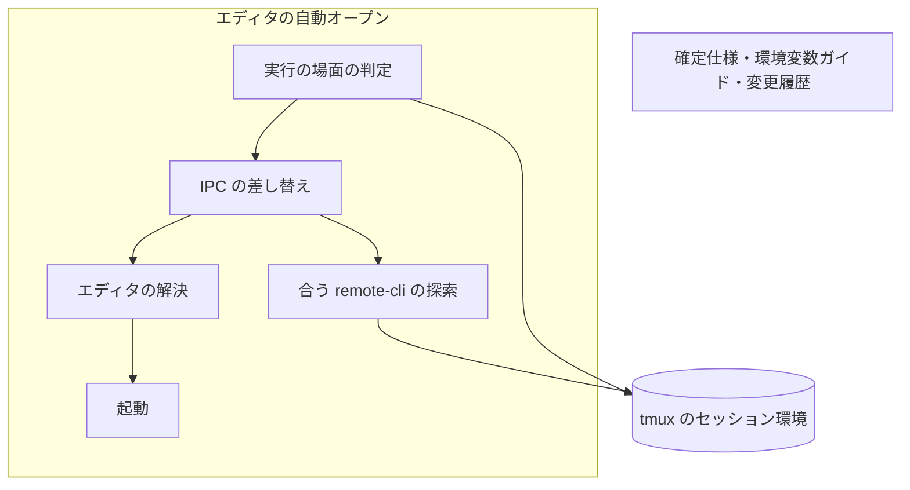
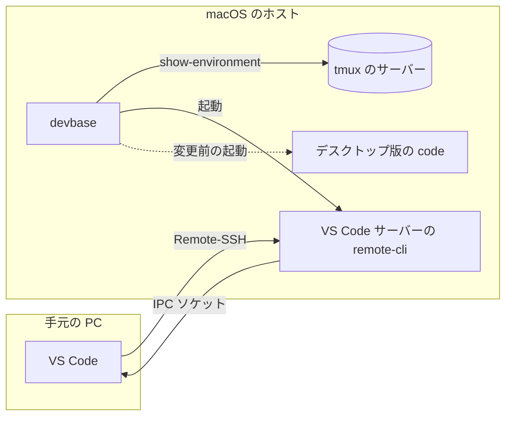
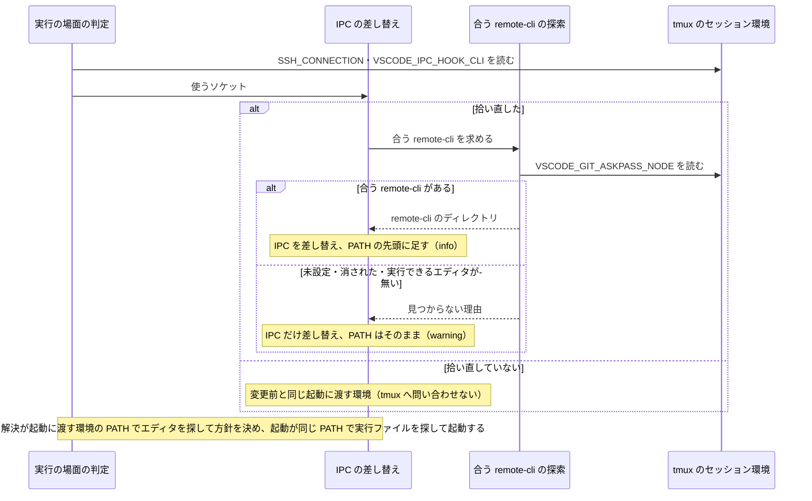

# エディタの自動オープン: tmux でソケットを拾い直したときも手元の VS Code に窓を開く（#523）

## 目的

- **今どうなっているか**: 手元の PC の VS Code から Remote-SSH で macOS のホストへ入り、以前のクライアントが作った tmux のペインから `devbase` でエディタを開く。IPC ソケットは拾い直せても、起動されるのはペインの `PATH` の先頭にあるデスクトップ版の `code` である。手元の PC には窓が開かず、エラーも出ない
- **誰に効くか**: Remote-SSH で入ったホストの tmux の中で `devbase up` / `devbase open` を使う利用者
- **変えると何が成り立つか**: 拾い直したソケットと同じ VS Code サーバーの `remote-cli` の `code` が起動される。手元の PC の VS Code に、dev コンテナへ接続した窓が開く。拾い直しが起きないときの振る舞いは変わらない

## 適用範囲

- **働く範囲**: このリポジトリの CLI（エディタの自動オープンと `devbase open`）だけ。プラグインのリポジトリは触らない
- **プロジェクトごとに違うもの**: 無し（プロジェクトの設定・引数は増えない。tmux の `update-environment` は利用者の `~/.tmux.conf` の設定として案内するだけ）
- **当たるモード**: `standard`

## あるべき姿の根拠

| 根拠 | 種類 | 何を示すか |
| --- | --- | --- |
| PRD1 | 外部の一次情報 | VS Code サーバーは統合ターミナルの `PATH` の先頭に自分の `remote-cli` を足す。`PATH` の先頭に合う `remote-cli` を入れる形は、VS Code 自身が統合ターミナルで作る状態と同じになる |
| PRD2 | 外部の一次情報 | デスクトップ版の `code` のラッパーは、`VSCODE_IPC_HOOK_CLI` があっても `PATH` に `remote-cli` が無ければホストの VS Code を開く。事象の原因が `PATH` にあることを示す |
| PRD3 | 外部の一次情報 | `VSCODE_GIT_ASKPASS_NODE` は VS Code サーバーの `node` の絶対パス（`process.execPath`）である。拾い直したソケットと同じサーバーを指す |
| 手元のホストの `ls` と `grep -c` | 実測 | 現行の配置で `<サーバー>/node` と `<サーバー>/bin/remote-cli/code`（実行できる）が並び、`server-cli.js` は `VSCODE_IPC_HOOK_CLI` を 1 回読み、デスクトップ版の `cli.js` は 0 回（外部の調査の「実測」の行） |

要求と受け入れ条件は #523 の本文にある（コピーは [issue-523-requirements.md](issue-523-requirements.md)）。この文書は「どう作るか」だけを扱う。

## ドメインモデル

### コンテキスト

| コンテキスト | 何の語が 1 つの意味に決まるか |
| --- | --- |
| エディタで開く（`editor`） | IPC ソケット・セッション環境・IPC ソケットの拾い直し・`remote-cli`・合う `remote-cli`・起動に渡す環境 |

変更はこのコンテキストの中で閉じる。用語集の `tmux` のコンテキスト（base イメージの tmux のコマンド）は触らない。

### 集約

| 集約 | 持ち主（書き換えてよいもの） | 根 | エンティティ | 値オブジェクト |
| --- | --- | --- | --- | --- |
| 起動の準備 | IPC の差し替え（エディタの自動オープンの、起動に渡す環境を作る段） | 起動に渡す環境 | — | IPC ソケット・合う `remote-cli`・`PATH` |

実行の場面の判定（`EditorContext`）は読むだけで書き換えない。判定と方針と URI の組み立ては範囲外である（要求の「含まない」）。

### 不変条件

| # | 集約 | 条件 | 破れたときの扱い |
| --- | --- | --- | --- |
| I1 | 起動の準備 | `PATH` に足す `remote-cli` は、ソケットを拾い直したのと同じ tmux のセッションのセッション環境から読んだ `VSCODE_GIT_ASKPASS_NODE` だけから求める。VS Code サーバーのディレクトリを探さない。ソケットの読みと `VSCODE_GIT_ASKPASS_NODE` の読みは別の tmux の呼び出しで、2 つが同じ attach の値であることは保証しない（決定 1） | 求められなければ `PATH` を変えない（I4） |
| I2 | 起動の準備 | 拾い直しが起きないとき（処理の流れの「拾い直した」に当たらないとき）、起動するコマンド・起動に渡す環境・tmux への問い合わせの回数は変更前と同じである | — |
| I3 | 起動の準備 | `PATH` に足すディレクトリは、絶対パスで、名前が `remote-cli` で、中に起動するエディタの名前の実行できるファイルがあるものだけである | 足さずに警告する（I4） |
| I4 | 起動の準備 | 合う `remote-cli` を求められないとき、`PATH` は変えず、警告を 1 行出し、起動はこれまでどおり続ける | — |
| I5 | 起動の準備 | 合う `remote-cli` を足したとき、`PATH` の先頭の要素はそのディレクトリで、2 番目以降はペインの `PATH` の要素を同じ順で持つ | — |

### ドメインイベント

| # | イベント | 発生元 | 受け手 |
| --- | --- | --- | --- |
| E1 | 利用者が tmux のペインで `devbase` からエディタを開いた | 利用者（`devbase up` の後の自動オープン・`devbase open`） | 実行の場面の判定 |
| E2 | ペインのシェルの IPC ソケットを使えないと判定した | 実行の場面の判定 | 実行の場面の判定（拾い直し） |
| E3 | セッション環境から接続できる IPC ソケットを拾い直した | 実行の場面の判定 | IPC の差し替え |
| E4 | セッション環境から VS Code サーバーの `node` のパスを読み、合う `remote-cli` のディレクトリか見つからない理由を求めた | 合う `remote-cli` の探索 | IPC の差し替え |
| E5 | 合う `remote-cli` を `PATH` の先頭に入れた。`PATH` を書き換えるのは IPC の差し替えだけで、探索は書き換えない | IPC の差し替え | エディタの解決 |
| E6 | 起動するエディタを `PATH` から求めた | エディタの解決 | 方針の決定・起動 |
| E7 | エディタを、拾い直したソケットと差し替えた `PATH` で起動した | 起動 | 利用者（手元の PC の VS Code） |

### 用語

| 用語 | 意味 | 用語集への反映 |
| --- | --- | --- |
| セッション環境 | tmux のサーバーがセッションごとに持つ環境変数。`update-environment` に挙げた変数は attach のたびにいまのクライアントの値へ更新される | 追加（要求の段で追加済み） |
| IPC ソケットの拾い直し | ペインのシェルの `VSCODE_IPC_HOOK_CLI` が使えないとき、セッション環境の接続できる値を使うこと | 追加（要求の段で追加済み） |
| remote-cli | VS Code サーバーが持つ CLI の置き場（`<サーバーのディレクトリ>/bin/remote-cli`） | 追加（要求の段で追加済み） |
| 合う remote-cli | 拾い直したソケットと同じ VS Code サーバーの `remote-cli`。セッション環境の `VSCODE_GIT_ASKPASS_NODE` の置かれたディレクトリの `bin/remote-cli` | 追加（この設計の段で `docs/glossary.md` と `docs/glossary/glossary.json` に反映済み） |
| デスクトップ版の code | ホストに入れたデスクトップ版の VS Code の CLI。`VSCODE_IPC_HOOK_CLI` があっても、`PATH` に `remote-cli` が無ければホストの VS Code に向けて開く | 意味の変更（ラッパーが `PATH` の `remote-cli` へ委ねることを足す。PRD2。この設計の段で同じ 2 つのファイルに反映済み） |

## 外部の調査

| 種類 | 調べるか | 理由 |
| --- | --- | --- |
| 標準・仕様 | 調べる | tmux の `update-environment` の既定に `VSCODE_GIT_ASKPASS_NODE` が入るかで、警告が要る場面が決まる |
| 主要な製品 | 調べる | VS Code のサーバー・デスクトップ版の CLI・git 拡張が、`remote-cli` と `PATH` と `node` のパスをどう扱うかが、直し方の根拠になる |
| ライブラリとサービス | 調べる | 実行ファイルの探索と起動を、既に依存している Python の標準ライブラリで足りるかを確かめる |

### 標準・仕様

| # | 標準・仕様 | 何を定めているか | 設計への反映 | 出典 |
| --- | --- | --- | --- | --- |
| STD1 | tmux の `update-environment` | attach と新しいセッションの作成のたびに、挙げた変数をクライアントの環境からセッション環境へ写す。クライアントに無い変数は消された印（`-NAME`）になる。既定の一覧は `DISPLAY`・`SSH_CONNECTION` など 13 個で、`VSCODE_*` を含まない | `VSCODE_GIT_ASKPASS_NODE` は推奨設定を入れた利用者でだけセッション環境に入る。無い・消されたときは警告で推奨設定を案内する（決定 4） | `man tmux`（tmux 3.7b）、`env -u TMUX tmux -L ndf523probe -f /dev/null start-server \; show -gv update-environment \; kill-server`（2026-11-16） |

### 主要な製品

| # | 製品 | どう解いているか | 設計への反映 | 出典 |
| --- | --- | --- | --- | --- |
| PRD1 | VS Code サーバーの拡張ホストの起動 | 統合ターミナルなどへ渡す環境の `PATH` の先頭に `<サーバー>/bin/remote-cli` を足す。`PATH` が無ければ `remote-cli` だけにする | 合う `remote-cli` を `PATH` の先頭に足し、ペインの要素は並びを変えずに残す（決定 2） | https://github.com/microsoft/vscode/blob/6e68549edb69380c9316e49df5d3795d5064a2b0/src/vs/server/node/extensionHostConnection.ts の 49〜58 行（2026-11-16） |
| PRD2 | VS Code のデスクトップ版の `code`（macOS のラッパー） | `VSCODE_IPC_HOOK_CLI` があるとき、`PATH` から `/remote-cli/` を含む `code` を探して委ねる。無ければデスクトップ版を開く | `PATH` に合う `remote-cli` があれば正しいクライアントへ届く。原因と直し方の根拠 | https://github.com/microsoft/vscode/blob/6e68549edb69380c9316e49df5d3795d5064a2b0/resources/darwin/bin/code.sh の 6〜13 行、手元の `/Applications/Visual Studio Code.app/Contents/Resources/app/bin/code`（1.146.0）の 6〜13 行（2026-11-16） |
| PRD3 | VS Code の git 拡張の askpass | 端末へ渡す環境に `VSCODE_GIT_ASKPASS_NODE = process.execPath`（拡張ホストを動かす `node` の絶対パス）を入れる | `node` の置かれたディレクトリを VS Code サーバーのディレクトリとして読む（決定 1） | https://github.com/microsoft/vscode/blob/6e68549edb69380c9316e49df5d3795d5064a2b0/extensions/git/src/askpass.ts の 36〜43 行（2026-11-16） |
| PRD4 | VS Code サーバーの CLI（`server-cli`） | `VSCODE_IPC_HOOK_CLI` のソケットを通じて手元のクライアントへ依頼する | `remote-cli` の `code` には拾い直したソケットを渡す（既存の振る舞いを保つ） | https://github.com/microsoft/vscode/blob/6e68549edb69380c9316e49df5d3795d5064a2b0/src/vs/server/node/server.cli.ts の 24・87 行（2026-11-16） |
| 実測 | 手元のホストの VS Code サーバー | `~/.vscode-server/cli/servers/Stable-<commit>/server/` に `node` と `bin/remote-cli/code`（`-rwxr-xr-x`）が並ぶ。`out/server-cli.js` の `VSCODE_IPC_HOOK_CLI` は 1 回、デスクトップ版の `out/cli.js` は 0 回 | 前提 1 の関係を現行の配置で確かめた | `ls -l <サーバー>/node <サーバー>/bin/remote-cli/`、`grep -c VSCODE_IPC_HOOK_CLI <サーバー>/out/server-cli.js`（2026-11-16） |

### ライブラリとサービス

| # | 候補 | 版 | ライセンス | 最後のリリースの日付 | 終了のアナウンス | 要件を満たすか | 出典 |
| --- | --- | --- | --- | --- | --- | --- | --- |
| LIB1 | Python の標準ライブラリ（`shutil.which(path=)`・`os.access`・`subprocess.Popen(env=)`） | プロジェクトの `requires-python >=3.10` に従う | PSF | Python 本体の版に従う | 無し | 満たす。`Popen` は `env` を渡すと `os.get_exec_path(env)` で実行ファイルを探すため、`PATH` の差し替えだけで起動する実行ファイルが変わる | `pyproject.toml`、`python3 -c "import inspect,subprocess; ..."` で `Popen._execute_child` の `os.get_exec_path(env)` を確認（2026-11-16） |

依存は増えない。

### 確かめられなかったこと

| 対象 | 試した手段 | 結果と理由 |
| --- | --- | --- |
| Cursor などのサーバーで `remote-cli` の中の実行ファイルの名前 | `ls ~/.cursor-server/cli/servers/*/server/bin/remote-cli` | 手元に Cursor のサーバーが無く、出力は空だった。公開の資料は試していない |
| git 拡張が統合ターミナルへ `VSCODE_GIT_ASKPASS_NODE` を渡さない設定（端末の認証を切った場合など）の有無 | 試していない | 渡さない場合は警告の経路に入る（決定 4）。設計の形は変わらない |

調べた量: 候補 6 件・取得の試み 13 回。

## 機能一覧

| # | 機能 | 誰が使うか |
| --- | --- | --- |
| F1 | IPC ソケットを拾い直したとき、合う `remote-cli` を `PATH` の先頭に入れてエディタを探し、起動する | Remote-SSH で入ったホストの tmux で `devbase` を使う利用者 |
| F2 | 合う `remote-cli` を求められなかったとき、理由と tmux の設定の置き場を警告で示す | 同上 |
| F3 | 確定仕様と環境変数ガイドで、拾い直しと `VSCODE_GIT_ASKPASS_NODE` の設定の要否を読める | 同上・devbase の開発者 |

## 構成要素

| 要素 | 責務 |
| --- | --- |
| 実行の場面の判定（既存・変えない） | ペインの IPC が使えるか、セッション環境から拾い直せるかを判定し、使うソケットを決める |
| IPC の差し替え（既存・変える） | 拾い直したとき、起動に渡す環境の `VSCODE_IPC_HOOK_CLI` を差し替え、続けて合う `remote-cli` の探索を呼ぶ。見つかれば `PATH` の先頭に足し、info を 1 行出す。見つからなければ `PATH` を変えず warning を 1 行出す |
| 合う `remote-cli` の探索（新設） | セッション環境の `VSCODE_GIT_ASKPASS_NODE` を 1 回読み、`<node の置かれたディレクトリ>/bin/remote-cli` を求め、I3 の条件を確かめる。結果は「ディレクトリ」か「見つからない理由（未設定・消された・実行ファイルが無い）」のどちらか |
| エディタの解決（既存・呼び方を変える） | `PATH` を差し替えたときは、差し替えた `PATH` でエディタを探す（現状は IPC を外したときだけ起動に渡す環境の `PATH` を渡し、ほかは実行中のプロセスの `PATH` で探す） |
| 起動（既存・変えない） | 起動に渡す環境の `PATH` で実行ファイルを探して起動する（LIB1） |
| 確定仕様・環境変数ガイド・変更履歴（変える） | 拾い直したときの `PATH` の扱いと、`VSCODE_GIT_ASKPASS_NODE` を `update-environment` に入れる必要を書く。`[Unreleased]` に利用者に見える変更を書く |

文書の要素は実行の流れに加わらないため、図では辺を持たない。

### システムの文脈と配置

変えるのは devbase だけである。tmux のサーバー・VS Code サーバー・デスクトップ版の `code`・手元の VS Code は変えられない外部の系として扱う。

## 構造

型の追加・変更は無い（`EditorContext`・`OpenPlan` は変えない）。変えるのはエディタの自動オープンのモジュールの中の処理の順序で、次の節に描く。関数の粒度の配置は詳細設計の文書が持つ。

## 処理の流れ

「拾い直した」は、判定が使うと決めたソケットがペインの `VSCODE_IPC_HOOK_CLI` と違うときを指す。次の 3 つの場合を含む。

- ペインのソケットが死んでいた
- ペインのソケットは接続できるが、以前のクライアントのものとして使わず、セッション環境のソケットを使うと決めた（`ipc_from_previous_client`）
- ペインに `VSCODE_IPC_HOOK_CLI` が無く、セッション環境から拾えた

受け入れ条件 6 の「ペインのソケットが接続できる」は、接続できて、かつ判定がペインのソケットを使うと決めた場合を指す。接続できても以前のクライアントのものとして使わない場合は、セッション環境から拾えれば「拾い直した」に入り `PATH` を変える。拾えなければ受け入れ条件 7 の経路（IPC を外す）に入る。I2 とテスト設計の受け入れ条件 6 の行は、この区分に従う。

拾い直したときに出すログは次の 2 つで、どちらか 1 行だけを出す。既存の「拾い直しました」の info はそのまま残す。

| 場面 | 水準 | 載せること |
| --- | --- | --- |
| 合う `remote-cli` を足した | info | 足した `remote-cli` のディレクトリ |
| 求められなかった | warning | 合う `remote-cli` が見つからなかったこと、理由（未設定・消された・実行できるエディタが無い）、手元の `code` で起動すること、環境変数ガイドの tmux の設定（`update-environment` に `VSCODE_GIT_ASKPASS_NODE` を入れる）の案内 |

## 非機能の実現方式

| 大項目 | 要求の条件 | 実現方式 | 確かめ方 |
| --- | --- | --- | --- |
| 性能・拡張性 | 追加の外部コマンドは、拾い直したときの `tmux show-environment VSCODE_GIT_ASKPASS_NODE` の 1 回だけで、既存の待ち時間の上限（2 秒）に従う。拾い直しが起きないときは追加の呼び出しをしない | 探索は拾い直したときの分岐の中からだけ呼び、既存のセッション環境の読み（上限 2 秒）を 1 回使う。ファイルの確かめは `stat` 系の呼び出しだけで外部コマンドを起動しない | tmux の呼び出しを差し替えて数え、拾い直したときは 1 回増え、拾い直さないときは増えないことを新しい単体テストで見る。拾い直す場面の既存のテストが増えた 1 回を受けても変わらず通ることは、テスト設計の「受け入れ条件 6（既存のテスト）」の行で見る |
| 運用・保守性 | 合う `remote-cli` が見つからなかった理由を、利用者が直し方まで辿れる警告で出す | warning に理由の区分と環境変数ガイドの tmux の設定への案内を載せる（処理の流れの表） | 理由ごとに warning の文面を単体テストで見る |
| セキュリティ | セッション環境の値から求めたパスは、`remote-cli` という名のディレクトリで、中に実行できる `code` があるときだけ `PATH` に入れる | 値が絶対パスでないときは足さない。求めたディレクトリの名前が `remote-cli` で、中の起動するエディタの名前のファイルが通常のファイルで実行できるときだけ足す（決定 3） | 相対パス・実行権の無いファイル・ディレクトリの `code` で足さないことを単体テストで見る |

## 決定の記録

### 決定 1: 拾い直したソケットと同じサーバーを使うため、セッション環境の `VSCODE_GIT_ASKPASS_NODE` から合う `remote-cli` を求める

`VSCODE_GIT_ASKPASS_NODE` は VS Code サーバーの `node` の絶対パスである（PRD3）。`VSCODE_IPC_HOOK_CLI` と同じ attach でセッション環境へ写る（STD1）。同じセッション環境から求めれば、attach の後にソケットとサーバーの版がずれた状態は残らない。

`node` の置かれたディレクトリの `bin/remote-cli` を合う `remote-cli` とし、現行の配置と旧い配置のどちらでもこの関係が成り立つ（実測・要求の前提 1）。

ただし、判定がソケットを読む呼び出しと、探索が `VSCODE_GIT_ASKPASS_NODE` を読む呼び出しは別で、2 つが同じ attach の値であることは保証しない。2 つの読みの間に別のクライアントが attach すると、ソケットと `node` のパスが別のクライアントのものになり得る。この間の attach は許容する。2 つの読みは続けて行う tmux の呼び出しで、間に利用者の操作は挟まらない。1 回の呼び出しでまとめて読む形は、判定の既存の問い合わせを変え、I2（拾い直しが起きないときの問い合わせの回数）と非機能の条件（追加は 1 回だけ）を崩すため採らない。食い違ったときに起きることは「未確認のまま残ること」に置く。

直し方は、要求の「起票者の推定」の S1・S2・S4〜S6 に沿い、S3（サーバーのディレクトリを探して使う）は採らない。推定はどれも課題の本文から読んだもので、設計はその対応を要求の表のとおりに引き継ぐ。

VS Code サーバーのディレクトリ（`~/.vscode-server/cli/servers/*`）を探して選ぶ方法は採らない。手元のホストに版の違うサーバーが 6 つ並んでおり（実測。`ls -d ~/.vscode-server/cli/servers/*/server | wc -l` が 6）、どれが拾い直したソケットのものかを決める手がかりが無いためである。

- 作り方: 自前で作る・標準に倣う
- 比べた候補: STD1 / PRD1 / PRD3 / LIB1

根拠: Mission / Value 1（MVV 版 1）

### 決定 2: VS Code の統合ターミナルと同じ状態にするため、合う `remote-cli` を `PATH` の先頭に足し、ペインの要素は並びを変えずに残す

VS Code サーバーは統合ターミナルの `PATH` の先頭に自分の `remote-cli` を足し、ほかの要素は触らない（PRD1）。同じ形にすれば、エディタの子のプロセス（`remote-cli` の `code` が使う `dirname` など）もペインの `PATH` で動く。ペインの `PATH` に別の版の `remote-cli` が残っていても、先頭の要素が先に当たるため起動には使われない。ペインのシェルの環境変数に `PATH` が無いときは、PRD1 と同じく `remote-cli` だけを `PATH` にする。

ペインの `PATH` から古い `remote-cli` を除いてから足す方法は採らない。先頭に足すだけで起動する実行ファイルは決まり、除くと受け入れ条件 2 の「2 番目以降はペインの要素を同じ順で持つ」を満たさなくなる。

- 作り方: 標準に倣う
- 比べた候補: PRD1 / PRD2

根拠: Value 1（MVV 版 1）

### 決定 3: セッション環境の値で任意の場所を `PATH` に入れないため、絶対パス・`remote-cli` の名前・実行できるエディタの 3 つを満たすときだけ足す

セッション環境の値は attach してきたクライアントが決める。相対パスを許すと、`devbase` を実行したディレクトリからの位置として読まれる。そのため値が絶対パスであること、求めたディレクトリの名前が `remote-cli` であること、中に起動するエディタの名前の通常のファイルがあり実行できることを確かめる。確かめに外部コマンドは使わない（非機能の条件）。

確かめるファイルの名前は、起動するエディタの名前とする。既定は `code`、`DEVBASE_EDITOR` があればその先頭の語のファイル名（絶対パスならその末尾）である。要求の前提 4 のとおり Cursor など VS Code 以外のサーバーも同じに扱うため、`code` に固定しない。`DEVBASE_EDITOR` が絶対パスでも `PATH` の差し替えは同じに行い、起動する実行ファイルはその絶対パスのまま変わらない。

- 作り方: 自前で作る
- 比べた候補: LIB1 / PRD2

根拠: Value 3（MVV 版 1）

### 決定 4: 版のずれたサーバーへ委ねないため、合う `remote-cli` を求められないときはほかを探さず、`PATH` を変えずに警告する

次のいずれのときも、`PATH` を変えずにこれまでどおり起動し、warning を 1 行出す。

- `VSCODE_GIT_ASKPASS_NODE` が未設定
- `VSCODE_GIT_ASKPASS_NODE` が消された（`-VSCODE_GIT_ASKPASS_NODE`）
- 求めたディレクトリに実行できるエディタが無い

tmux の既定の `update-environment` は `VSCODE_*` を含まないため（STD1）、この経路は推奨設定を入れていない利用者で必ず通る。警告には環境変数ガイドの tmux の設定を案内し、利用者が `~/.tmux.conf` に 1 行足せば次から直る形にする。

この決定は要求の前提 2 を採る。推奨設定をしていない利用者は、警告を受けて設定を足すまで手元の PC に窓が開かない。それでも採るのは、版のずれたサーバーで開くと、開いた窓が拾い直したソケットのクライアントのものである保証が無いためである。設定の 1 行で直る経路を警告で示せば、利用者は自分で直せる。

サーバーのディレクトリを探して代わりに使う方法は採らない（決定 1 と同じ理由）。起動を止める方法も採らない。これまでの振る舞いより悪くしないためである。

根拠: Value 1（MVV 版 1）

### 決定 5: 起動の形を変えないため、起動するコマンドの先頭の語はエディタの名前のまま残し、起動に渡す環境の `PATH` で解決させる

`subprocess.Popen` は渡した環境変数の `PATH` で実行ファイルを探す（LIB1）。エディタの解決も同じ `PATH` で探すようにすれば（構成要素の「エディタの解決」）、存在の確かめと起動が同じ実行ファイルを指す。先頭の語を絶対パスへ書き換えないので、`DEVBASE_EDITOR` に引数を書いた場合も、起動のログと既存のテストの期待値の形も変わらない。

先頭の語を `remote-cli` の絶対パスへ書き換える方法は採らない。`PATH` の差し替えと 2 か所で同じ事実を持つことになり、`DEVBASE_EDITOR` が絶対パスのときの扱いが分かれるためである。

- 作り方: ライブラリやサービスを使う
- 比べた候補: LIB1

根拠: Value 1（MVV 版 1）

## テスト設計

| 受け入れ条件・不変条件 | どの振る舞いで縛るか | どう壊したら落ちるべきか |
| --- | --- | --- |
| 受け入れ条件 1 | ペインの `PATH` の先頭にデスクトップ版を模した `code`、セッション環境だけが接続できるソケットと `VSCODE_GIT_ASKPASS_NODE=<サーバー>/node` を持ち、`<サーバー>/bin/remote-cli/code` が実在するとき、起動するコマンドの先頭の語を起動に渡す環境の `PATH` で解決すると `<サーバー>/bin/remote-cli/code` になる | 探索を呼ばない・エディタの解決が実行中のプロセスの `PATH` で探す、と落ちる |
| 受け入れ条件 2・I5 | 1 の起動で渡す環境の `PATH` の先頭が `<サーバー>/bin/remote-cli`、2 番目以降がペインの `PATH` と同じ並び、`VSCODE_IPC_HOOK_CLI` が拾い直したソケット | 末尾へ足す・ペインの要素を除く・並べ替える・IPC を差し替えない、と落ちる |
| 受け入れ条件 3 | 1 のとき、足したディレクトリを含む info が 1 行出る | ログを出さない・2 行以上出す、と落ちる |
| 受け入れ条件 4・I4 | 拾い直したがセッション環境の `VSCODE_GIT_ASKPASS_NODE` が未設定・消されたとき、`PATH` はペインのまま、tmux の設定を案内する warning が 1 行出て、起動は行われる | `PATH` を変える・警告を出さない・起動を止める・消された印をパスとして扱う、と落ちる |
| 受け入れ条件 5・I4 | 求めたディレクトリに `code` が無い・実行できないとき、4 と同じ形の warning が出て `PATH` は変わらない | 実在だけを見て実行権を見ない・ディレクトリの存在だけで足す、と落ちる |
| 受け入れ条件 6・I2 | ペインのソケットが接続できて判定がそれを使うと決めた・tmux の外・セッション環境に接続できるソケットが無いとき、起動するコマンドと渡す環境が変更前と同じで、`VSCODE_GIT_ASKPASS_NODE` を問い合わせない。ペインのソケットが接続できても以前のクライアントのものとしてセッション環境のソケットを使う場合は、拾い直した側（受け入れ条件 1〜5）で縛る | 拾い直していないときにも探索を呼ぶ・`PATH` を触る、と落ちる |
| 受け入れ条件 6（既存のテスト） | `tests/editor/` の既存のテストを変更せずに通す。拾い直す場面の既存のテスト（拾い直したソケットを起動に渡す・以前のクライアントの IPC の代わりにセッション環境の IPC を使う、など）は tmux の差し替えが `VSCODE_GIT_ASKPASS_NODE` の問い合わせも受ける。差し替えは問い合わせた名前に合わない行か空を返し、例外を投げないため、探索は未設定として扱い `PATH` を変えずに warning を 1 行足す。これらのテストが見ているのは起動の結果・起動に渡す `VSCODE_IPC_HOOK_CLI`・起動するコマンドで、warning の有無と tmux の呼び出しの回数は見ていない（`tests/editor/test_opener.py` の `_FakeRun` と `_FakeTmuxEnv` を使うテストを読んで確かめた）。変えてよいテストは無い。通らなければ、実装をこの形に合わせて直す | 探索の追加で既存のテストを書き換える必要が出る、と落ちる |
| 受け入れ条件 7 | ペインのソケットを以前のクライアントのものとして外し、セッション環境からも拾えないとき、`PATH` から `remote-cli` を除いて手元の `code` を探す | 探索の追加で IPC を外す経路の `PATH` の扱いが変わる、と落ちる（既存のテストが縛る） |
| 受け入れ条件 8 | 確定仕様と環境変数ガイドの tmux の節に、拾い直したときに合う `remote-cli` を `PATH` の先頭に入れること・`VSCODE_GIT_ASKPASS_NODE` を `update-environment` に入れる必要があることが書かれている | 文書の確認（レビューと手動の読み合わせ） |
| I1 | セッション環境の `VSCODE_GIT_ASKPASS_NODE` が無く、VS Code サーバーのディレクトリには `remote-cli/code` が実在するとき、`PATH` は変わらない | サーバーのディレクトリを探して足す、と落ちる |
| I3 | `VSCODE_GIT_ASKPASS_NODE` が相対パスのとき・求めた場所の `code` がディレクトリのとき、`PATH` に足さず warning を出す。`DEVBASE_EDITOR=cursor` のときは `remote-cli/cursor` の有無で決まる | 名前を `code` に固定する・相対パスを受け入れる・ディレクトリを実行ファイルとみなす、と落ちる |
| 性能の条件 | 拾い直したときの tmux の問い合わせは変更前より 1 回だけ多い | 2 回以上読む・拾い直さないときにも読む、と落ちる |
| 手動確認（前提 3） | 手元の PC の VS Code → Remote-SSH → macOS のホストの tmux のペインで `devbase open proj-a` を実行し、手元の PC に dev コンテナへ接続した窓が開く | リリース後テストで利用者が見る |

## 設計の結果

| 課題 | 扱い | 取り込み先 | 触るファイル |
| --- | --- | --- | --- |
| #523 | 実装する | — | `lib/devbase/editor/opener.py`、`tests/editor/test_opener.py`、`docs/specifications/editor-open.md`、`docs/user/environment-variables.md`、`CHANGELOG.md`、`docs/glossary.md`、`docs/glossary/glossary.json`（用語の追加と意味の変更。設計の段で反映済みで、実装の段では内容を変えない） |

## 人へ残す判断

無し（この設計の判断に、共通原則の C1〜C8・プロジェクト MVV の P1〜P3 に当たるものは無い）

## 未確認のまま残ること

| 項目 | 内容 |
| --- | --- |
| 手元の PC に窓が開くこと（前提 3） | 起票の時点で確かめたのは `remote-cli` の `code` の終了コード 0 までである。窓が開くかはリリース後テストで、利用者が手元の PC の VS Code から確かめる |
| Cursor などのサーバーでの `remote-cli` の中身 | 手元に無く確かめていない（外部の調査の「確かめられなかったこと」）。中の実行ファイルの名前が起動するエディタの名前と違えば、決定 4 の警告の経路に入る。使う利用者が現れた時点の報告で分かる |
| git 拡張が `VSCODE_GIT_ASKPASS_NODE` を端末へ渡さない場面 | 設定によって渡さない場面があるかを確かめていない。渡さない場合は決定 4 の警告の経路に入り、これまでの振る舞いのまま起動する。警告を受けた利用者の報告で分かる |
| ソケットの読みと `node` のパスの読みの間の attach | 2 つの読みの間に別のクライアントが attach すると、ソケットと `remote-cli` が別のクライアントのものになり得る（決定 1）。その組み合わせで起動したときに、起動が失敗するか・どちらのクライアントに窓が開くかは確かめていない。起きる幅は続けて行う 2 回の tmux の呼び出しの間に限られる |
| macOS 以外のホスト（Linux・WSL2）での振る舞い | 確かめたのは macOS のホストだけである。`node` と `bin/remote-cli` の位置関係は VS Code サーバーの配置で決まり OS に依らないと読んでいるが、実機では確かめていない。Linux のホストで Remote-SSH を使う利用者の報告で分かる |
