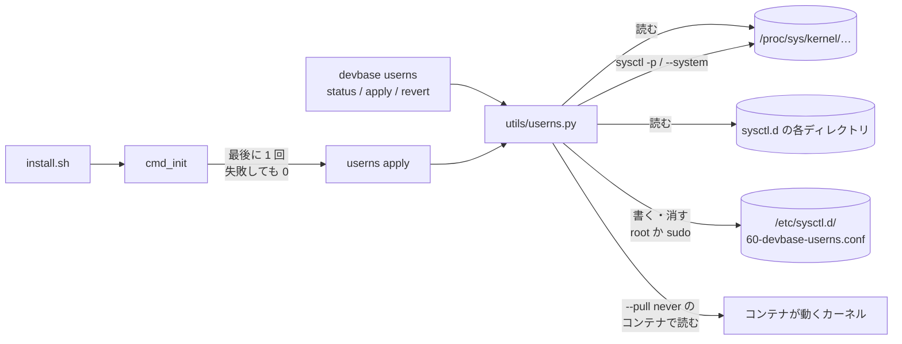
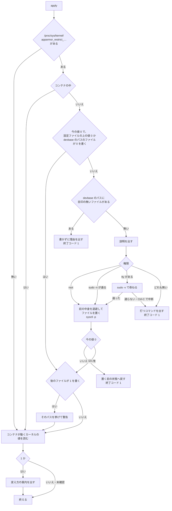

# devbase init: ホストの userns の制限を外し、戻せるようにする（#533）

Ubuntu 23.10 以降のホストでは userns の制限（`kernel.apparmor_restrict_unprivileged_userns = 1`）が、dev コンテナの中の bubblewrap による user namespace の作成を止め、利用者は端末ごとに手で sysctl を入れている。`devbase init`（`install.sh` が呼ぶ）の最後で、新しいコマンド `devbase userns apply` が、説明を出してから devbase の sysctl の設定ファイルを置いてその場で 0 にし、権限が得られなければ手順を出してインストールを続ける。macOS など、コンテナが VM の中で動く端末では、コンテナが動くカーネルの値を読んで案内だけを出し、`devbase userns revert` で戻せる。採らなかった案は「決定の記録」に、調べた一次情報は末尾の「外部の調査」にある。

## 今の姿

何が起きたか・目的・受け入れ条件は要求仕様（[issue-533-requirements.md](./issue-533-requirements.md)、正は #533 の本文）にある。この文書は「どう解くか」と「なぜその解き方か」だけを書く。

```mermaid
flowchart LR
    U[利用者] -->|curl \| bash| I[install.sh]
    I -->|clone / pull| R[(~/devbase)]
    I -->|bin/devbase init| N[cmd_init]
    N --> P[plugins.yml]
    N --> RC[rc と補完]
    N -.->|今は触らない| S[(/etc/sysctl.d と<br>/proc/sys/kernel)]
    D[dockerd] -->|カーネルを共有| C[dev コンテナ]
```

- `cmd_init`（`lib/devbase/commands/init.py`）は submodule・plugins・rc・補完の順に整え、失敗を `DevbaseError` / `OSError` で受けて終了コード 1 を返す。sudo もホストのカーネルの設定も使わない
- `install.sh` は `curl | bash` で動く。bash は標準入力からスクリプトを読み続けるので、`init` の子プロセスが標準入力を読むと、残りのスクリプト（`print_next_steps` と `main "$@"` の呼び出し）を食う
- docker を叩く処理は `lib/devbase/utils/docker_context.py` と同じく、`runner`（`subprocess.run` と同じ形の呼び出し）を引数で差し替えられる形で書かれている
- トップレベルのコマンドの一覧は、`lib/devbase/cli.py` の `_create_parser`・`_expand_argv` の `commands`・`_ROOT_COMMANDS`、`bin/devbase` の振り分けと `resolve_command`、`etc/devbase-completion.bash` と `etc/_devbase` に写しがある

## 文脈と制約

- **ホストの設定だけでは codex は動かない。** 0 にした後も Docker の既定の seccomp が `unshare` を止める。`security_opt` を生成する compose へ足すかは #534 が決める。この設計は、#534 がどちらに決まっても要るホストの側だけを扱う
- ホスト全体のセキュリティを緩める変更である（AppArmor の一次情報はこの制限を、特権の無いプロセスからカーネルの攻撃面を減らす手段として置く。STD2）。利用者が知らないまま緩めない（共通原則 C6）
- `install.sh` は非対話で動くことがある（CI・`ssh host 'curl … | bash'`）。sudo のパスワードは tty からしか尋ねられない
- sysctl.d はファイル名の辞書順で読み、同じキーは最後のファイルが勝つ。`/etc` のファイルは同じ名前の `/usr/lib` のファイルを置き換える（STD1）
- テストは CI（GitHub Actions の Ubuntu。パスワード無しの sudo がある）と開発者の端末で走る。既存の `cmd_init` のテストがそのまま `apply` を通ると、実のホストの sysctl を書き換える
- macOS の Docker Desktop の VM にこのキーがあるか、値は何かを確かめていない（「未確認のまま残ること」）

## 解き方の全体像



図に含めない構成要素は、実行の経路に現れない CLI の登録（`cli.py`・`bin/devbase`・補完）とテストの隔離（`tests/conftest.py`）である。

- `devbase init` は最後に `apply` を 1 回呼び、結果に依らず今と同じ終了コードで終わる
- `apply` は Linux のホストで userns の制限があるときだけ、説明を出し、root・パスワード無しの sudo・tty で尋ねる sudo の順に権限を得て、devbase の sysctl の設定ファイルを置いて `sysctl -p` で 0 にする。どれも得られなければ打つコマンドを出す
- `status` はホストの値・設定ファイルの上の値・コンテナが動くカーネルの値を出す。コンテナが動くカーネルが別（VM・リモート）で 1 なら、`apply` は変え方の案内だけを出す
- `revert` は目印のある devbase のファイルだけを消して `sysctl --system` で読み直す

## 構成要素

| 要素 | 責務 |
| --- | --- |
| userns の判定と変更（`lib/devbase/utils/userns.py`、新設） | ホストの値・設定ファイルの上の値・コンテナが動くカーネルの値を読み、権限を選び、devbase のファイルを置く・消す。子プロセスは差し替えられる `runner` で起動し、標準入力を渡さない |
| userns のコマンド（`lib/devbase/commands/userns.py`、新設） | `status` / `apply` / `revert` の表示と終了コード。判定と変更は上の要素へ渡す |
| `cmd_init`（変更） | 最後に `apply` を呼び、`DEVBASE_SKIP_USERNS` があれば飛ばす。`apply` の結果で終了コードを変えない |
| CLI の登録（`cli.py`・`bin/devbase`・補完、変更） | トップレベルの `userns` を足し、`u` を `up` に残す |
| テストの隔離（`tests/conftest.py`、変更） | autouse の fixture で、ホストのパスを tmp へ向け、`runner` を呼ばれたら落ちるものへ差し替える。`DEVBASE_SKIP_USERNS` を隔離の一覧へ足す |

## 入出力のコントラクト

| コマンド | 変えるもの | 終了コード |
| --- | --- | --- |
| `devbase userns status` | 無し | 0 |
| `devbase userns apply` | 制限があり権限が得られれば、devbase のファイルと今の値 | 0: 制限が無い・外した・変えないと決めた（キーが無い・コンテナの中・既に 0）。1: 権限が得られない・sudo のパスワードの入力を中断した・同じパスに目印の無いファイルがある・`sysctl -p` が失敗した・値が 0 にならない |
| `devbase userns revert` | devbase のファイルと今の値 | 0: 消した・ファイルが無い。1: 目印が無い・権限が得られない・消せない |

devbase の sysctl の設定ファイルの中身（2 行。1 行目が目印）:

```text
# devbase: dev コンテナの中で bubblewrap などが user namespace を作れるようにする。戻すには devbase userns revert
kernel.apparmor_restrict_unprivileged_userns = 0
```

`status` の出力（行の並びだけを約束し、文言は実装で決める）:

```text
ホスト:                  1（設定ファイルの上では 1: /usr/lib/sysctl.d/10-apparmor.conf）
devbase のファイル:      無し（/etc/sysctl.d/60-devbase-userns.conf）
コンテナが動くカーネル:  1（devbase-base:latest から読んだ）
```

`apply` が変える前に出す説明（tty で sudo を尋ねる前・root やパスワード無しの sudo で変える前の両方）:

```text
==> ホストの userns の制限を外します
    キー:     kernel.apparmor_restrict_unprivileged_userns（1 → 0）
    ファイル: /etc/sysctl.d/60-devbase-userns.conf（再起動の後も 0 のまま）
    理由:     dev コンテナの中で bubblewrap（codex のサンドボックスなど）が user namespace を作るため
    緩むこと: AppArmor のプロファイルを持たない、ホストのすべての特権の無いプロセスが user namespace を作れるようになる
    戻し方:   devbase userns revert（または sudo rm <ファイル> && sudo sysctl --system）
    止め方:   DEVBASE_SKIP_USERNS=1 で init を打つ
```

環境変数 `DEVBASE_SKIP_USERNS`: 空でない値があれば、`init` は `apply` を呼ばない。`devbase userns apply` を直に打ったときは見ない（明示の操作を優先する）。

## 処理の流れ

`apply` の分岐（`status` は同じ読み取りを行い、変えずに出す）:



コンテナが動くカーネルの値の読み方:

| 手元の状態 | 読み方 | 出す値 |
| --- | --- | --- |
| docker が無い・daemon に届かない・20 秒で返らない | 読まない | 未確認（理由） |
| `devbase-base:latest` がある | `docker run --rm --pull never --network none --entrypoint cat devbase-base:latest /proc/sys/kernel/apparmor_restrict_unprivileged_userns` | 0 / 1。ファイルが無ければ「キーが無い」 |
| イメージが無く、`docker info` の `SecurityOptions` に `apparmor` が無い | `docker info --format '{{json .SecurityOptions}}'` | 制限は効かない（AppArmor が無い） |
| イメージが無く、`apparmor` がある | 同上 | 未確認（イメージが無い。`devbase build` の後に `devbase userns status` で確かめる） |

## 決定の記録

### 決定 1: 戻し方と確かめ方を同じ入口に置くため、新しいコマンド `devbase userns` を足し、`init` から `apply` を呼ぶ

- **質問**: ホストの設定を変える処理を `install.sh`・`devbase init`・新しいコマンドのどこに置くか
- **選んだ案**: `lib/devbase/utils/userns.py` に判定と変更を置き、`devbase userns status|apply|revert` を足す。`cmd_init` が最後に `apply` を呼ぶ。`install.sh` は変えない（`init` を通るので届く）
- 採らなかった案: `install.sh` に bash で書く（`git pull` の後に `init` を打つ利用者に届かず、戻すコマンドと確かめるコマンドの置き場が無い。`install.sh` のテストは `init` をスタブしており、sysctl の分岐を pytest で縛れない）
- 採らなかった案: `init` の中だけに置く（戻す・確かめる入口が無く、利用者が手でファイルを消す手順を覚えることになる）
- **代償**: トップレベルのコマンドが 1 つ増え、写し（parser・`_ROOT_COMMANDS`・`_expand_argv`・`bin/devbase`・bash と zsh の補完）をすべて合わせ、`u` の解決の優先（`TOP_PREFIX_PREFERENCES` と `bin/devbase` の `resolve_command`）を足す
- 作り方: 自前で作る・標準に倣う
- 比べた候補: STD1 / PRD1 / PRD2
- 根拠: Value 1「入った時点で使える」（MVV バージョン 1）。STD1

### 決定 2: インストールを止めないため、`apply` の失敗で `init` の終了コードを変えない

- **質問**: 権限が得られない・`sysctl -p` が失敗したとき、`init`（と `install.sh`）を失敗にするか
- **選んだ案**: `apply` は失敗を終了コード 1 と手順の表示で返すが、`init` はそれを警告として出し、今と同じ終了コードで終わる。`apply` は `init` の最後（rc・補完の後）に呼ぶ
- 採らなかった案: `init` を失敗にする（rc と補完が整っていても `install.sh` が `set -e` で止まり、`print_next_steps` が出ない。userns の制限は codex の読み取り専用の起動だけに効き、devbase のほかの使い方を止める理由にならない）
- **代償**: 非対話のインストールでは制限が残ったまま「完了しました」と出る。警告と打つコマンドを出して補う
- 根拠: Value 1「入った時点で使える」（MVV バージョン 1）

### 決定 3: 利用者が知らないまま緩めないため、変える前に毎回説明を出し、権限は root・パスワード無しの sudo・tty で尋ねる sudo の順に選ぶ

- **質問**: sudo のパスワードを求めるか、非対話のときどうするか、利用者の同意をどこで得るか
- **選んだ案**: 変える前に「入出力のコントラクト」の説明を出す。root ならそのまま書き、`sudo -n true` が通ればそのまま sudo で書く。通らず `/dev/tty` を開ければ `sudo -v` でパスワードを尋ね、通ったら書く。どれも無ければ変えずに打つコマンドを出す。パスワードの入力を利用者が Ctrl-C で中断したら、断ったものとして扱う。`apply` が `sudo -v` の呼び出しで `KeyboardInterrupt` を受け、何も書かずに「中断した」と打つコマンドを出して終了コード 1 で返す。`init` はこれを決定 2 のとおり警告にして 0 で終わる（Ctrl-C は Python にも届くので、受けないと `init` が SIGINT で死に、`curl | bash` の bash も止まって最後の案内が出ない）。止めたい利用者は `DEVBASE_SKIP_USERNS` で止める。sudo・sysctl・docker の子プロセスには標準入力を渡さない（`stdin=subprocess.DEVNULL`。`sudo -v` は tty から読む）
- 採らなかった案: 変える前に y/N を尋ねる（利用者の依頼は「自動的に」で、tty の無いインストールでは尋ねられず、結局どちらかへ倒す既定が要る。tty があるときは sudo のパスワードが同意の場になる）
- 採らなかった案: tty が無くても `sudo` を打つ（パスワードを読めずに止まるか失敗し、`curl | bash` の標準入力を食うことがある）
- **代償**: root とパスワード無しの sudo の端末（CI の runner など）では、説明を出すだけで尋ねずに緩める。この扱いは「人へ残す判断」で人が見る
- 根拠: Value 1「入った時点で使える」（MVV バージョン 1）

### 決定 4: 再起動の後も効き、devbase のものだけを戻せるよう、目印つきの `/etc/sysctl.d/60-devbase-userns.conf` を 1 つだけ置く

- **質問**: どのファイルにどう書き、既にある設定・後から読まれる設定とどう付き合うか
- **選んだ案**: `/etc/sysctl.d/60-devbase-userns.conf` に、1 行目を `# devbase:` で始まる目印とした 2 行を書き、`sysctl -p <そのファイル>` で今の値も 0 にする。今の値が 0 で、設定ファイルの上の値が 0 か、devbase のパスのファイルが既に 0 を書いていれば書かない（後のファイルが 1 を書くなら警告だけを出す）。今だけ 0 なら書いて残す。同じパスに目印の無いファイル（利用者が手で置いたもの）があって書く必要があるときは、書き換えずに理由を出して止める。書いた後に今の値が 0 にならなければ、書く前の状態へ戻す。前にファイルが無ければ消し、目印のある前のファイルがあれば退避した中身へ戻す。辞書順で後のファイルが 1 を書くなら、そのパスを挙げて警告し、そのファイルには触らない。`revert` は目印のあるファイルだけを消し、`sysctl --system` で読み直す
- 採らなかった案: `/etc/sysctl.d/99-zz-devbase-userns.conf` のように最後に読まれる名前にする（利用者や管理者が後の名前で入れた硬化の設定を黙って上書きする。ファイル名の番号は Ubuntu の案内（`20-apparmor.conf`）と同じく途中に置き、負けたら知らせる）
- 採らなかった案: `/etc/sysctl.conf` へ行を足す（利用者のファイルを書き換え、devbase の行だけを戻すのに中身を編集することになる）
- 採らなかった案: `sysctl -w` だけで今の値を変える（再起動で 1 に戻る）
- **代償**: 番号が 60 なので、後の番号で 1 を書く端末では再起動で戻る。警告で知らせ、直すのは利用者に任せる。この端末で手で置いた同じパスのファイル（1 行目が `# devbase:`）は devbase のものとして読む
- 作り方: 標準に倣う
- 比べた候補: STD1 / STD2
- 根拠: Value 2「作り直しで失わない」（MVV バージョン 1）。STD1

### 決定 5: devbase が変えられない場所を壊さないため、キーの無いカーネル・コンテナの中・コンテナが動くカーネルが別の端末では、変えずに値と案内だけを出す

- **質問**: macOS・AppArmor を使わない distro・コンテナの中・VM（Docker Desktop・Colima・OrbStack）で何をするか
- **選んだ案**: ホストに `/proc/sys/kernel/apparmor_restrict_unprivileged_userns` が無ければ変えない。`/.dockerenv` か `/run/.containerenv` があれば変えない。コンテナが動くカーネルの値は「処理の流れ」の表の読み方で読み、1 でホストの変更で変わらないなら、VM の中で同じファイルを置く手順（Colima なら `colima ssh` の中で、など）と、VM を作り直すと消えることがあることを出す。イメージは取得しない
- 採らなかった案: 特権のコンテナから `nsenter` で VM の sysctl を書く（VM の再起動で戻り、永続の置き場が製品ごとに違う。案内の外で VM の中を書き換える操作は利用者の環境を黙って書き換えるのに近い）
- 採らなかった案: 値を読むためにイメージ（`alpine` など）を取得する（`init` が通信とディスクを使い、非対話の macOS ではキーチェーンで取得が止まる。AGENTS.md の「落とし穴」）
- **代償**: macOS の端末では自動では何も変わらない。Docker Desktop の VM にキーが無いと分かるまで、案内が要るかどうかは実測を待つ（「未確認のまま残ること」）
- 根拠: Value 3「プロジェクトの境界を守る」（MVV バージョン 1）

### 決定 6: 依頼された設定を他の変更に依らずに入れるため、bubblewrap だけに user namespace を許す AppArmor のプロファイルを採らない

- **質問**: ホスト全体の制限を外す代わりに、bubblewrap 用のプロファイル（`bwrap-userns-restrict`）で許す形にするか
- **選んだ案**: sysctl で制限を外す。プロファイルの形は採らない
- 採らなかった案: `bwrap-userns-restrict` を読み込む（codex の手引きと Ubuntu はこちらを先に勧める。PRD1・PRD2。ただし dev コンテナは `apparmor=unconfined` か `docker-default` で動き、ホストのパスに当てたプロファイルがコンテナの中の `/usr/bin/bwrap` に当たるかを確かめていない。当てるには compose の `security_opt` でプロファイルを名指すことになり、#534 の範囲に入る）
- **代償**: ホスト全体の制限が外れる（AppArmor のプロファイルを持たない、すべての特権の無いプロセスが user namespace を作れる）。説明の「緩むこと」で毎回知らせる
- 作り方: 標準に倣う
- 比べた候補: PRD1 / PRD2 / STD2
- 根拠: Value 1「入った時点で使える」（MVV バージョン 1）。PRD1

### 決定 7: テストが実のホストを変えないよう、ホストのパスと子プロセスの起動を 1 つの値にまとめ、autouse の fixture で差し替える

- **質問**: 既存の `cmd_init` のテストと新しいテストが、実の `/etc/sysctl.d`・`/proc/sys`・sudo に触らないことをどう保つか
- **選んだ案**: `userns.py` に、読むパス（proc のキー・sysctl.d の各ディレクトリ・devbase のファイル・コンテナの印）と `runner` をまとめた値（`HostPaths` と `Runner`）を置き、関数は引数で受け、省けばモジュールの既定を使う。`tests/conftest.py` の autouse の fixture が既定を tmp のパスと「呼ばれたら落ちる runner」へ差し替える。`DEVBASE_SKIP_USERNS` を隔離の一覧（`ISOLATED_ENV`）へ足す
- 採らなかった案: `init` のテストだけで `DEVBASE_SKIP_USERNS` を立てる（テストを足すたびに立て忘れが起き、CI の runner ではパスワード無しの sudo で実の sysctl を書く）
- **代償**: 実のパスへ書く経路はテストで通らない。受け入れ条件 1・12 は手動確認（マージ前）で確かめる
- 根拠: Value 1「入った時点で使える」（MVV バージョン 1）

## 影響と危険

- **働く範囲**: このリポジトリだけ。プラグインと生成する compose は変わらない
- **プロジェクトごとに違うもの**: 無い。ホストの設定なので、端末ごとに 1 回効く。止めるのは環境変数 `DEVBASE_SKIP_USERNS`
- **当たるモード**: 無し（NDF のモードに依らない。devbase の CLI の変更）
- 同じファイルを触る別の変更: `lib/devbase/cli.py`・`bin/devbase`・補完は、トップレベルのコマンドを足す変更とぶつかる。`docs/glossary/glossary.json` と `CHANGELOG.md` も並行の PR とぶつかりやすい（AGENTS.md の「Pull Request」）
- 壊れうる箇所: `cmd_init` の既存のテストが、fixture の差し替えを経ずに実の sudo を呼ぶ（決定 7 で塞ぐ）。`devbase u` が曖昧になる（受け入れ条件 20）。`curl | bash` の標準入力を子プロセスが食う（決定 3）
- 用語集の文書（`docs/glossary.md`）は、今の NDF の `glossary render` が別の形（コンテキストごとのファイル）で書き出すため、`render --check` が 16 件の差を出す。この PR では作り直さず、語は `glossary.json` にだけ足す（作り直しは #535）

### このリポジトリだけの事情

- 無し（代表のリポジトリの設定（`.ndf/design.json`）が無く、運用の値を足す変更でもない）

## 用語

| 用語 | 意味 | 用語集への反映 |
| --- | --- | --- |
| userns の制限 | `kernel.apparmor_restrict_unprivileged_userns` が 1 で、AppArmor のプロファイルを持たない特権の無いプロセスが user namespace を作れない状態 | 追加 |
| devbase の sysctl の設定ファイル | devbase が置く `/etc/sysctl.d/60-devbase-userns.conf`。1 行目の目印のコメント（`# devbase:` で始まる）で devbase が置いたものと見分ける | 追加 |
| 設定ファイルの上の値 | sysctl.d の読む順（ファイル名の辞書順で最後のものが勝つ）で、起動のときにキーへ入る値 | 追加 |
| コンテナが動くカーネル | dockerd が動くカーネル。Linux の native の dockerd ではホストと同じで、macOS や docker context の接続先では別である | 追加 |

## テスト設計

| 受け入れ条件・不変条件 | どの振る舞いで縛るか | どう壊したら落ちるべきか |
| --- | --- | --- |
| 1 | root で、tmp の proc のキーが 1 のとき、tmp の devbase のファイルが目印と 0 の 2 行で書かれ、`sysctl -p <ファイル>` が runner に渡る | 目印を書かない・`sysctl -w` だけを打つ |
| 2 | root でなく `sudo -n true` が 0 を返す runner で、書き込みと `sysctl -p` が `sudo` を頭に持つ | sudo を付けずに書く |
| 3 | tty を開ける・`sudo -n` が失敗する組で、説明の出力が `sudo -v` の呼び出しより前にある | 説明を `sudo -v` の後に出す |
| 4 | tty を開けず `sudo -n` が失敗する組で、ファイルが無いまま・`sudo -v` を呼ばない・終了コード 1・打つコマンドが出る | tty の有無を見ずに `sudo -v` を打つ |
| 5 | `apply` が 1 を返すように差し替えた `cmd_init` が 0 を返し、rc と補完の行が書かれている。`sudo -v` の呼び出しで `KeyboardInterrupt` を出す runner で、`apply` が `ok` 偽・ファイル無しで返り、`cmd_init` が 0 を返す | `apply` の結果を `cmd_init` の返り値へ渡す・`KeyboardInterrupt` を受けずに外へ出す |
| 6 | 今の値 0・設定ファイルの上の値 0 で、runner が 1 度も呼ばれない | 今の値だけを見て書く |
| 7 | 今の値 0・設定ファイルの上の値 1 で、ファイルが書かれる | 今の値が 0 なら何もしない |
| 8 | proc のキーが無い tmp で、runner が docker 以外で呼ばれず、終了コード 0 | キーの有無を見ずに書く |
| 9 | コンテナの印がある tmp で、ファイルが無いまま・終了コード 0 | 印を見ない |
| 10 | `99-hardening.conf` が 1 を書く tmp で、警告にそのパスが出て、そのファイルの中身が変わらず、「再起動の後も 0」が出ない。目印つきの devbase のファイルが 0 を書き今の値が 0 の組では、runner が `sudo` も `install` も受けない | 辞書順を見ずに最初のファイルで決める・設定ファイルの上の値だけを見て毎回書き直す |
| 11 | `sysctl -p` が失敗する runner で、前にファイルが無ければ消え、目印のある前のファイルがあれば中身が元に戻り、終了コード 1 | 失敗の後にファイルを残す・前のファイルまで消す |
| 12 | 目印のあるファイルで、`revert` が消して `sysctl --system` を runner に渡し、終了コード 0 | 消さずに `sysctl -w` で戻す |
| 13 | 目印の無いファイルで消さずに 1、ファイルが無いとき runner を呼ばずに 0 | 目印を見ずに消す |
| 14 | `status` が 3 行を出し、tmp のファイルと runner の呼び出しに書き込みが無い | `status` が `apply` を呼ぶ |
| 15 | イメージがある runner で `--pull never` を含む `docker run`、無い runner で `docker run` を打たず `docker info` の結果で出し分ける | `--pull never` を外す・イメージが無いのに `docker run` を打つ |
| 16 | ホストを 0 にした後もコンテナが動くカーネルの値が 1 の runner で、案内が出て、VM へ向けた書き込み（`nsenter` など）が runner に渡らない | 案内を出さない |
| 17 | `DEVBASE_SKIP_USERNS=1` で `cmd_init` が `apply` を呼ばず、飛ばした 1 行を出す | 環境変数を読まない |
| 18 | runner に渡る呼び出しがすべて `stdin=subprocess.DEVNULL` を持つ | `stdin` を指定しない |
| 19 | autouse の fixture の下で、既定の runner を呼ぶと落ち、既定のパスが tmp を指す | fixture を外すと既存の `cmd_init` のテストが落ちる |
| 20 | `_expand_argv` と `bin/devbase` の `resolve_command` で `u` が `up` に、`us` が `userns` に解決する | 優先を足さない |
| 21 | `devbase --help`・補完の一致テスト・`bin/devbase` の振り分けのテストに `userns` が現れる | 写しの 1 か所に足し忘れる |
| 22 | 目印の無いファイルが devbase のパスにあり今の値が 1 の tmp で、そのファイルの中身が変わらず、runner が `install` を受けず、終了コード 1 | 目印を見ずに上書きする |

[詳細設計](./issue-533-design-detail.md)

## 設計の結果

| 課題 | 扱い | 統合先 | 触るファイル |
| --- | --- | --- | --- |
| #533 | 実装する | — | `lib/devbase/utils/userns.py`（新設）、`lib/devbase/commands/userns.py`（新設）、`lib/devbase/commands/init.py`、`lib/devbase/cli.py`、`bin/devbase`、`etc/devbase-completion.bash`、`etc/_devbase`、`tests/conftest.py`、`tests/utils/test_userns.py`（新設）、`tests/commands/test_userns_command.py`（新設）、`tests/commands/test_init_userns.py`（新設）、`tests/cli/test_prefix_resolution.py`、`tests/cli/test_completion.py`、`tests/cli/test_wrapper_dispatch.py`、`docs/user/getting-started.md`、`docs/user/environment-variables.md`、`docs/user/cli-reference/01-toplevel.md`、`docs/user/troubleshooting.md`、`CHANGELOG.md`、`docs/glossary/glossary.json` |

## 人へ残す判断

| 判断 | 当たるレッドライン | なぜ当たるか |
| --- | --- | --- |
| `devbase init`（`install.sh`）が、尋ねずに（root・パスワード無しの sudo の端末では説明を出すだけで）ホストの `/etc/sysctl.d` にファイルを置き、userns の制限を外す | C6 | 利用者のローカル環境（ホストのカーネルの設定）を書き換え、ホスト全体のセキュリティを緩める |

## 未確認のまま残ること

| 項目 | 内容 |
| --- | --- |
| Docker Desktop（macOS）の VM の値 | VM のカーネルに `kernel.apparmor_restrict_unprivileged_userns` があるか・値は何かを確かめていない。LinuxKit のカーネルは AppArmor を持たないと推すが、一次情報は見つからなかった。macOS の端末でのリリース後テスト（受け入れ条件 15）で `devbase userns status` を打って分かる |
| Colima・OrbStack の VM の値と永続の置き場 | Ubuntu の VM のときは 1 のことがあるが確かめていない。Lima の containerd の起動のスクリプトが自分で外すという記述（PRD3）も確かめていない。案内の文言は、確かめた製品だけを名指し、ほかは「VM の中で同じファイルを置く」と書く |
| `docker info` の `SecurityOptions` と、コンテナが動くカーネルのキーの有無の対応 | `apparmor` が無ければキーも無い、と推すが、Docker Desktop で確かめていない。リリース後テストで、イメージのある端末とない端末の出力を比べて分かる |
| リモートの docker context の接続先 | 確かめない（要求の「含まない」）。`status` は今の docker context を読むので、リモートを向けた端末では接続先の値が出るが、`apply` は変えない |

## 外部の調査

| 種類 | 調べるか | 理由 |
| --- | --- | --- |
| 標準・仕様 | 調べる | sysctl.d の読む順と、制限の意味が設計の前提になる |
| 主要な製品 | 調べる | codex・Ubuntu・Lima がこの制限をどう扱うかで、勧められる形が決まる |
| ライブラリとサービス | 調べない | sysctl のファイルを置くだけで、Python の標準と OS のコマンドで足りる。依存を足す余地が無い |

### 標準・仕様

| # | 標準・仕様 | 何を定めているか | 設計への反映 | 出典 |
| --- | --- | --- | --- | --- |
| STD1 | sysctl.d(5) | `/etc`・`/run`・`/usr/local/lib`・`/usr/lib` の `sysctl.d` を読み、ファイル名の辞書順で並べ、同じキーは最後のファイルが勝つ。`/etc` の同じ名前のファイルが他を置き換える | 決定 4 のファイル名と、設定ファイルの上の値の求め方・後のファイルの警告 | https://man7.org/linux/man-pages/man5/sysctl.d.5.html（2026-11-28） |
| STD2 | Ubuntu の `10-apparmor.conf` の注記 | 制限を外すなら、このファイルを書き換えずに `/etc/sysctl.d/20-apparmor.conf` のような別のファイルで 0 にする | 決定 4 で `/usr/lib` のファイルに触らず、別のファイルを途中の番号で置く | この端末の `/usr/lib/sysctl.d/10-apparmor.conf`（Ubuntu 24.04、2026-11-28） |

### 主要な製品

| # | 製品 | どう解いているか | 設計への反映 | 出典 |
| --- | --- | --- | --- | --- |
| PRD1 | Codex（サンドボックスの手引き） | Linux では bubblewrap を使い、制限のある distro では `bwrap` の AppArmor のプロファイルを先に勧め、だめなら `sysctl -w kernel.apparmor_restrict_unprivileged_userns=0` で外すとする。Docker の中の扱いは書いていない | 決定 6（プロファイルを採らない理由）、説明の「理由」の文 | https://learn.chatgpt.com/docs/sandboxing.md（2026-11-28） |
| PRD2 | Ubuntu（AppArmor の userns の制限） | 23.10 で入り 24.04 で既定で有効。制限は特権の無い unconfined のプロセスに効き、プロファイルの `userns` の許可で個別に許す。sysctl を 0 にするとすべてのプロセスで外れる | 決定 3 の説明の「緩むこと」、決定 6 | https://discourse.ubuntu.com/t/understanding-apparmor-user-namespace-restriction/58007（検索の結果の要約、2026-11-28） |
| PRD3 | Lima / nerdctl | nerdctl の issue に「Lima は自分で外す」との記述がある（containerd の起動のスクリプト） | 未確認のまま残ることへ。Colima の案内を名指すかの材料 | https://github.com/containerd/nerdctl/issues/2847（検索の結果の要約、2026-11-28） |

### 確かめられなかったこと

| 対象 | 試した手段 | 結果と理由 |
| --- | --- | --- |
| AppArmor の wiki（unprivileged_userns_restriction） | https://gitlab.com/apparmor/apparmor/-/wikis/unprivileged_userns_restriction | 題と案内の行だけが返り、本文を読めなかった |
| Docker Desktop の LinuxKit のカーネルが AppArmor とこのキーを持つか | 検索「Docker Desktop LinuxKit kernel AppArmor support apparmor_restrict_unprivileged_userns」 | 一次情報が見つからなかった |
| Colima の provision で sysctl を永続させる形 | 検索「colima provision sysctl persistent lima ubuntu vm apparmor_restrict_unprivileged_userns」 | Colima の一次情報が見つからなかった |

調べた量: 候補 5 件・取得の試み 8 回。
